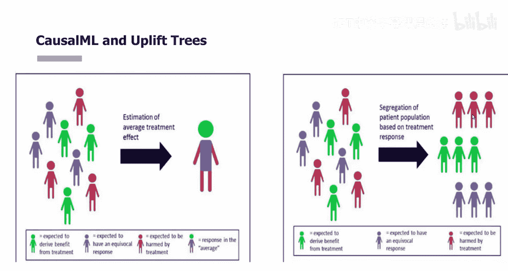
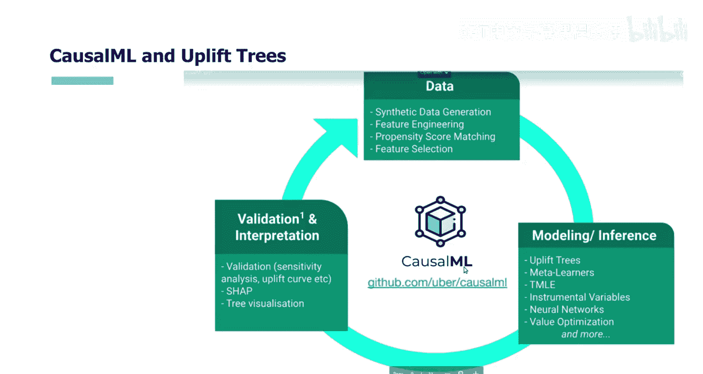
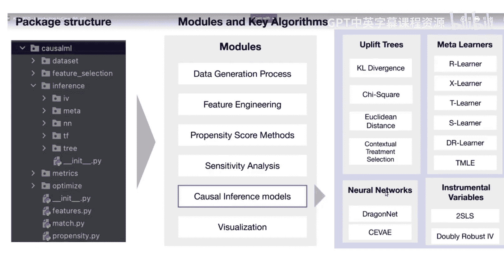
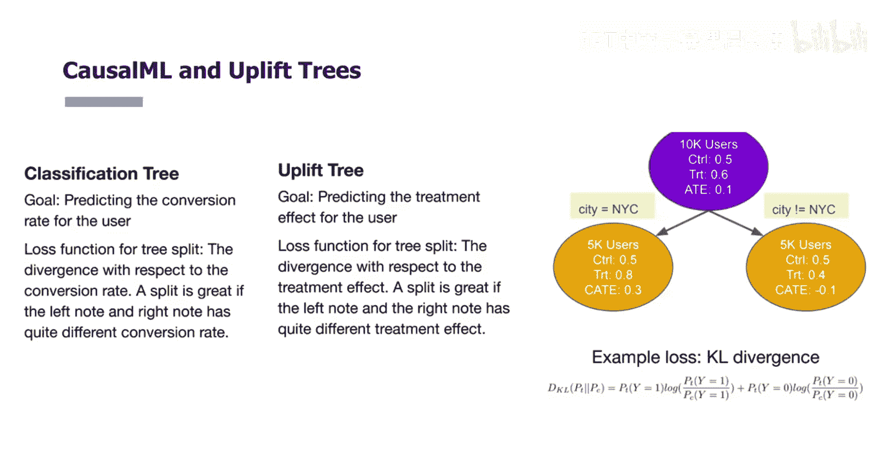
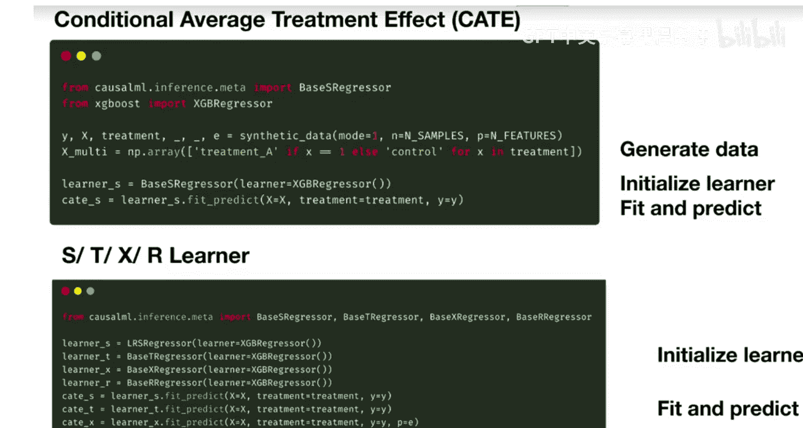
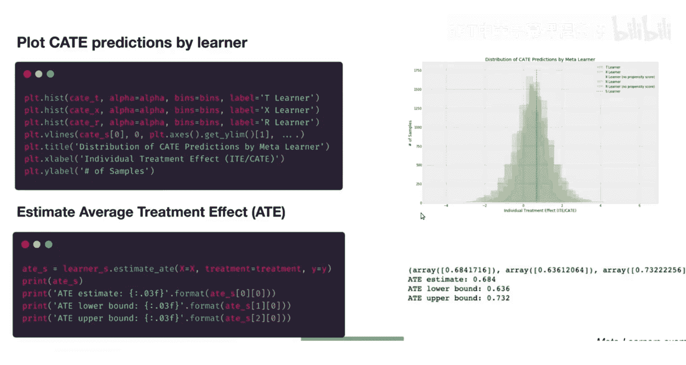
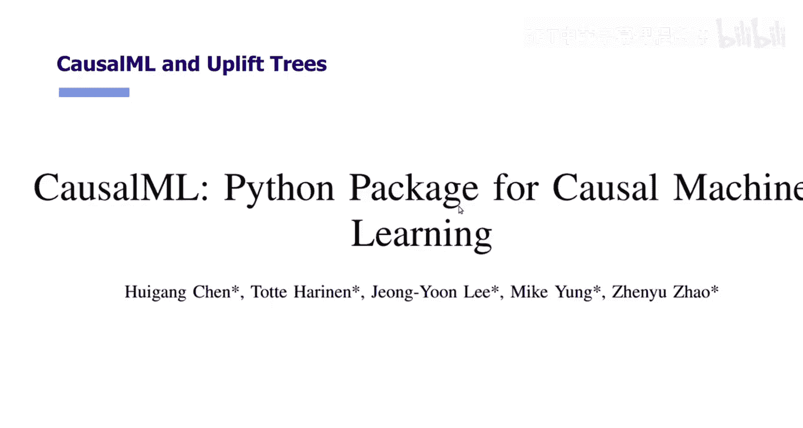

# 约翰霍普金斯大学《数据科学：时间中的决策｜Data Science Decisions in Time》中英字幕 p54 5_CausalML与增益提升树.zh_en -BV1NCuzzfEJa_p54-

We'll not talk about causal M and uplift trees。 This will be the last bit in your second week。

 and I think it'll help you to see further into how you handle data within a causal framework。

 So within causal M and the uplift tree approach the way you want to be thinking about it is you may have some sort of an estimation of average treatment effect。

 This goes to the regression versus classification type things that we were just now talking about it just recently talking about in other words。

 you may have something where you fit a very heterogeneous population。

 and to find your average treatment effect。 What you really want next is to understand how to define which regions of that population are most likely to benefit from treatment。

 You can think of this as going from a regression type fit to a classification type fit you're going also view this as a form of uplift modelting。

 where effectively you're arguing can I find those that will benefit most from particular treatment having the best therefore treatment response。

 and likewise can I understand who。ho mayy have a detrimental effect who really should not be selected for treatment so as the key candidates here these are expected to write benefit from treatment these may have some less than ideal response。

 These may potentially even be harmed by the treatment so the argument is that we've got subsets of people and really don't worry too much about whether I mapped them correctly a minute ago just be aware that I can have different segments that can be mapped and effectively what we got is a distribution function that's defined ultimately my regression type it and we're trying to define who will most benefit from a particular treatment and will be harmed by the treatment so within the causal Ml framework we introduced econ M causal M there's three codes that have been really open sourced and really based around some very active research groups and so these are codes that I would hope from any of you take his class you could feel comfortable。

Really spending some time with and realizing that they could really help you answer these kinds of questions。

 So imagine your data， you may have at generation mechanism and console M you can do feature engineering。

 which I' emphasize a little bit near the very end。

 propensity score matching So getting instrument variables meaning again that something that will define who is being selected for treatment and who not feature engineering feature selection really going together in terms of trying to identify who is going really benefit the most from a particular treatment and then we've got one of our main emphasis points in this week are things like uplift trees instrument variables。

 which we' already emphasize a little bit value optimization again related to who's going to benefit most from a treatment and choice of treatment and then we've got validation tree visualization These are all parts of this code base and again something I hope many of you will feel comfortable diving into So a little bit on their package structure we've got different modules。

 feature engineering is just emphasize。

But data generation， propensity score methods of instrument variables， sensitivity analysis。

 and we've got models， which is really what we're talking about over here。

 and we've got visualization。 We've not really introduced these different types of learners and I'm not going to have time to go into great detail But our next slide will help you see a little bit into the different types of learners。

 you can think of these as ultimately ways to try and fit the data or try and understand what's going on in the data Instrual variables we touched on a little bit in the context especially of whether you're doing a classification or regression type setting。

 And if you can have something instrumental that picks whether to treat or not than the argument is that you've got a better chance of understanding your average treatment effect and therefore the distribution function。

 and then neural networks come into this in terms of the quality the fit。

 And there's a lot of work here。 And I'm just trying to give you a sense of what's going on。

 So again， in the meta learners， we've got different types of learning mechanisms that could。

Involved so things like an S learner， a T learner， an X learner and R learner and these figures give you some sense。

 at least for what's going on。 So treatment and control。 that's the T and the C input。

 and you're going to train it's almost like an neural net that's trained and then effectively we're in this S learner。

 we're doing our prediction on the treatment and control fully joined in a T learner and also an X learner。

 you can see that we've made models for treatment and control separately and in the T learner we've separated these in and built different models and then on the conditional treatment effect over in here we're combining them。

 That's in contrast to the X learner where we've got our T andC separated treatment and control separated。

 Then we do our training。 and then we keep the prediction。

Versus the actual separate and then we estimate only here at the end in terms of our control and our treatment and the R learner we're really trying to find a tau star and so effectively what weve got is our conditional average treatment effect in tau but we're really thinking in terms of the star we've got a model and our estimator and we're trying to optimize within that and that's the R learner so these four ways of doing it are part again of this causal ML package and then we've got the uplift trees which is the other thing that I want to try and give you some feeling for in this fairly brief introduction to causal ML and again。

 many more papers you can read on it， but you can do your uplift tree where you effectively almost like a decision tree trying to think about now in the context of the conditional average treatment effect you're think of the distribution andre trying to find who will most benefit so that's what we mean by uplift and then you've got things like Caldiverence chi。

Wherere dec cleaningding distance architectural treatment selection that can help define where you're going to split where you're going to argue that things go up。

 So something like kale divergence here for uplift tree。

 you can see what we're defining our splitting So in an uplift tree。

 the goal here is to predict the treatment effect for the user and we can define that a loss function for the tree split in this case。

 this kale divergence and it's this divergence then with respect to the treatment effect and it's really great if the left node in the right note I mean in these two sides have quite different treatment effects So say New York City versus not New York City as a simple example。

 very a big difference so you can split So this is aheads a tree you can also do a classification tree predicting the conversion rate for the user and you're also looking in terms of loss function for the tree split and again arguing that if you've got a nice split if there's quite different conversion rates between left and right。

 So again this goes to things like classification versus regression again where we're trying to argue。

You can find ideally the best feature set that describes the individuals the one benefit from treatment so just a little bit on the code to give you some feeling for what this looks like I'm huning that many people listening to this are comfortable with Python at least I hope so if you're not again this is a good chance to do some learning and one of the benefits of this class in fact so here's causal ML again you're reading in the basis regressor're reading an XG boost and then effectively we're dealing here with synthetic data so we're generating the data so we're generating our outcomes or our covariates our treatment choices and then we're basically doing a learner we're fitting our conditional average treatment effect then we can define the ST X and R learners those four that we had before and effectively we can then compare those different learners in terms of how they do and again I think you can see this is really fairly simple code you can see your way quite far into it from these examples。

We can compute a distribution function again the argument is for these condition of treatment effects there's a distribution you can think about there being almost like a vertical bar again where your benefit from treatment to the right from to the left it's not so good and so the individual treatment is to define where people are on that so again fairly easy this is the plot for this this is the estimates for the average treatment effect and again the concept space I hope is making sense so the argument is well and again this goes to the classification versus regression type argument from previous lecture the argument is that you can in this code I think also like a value function so the value function is again trying to find and the context of knowing something about the regression those users that will most benefit from treatment so there will be some people where it makes sense in terms of the cost of targeting and where your condition of treatment effect is defined。

And where you can decide that you really want to optimize And other ones where you it's not so good。

 So the argument again， is that you can think in terms of cost for the intervention as well as benefit from the intervention and therefore you can think about the value especially with that。

 especially in a business type context that can make a lot of sense and it can really again help in terms of optimizing the decision。

 So the closing thought here is really like a flow type diagram for how you might imagine bringing in causal ways of thinking。

 So maybe ran an experiment was an observational data was it something where your experiment was well definedfin in terms of the controlling for the covariates and controlling for the confounding。

 if there were confounding yes or no， if there were no confounders。

 then you can go directly into the o models otherwise if there were you can maybe go in and see whether there's some sort of instrument variables and that leads into propensity scores and then。

can go back and do the estimation models if you ran the experiment and you had compliance issues。

 then you may have to adjust for the incomplete for the compliance not being there and obviously have to think strongly about what it might mean if your compliance was incomplete then you can do validation modules these go into the uplift ideas you can do optimization modules。

 which goes into again defining those individuals that most benefit from the interventions。

 So that's a quick nutshell for some of the code and some of you may I would feel benefit from spending some time with the code。

 I think's just like the Econml it's nicely defined code。

 So I'm just going to mention two papers this one it's in your reading list。

 This is getting it improving feature selection， which I trying to emphasize a little bit for uplift modeling。

 And then this other one is is their Python package really describing fairly briefly the code that we just went through this causal ML code so。

We will pause and I hope you enjoyed this， thank you。

