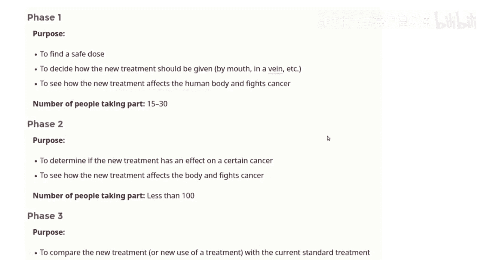
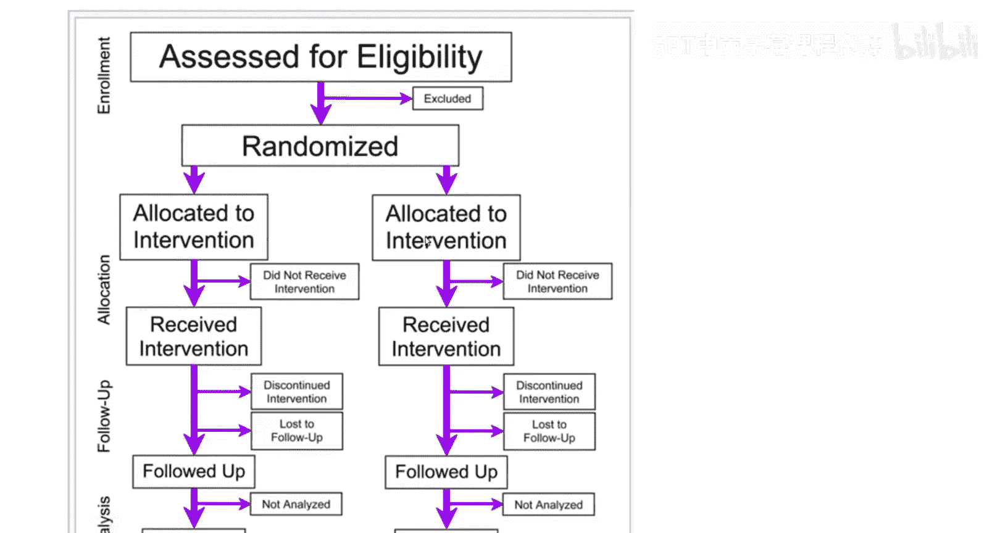
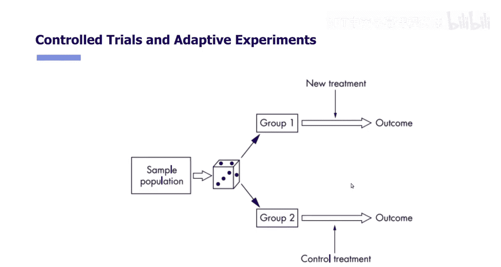
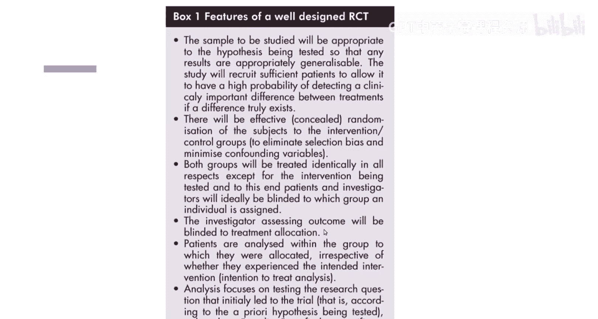
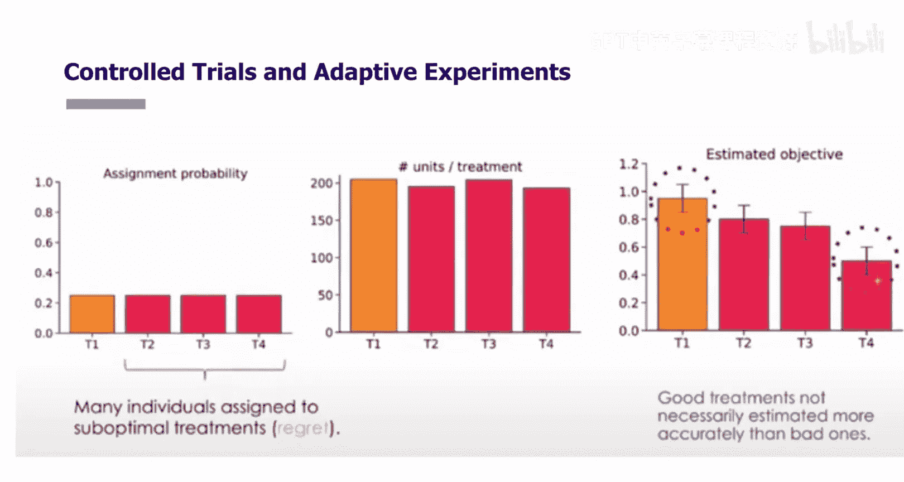
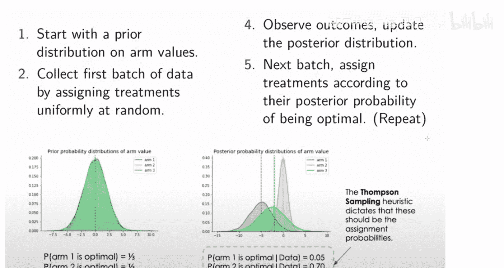
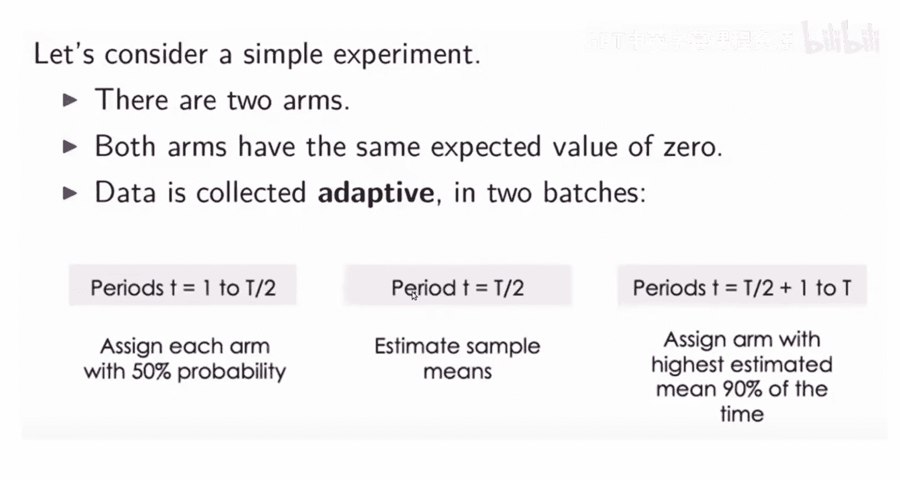
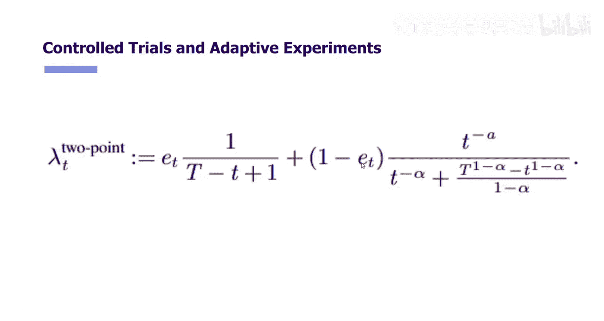
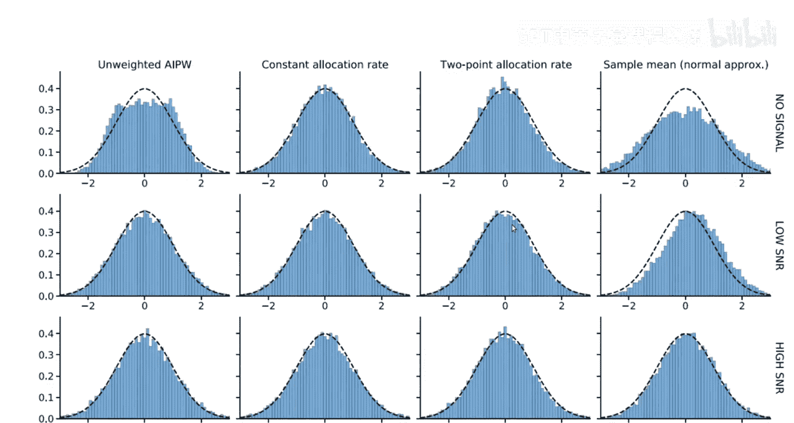

# 约翰霍普金斯大学《数据科学：时间中的决策｜Data Science Decisions in Time》中英字幕 p55 6_随机对照试验与自适应设计.zh_en -BV1NCuzzfEJa_p55-

We'll now talk about randomly controlled trials， clinical trials。

 especially with this and adaptive experiments。 you can think of this as being a modification of the ideas of a clinical trial。

 but something that could be is safer economics or market research。

 The ultimate goal in both cases is to understand causally what could be best。

 Here's some cartoons to try and get you started in terms of where controlled clinical type trials。

 you've got a patient population you're collecting ideally to have a well balanced clinical trial。

 meaning all the potential confounding variables or controlled。 and by doing that。

You're able to sample over a population that represents a very diverse set and ideally what that means is again you've got all sorts of different ages。

 genders， settings maybe even preclinical type conditions and basically what you're doing is trying to make sure that your covariates are well sampled and then you do a random selection and the idea is that that prevents bias you're just then assigning it into two groups ideally this is blinded you're randomly selecting neither the patients nor the providers know about which group they're going to be in and then all the way through the treatment until the outcomes and then at the end of course's in terms of the analysis you'll break out which the two groups one was formed into the idea is ultimately to do this in phases have a phase one or phase two and a phase3 initially what that means is you're finding for a new drug a safe dose deciding how the treatment should be given seeing how the treatment affects the body and this is really as I said phase one。

It's kind of evaluating where you're going to set your hypothesis and that means again you found a safe dose and then if this was a cancer type of treatment。

 you're starting to refine your hypothesis about how the treatment effects the individuals in the study and whether it works and then in phase three which is really where we're getting into the clinical randomized clinical trial or the RCT we might have1 hundred to several thousand people and you're again randomly assigning to the treatment arm so here's from Wikipedia another way of thinking about it or viewing the same thing。

 you're assessing for eligibility， then you randomize and then you either allocate intervention of one form or another form。

 some people will not。

Comply and and have to be removed。 But you've got some people that are receiving the intervention。

 Some people can be lost to follow up or discontinu the intervention。

 but essentially you're going keep following up and then you're gonna analyze at the end。

 So the point that I like in this figure is that you've got a long time from the initial randomization until the outcome in most clinical trials。

 So the key in all of this。 And this is from one of the papers that you'll be reading through this week is that you've got some sort of sample population。

 And then you've got effectively an instrument control。

It's effectively just randomized and you could think of it like a die roll。

 you can think a coin flip。 however you want to think about it。 it's completely random。

 If your sample population is sufficiently diverse。

 this avoids compounding so then you've got group1 and group two maybe control treatment versus new treatment follow them out over time and you get your outcomes。

 So this ideal only gives you some idea of whether that particular treatment really works or not on average over this set of people So a well-des randomized clinical trial has these kind of bullet points。

 which I'll try and briefly go through and this comes from the paper one of the papers you're assigned this week。

 So the sample to be studied has to be property to the hypothesis being tested so that you can generalize from it。

 So you need sufficient patients allow for the high probabilitybri detect a clinically important difference between treatment if that really happens if there really is going to be a difference。

 So again this goes to the intake the number of patients that you're potentially screening and if there's an effective or randomization in the subjects then you're doing it。

Right way you're going to eliminate selection bias and are going to be advising conferring in variables and otherwise both groups have to be identical in all respects in the words ideally there's blinding。

 no one knows which group they're in， the clinical people nor the subjects themselves and the investigators assess the outcomes has to be blinded to which allocation so in other it's again that bias the patients within each group are not being assigned they have no idea which group they were in and then the analysis is ideally focused on what the hypothesis to be tested was on at the beginning。

 so it's effectively a well-designed clinical trial things have been defined from the getka。

What I now want to go over is some new ideas coming up from Susan Athe's group another paper that you are signed that I think is interesting and follows nicely from this。

 So in a traditional moral clinical trial， you got them uniformly across， say all arms of the trial。

 The ones I just went through were like a two armed trial。

 So you would just have T1 and T21 might even be control the one be the new therapy But the argument they're making。

 which I think is a strong argument and it really applies to Thompson sampling and of the things we've been talking about in our previous courses。

 is that you may have reason to want to assign adaptively， you may really think of this almost again。

 like Thompson sampling where one particular arm and like a multi-armed bandit type setting is really significantly better than the other。

 So if you're doing that， then you're going to end up with something。

Where the distribution is not uniform across the units。 And the question is。

 can you adjust the trial to control for this And the argument they making and I agree with them is that you can And so for example。

 you might have more in T1 less in T2 less in T3 and less in T4。

 But if you know how they've been assigned this goes to a controlled type of trial and the adaptive experiments that can flow from that。

 if you know how they've been assigned then you can adjust for that you can effectively then still reuse the data in many settings and know that you're not having compounding issues。

 So one way of addressing this or thinking about what they're doing is that you might start with a prior on your arm values。

 collect your first batch of data assigning treatments uniformly at random。

 This again is going to an adaptive design， then you observe the outcomes。

 update to the posterior distributions。 This is just Thompson sampling and the next batch you assign according to that posterior distributions again a Bayesian method in Thompson sampling and this can work well in many settings the problem for。

lin trial says that you really ultimately need to keep track of the assignment probabilities in order to correct for that at the end。

 if you don't correct for that， then some of the things in terms of clinical trial type settings could be off。

 So they looked at a simple experiment again the Susan Anthonyist group。

 there were two arms say so going back to the original clinical trial design。

 you could think of that as like a control and when youre testing and in their experiment。

 let's say they both have expected value of zero So neither one was beneficial relative to the other。

 the problem you run into is that depending how long your initial treatment is you may kind of wrongly。

 statistically。

I have sampled randomly in such a way that one of them seems to be better than the other。

 So then in the second period in this simple example， it's just two periods。

 you could have one of them that's now sampled much more than the other。

 So this is again from their paper this was published in PNS Susan Athe。

 Stephen Wger where two that I think lead this particular PNS1 these three of all contributed to it and essentially what they're comparing to something like an average effect an estimator over that full set relative to a approach to estimating the treatment effect by keeping track as to which arm was chosen if you don't keep track and you're just looking the sample mean you can see that it's shifted you've got a biased estimator it's not appropriate。

 but if you keep track in the right way and they're proposing in this 2。

1 based essentially on Thompson sampling that you're keeping track as to which arm was used then at。

En point， you've got something and this is the two point allocation here that can be understood and corrected for。

 So essentially what that means is that you've got almost the equivalent of the di roll。

 you've got the ability to understand the patients say that we're allocated to the different study arms and to correct for the fact that you're doing a dynamic treatment and still have confidence in terms of what's coming out。

 So anyway， this is an emerging concept in terms of how to design these kinds of trials。

 it's not mainstream at this point， but I think there's a lot of belief in in research communities that these kinds of adaptive trial designs are going to really be the direction things are headed。

 and again， this goes back in our course setting to things like the Thompson sampling that we talked about in a Bayesian。

The frame here is more frequent。Looking asymptically and arguing that with something like a two point allocation as compared to something like an unweighted with an instrument or a constant allocation rate。

 or especially the when we started with just a sample mean that you've got the ability to control under all settings and no signal a low signaloid ratio or a high signaloid noise ratio in other words。

 asymptotic properties are reasonable and you can correct then for the fact that you've got a dynamic clinical trial type setting or a dynamic trial itself going on。

 So okay with that I hope I've given you a feeling for randomized clinical trials and for these new emerging ideas for adaptive designs because and I think they're quite exciting and with that we'll pause Thank you。

