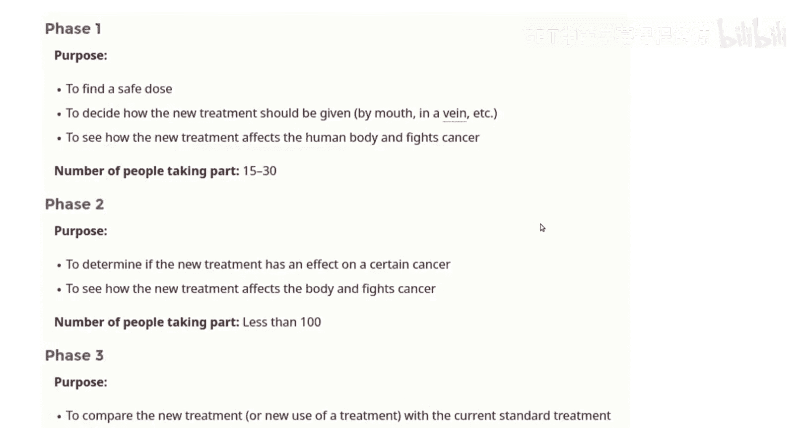
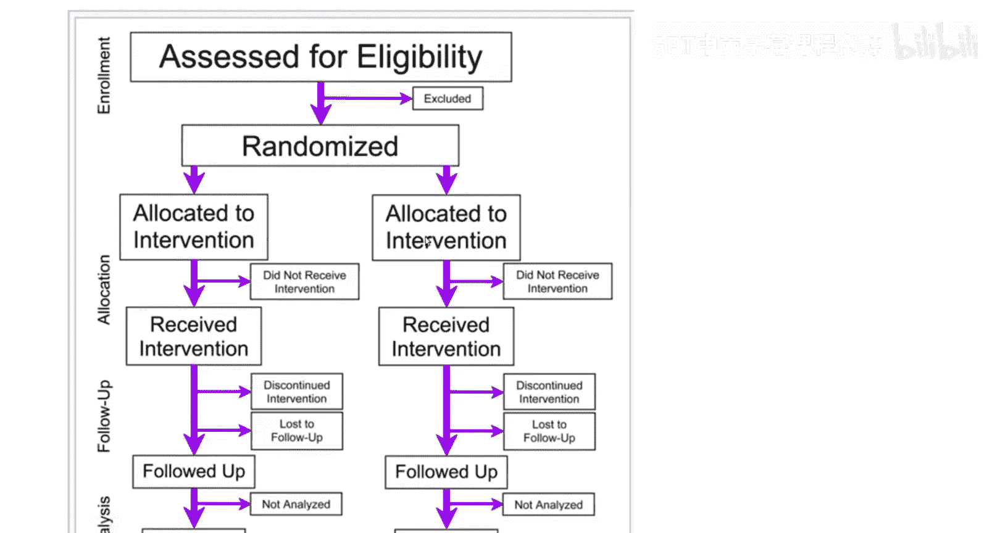
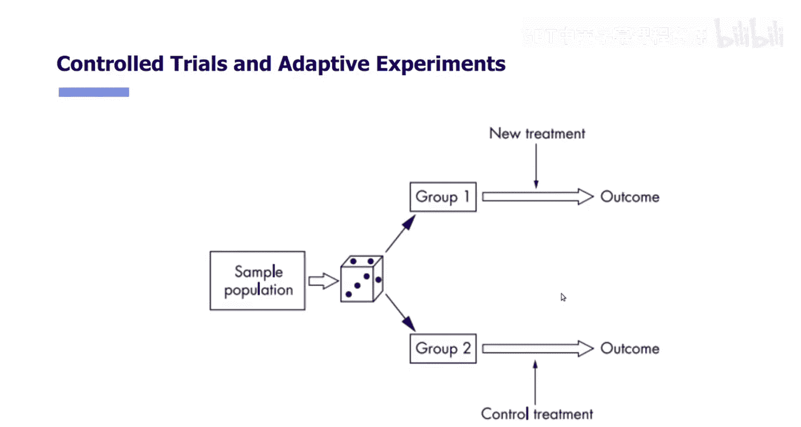
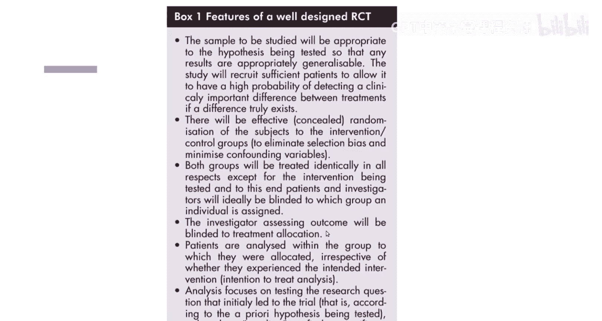
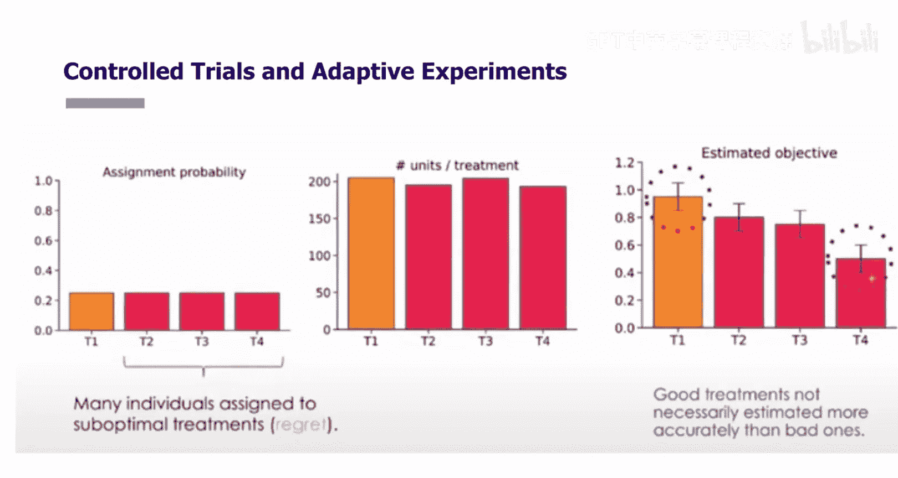
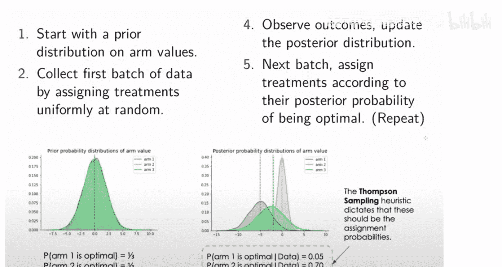
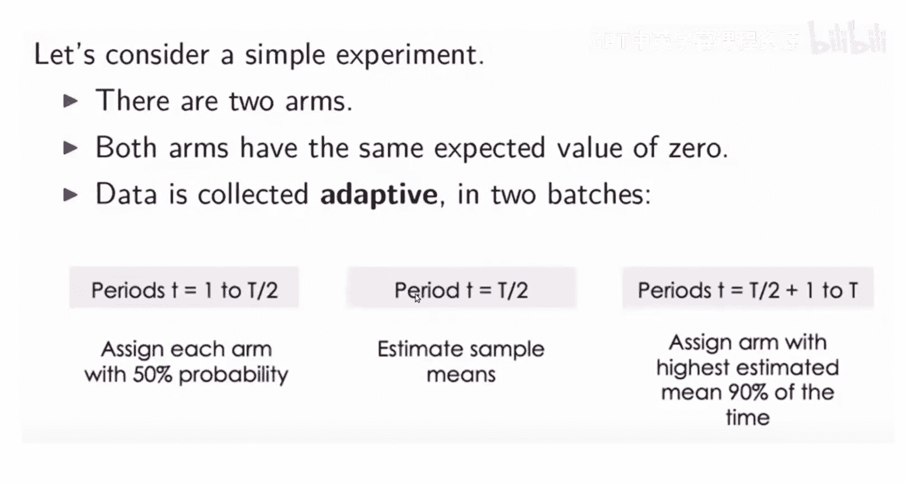
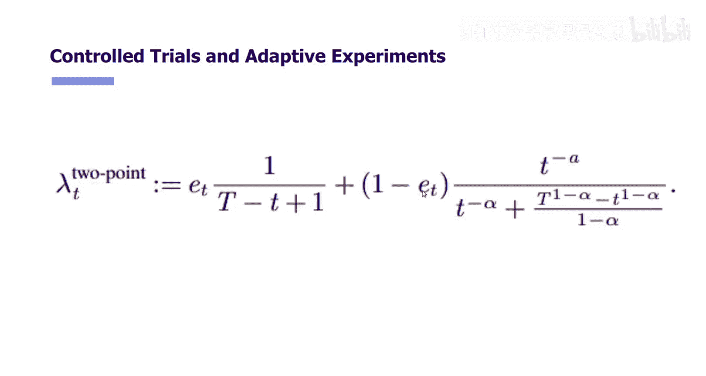
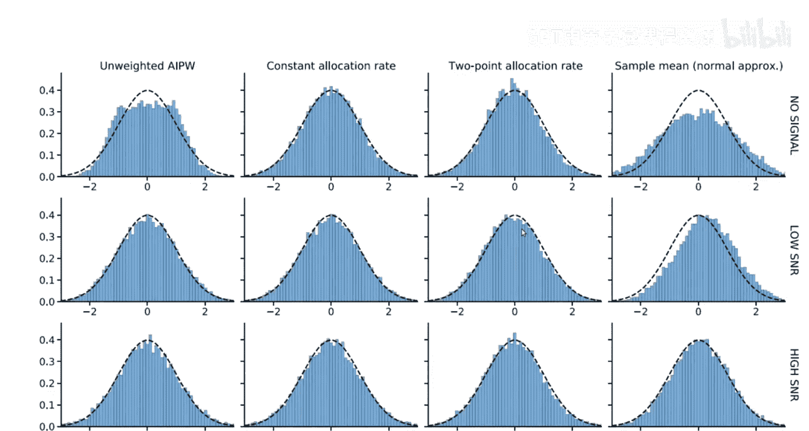

# 数据科学：时间中的决策：6：随机对照试验与自适应设计 🧪📊

在本节课中，我们将学习随机对照试验（RCT）的基本原理，并探讨一种新兴的、更灵活的实验设计方法——自适应设计。我们将了解如何通过随机化来避免偏差，以及如何利用自适应方法在实验过程中动态调整策略，同时保持因果推断的有效性。

## 随机对照试验（RCT）概述

上一节我们讨论了因果推断的基本框架，本节中我们来看看其最严谨的应用形式之一：随机对照试验。这是一种常用于医学、经济学和市场研究的方法，其核心目标是通过随机分配来理解不同干预措施之间的因果效应。

在理想的随机对照试验中，我们有一个患者或参与者群体。为了确保试验结果具有普遍性，这个群体需要在所有潜在的混杂变量（如年龄、性别、基础健康状况）上保持平衡和多样性。通过随机选择参与者并将其分配到不同组别（例如治疗组和对照组），我们可以有效防止选择偏差。通常，试验会采用“盲法”，即参与者和研究人员都不知道具体的分组情况，直到最终分析阶段。

## RCT的标准流程与关键原则

一个设计良好的随机对照试验通常分阶段进行，并遵循一系列严格原则。以下是其关键组成部分：

*   **分阶段进行**：试验通常分为I、II、III期。I期旨在确定新药的安全剂量和给药方式；II期开始评估治疗效果并细化假设；III期则是大规模的随机对照试验，涉及成百上千的参与者，以最终确认疗效。
*   **标准流程图**：一个典型的RCT流程包括：评估参与者资格 -> 随机分组 -> 分配干预措施（治疗或对照）-> 进行随访 -> 分析结果。过程中需处理参与者不依从或失访等情况。
*   **核心设计原则**：一个设计良好的RCT具备以下特点：
    *   **样本代表性**：研究样本需能代表目标总体，以确保结果可推广。
    *   **足够的样本量**：需要有足够多的参与者，以确保有较高的概率检测到真实的、有临床意义的治疗效果差异。
    *   **随机化**：通过像掷硬币或掷骰子一样的完全随机方式分配参与者，以消除选择偏差和混杂变量影响。
    *   **盲法**：参与者、医护人员和结果评估者均不知分组情况，以消除主观偏差。
    *   **预先设定的分析**：分析应严格围绕试验开始前设定的假设进行。

## 从固定设计到自适应设计

传统的RCT采用固定、均匀的分配策略（例如，50%的参与者分到对照组，50%分到治疗组）。然而，在某些情况下，我们可能希望实验设计能更灵活地适应中期结果。

这就引出了自适应设计的概念。其核心思想是：如果在实验过程中，有证据表明某个治疗臂（例如新疗法）的效果显著优于其他臂（例如标准疗法或安慰剂），我们可以动态调整后续参与者的分配概率，将更多人分配到可能更有效的治疗组中。这类似于我们在之前课程中讨论过的“汤普森采样”或多臂老虎机问题。

## 自适应设计的挑战与解决方案

然而，这种非均匀的分配带来了一个统计挑战：它可能引入偏差，影响最终对治疗效果的估计。如果我们不加以校正，简单地计算各组的平均结果可能会得到误导性的结论。

解决方案在于跟踪每个参与者的**分配概率**。以基于汤普森采样的自适应设计为例：
1.  从对各个治疗臂效果的先验信念开始。
2.  收集第一批数据，初始分配是均匀随机的。
3.  观察结果，根据贝叶斯法则更新对治疗臂效果的后验分布。
4.  下一批参与者根据更新后的后验分布进行分配（效果估计更好的臂被分配的概率更高）。
5.  **关键在于**：在最终分析时，我们需要根据每个参与者被分配到其实际所在治疗臂的历史概率来进行加权校正。

通过这种方法，即使分配是动态和非均匀的，我们仍然能够获得对治疗效果的**无偏估计**。研究表明，这种校正后的估计量在各种设置下（无论信号强弱）都具有良好的渐近性质，使得在动态调整的试验中也能保持统计推断的可靠性。

## 总结与展望

本节课中我们一起学习了随机对照试验这一因果推断的黄金标准，它通过随机化、盲法和严谨设计来确保结论的有效性。同时，我们也探讨了**自适应设计**这一新兴方向。它允许实验根据累积数据动态调整，有望使研究更高效、更符合伦理（例如，让更少的参与者接受效果较差的治疗）。虽然目前尚未成为主流，但自适应设计代表了临床试验和实验设计的一个重要发展趋势，并与我们之前学习的贝叶斯方法、汤普森采样等概念紧密相连。