# 约翰霍普金斯大学《数据科学：时间中的决策｜Data Science Decisions in Time》中英字幕 p56 7_因果树模型.zh_en -BV1NCuzzfEJa_p56-

We not talk about causal trees。 This is a really nice way of thinking about how to split on information just like a decision tree。

 but now in the context of causal information。 And so let me try and give you a sense for what that's about。

 So the idea here is that we've got a set of subjects。

Ially we think of them as ID that's a fairly strong assumption and something as you'll see all the way through this assumptions are being made I。

 when you think of terms of probability， you know like coin clips for example。

 you're assuming that everything is independent from one coin clip to another here you think of this as a set of subjects。

 this was like a clinical trial， youll be thinking of these as different individuals and you can imagine if it's a clinical trial。

 they really could be independent but again you've got to be careful with the things that are being assumed now what we're doing is we're assuming you've got covariates。

 these are these x subs you can think of this also as like a feature vector just like in machine learning and then you've got y subs。

 which is your response， your outcome and then W sub is the treatment assignment frequently it's made just a binaryaries from the set01。

 So this is the thing that we're trying to understand。

 and the problem is again that we don't always see all possible outcomes。

 we only see one outcome per individual and ideally as we talked about within clinical trials。

 you would。

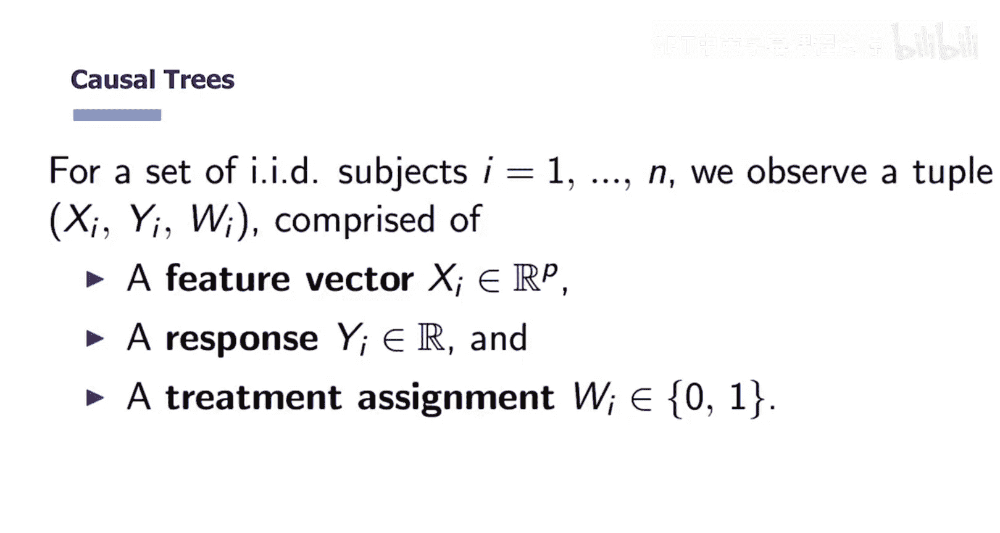

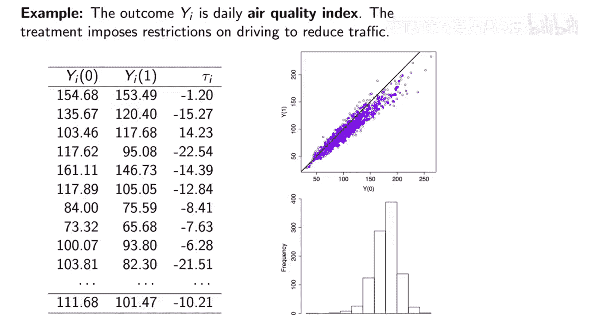

Randomly assigned so if you had all of these variables so again this is the set x sub I y sub I and w sub I then you could just fit this like a regular stat s model so this would be outcome zero outcome1 or I'm sorry I really should say treatment0 and1 and then you've got outcomes defined by assigning those to each of the different I individuals and this would be for air quality index this comes from not very nice presentation that Stephen Baar gave online from Stanford School of Business and then what we can do is define our treatment effect the difference between0 and1 and if it's air quality again and if we had everything and obviously we won't necessarily everything I should probably sign the next slide I'll flip to in a moment then you would just be able to fit this you would distributed to say y0 versus y1 we fit it we've got our average treatment effect then this house of I the difference between these and again these are the response。

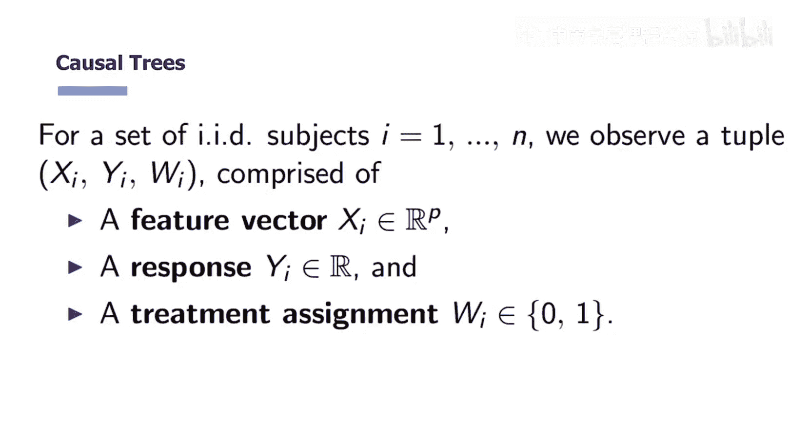

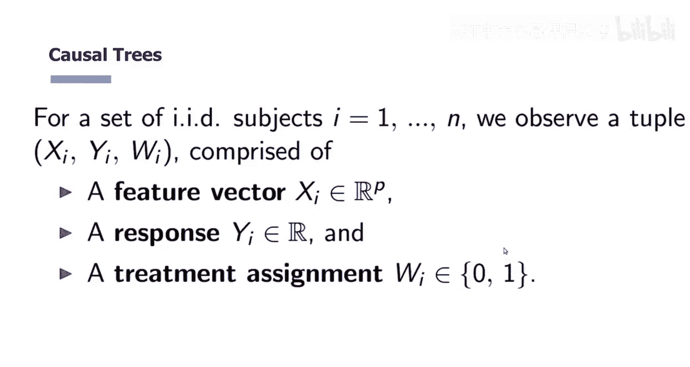

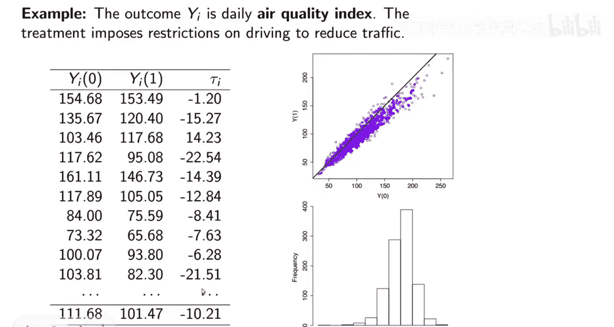

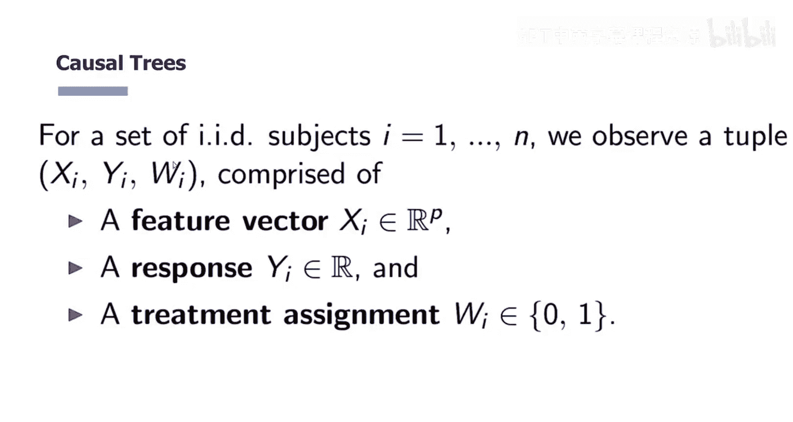

the outcomes from this。 So these are taking numbers for air quality and we've got to say different policies。

 maybe it's a policy on how many cars could drive on the road on a particular day and these might be different days。

 which we're going to assume it be independent and we would ask you does this policy make a difference the problem obviously for real causal type things is that we don't see all the numbers So we're either seeing zero01。

 meaning the policies in place or it's not in place so this might be in place this might be out of place and so again we've got missing data all the way through and so the question is can we still predict tas of I given this kind of missing data。

 this is really be the key problem for our causal methods in general so you only see one actual thing coming out but you want to understand it so like in our randomized clinical trial we can just average over R we in control。

 in of other words it's randomly assigned to either zero1 and these are ID and something we can get。

fairly easily in a randomized clinical trial， the averages and in that kind of setting。

 then we just estimate how does the difference between these two and that would then be in an RCT over a population or average impact。

 but again， an observational setting。 and maybe this is like our air quality thing and we're observing。

 you often don't have something as simple as a randomized clinical trial or is ideal as a randomized clinical trial。

 And so then you've got to understand how these assignments， zero in one coming in。

 And this really goes to things like confounding， which is a huge huge problem for causal。

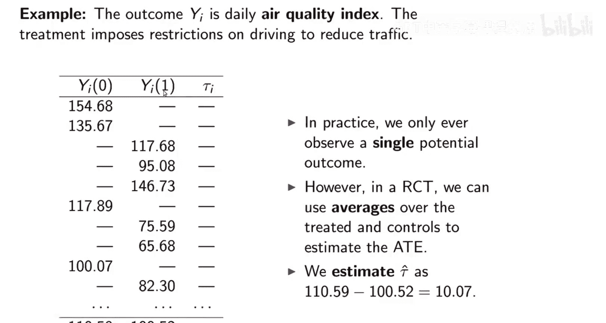

So examples here might be things that we're thinking about in terms of clinical settings why subbi might be our quality adjusted life yearss。

 So just like here you know where we're thinking about this in terms of air quality indexduct in a clinical context quality adjusted life here is completely reasonable and subise whether you're doing some sort of treatment with obesity medicationig and prevention something that you may be offered and ideally you would offer it randomly if it's a randomized clinical trial。

 but maybe you offer with some sort of confounding and that's what you've got to worry about in learns are you more likely to treat the obese people then the less obese people that's what we'll see in a minute the covervarit ex subi might be our electronic medical recordsancies would include all the other features that are important about the individuals。

 So the problem obviously is that doctors may be more likely to prescribe the treatment to patients with higher weight And if they do that then you'll get something like this again from st majors very nice。

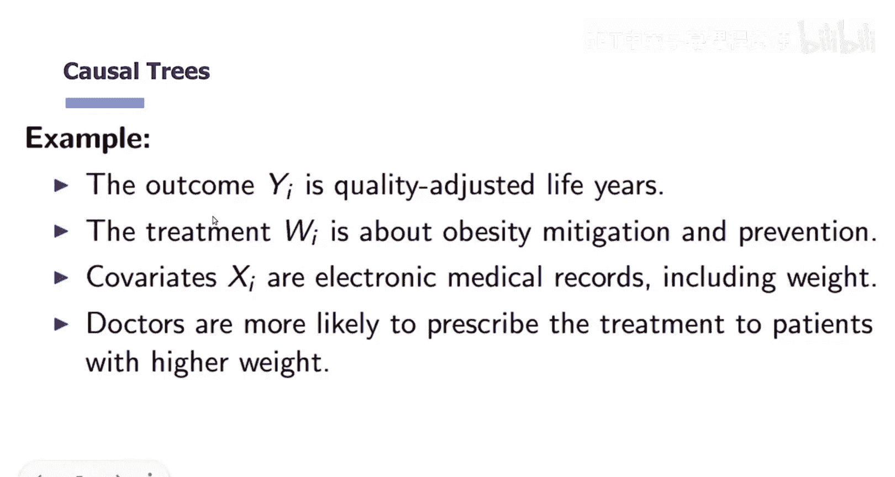

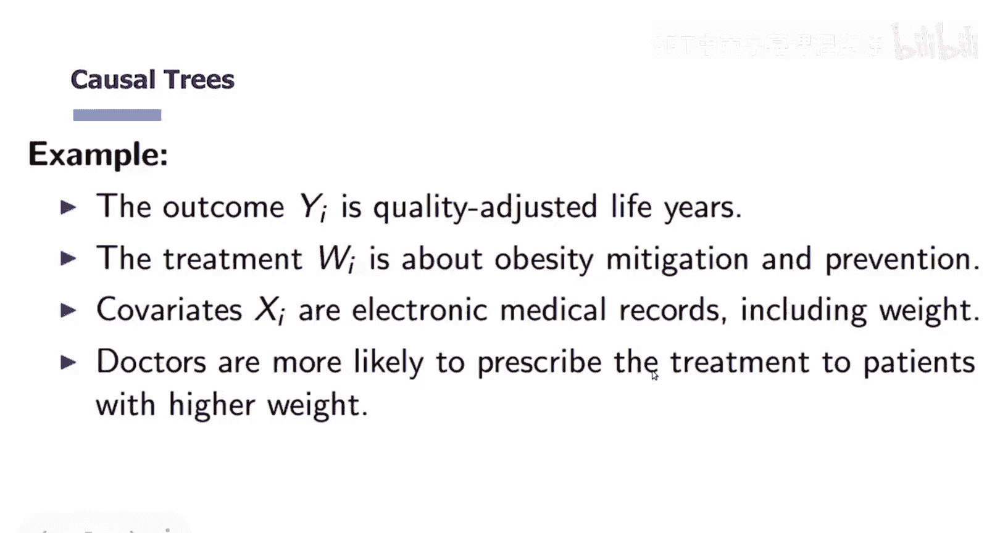

Really pictorial presentation on some of these concepts。 Here's weight on this side。

 Here's our outcome variable。 And if we is more likely to assign to higher weight than treated versus controls are from different regions。

 So what that would mean then， obviously， is you can't simply take your average your expectation of this difference between the1 and 0。

 which is what we just did， because。They were not randomly assigned， so this doesn't make sense。

 they were assigned based on the weight， so there's a confounder there， and that makes a big。

 big impact on the ability to think about what's going on。 So causal trees。

 which I'll try and give you a feeling for here in the next little bit。

 is a way to try and work around this with the idea that again we may have a way to understand through some sort of what's called instrument variables or propensity scores。

 which is the way of thinking about it some way of understanding how these are assigned in an observational setting and so that we can try and make up the fact that there could be a confounder so in general again。

 what we're trying to estimate here is our average treatment effect。

 So this expectation of the difference between outcomes， the why is the outcomes again。

 given different binary treatment society， either one or zero。

 so you can think of this system like the control in our random clinical trial。

 randomized clinicaltrosm1 being the one that's given something like a weight management。

 as which is said for obesity。

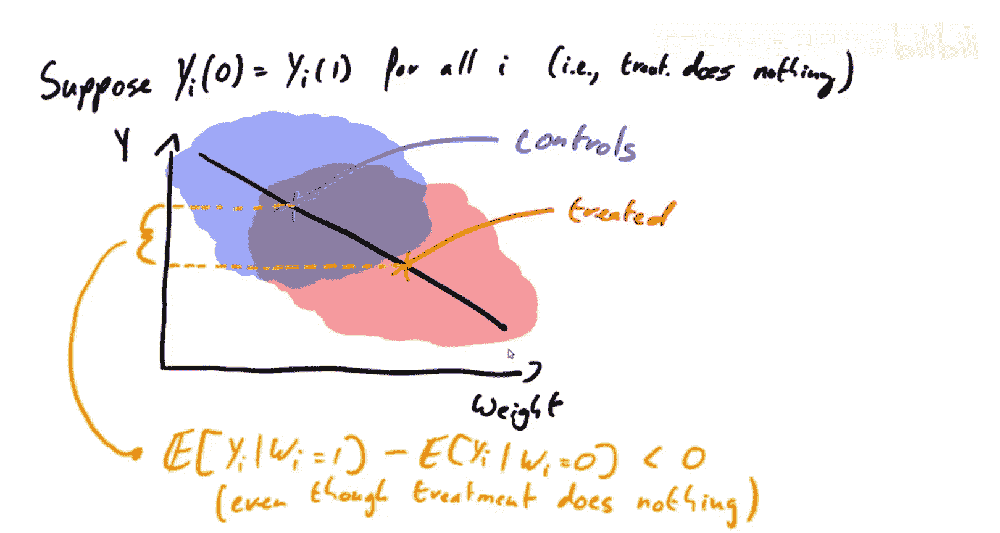

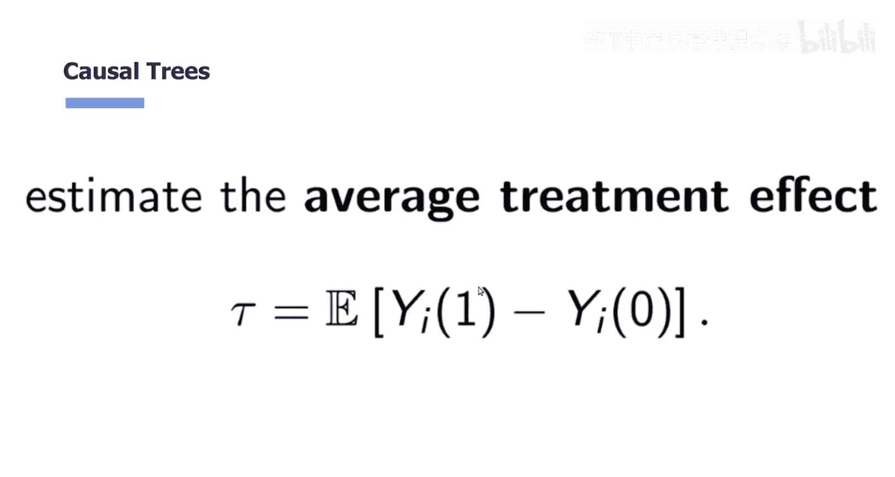

So as I just mentioned the propensity score is the most common way of adjusting or thinking about this and this is really because in a lot of observational trials。

 again， not randomized clinical trials， but observational trials where treatments may have been selected in some way you can think of this is exactly it sounds higher propensity to do one thing versus another and you adjust for that you explain this distribution function。

 this probabilityme for a particular assignment that becycl1 conditioning on a particular random variable that you're measuring covariant or feature that you're measuring。

 so you think of this as like weight then what you're doing is you're defining the treatment as a distribution function conditioning on the values of the weight。

 so this propensity score， little E again a function of the actual values。

 little x of the feature vector as point pointing out here。

 it's just an ubiquitous concept in causal inference。

 and the definition really is quite simple but you need to keep in mind it's just a distribution。

has to be defined in such a way that makes sense again for a randomized clinical trial we're assigning these treatments completely at random so we don't have to worry about this chronic conditional。

 so it's this probability of readinging treated conditionally on the feature vector the X sub I so again the idea would be that we can then measure the every treatment effect and we know something about the likelihood of different individuals with different features being assigned either treatment or to control so again in a randomized clinical trial it's just constant we would say e x is some number E0 say between0 and1 and so that would mean that at least qualitatively you can think of the variability from the propensity score iss just giving you measure of how far you are away from a clinical trial from a randomized clinical trial So this again randomized clinical trial is kind of the gold standard propensity scores for observational down is a way to try and make up for that again it assumes that you can define this distribution you can define this。

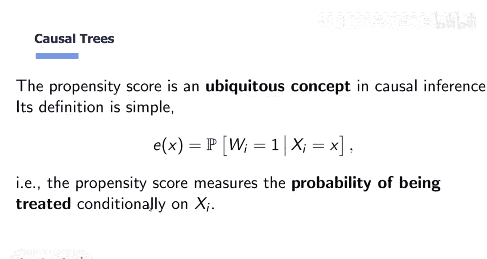

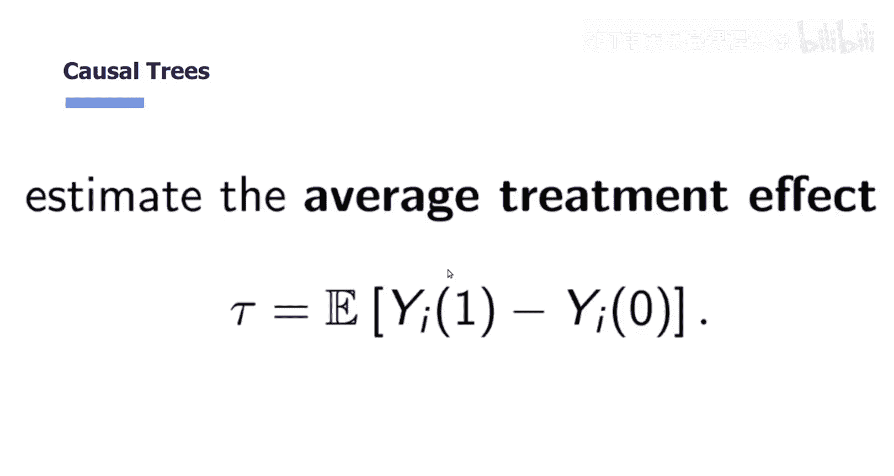

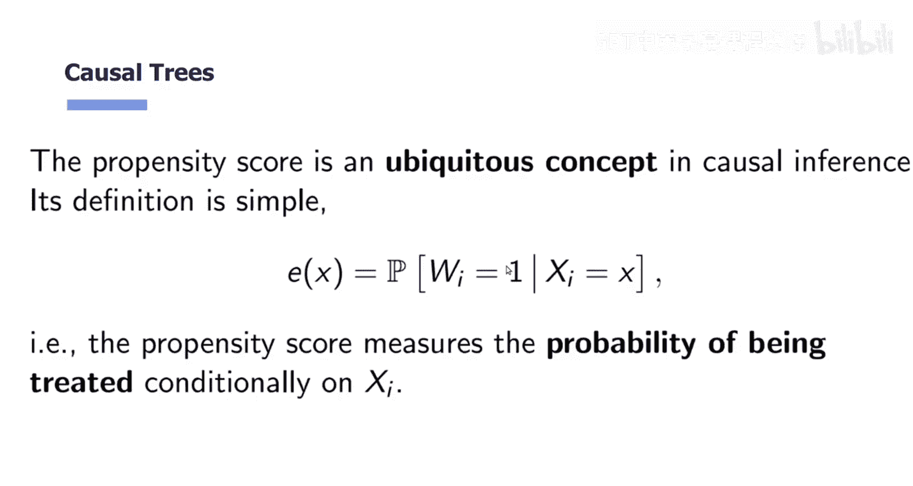

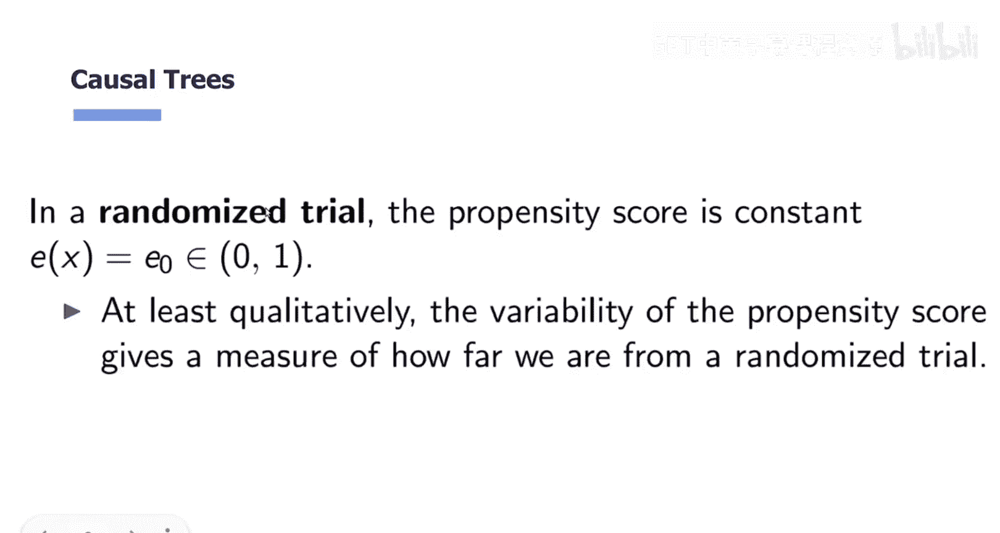

If you can't define that or if you don't have confidence in being able to decide that。

 then your observational trial is how it's not going to work。

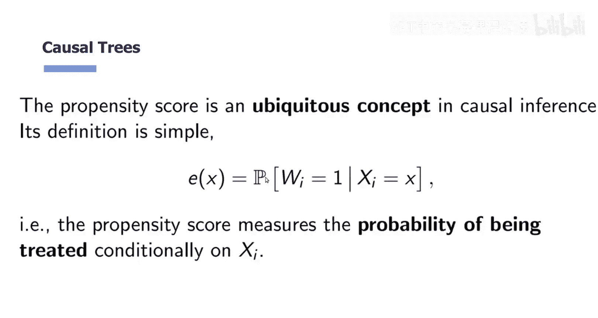

So as I mentioned， this is work that largely comes from this BNS paper from Susan Athe and we know Is Is was given an Ebel prizeze。

 many of you may to this may be aware of this in economics in December 2021。

 so this was fairly recent and this husband and wife team at the graduate school business at Stanford so then go BNS paper was recurarsive parting for heterogeneous causal effects and it'll be a your reading for this week。

 you can see submitted 2016 still I think a really nice piece of work in it set up causal force which we'll be talking about next。

 but this is again causal trees， so again let me try and give you some feeling for this the first one for many。

 many work settings in causal inference is this idea of unconfotainous in other words that our treatment is independent of our ability to understand this assignment and outcomes from 011 given the covariates So in other words our treatment assignment can be thought of as a。

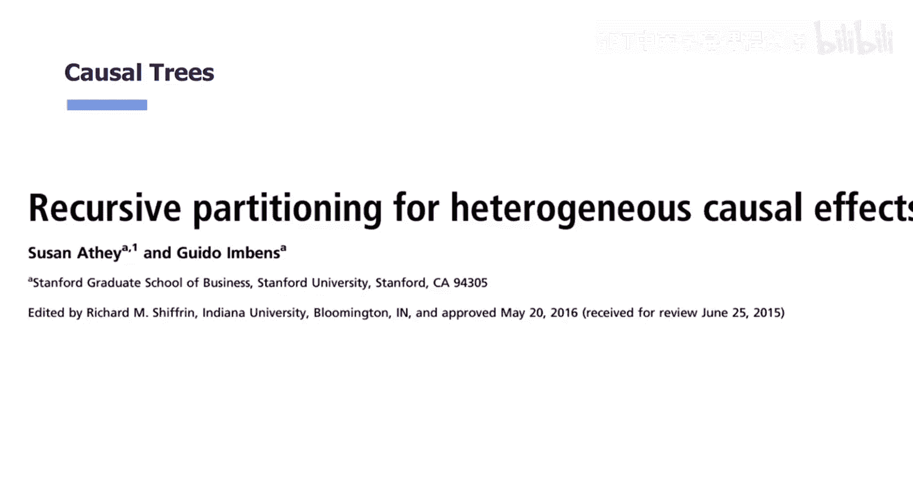

Distribution function as I just outlined and it's independent of these outcomes in 001 and that's important。

 this unconfoundedness assumption comes back to Ren and work that large predates causal tree causal forest ideas but builds in the same way that the causal tree causal forest in the sense that we're assuming in this kind of unconfoundedness or independence so causal trees。

 you can think about it almost like a ten nearest neighbor sort of algorithm for those of you that may have had some machine learning。

 we're looking within a region you're trying to define a boundary where inside say one type and others are outside of it so you can think of like a categororical type thing that you're trying to draw these boundaries on in a tree-based neighborhood you can think of these as being rectangles that are being defined essentially what we're doing is making a partitioning method where we're looking down into the leaf in the tree for branches and you'll see in a little bit with a forest that we enlarge this from individual trees to a forest。

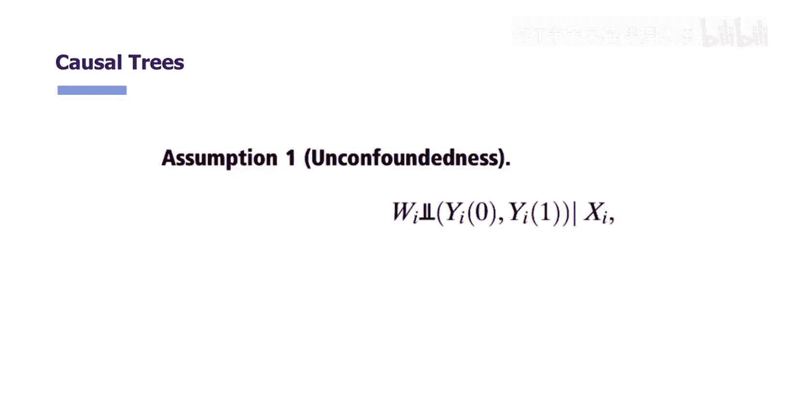

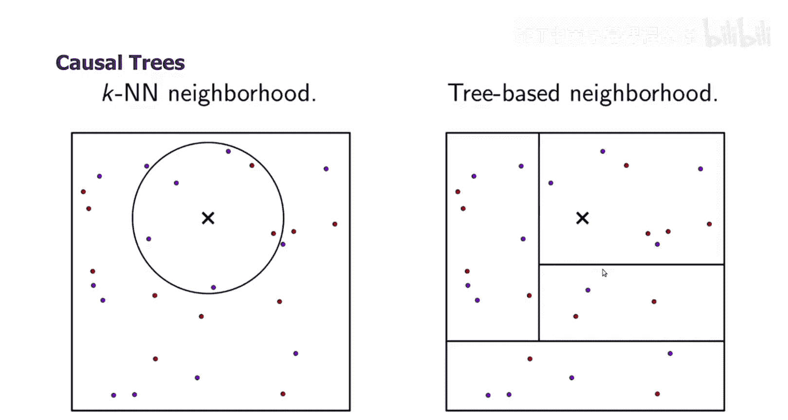

And what I like about this way of thinking is that decision trees are just very easily explained。

 There's something that you can point to say clinical care team or to friends making a business decision。

 and you can explain it completely naturally in a way that I think almost everyone will understand。

 And I think that's why this way of thinking about making a causal model is very appealing。

 And again， there's just adaptive nearest neighbor and given our covariatess are feature vector and our outcomes。

 we're going to try and estimate mu and mu now really is just an estimate。

 So you can see that you had here， it's an estimateimator。 it's from this expectation。 So again。

 think of this as being over a set of measures。 and these are outcomes given a particular covariate feature vector x of y defining as a value X a little x is the values that the random variable capital x of I as taken。

 So you can say that this now is a treebased estimate， and it's an average of these outcomes。

 given that you're in a particular leaf。 So you're trying to divide this tree up in such a way that you've got a series of leaf。

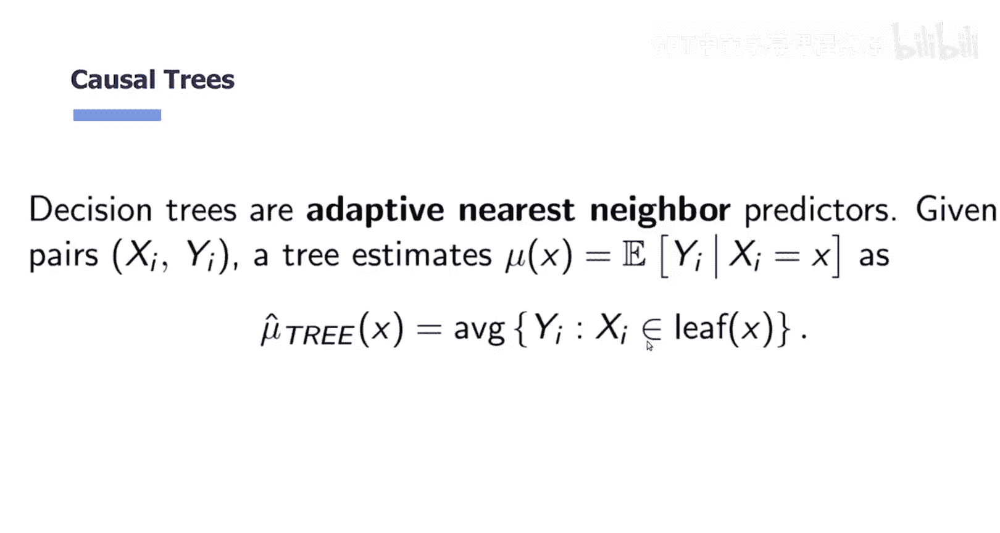

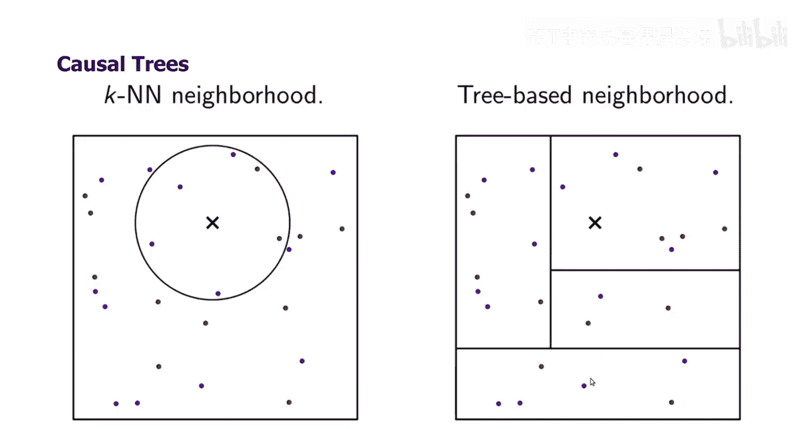

And you can think of these as being defining a set that defines this leaf。

 and then you define this estimator for the tree。 So in the simplest way of thinking that about a tree。

 you can do something like a t learner and it's just two separate models on the treated in the controls。

 So W sub equal0 to be 1 you're defining this estimator mu 0 and1 you're predicting these y subs from the x subs And then you can report your average treatment effect。

 just as the difference in these muse。 and there's code that will be going over most of you I hope will be going over to try and understand this a little better in R or in Python It's a really nice。

 fairly straightforward method pulls from machine learning pull from stats and I think pretty easy to understand what at least in a big picture sense it's going on。

 So okay， we'll pause here again， this was causal trees。

 causal for that will be coming up and I hope this has helped you to see a little bit further into it。

 Thank you。

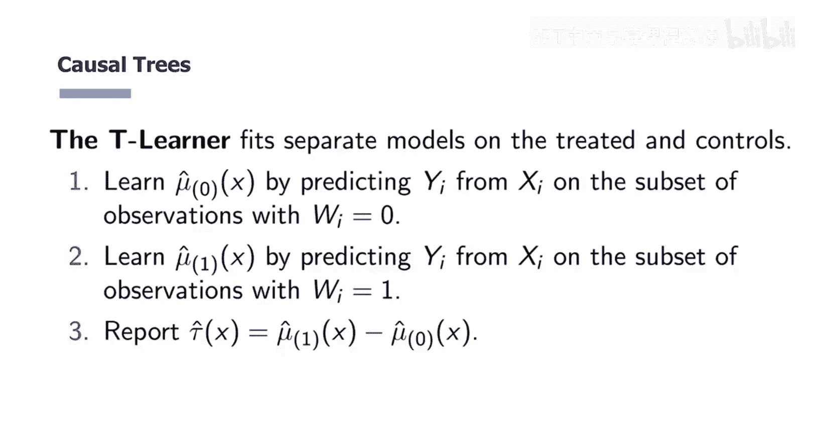