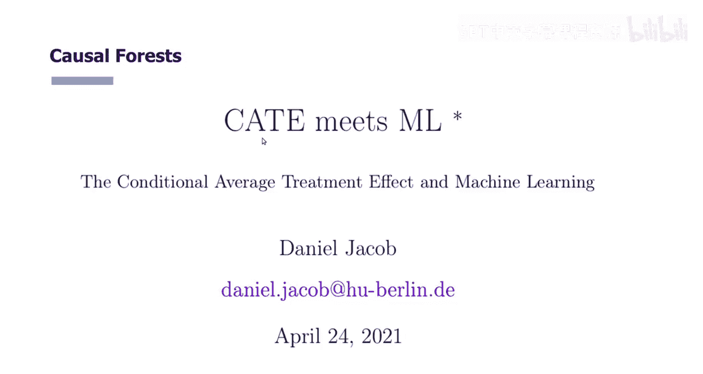
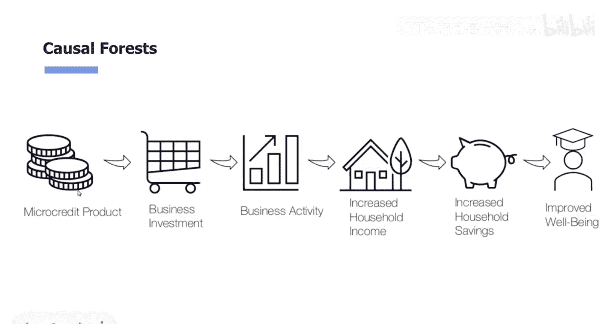
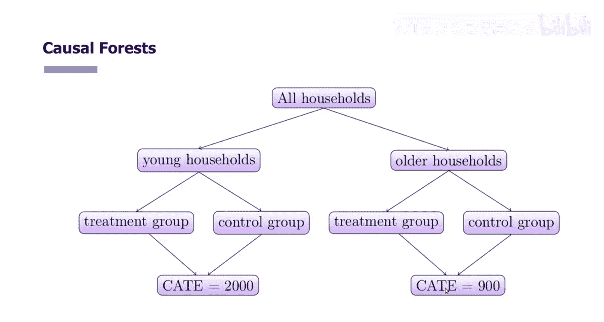
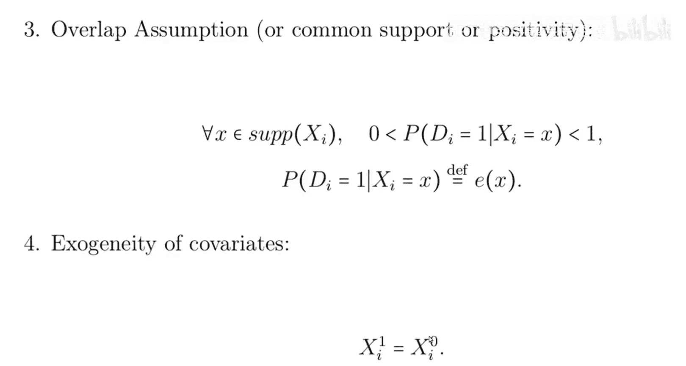
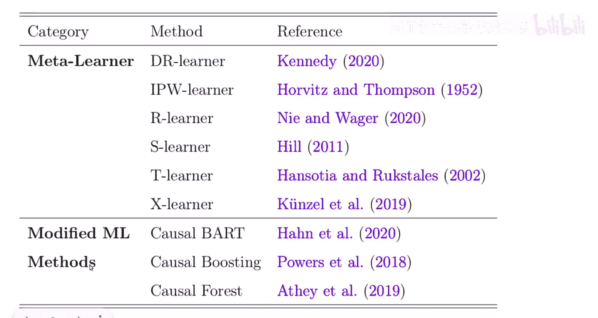
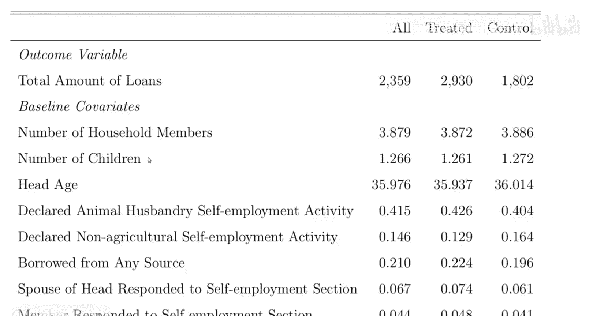
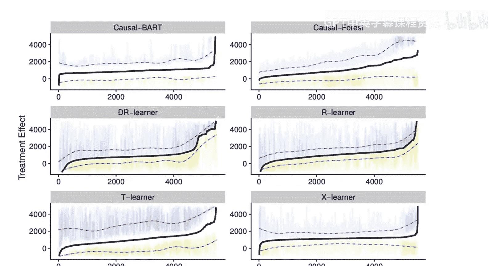
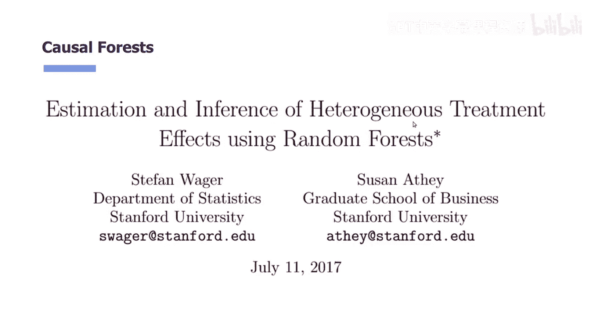
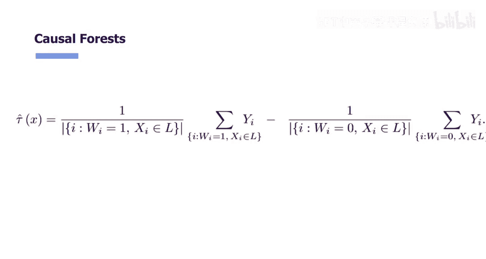
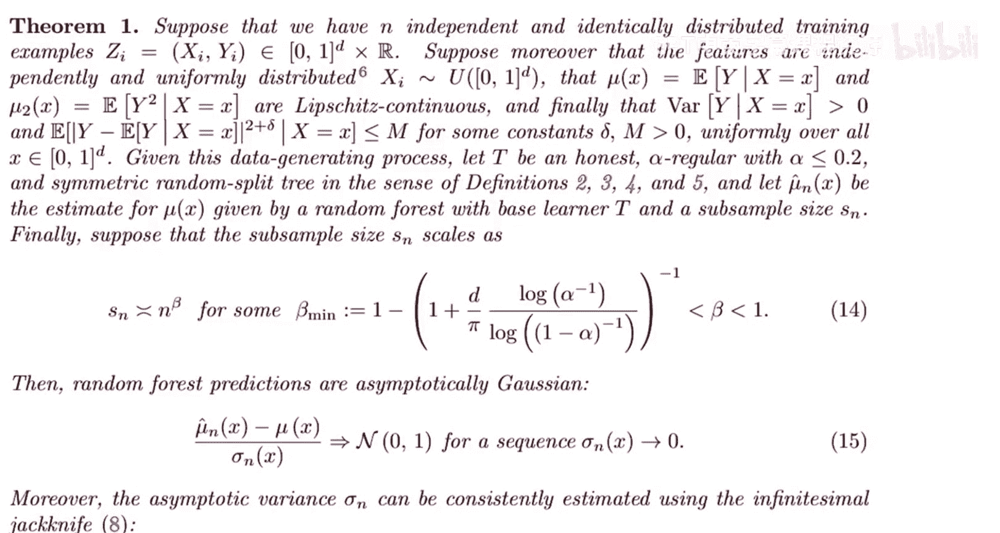

# 约翰霍普金斯大学《数据科学：时间中的决策｜Data Science Decisions in Time》中英字幕 p57 8_因果随机森林.zh_en -BV1NCuzzfEJa_p57-

We'llll talk about causal forest more directly。 This is something we've been leading up to this week and I think you'll follow it fairly well and there's a lot involved in this and I'm just going to need to kind of skim the surface in terms of and I think we can get the main ideas out and again the big picture sensors that we're trying to understand sequential causal decisions So I'm going to start with a paper from Daniel Jacob this is condition image treatment effect meaning machine learning and he's reviewing I think very nicely several of the methods for computing this condition average treatment effect and how do we how do we go about thinking about that So his example from the beginning this microcredit product you can think of this is related to econ Ml and again that's a set of code that I think many of you may enjoy playing with as part of the learning this week but the idea would be that you want to evaluate who's most going to benefit from microcredit loan so you're making investment it's a small amount ideally it helps them to grow business。

Increases their household income leads to increased household savings and improved wellbeing。

 So what you want to understand。 And this is where the intergeneous treatment effect comes in is can identify which individuals are most likely to benefit for this。

 Think of this as a treatment。 you know， a sign or not Y equal1 or y equal0。

 So in terms of a tree and ultimately a forest， you can think of this as we're trying to split。

 we've got all households。 maybe we split first on young households versus older households。

 and we're assigning our treatment。 And again， you can think of this as coming in an RCt from a coin flip in the context here。

 we're assuming that we can understand like an inserter。

 we' can understand how we're assigning to these two different groups。

 And then we can compute our condition average treatment effect。 You can think of this。

 especially again， by comparison to the randomized clinical trials or RCts。

 Our average treatment effect in an RCt is really easy just a coin flip。

 I move from treatment to outcome。 I've got no confusion。 And even if I've got covariates。

 my condition the treatment effect as long as this is a。

CT it's really very straightforward the treatment and the covariates are completely separated in the words I'm not choosing my treatment based on the values of the covariates again。

 the classic example would be overweight and a drug for high BMI individuals if I'm choosing treatment based on their covariate in other wordss then aic down here then it's no longer quite so easy to do the computation。

So in many observational studies and again think of even something like the microcrta we just went through these are observational and unless you could cleanly describe how treatment is being influenced by covariates in other words you understand the assignment then you've got a confusion from the covariates and again that would be really awkward to interpret the outcome from so what we're doing again is try to understand how to handle this kind of situation and an observational study where I've got a mapping from my covariates to my treatment and Ive want to understand how thats set out so there's four assumptions that are required for getting this to be understood and we've gone through all of them but I think the notation here is nice and it's just a good reminder so the first one is that are outcomes and therefore treatments that they're independent of our exabis of our covariates so in other words we've got a conditional independence form and we can think of this as being we've got an independent。

of our assignments and therefore of our outcomes conditional on x of I and so's the form of conditional independence。

 The second was this stable unit treatment value assumption or setfa and again this is saying that we can understand our outcome variables cleanly in terms of the way the distributions are defined and then we've got overlap assumption。

 this is arguing that we don't have something that's pegged too tightly at0 or1。

 this defines our propensity score E of x So the probability d sub i is1 conditional on x sub I equal to little x。

 and you'll see this notation of the c of x've both previously I defined it in this lecture as well。

 and then we've got the argument that the covariates are essentially equally distributed in one and0 in other words that we can understand the covariates is being well defined all the way through。

 So there's a set of better learners that have been defined you can think of these these four。

of one letter ones we touched on a little bit earlier， the three letter and the two letter ones。

 we didn't touch on quite so much I be have is actually one of the older ones。

 but all of these are machine learning type methods that can be fairly readily described in this formalism and then we've got things like the causal forest which we're talking about now causal boost in causal bart so a Bayesian type method and these are largely treebased type methods that especially bart and the causal forest that we're thinking about in this context so now for the microcredit loans here's a table'm trying to give you feeling for what the primary data would look like we've got the total amount of loans treated in control。

 so again we're putting the y equal1 or y equal to zero and then a whole bunch of covariates household members children head age employment type things etc is a fraction of the total table but again we want to understand based on all these covariates and make predictions in terms of。

People will most benefit from treatment So you can run these through these different models and this is just to give you a flavor for the outcomes。

 these are ordered observations。 this is the treatment effect and things like causal bar or causal force you can see they've all got the same sort of qualitative sense of describing this treatment effect in terms of these ordered observations but the conference bars are very different in the different ones and rate these kind of we'll call these intermediate orders differ from one to another and so deciding which model to use and defining your policy based on that is therefore important decision and these days you might even want to run more than one。

 So again the main one we're thinking about now this one from stuff on in Susan from Stanford and this goes back to 2017 and these are these random of forest that we've been talking about and again the idea would be to understand the heterogeneous treatment effect within that context so the argument is that we can define this mu how an estimator for。

Thesese leaf populations， you can think of these as leaves that are defined by these covariates。

 imagining that each of the individuals that have been mapped and these leaves is roughly homogeneous in other words that we can think of these as defining our heterogeneous treatment effect and we're doing this over a set of trees and ultimately a forest and the idea that we can predict our heterogeneous treatment effect or tau highd on X so note that we're using that same term that we had before but this is for one and this is for zero。

 so you can think of this again as our control and our treatment so we have to understand how we're mapping into these leaves and you can think of these as ultimately things that we do multiple times we split in many different ways and therefore we can put confidence mars on it it leads into this theorem I know there's many too many words up on the screen and it's a little confusing and you'll probably have to read through it and think about it it's a more offline but I just want to give you a flavor one of the results in the paper What is really fun to think about it is that they' estimator。

A pen hat minus the true answer mu of x divided by of n It's like a z score。

 It has an n01 in which since a unit Gaussian are zerocented1 for the center deviation of the variance。

 So this is a nice result you can argue from these random force predictions。

 So the argument and just a little more detail， hopefully bear with me just a little bit is z sub I is ordered pair our covariance and our treatment outcomes they're distributed in a reasonable way and we're going to assume that our features are independent uniformly distributed so x sub I comes from a uniform 01。

 and then our mu of x going to the leaves is an expectation of outcome and predict on our conditional on our values for x and mu2 you can think of this is being related to variance their ellipses continuous and then we've got our variance on y greater than0 our y minus our expectation to the two plus sigma。

Conditioned on x x equaling little x is less than equal to M。

 we defined constant delta and M here delta and M And given that we've got this and we define an honest and you have to be through the paper to get maybe a stronger sense for that but the idea is that we can define the trees to be honest and therefore again the forest to be honest。

 then we've got our estimator we've got it's an estimate again of mu of x and we've got our base there t and then we're going to think in terms of subsamples and these subsamples we can argue they scale is end of the where beta is defined in this particular way and it's bounded。

 So then there are asymptally Gaussian， which is really nice and we've got an variants that defines from that。

 So again these are arguments theoretically about what the random forest should do and they're fun to think about hopefully you've got these some feeling for why people can get excited about them and and about what they mean。

But the main thing to take away from this again is that we can fit a model for these observational data and make causal decisions I what that means on ways we can make sequential decisions for a data side so okay I will pause here and I hope this has been a help。

 Thank you。

