# 约翰霍普金斯大学《数据科学：时间中的决策｜Data Science Decisions in Time》中英字幕 p58 9_多因优化：以电影收益最大化为案例.zh_en -BV1NCuzzfEJa_p58-

We now talk about a very interesting set of papers from David Bla's group。

 This is called the Bs of multiple causes。 It's another way to think about cosmo systems。

 and we'll start with really almost a cartoon like example about optimizing movie revenue。

 I think you'll find this fun， it's really a very nice idea may not apply all through causal systems but for where it does apply。

 I think it's really quite fascinating。 So the system that David Bla did with X and Wang and this was published in 2019。

 by the way， generated a lot of commentary。 So for those of you that are interested in following scientific debates you can search on this paper and see there's a lot of really。

 in some ways ongoing debate in terms of when this kind of approach applies and when there might be problems。

 but again， I think it's interesting idea and it's well worth thinking about and if potentially does apply to something you're interested in then that's fantastic。

 So the argument here is that we've got a set of movies。

 think of this is coming from IP or some other large database。 And the idea。

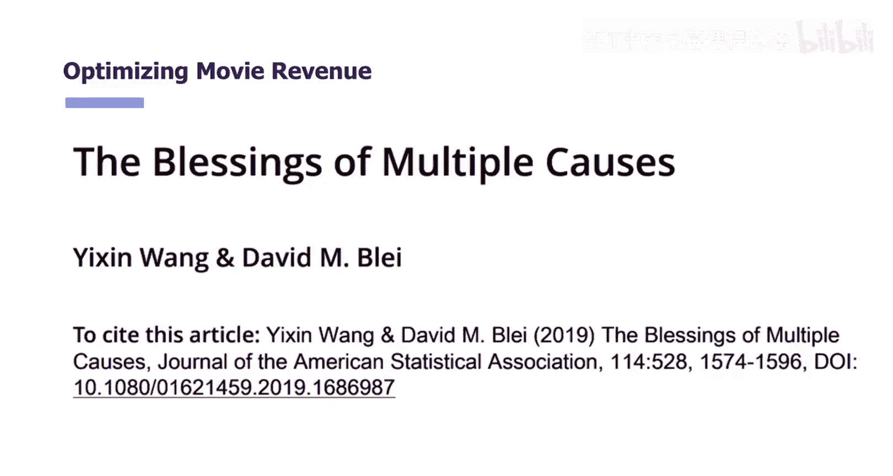

Can we understand the causal effect， can we understand what happens when we put different actors in different movies now again。

 this is a little cartoonish you know imagine that you've got enough independence that you can kind of just sub in different actors and understand what it means in terms of the revenue but the question would be in terms of cause and effect your action。

 your thing that you're doing is adjusting which actors appear in which movie and your outcome is of revenue from those movies。

 so imagine again something like this， different movies， different casts。

 different potential revenues that are coming out。Could you interpret this。

 Could you really try and optimize in terms of what's going on and realize again the idea here is to introduce the method whether this would actually work for movies is a completely separate question。

 but in the most Eive solution， something like this you would just say a regression to this maybe do some sort of deep learning or other large database to try and interpret what's going on in other words。

 machine learning context， the actor is simply features the revenue is the response to that again。

 so this is what you're trying to predict in a causal way。

 and what you want to do is now imagine if you swap in different actors in different movies。

 how does this revenue change So again similar to what we talked about with causal trees causal force us we only observe one movie with one set of actors So the what if type question is what if we had other actors that were in that setting if we did this in a standard way though we just don't get causal inferences and so we can't correct for what's going on So in other words。

 whether an actor was cast and the kind of a what if type question。

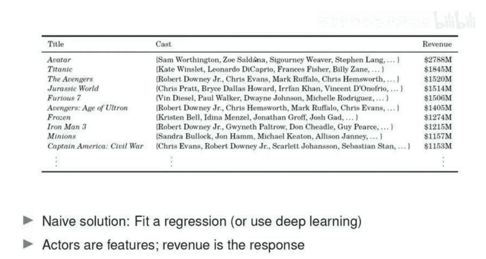

I different from the actual movie that was made with a particular cast and so what we're trying to do is do again。

 causal inference， a what if type question and so we can think of them about this in kind of naive way and we've got a significant so to speak unobserved confounder。

 which is this James Bodenness of the movie。

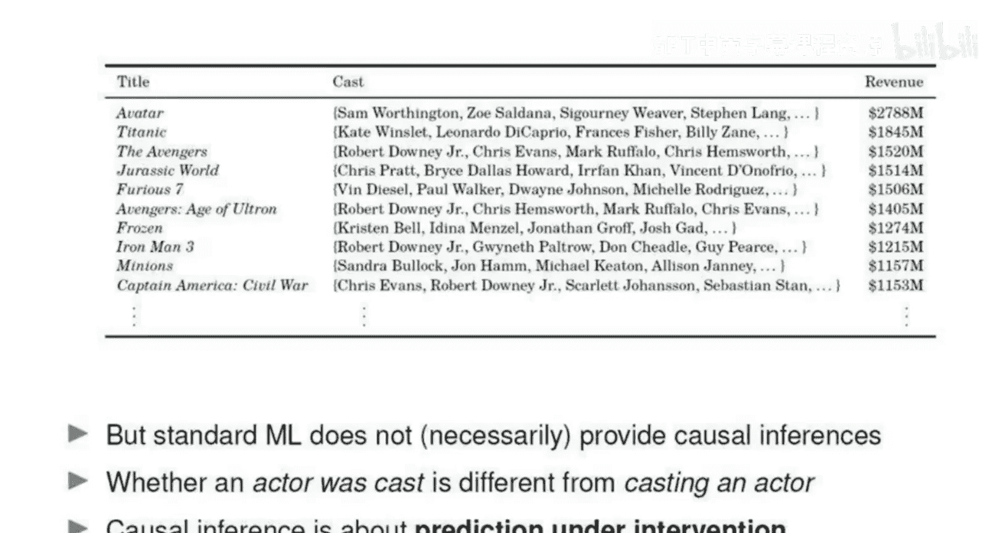

So the revenue we could argue is very much a present of the entire storyline it's the whole James Bond series and then we've got actors that are coming in。

 So this confounder， as I've already pointed out and you've heard hopefully in other contexts as well for causal settings this confounder is what really makes this a challenging problem but the blessing theory that we've got a bunch of different actors that can be eventually put in it so you'll see that while this naive solution would suggest that we've got a terrifically hard problem with this confounders we do have a way with the deconfounder of thinking about what's going on So in a little more detail。

 a classical solution would be to think about these confounders for example maybe this James Bondness and then measure the confounders and then effectively remove them。

 so we'd estimating the causal effects and this again goes to things like the causal tree and causal force So estimate you mean average over distribution function of the revenues the y conditional on。

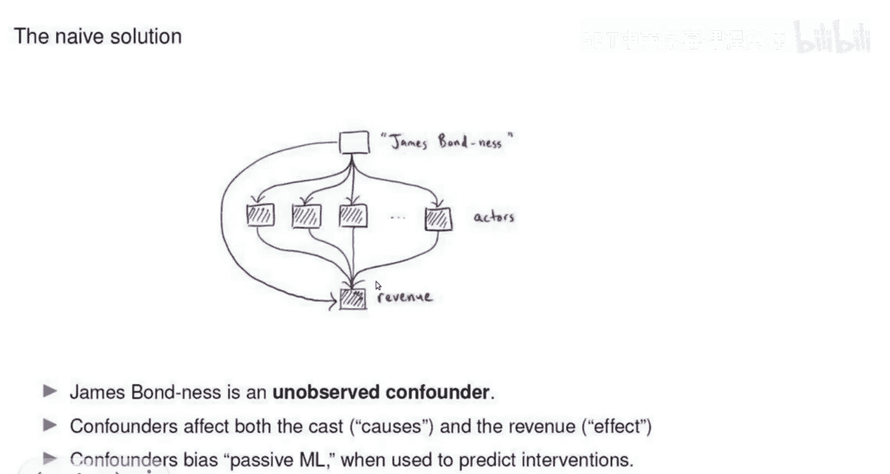

Particular treatments and actors that have been selected and Southerns were removing the confounders by understanding in great detail about what's going ons a classic solution the deconfounder which is less into multiple causes so again David Bla's group and the things coming from that now what we're thinking about is really a latent variable type model where we've got multiple causes now again I。

I'm trying to introduce this for all of you in terms of movies。

 you can think about this in terms of any sort of problem where you've got multiple causes and potentially latent。

Variables that are behind these multiple causes， and then you can fit a model to that。

 and you'll see that there are many different kinds of models that could be appropriate。

 but the idea here is that you've got latent。 so you'll see in a moment I'll showing you how you might do this from there B paper how you might fit the movie database the important thing again is that you've got something where the directionality is fairly clearly defined again。

 that's key to all of this and we've got multiple causes。

 So we're going to estimate the sub confounders and then we're going to estimate our causal effects。

 So it's very similar to what we had before。 but in a way that really does deconfound it。

 So the idea is this is a factor model。 the factor model has these latent variables and let's us make a substitute confounders for each individual and that makes the causal model for the outcome。

 So again， that's the essence of the deconfounder and。

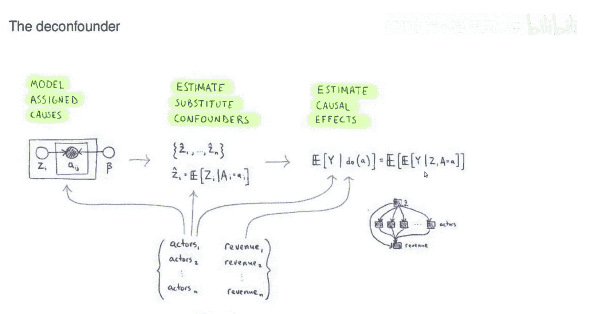

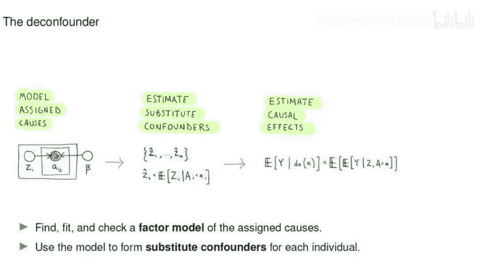

For the movies， what that would mean in a little more detail is we're going to appear a prolistic matrix factorization for the movie Ca。

 you can think of this is because the easiest way of thinking about this as a non-negative matrix where we're thinking in terms of counts。

 So I think in terms of Poisson we've got these per movievie variables in that matrix factorization and then we can make a regression from the casts to the earnings。

 So effectively what that means we've got a plate type model。

 this is what this kind of form is with the z sub a sub J and beta and effectively what we're doing is z1 to Zn。

 So note that's one form and then we've got this separate distribution expectation or expectation where we're thinking in terms of the separate breakdown the js here So this lets us again do this as a model that we can build up on Now there are some assumptions and kind of intuitions that go into this the first one is that there are no unobserved single cost confounders So what that means is that we've got these multiple cause confounders。

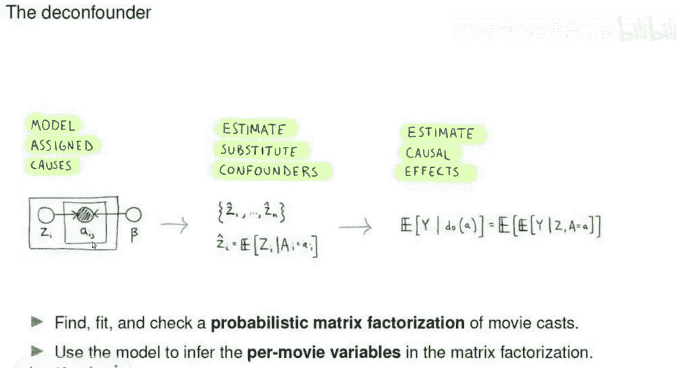

That's introducing this dependence among all the different causes and it's encoded in the data。

 so that means that's why we can factor with this factor model that has these latent degrees of freedom behind it。

 So it's all checkable， that's what I like about this approach and hopefully it's fun for those of you listening and taking the course you can check whether this works you can build a model like this and and see whether it makes sense and because there's been a lot of work on these factor type models it means especially from a machine learning perspective。

 a little bit like the causal degrees causal force。

 it's no harm in trying that's something that one can start off and see how it works so in the case of the movies again we've got individual movies each line we we would argue is going to be like an I and independent identify distribute type set we can argue that we've got different casts and principle that could be drawn from a very large set of different actors So what that means is we've got for each of these set outcomes with our vectors survive so to speak for each of the different。

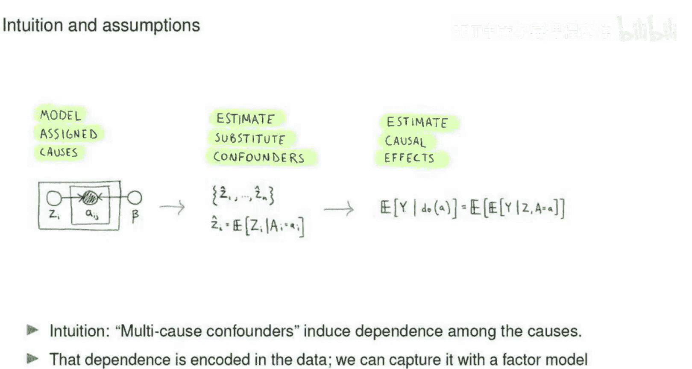

Cas that were in the movie and again， we're trying to optimize our revenue。

 so we're effectively doing a causal inference。We're trying to optimize on that Now obviously I don't want you to take this completely literally nor to David play in his team。

 but the argument is that there is variability depending upon what actors and actresses are picked in a particular James Bond movie or other movies。

 you can imagine a wide range of outcomes So again the idea is if it need a factor model and then that factor model you can make subsequent confounders and then that means you're making a causal model of the movie revenue from doing that。

 So in my really last slide here again to help you see I hope a little bit into this a little bit more on this plate type model we've got movies seen in this rectangle here。

 we've got actors in this one here。 So the actors are from one to M so you can think of this as the different set of actors that we can mentally pulling from the movies are this from I from one to N these are both gamma distribution。

 hopefully most of you listen to this are' comfortable with。

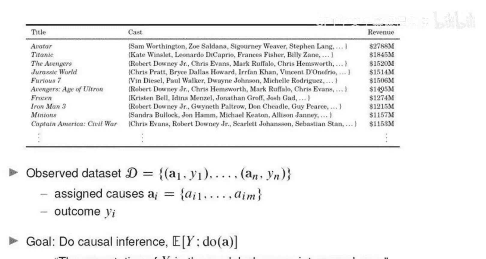

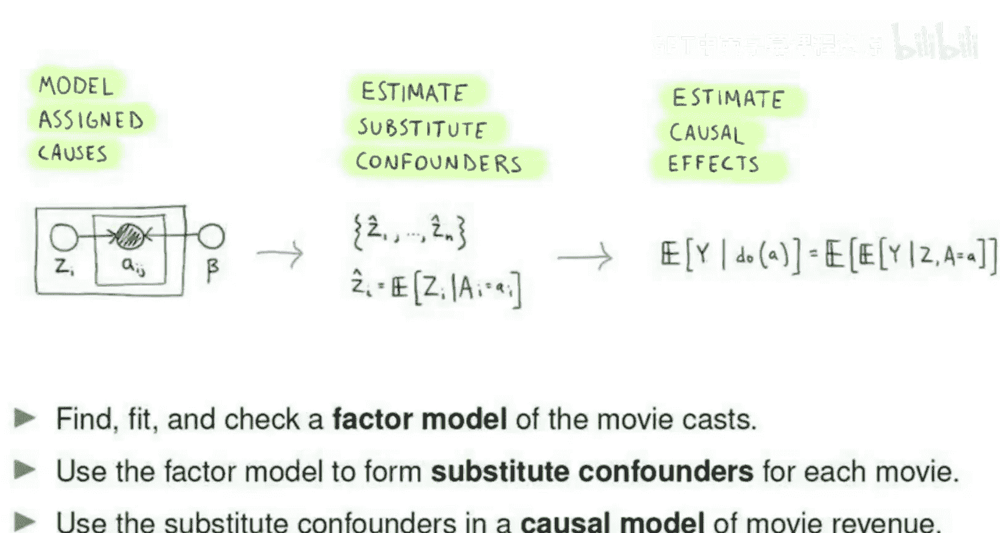

Gmma distributions if you're not， you can look that up in Wikipedia。

 but it takes two variables A and B， and then you could fit so you're fitting beta sub Jk。

 you're fitting z sub K。 then you're assuming a sub j is a Poisson that' set by this product of the Z sub transpose。

 you can think of this as just a row vector times the column vectors that we've got a Poisson。

 So this is the lambda variable that comes out in the Poisson。

 so then we've got our counts a subj that comes from doing that。

 So this means we can think of this as like a generative model for all the Asan causes a subj。

 these are right here。 and then that means that we can fit this very quickly with variational methods。

 this is a quick way to do a Bayesian。 so we're not even doing MCmC we're assuming with variational methods and you can think of this really as like a Bayesian form of non-neative matrix factorization。

 So again makes sense to be non- because the form of the problem that we're looking at here。

 So again this plate model some of humanity spend a little more time to understand it。

 but essentially we'。D find the say supplyj and then we can again having fit this from our data set of movies and actors。

 we can answer some of these what of questions， some of these causal questions so I think really really quite fascinating and there'll be more coming up this week this is just the introduction I hope already this has got your appetite wedded for the sorts of ideas that are coming up in this week and again the main paper will be one of your meetings from this week so I think it's a really really interesting idea for how to do causal inference and this kind of frame of less of multiple causes so okay I hope that helped to you Thank you。

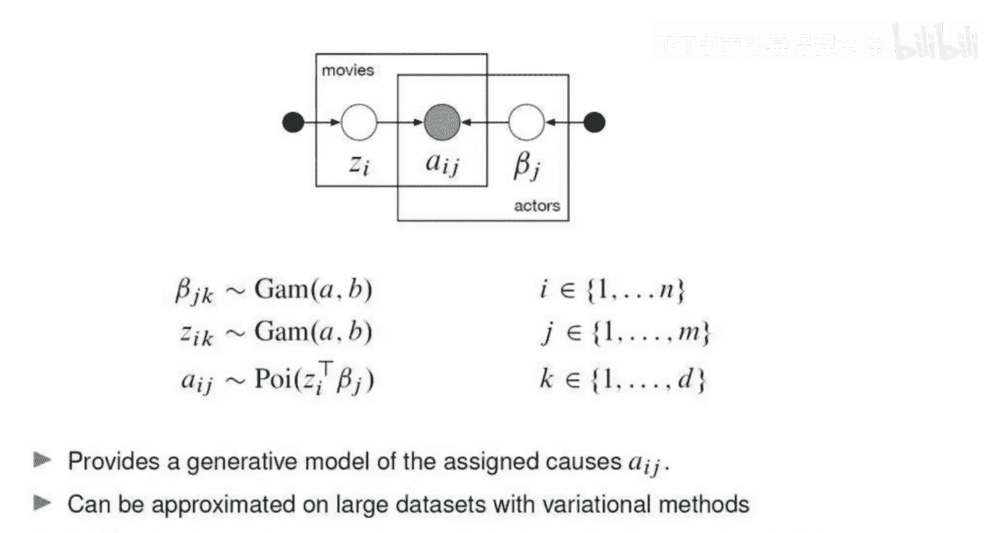