# 数据科学：时间中的决策｜9：多因优化：以电影收益最大化为案例 🎬

在本节课中，我们将探讨一个非常有趣的研究方向——多因优化，特别是由David Blei团队提出的“去混杂因子”方法。我们将通过一个电影收益最大化的案例来理解其核心思想，并学习如何应用这种方法进行因果推断。

---

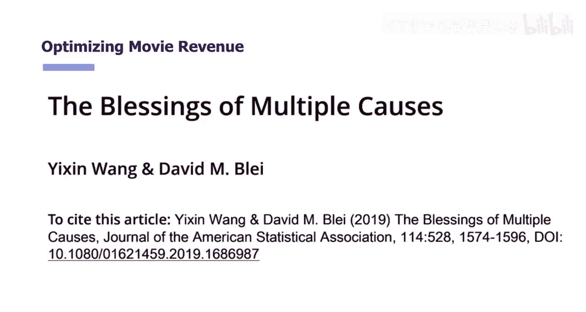

## 概述

我们首先介绍David Blei团队在2019年发表的一系列论文，这些论文提出了“多因去混杂因子”的概念。这是一种思考因果系统的新方式。我们将从一个近乎卡通化的例子——优化电影收益——开始，逐步深入其背后的原理和应用。

## 多因优化与电影收益案例

上一节我们提到了多因优化的概念，本节中我们来看看如何将其应用于电影收益的优化问题。

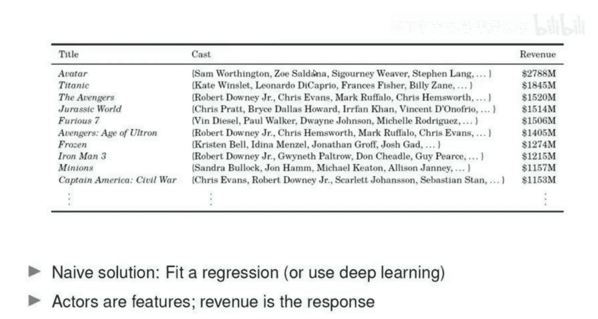

想象我们有一个电影数据库，其中包含多部电影及其演员阵容和票房收益。我们的目标是理解因果效应：当我们更换电影中的演员时，票房收益会发生什么变化？这里的“行动”是调整哪些演员出演哪部电影，而“结果”是电影的票房收益。

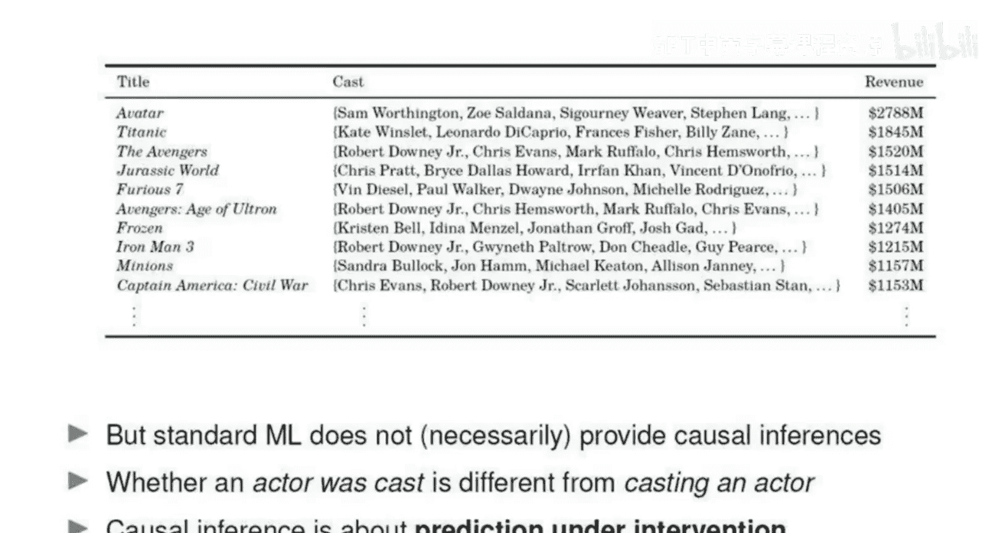

在标准的机器学习方法中，演员可能被视为特征，票房收益是响应变量。我们试图预测的是在因果层面上的收益变化。然而，我们只能观察到每部电影在一种演员阵容下的实际收益。要回答“如果更换演员会怎样”这类反事实问题，标准方法无法提供因果推断，因为我们无法校正潜在的混杂因素。

## 混杂因素的挑战

一个显著的未观测混杂因素是电影的“詹姆斯·邦德特质”。票房收益很大程度上取决于整个故事线和系列品牌，而演员是在此基础上加入的。这个混杂因素使得因果推断变得极具挑战性。

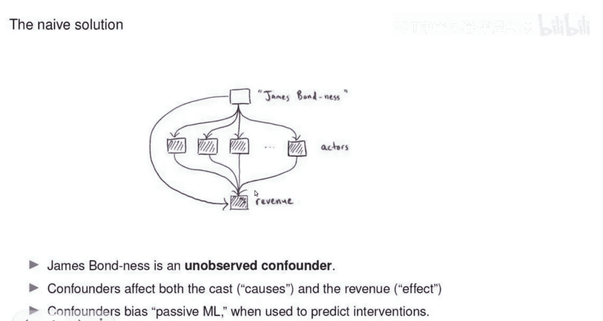

然而，“去混杂因子”理论提供了一种思路：虽然我们面临混杂因素的难题，但我们拥有多种可以组合的演员。这为我们提供了一种思考问题的新途径。

## 经典解决方案与去混杂因子方法

经典的解决方案是识别并测量这些混杂因素（例如“詹姆斯·邦德特质”），然后将其从模型中移除，从而估计因果效应。这类似于因果树和因果森林等方法。

**公式表示**：经典方法旨在估计条件期望 `E[Y | T, X]`，其中 `Y` 是收益，`T` 是处理（演员选择），`X` 是观测到的混杂变量。通过控制 `X` 来估计 `T` 对 `Y` 的因果效应。

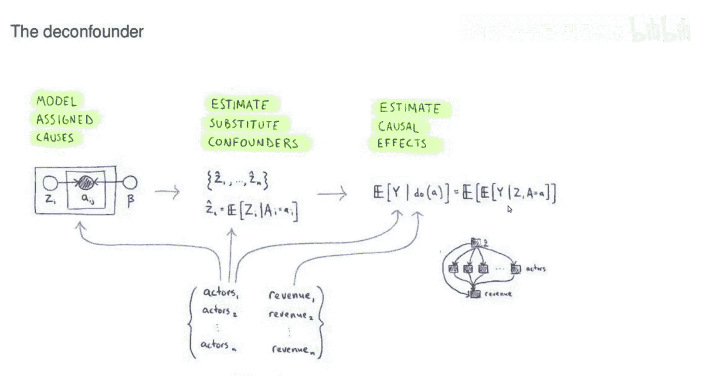

相比之下，“去混杂因子”方法则针对多因情况。它本质上是一种潜变量模型，假设存在一个潜在的变量来解释多个原因（演员选择）之间的依赖关系。

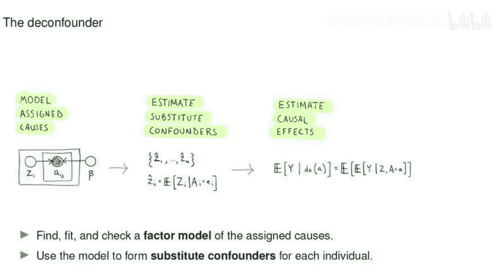

**核心思想**：该方法是一个因子模型。该模型包含潜变量，并允许我们为每个个体（电影）构建一个替代的混杂因子，进而建立关于结果的因果模型。

## 应用于电影案例的模型细节

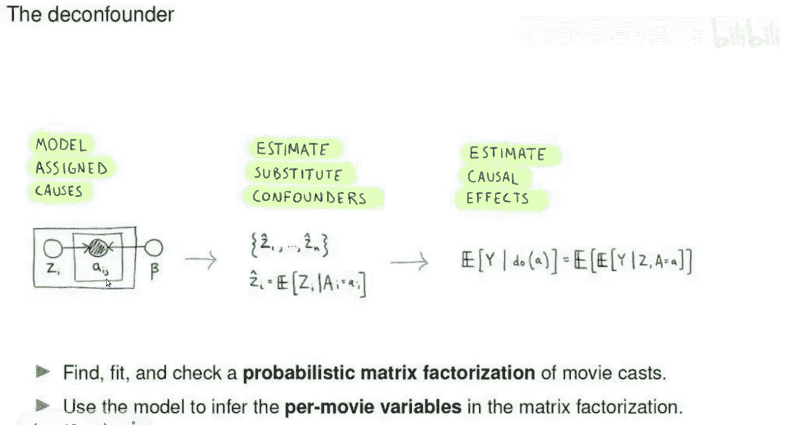

对于电影案例，更具体地说，我们将对演员阵容应用概率矩阵分解。可以将其视为一个非负矩阵，其中我们考虑计数（例如泊松分布）。我们在矩阵分解中获得了每个电影的潜变量，然后可以从演员阵容回归到收益。

**模型表示**：我们有一个板模型（plate model），其形式如下：

```
对于每部电影 i (i = 1...N):
    Zi ~ Gamma(a, b)          # 电影的潜变量
对于每个演员 j (j = 1...M):
    βj ~ Gamma(c, d)          # 演员的参数
对于每部电影 i 和演员 j:
    λij = Zi^T * βj           # 泊松分布的参数
    Aij ~ Poisson(λij)        # 演员 j 是否出现在电影 i 中（计数）
```

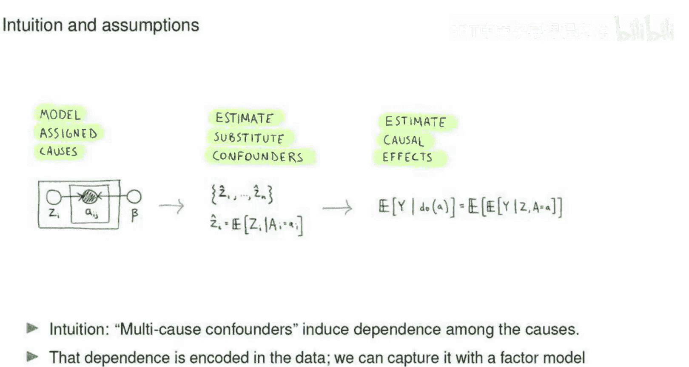

然后，我们基于拟合出的潜变量 `Z`（作为替代混杂因子）和演员特征 `A`，建立收益 `Y` 的回归模型：`Y ~ f(Z, A)`。

这个模型可以看作是一种贝叶斯形式的非负矩阵分解，可以使用变分推断等方法快速拟合。

## 方法的前提假设与直观理解

以下是该方法依赖的一些关键假设和直观理解：

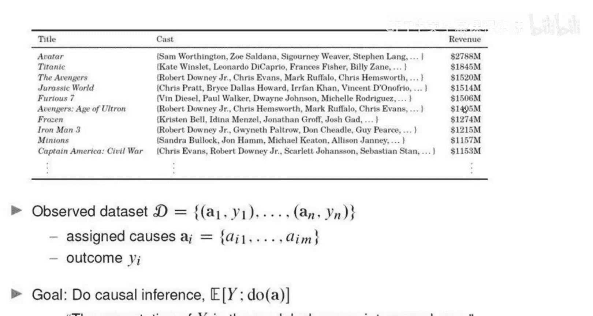

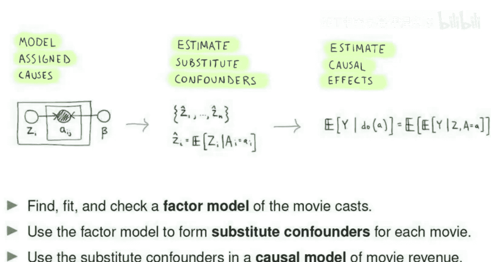

*   **无未观测的单因混杂因子**：所有引入多个原因之间依赖关系的混杂因素都编码在数据中。这就是为什么我们可以用具有背后潜自由度的因子模型来分解它。
*   **可检验性**：该方法的优势在于其可检验性。你可以构建这样的模型，检查它是否合理。
*   **独立性**：在电影案例中，我们假设每部电影是独立同分布的，并且演员阵容可以从一个很大的演员池中抽取。

## 总结与展望

本节课中，我们一起学习了“多因去混杂因子”方法的基本原理。我们通过电影收益最大化的案例，了解了如何利用潜变量模型来处理多因因果推断问题，从而绕过直接观测混杂因素的困难。

这种方法的核心是构建一个因子模型来拟合多个原因（如演员选择）的联合分布，从中提取潜变量作为替代混杂因子，然后在此基础上建立结果的因果模型。这是一个非常有趣且强大的思路，为处理复杂的多因系统提供了新的工具。

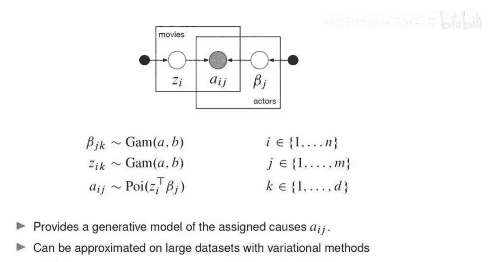

本周后续内容将对此进行更深入的探讨，相关的主要论文也将是本周的学习材料之一。希望这个介绍能激发你对本周即将出现的更多思想的兴趣。