# 约翰霍普金斯大学《数据科学：时间中的决策｜Data Science Decisions in Time》中英字幕 p59 10_打破推荐系统的反馈循环.zh_en -BV1NCuzzfEJa_p59-

Well now continuing discussion of work coming out from David Blalas Group on the blessings of multiple causes。

 I really want to cover a little bit more about how this might work for things like movie recommendations。

 but also the extension that was done from Michael Jordan's group on breaking recommendation feedback loops because I think this potentially could be of interest in many of you taking this class So this line of thinking really starts from a followup that Nix and Wang did again from David Bla's group on causal inference or recommender systems in this paper they were really thinking about how you could recommend movies better they idea didping you don't want to continually recommend all movies from the same type but that there could be a way to break type of feedback loop using causal inference。

 and that was really followed up on again from Nix and Wang but now working as opposed to in Michael Jordan's group where they developed ideas for breaking these feedback loops with causal inference and so I think these are generally interesting ideas and both these papers where again won be in your。

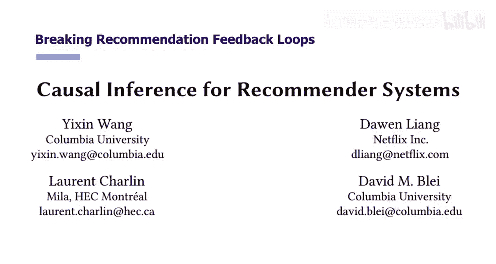

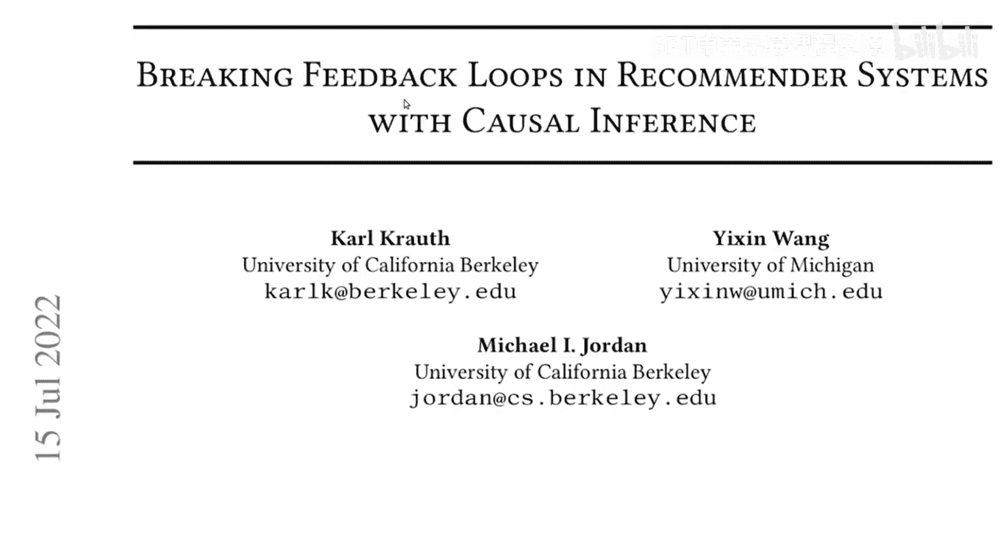

Readings for this week， the central idea is something like this that you've got a recommender system that's recommending a particular action。

 and if you don't design these things in the right way。

 and most recommender systems are going to be like this， you've really got a feedback loop。

 So what that means is that you're going to drill down so to speak into a particular genre a particular director in particular set of actors if it's a movie recommendations system it's not necessarily going to be recommending broadly and so there's a feedback in the words it's between the ratings and the recommendations that are given that are going to generate many recommendations in similar sort of context。

 and you can think about this in a more temporal context or now it becomes more sequential very similar to our making decisions in time overall team。

 which again is at least in part why'm picking this because you can think about a series of recommendations going up to some time capital T and at each point you can think about feedback and an estimator for that feedback and the question is whether we can estimate the impact of this feedback and。

make better recommendations by understanding this causal connection between these series of recommendations over time and therefore better decisions on what kind of recommendations to serve up so we'll start with the first paper the idea being that if you had an initial relatively easy regression type fit based on the actual actions that are taking whether you've recommended movie or not in the context of that first paper you've got a noise term and effectively you've got a matrix that you're solving with weights and you can fit this in a kind of naive sense as a formal recommendation and there's a lot of work that's already been done in this way using these matrices but the suggestion they're making is the better way to do this is to think causally and we introduce a new term here this estimator effectively on the causality related to predicting the particular actions with a multiplier and so this be a new model and the idea would be that this would be a better way to do it and it grows out of the blessings of multiple causes。

 this de confounder。

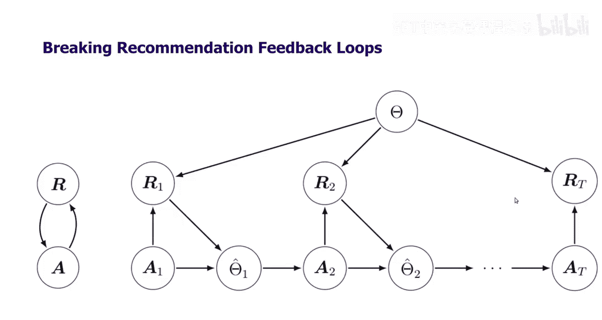

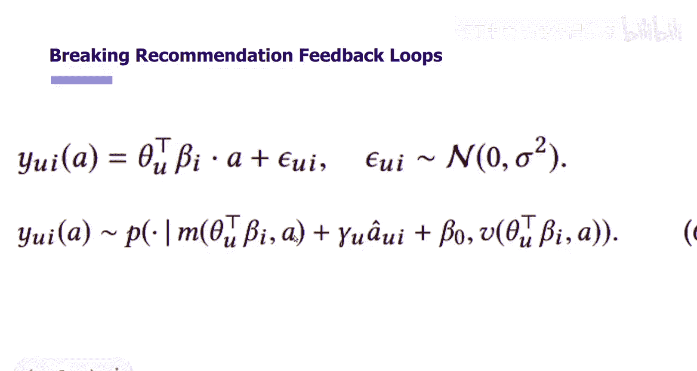

IeaSo you've got a data set of exposures and raddiance again。

 these are the movies if you want to think about it you're recommending。

 but it's recommendation system in general， you've got actions。

 you've got outcomes based on those and you're trying to understand better causal only better how you can prove what's going on so I'm going to put in these equations and the following slides but essentially what we're doing is fitting a factor model this is a Poisson version of a factor model so the latent degrees of freedom so less and multiple causes to these exposures。

 these a ofuis and then you make confounderers so these are now estimators on that and then you make a model for that entire effect and the idea is that that's going to do better so trying to connect this back to the first of our entrance into it less of multiple causes essentially you've got us a Poisson with two terms in it these are both coming from gammas and again you' can need more on this if you're all curious but the idea is that this is we used to straightforward to fit。

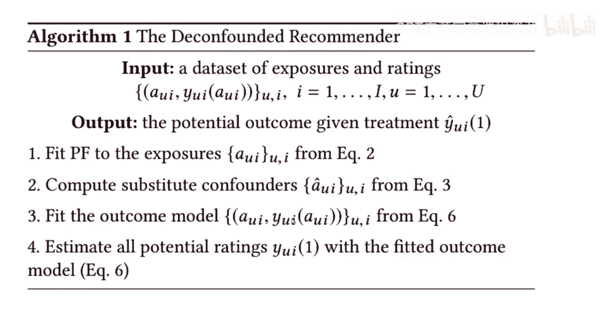

This is a Bayesian using variational methods， you can put in the data and again that means you can infer the values for this pis sub U with this gamma on C1 and C2 and the sda subi again these are drawn ID gamma C3 and C4 so you've to infer these c1 C2 and C3 C4 for the pi U and Lada subi then you make that product and then you've got a Poisson for the AC subUi and you can see that that's immediately can come back to matrix type estimators but now it's in the context of these latent factor type models that again come from the glys of multiple causes。

 so in particular our Poisson factor type model is set up here where again we've got our two terms here from the gamma distributions conditional on the assignments。

 the treatments that are assigned so we've got a new type of estimator that comes out from doing that and that effectively then can be improved to make our model for the system。

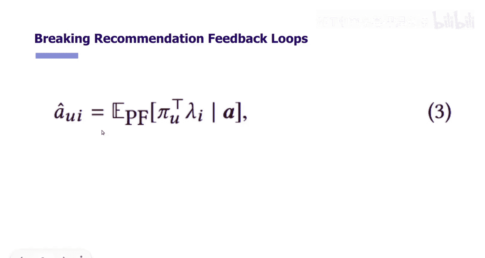

Okay so now going back really to the second paper coming now from works with Michael Jordanan's lab。

 we're now trying to estimate that of one hat in this temporal context and I apologize to some of you this will be a little more mathematical than some of the other parts of the class but I want to communicate the central idea。

 I don't think it's too hard to understand。 essentially what we're going to do is make a co labor divergence scale divergence we're going to do an argument on that。

 So this estimator for the status of1 hat is an expectation we're comparing two different distributions here and the argument ultimately is that we can using this kale divergence fit an estimator for that and by fitting that estimator we've got some nice things that flow So first lemma is saying that that causal graph and figure 1 B which again is this term right here in the words we're estimating these terms that this causal graph in 1 B we can make an estimator using that。

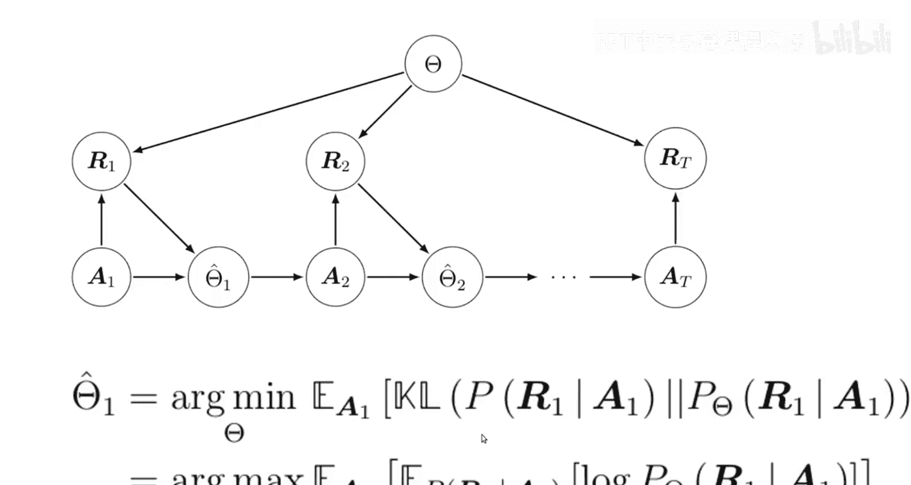

do calculate again coming from today Pel's work where we're actually going in and intervening on this snap being our recommender system on what we're going to recommend and by doing this in the right way we make it a product so it's now IID and the argument is that by doing it this way we can undo this feedback loop so we've got now a product of IID over all of that and that makes that our actions are reasonable so in the secondlemma again that same causal graph the argument is that we can do an argument on the K divergence so we're comparing these two different distributions。

 this is our estimator Q here， our capital Q is effectively an estimator set and they satisfy these independence mutation that we're in equation6 going back to this so the argument again is that there exists a way to estimate this to break this feedback loop so what that means is that we can estimate that causal term in terms of these Cal diveivergences and。

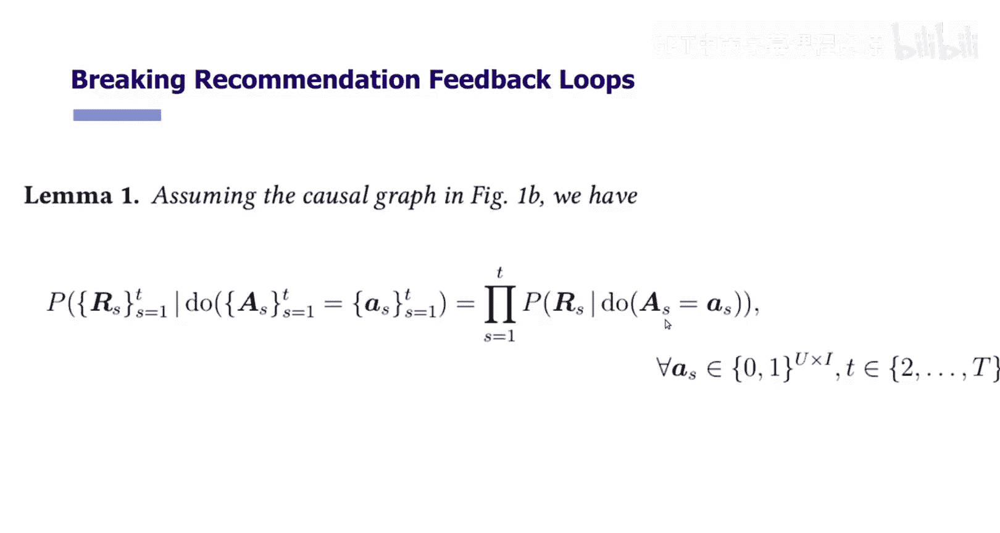

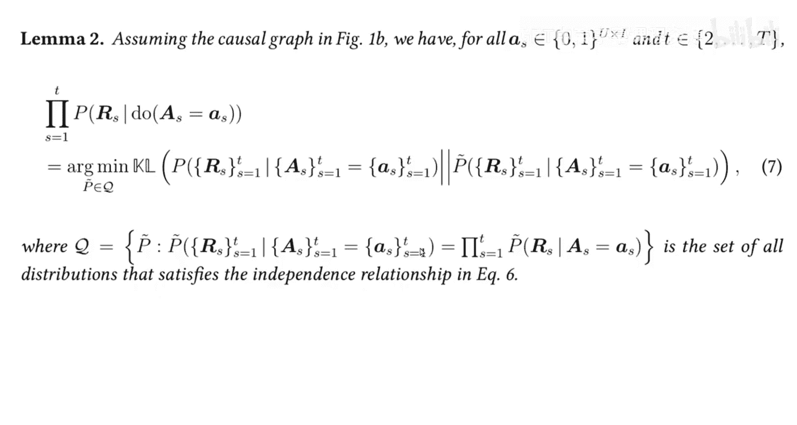

We can build this up and in spirit it flows out from the proson factor type models from David Bla's group。

 but this is an even deeper way of thinking about it in terms of the counterivergence in terms of thinking about estimating these causal effects So what that means is we're making some assumptions and reasonable ones this goes back to emunds and ruben paper in 2015。

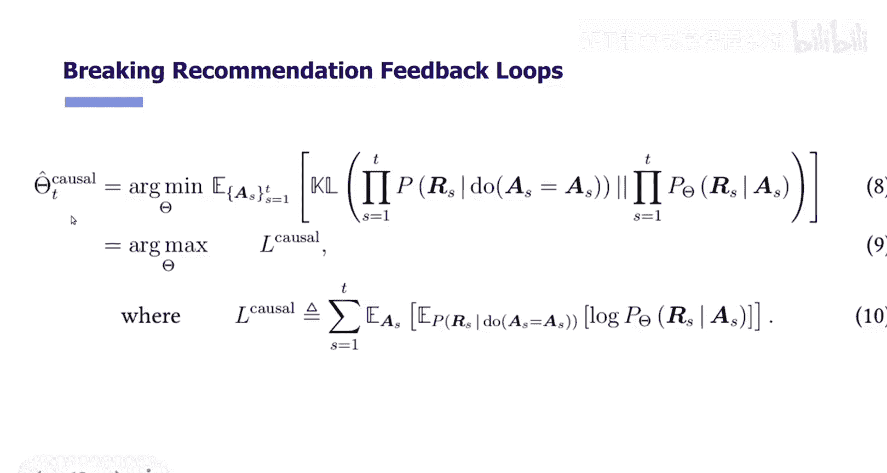

We're going to assume that we've got a poitivity condition in words our probability is greater than zero strictly greater than zero again。

 looking at that same causal graph then that means that we can estimate this in terms of these status of hat estimators so in terms of our due calculus again breaking that causal feedback loop we've got a clean integral that we can compute and so what they're arguing in that paper and again this will be in your meaning is that their algorithm breaks these feedback loops and gives better recommendations in other words it reduces the limiteditation and gives a much more reasonable set of recommendations So with this hopefully giving you some feeling for less multiple causes and again this idea that we can make better recommendations systems that flows out from that again the central concept being that just like we've got sequential decisions being made we've got sequential recommendations that need to be made and how can we break this up in such a way that we've got independence causally break it up so that we don't have。

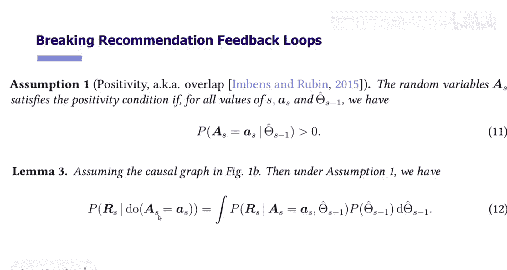

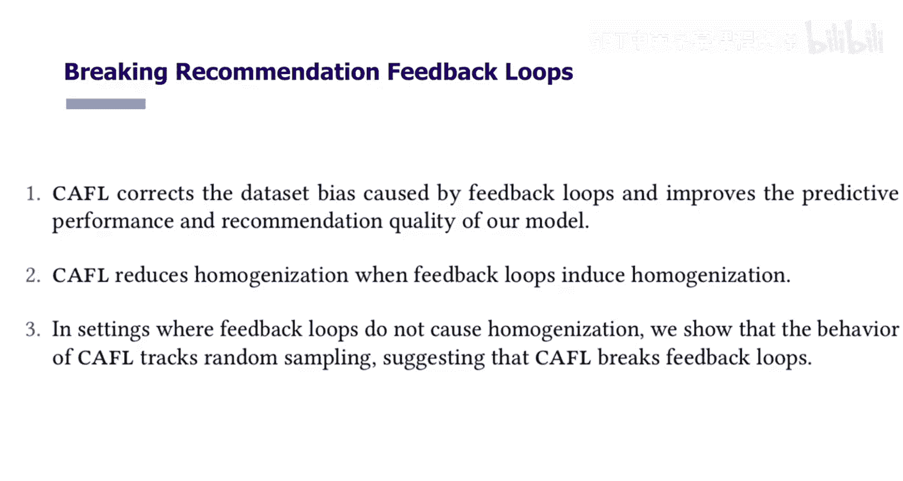

some graing into a homogeneous set of recommendations that efficiently drives you into all seeing movies with the same genre or same actors or same director but effectively diversifies and the argument being that therere reasonable recommendations again but they're causally now broken apart of the way that we've got independence I think potentially a really really impactful paper coming out from this so with that I'll pause here and I hope you all are enjoying this and thank you for your attention。

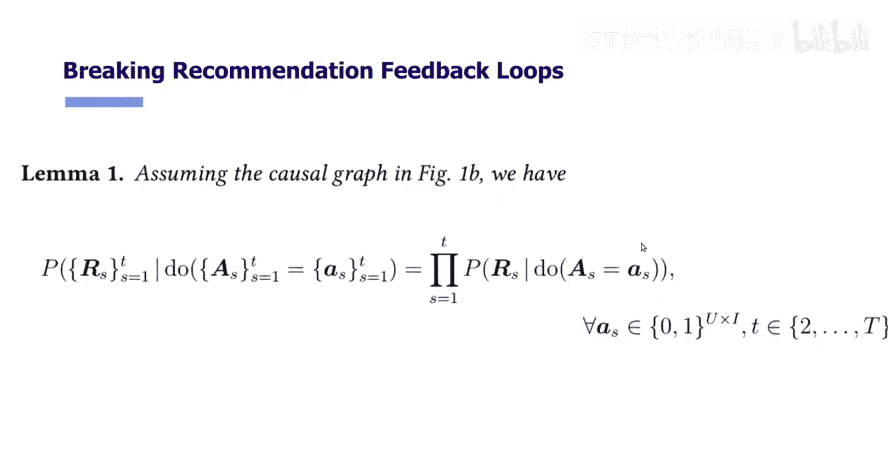