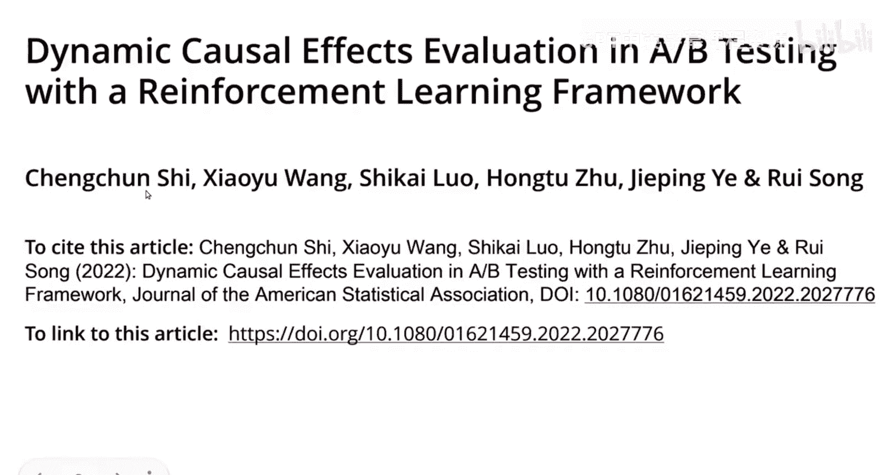
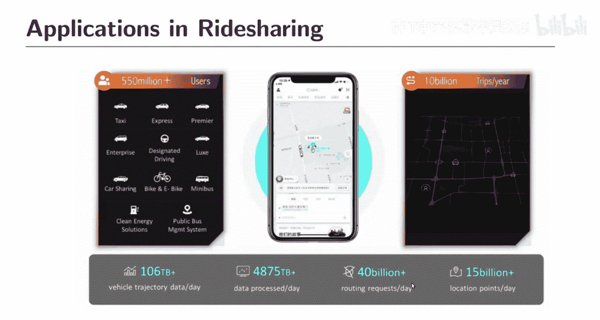
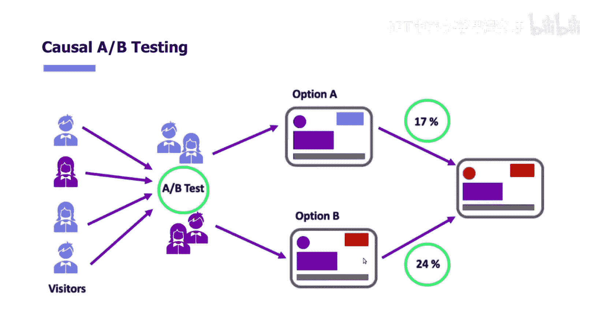
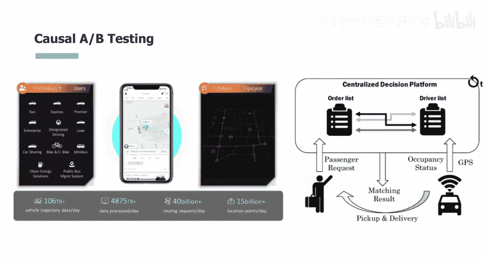
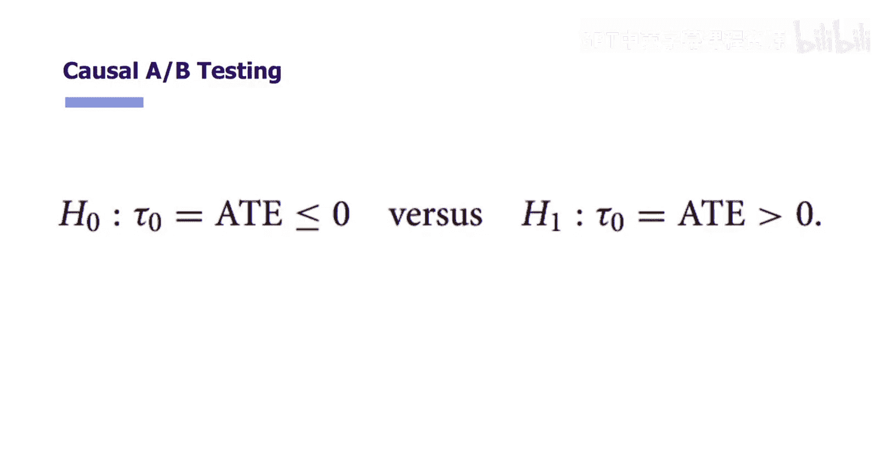

# 约翰霍普金斯大学《数据科学：时间中的决策｜Data Science Decisions in Time》中英字幕 p60 11_因果视角下的A-B测试.zh_en -BV1NCuzzfEJa_p60-

When I talk about AB testing in the context of causal decisions。

 this is a really nice extension of ideas that we've been talking about from the beginning of our specialization。

 The paper I've picked for here is a relatively recent paper you can see 2022 the senior author here or the first author is now in London as In professor and it's sponsored and I believe by Ruong's group so I think a really interesting paper youll be able to read more about it I only be able to give you a rough introduction to it and it's partly based on a talk that first author here gave So the idea is how do you help something like a ride sharing applications I think of something like Uber and they've got 550 550 million plus users a huge amount of data and ultimately what they're trying to do is match drivers these are people who are trying to earn a living obviously from bringing their car and themselves to pick up passengers and passengers。

Trying to get from point A to point B。Huge amount of requests per day and huge amount of location points that they've got to go to。

 And again， as a reminder for AB testing， you've got a bunch of people coming in this case maybe to a rideshare platform and your A test is can you root them differently Can you do something like for the。

Cars in the Uber drivers ultimately can you say something they only go to their nearest neighbors or can you evaluate other options that might have a better impact long term by trying to strategically plan where the cars should go so that they're in place for requests that might come a little bit later on in the day so you're ultimately in an A test asking which of these options is better and you're trying to evaluate what's going on So in the case of Uber again with it 150 million plus users。

 you can think about it as you've got like an order list and a driver list。

 you've got the passengers make a request you've got the drivers with their cars and how do you best match is there an algorithm。

 is there a policy that does better for doing this over another and this is a form again of A testing So the idea behind this paper is that it's almost like an online experiment in this case one that could last two weeks their time unit' about 30 minutes to an hour either one or the other of these you can think about there being time dependent。

State functions as sub T that specify the number of drivers and the number of call orders and again this is state function just exactly that we've talked about or there on a specialization and then treatment which goes to equivalent what we're asking AB testing old versus new in this case there to be something like a switchback design start going old to new and back again to old new and repeating and the question is can you cleanly decide which policy is better now remember when we talked about AB testing before these were something like web pages and we were just simply asking is one webage better than another given how many people say。

Going into a sales funnel or click through to other things。

 so here we're evaluating a policy in a market setting so it's a little more complicated。

 but the same concept， just two different treatments and you're trying to decide which one is better A versus B in this instance we're thinking of an outcome or sub T and you're going to see that we're going to go to reinforcement learning see when we can start to think of this as a mark type process and it can going back to the things we talked about in our specialization so the outcome we can think about answer rate completion rate and driver's income and so we're thinking about trying to optimize all of these in other words our answer rate should be high our completion rate should be high and the driver's income should be high。

And there's some real challenges here that are distinct from some of the other ways of thinking about AV testing that really bring in this idea of using reinforcement learning in a causal type structure。

 The first one is this idea of carryover effects but that really means is that past actions will affect future outcomes and I think if you've really seen these sorts of things this is actually fairly common a lot of these things especially is the places you're applying them coming in you can have situations where the past actions is going to have an impact on the future outcomes。

 in other words it's not simply that you have an immediate you can have a time delay and so what they're calling care effects I think is a really key aspect of what they're proposing is that it really does help to bring that in for AV testing as well we talked about this going way back to world the idea that we want to be able to bring in early termination on we don't for AV testing to say that in like a frequent type approach that you've got to do a certain number of tests always we wanted them to say that you've clearly。

Being able to show one policy versus another is better and that's obviously important for commerce sub like Uber where this can be quite expensive to set this up so you can save time and budget by doing this early and so this goes to ideas of adaptive randomization and we're actually basically trying to find as quickly as possible which policy is best so a reminder for things like reinforcement learning again thing that we touched on as well in our specialization earlier。

 we've got our agents at different times they're taking different actions against the environment meaning again particular states we're getting reward back this is moving forward in time and the argument here again is that we've got a carryover effect so what this looks like in terms of our Mark assumption we've got states actions and the words then this feeds into the next state so in particular these previous ones in a traditional Mark type assumption we're thinking about only current state and influence。

Back is modest if at all， but in a carryover type effect。

 we argue that there is a coupling one back so to speak， so in a traditional Markov model。

 the way you think about it is that the updates to the state。

 this one here is only dependent on these at this particular time， the state。

 the action and the reward in the situation where we're thinking of a carryover effect。

 we're going to argue that this previous action has an impact on this state and that goes in to impact on this one and as we've got a stronger time dependence that we're trying to model。

So in our reinforcement learning type approach and this is where it can only give you a rough sense because of the time involved in these Coursera settings。

 but essentially in a reinforcement learning setting we can define our value function。

 a function of the states， it's going to be an expectation we' got a discounting function down into the T effectively given our initial state and our reward series we can evaluate our optimal policy in this value function setting and when they do this again in the context of Uber you can compare A with a and obviously the testing framework says that it's stable in this case what you're wanting to argue is that there's no advantage of one versus together and if you do an AB testing。

 you can see that it's actually starting to cross and so you can argue that there is going to be an improvement moving to the alternate one。

So this is really a demonstration of the concepts work and just to reinforce a little more of the ideas here。

 we're dealing with again value functions， we're integrating them over all sets of states so effectively there's a reference distribution G this is what is here and we're assuming it's going to be bound density on our series of states and then we can define our average treatment in terms of this and again it's expectation because it's over all the pathways so it's a difference than between our value functions where we've got just two different treatments is011 before we thought of this is our so to speak reference or untreated and one treated effectively what we're doing is we're asking for an hypothesis testing in their wayracing it I think a very reasonable way of thinking about it our average treatment effect H0 tou0 we're saying it's less than equal to0 versus H1 we're saying our average treatment effect is greater than certain that's what we're looking for in this so again I think a really interesting paper I hope youll enjoy meeting and thinking about it and more again it's AB testing now going into a。

Also settingSo with that， we'll pause and thank you very much。

