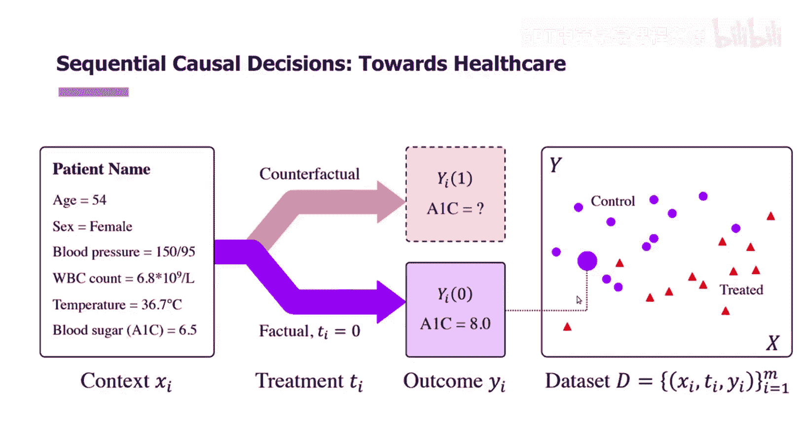
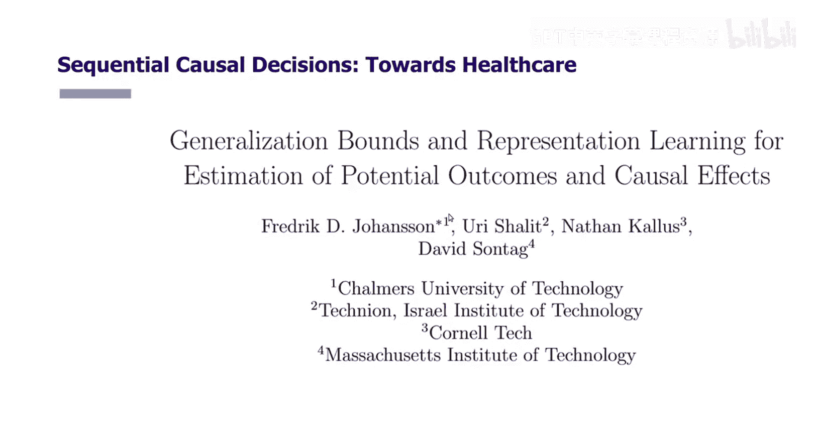
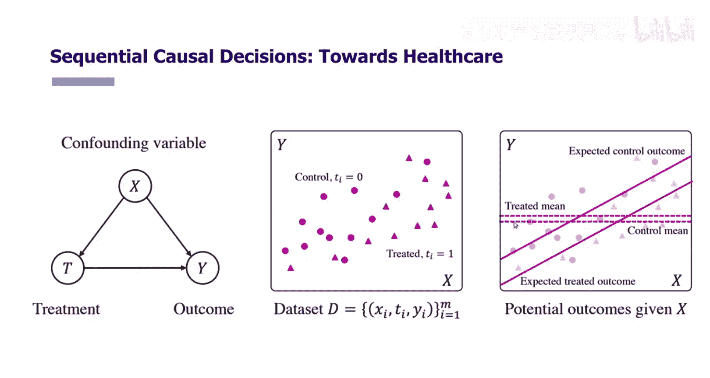
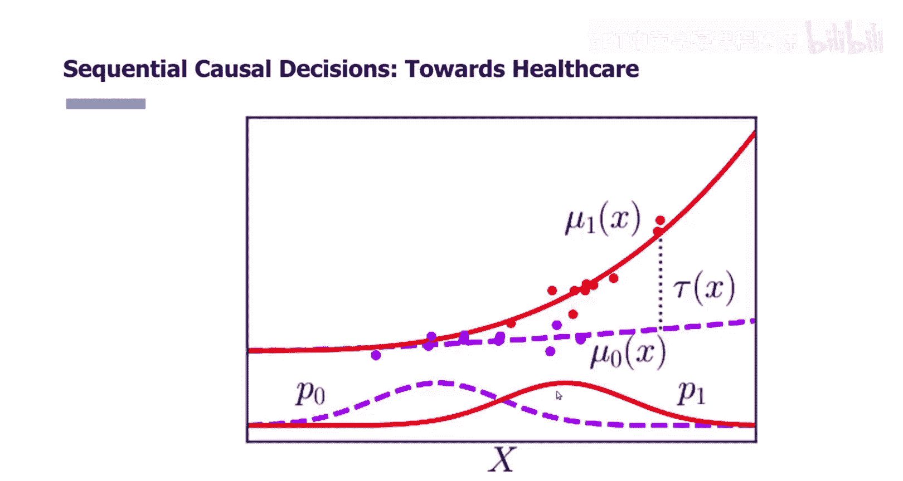
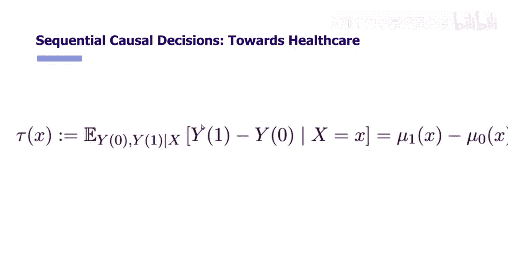
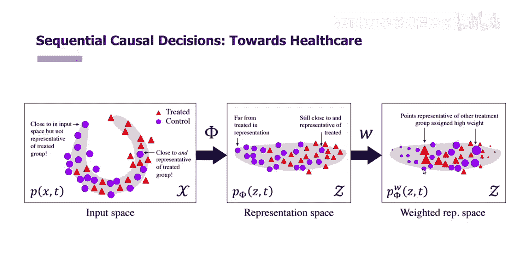
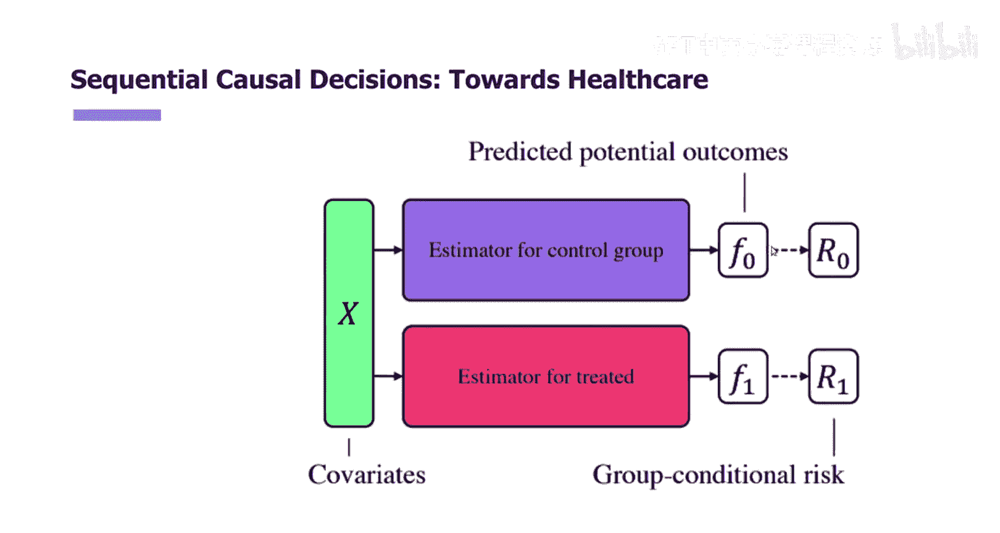
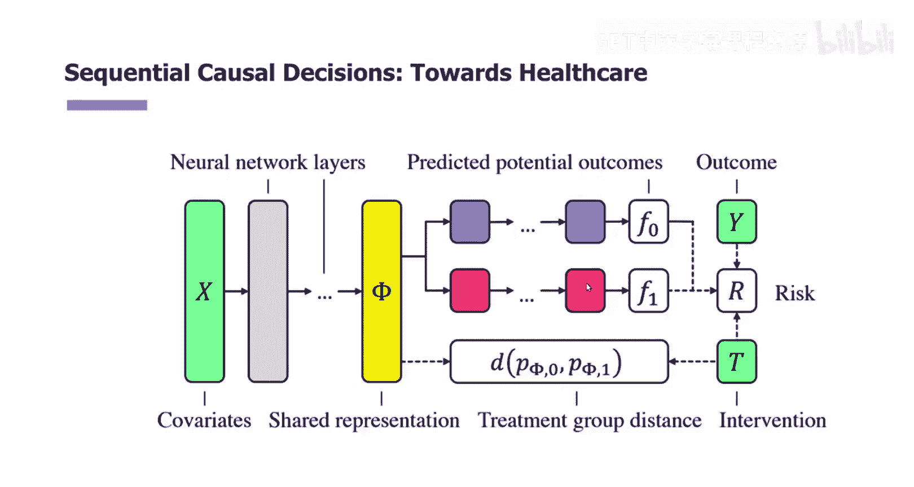

# 约翰霍普金斯大学《数据科学：时间中的决策｜Data Science Decisions in Time》中英字幕 p61 12_治疗与否，这是一个问题.zh_en -BV1NCuzzfEJa_p61-

We'll now start our last unit， which is on personalized healthcare。 This is really an ongoing area。

 There's a lot of work still needing to be done。 I think at the same time。

 it's so exciting and there's a lot of potential here for really interesting things coming up in the future。

 one way of thinking about this comes from a recent paper where I think it outlines very clearly some of the things that still need to be done in moving towards healthcare for things like sequential causal decisions。

 So imagine we've got a bunch of context variables。 these we're going to call X sub I。

 these can be time invariant or time dependent at least in general。

 but right now think of these as being things that describe the patient and that are relatively constant because that's the easiest set of covariates。

 Xab I to think about so be things like age， gender， blood pressure， white blood silk count。

 temperature， blood sugar A1 C is a common measure for blood sugar like an integrated measure that comes from a blood workup。

 So anyway， these six characteristics you can think of as a context for a particular patient。

And then you can assign a treatment， this is T sub I， you can either assign 0 or1，0，1 and print here。

 and then you get outcomes， these are these y subs。One of these treatments is taken。

 the other one is not。 So the big challenge， as you've seen already throughout this class so far。

 is describing the difference between given the context between a factual treatment and a counterfactual treatment。

 meaning something that actually occurred。 you've got a measurement for it and something that you didn't do but then principle could have been done and can you predict what that outcome would have been in that counterfactual case。

 So in the factual case again ts in this case is zero in the counterfactual case in this case it is one。

 So in one case we can actual measure for a1c again that's our blood sugar integrated firm our blood workoutup。

 So we get an outcome variable y sub here in one case measured in the case we wanted to infer it。

 at least assuming we can given an estimate for it from the data because that lets us make decisions based on what we believe would have been the best in other words by evaluating both the factual and the counterfactual we can decide what treatment option would have been a better one to give maybe the one that was assigned or the one that was not assigned。

 then eventually made。With the data set D。 this is our covariates X sub， our treatments t sub。

 our outcomes Y subi over all of our patients divided in this case into the different treatment options control in this color blue and treated in this color red So we've got our two different treatment options。

 These are these t sub in our counterfactual type space as well as our factual type space and the way of saying that is that given a set of x subs。

 we get a bunch of outcomes and y and we've got different treatments that could be given and what we'd like to do is plot not just the values for the factual but also the values for the counterfactual。

 That's the challenge is can we plot both in this kind of a data set like setting as pictured here we're only bringing in the ones where we've got actual data but we would like ideally to understand with the counterfactuals as well So this is the paper this will be in your meeting list for this week I think an interesting paper。

 probably more detailed than many of you need right now。

 but I think there's a lot of interesting things in。

And what worth a read the real challenge with're thinking about these counterfactuals are these things confounding variables。

 And again， something we've touched on already， but just in the context of their paper and the ideas that illustrate。

 I think they do a nice job of bringing it out。 So we've got again our treatments and our outcomes we've got our covariates。

 but these covariates could have an impact both on the treatment chosen and on the outcome。

 And so this is known as confounding。 in other words we're not just going from treatment into outcome。

 we also have a coupling variable through our confounding。

 And again may not be all of the confounding variables have this。

 but some fraction of them may And if that happens we need to figure out how we're going to decouple this so that we've got a clear causal connection between our treatments and our outcomes again。

 not so easy to do。 So we went back to our data set again， our covariates。

 our treatments and our outcomes over all patients represented here in terms of our covariates and thinking in terms of our outcomes。

 we effectively just have in this relatively straight。ward simple cartoon， just two options。

 either a control treatment0 or treated option t equal1。 so they go is like a coin flip0 and1。

 and then we color differently depending upon where they are。 So the potential outcomes。

 this idea of trying to understand the difference between this one treatment and the other where we're taking account again of our situation where we have counterfactuals is what we're trying to understand but because we can have confounding these lines don't match up the red and the blue lines don't match up。

 so expected control outcome expected treated outcome or treated mean and control mean。

 especially think of theseesis the main thing that we'd like to understand is the means these are offset and it's because of this confounding variable So the goal of this way of thinking is how do we unconfound this how do we find ways so that our means make sense that we can really think about the treatment effects coming out between。

differ groups so another way of thinking about this is in the context of our different covariates again。

 our descriptions of the patient， we've got two， say different types of things that could happen depending upon whether were assigning to zero or to one for the treatment options。

So these are different than outcomes， mu 1 and mu 0 on x。

 and then our treatment effect is this tau of x and so what we're thinking about is can we plot ideally how these curves look as the function of these covariates for the different treatment options。

 this will give us what's ultimately called。Conditional average treatment effect。

 And this treatment effect is dependent then on whether we put them in 0 or  one for the treatment。

This is what we would like to be able to compute and this again involves these counterfactuals。

 we'd like to imagine being able to put all patients and we can't do the actual experiment。

 we'd like to imagine putting all patients under both treatment options and then seeing the outcomes depending on those different treatment options so we could do that then we could cleanly and if we didn't have confounders then we could cleanly say okay this is the average treatment effect conditional on whether we assign them to zero or one。

 in words we like to understand which option is better for a particular patient given a particular value for their covariance。

 this goes to this idea of being able to predict the best treatment so again we're trying to make our sequential causal decisions we're trying to understand the best way to make decisions so this is outcome with treatment one minus outcome with treatment  zero conditioning on our covariance and so we can think about this again as the main thing that we're trying to understand as influencing which one to assign them to the expectation here's what we want and this is tau this is what it was just。

22 minute ago an average expectation or expectation is the average the expectation of y0 and y1 conditional on x。

 So this is mu1 over all x and minus mu0 over all x。

 and another way of saying this again is that given a particular value of x。

 this would be these little numbers here。 given a particular value of x。

 we'd like to be to predict for that particular value of x the best treatment to choose and we'd like to be to understand it in terms of outcomes and the difference between those outcomes conditioning on the value of x again。

 that we assign them to1 or to0。 So this is a。Important number， if we could calculate it。

 it would clearly tell us what to do in terms of our sequential causal decisions。

 but not at all easy to find within the data set。 So here's another way of thinking about this。

 and this goes into the machine learning type methods for how we do it。

 we've got an input space script X capital script X series。

 the space of all of our potential descriptors for the patients。 And again。

 this could be time independent as well as time dependent。

 And then we've got again just two different options control versus treated in this relatively simple representation So our。

Densty estimator P X of T here is some sort of maybe Hing shapeped environment clearly it doesn't have to be linear。

 it could be some odd shape in here， but basically our patients are distributed throughout all of this and we can map this through this function fee into a better representation space you can think of the system like under neural net would do some sort of algorithm would do we're mapping this into representation space Z and you can see that maybe we're a little cleaner in terms of understanding which one is better for treatment assignment either the control or the treated so piece of fee is again this mapping into this representation space and then we can do a weighting in this and this weight which again is another big challenge but important to getting the best assignment of the treatments by weighting this we can understand still better which treatment is best for which patients so given again a particular value of x or goal is to understand the best treatment for those patients。

So we can think of this in maybe almost two types of neural nets。

 one would be we've got our covaris coming in， we've assigned them into different treatment options。

 either control group0 or treatment1 so0 or1 then we've got our potential outcomes and then we've got our estimate for the risk coming from the assignment into that and another way of saying this is that we really want is something like this where we've got our neural network our covaris are coming in。

 we've got our mapping through fee now we're trying to predict our potential outcomes so F0 and F1 we've assigned them we've come out with this through risk we can now understand something about this connection between the two different treatment groups in our new representation space and then we've got a better way of understanding which way they should be assigned you can think of this as being like a loop theyre learning from previous patients to help the future patients and it becomes an aspect of personalized medicine because again one is trying to estimate this treatment offset between。

The zero and the one in our representation setting。

 this fee setting in this mapped setting where we imagine we can get a better understanding of what's going on。

 So this is kind of your introduction to thinking about healthcare and how we want to stage it to make better causal decisions again。

 the idea is that we want to understand the difference it does have to be zero or want it could be multiple treatments maybe be treatments through time。

 but we want to understand what's the best way to assign particular treatments to particular patients again。

 they present with a particular set of covariates or covariates through time。

 how do we assign them to treatments and how do we compute what would have been the better the counterfactual。

 the better treatment or。That we sign them correctly again。

 obviously we're hoping we assign them correctly to the treatments so the question is can we improve that。

 that's really again where we're headed so okay， I hope this helped you。

