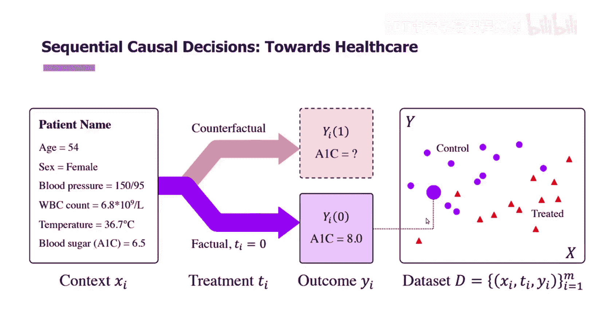
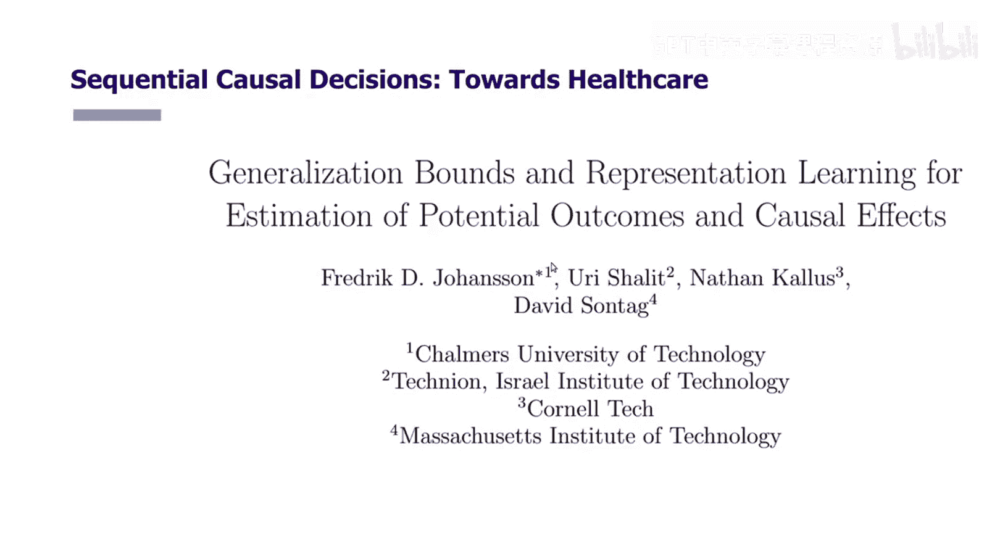
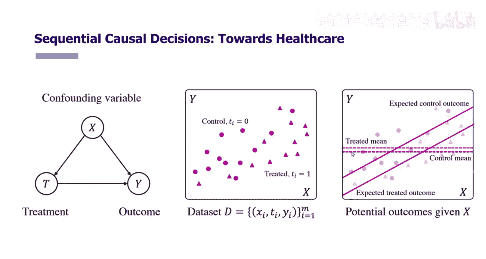
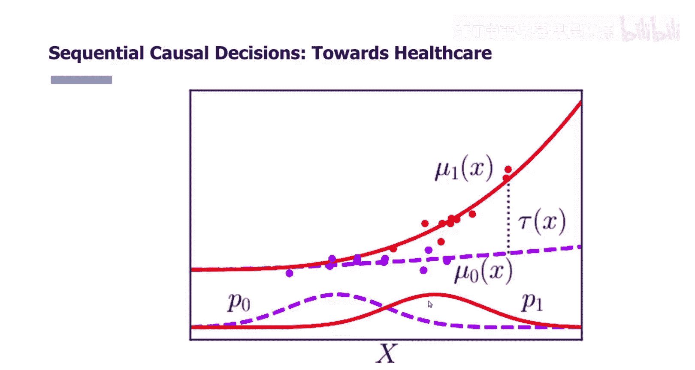
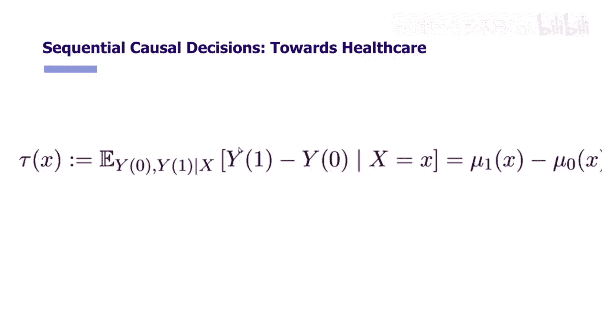
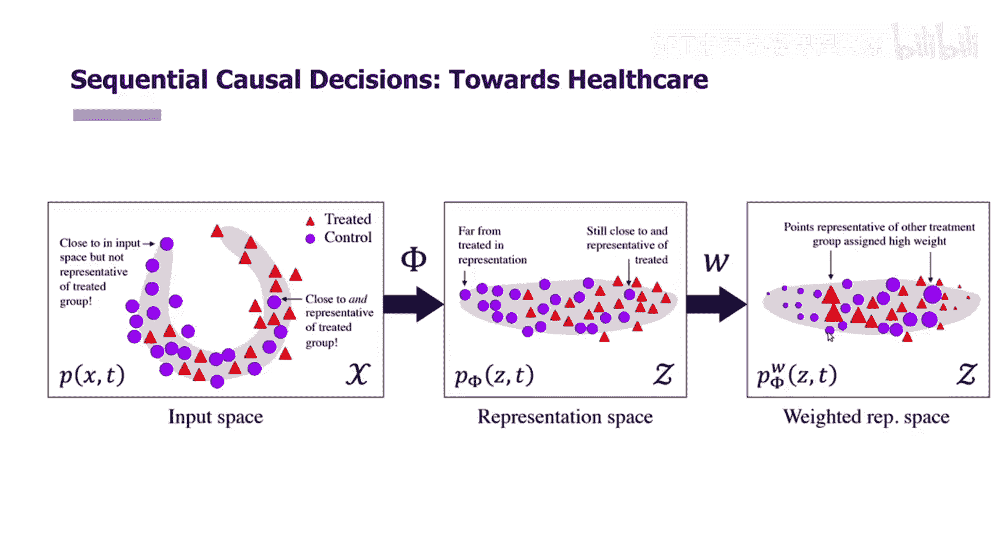
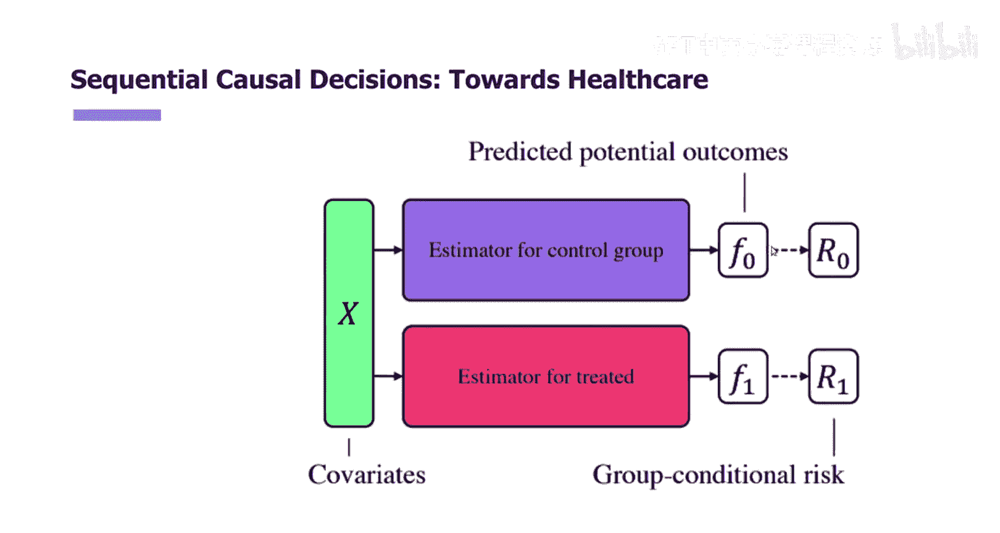
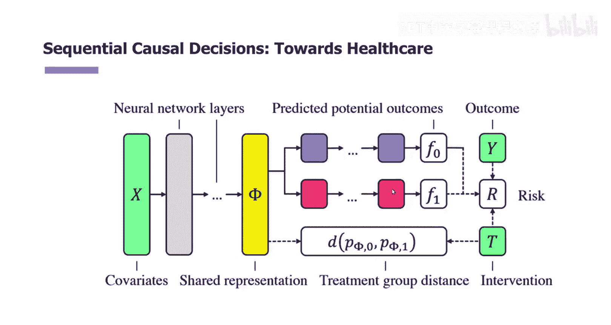

# 数据科学：时间中的决策｜12：治疗与否，这是一个问题 💉

在本节课中，我们将开始最后一个单元的学习，主题是**个性化医疗**。这是一个持续发展的领域，虽然仍有许多工作有待完成，但它充满潜力，未来将涌现许多有趣的应用。我们将通过一篇近期论文的视角来探讨这一主题，该论文清晰地阐述了在迈向序列因果决策医疗过程中仍需完成的一些工作。

## 背景与核心挑战

想象我们有一组**背景变量**，记为 **Xᵢ**。这些变量可以是时间无关的，也可以是时间相关的。目前，我们可以将它们视为描述患者且相对恒定的特征，例如：
*   年龄
*   性别
*   血压
*   白细胞计数
*   体温
*   血糖（如糖化血红蛋白A1C）

然后，我们可以分配一个**治疗**，记为 **Tᵢ**，其值为0或1。之后，我们会观察到**结果**，记为 **Yᵢ**。其中一个治疗被执行（事实），另一个则没有（反事实）。

本课程迄今反复出现的核心挑战在于：**描述在给定背景下，事实治疗与反事实治疗之间的差异**。事实治疗是实际发生并可以测量的，而反事实治疗是原则上可以执行但未执行的，我们需要预测其在反事实情况下的结果。

在事实情况下，Tᵢ=0；在反事实情况下，Tᵢ=1。我们能在一种情况下实际测量结果（如A1C值），而在另一种情况下则需要推断它。通过从数据中估计反事实结果，我们可以评估事实和反事实两种选择，从而决定哪种治疗方案可能更好。

## 数据集与混杂变量

我们的数据集 **D** 包含所有患者的协变量 **Xᵢ**、治疗分配 **Tᵢ** 和结果 **Yᵢ**。患者被分为不同的治疗组（例如，对照组用蓝色表示，治疗组用红色表示）。我们的目标不仅是绘制事实情况下的结果值，还包括反事实情况下的结果值。然而，挑战在于我们只能获得实际执行治疗的数据。

思考这些反事实时，真正的挑战在于**混杂变量**。我们的协变量可能同时影响治疗的选择和最终的结果，这种现象被称为**混杂**。换句话说，治疗和结果之间并非直接的因果关系，而是通过混杂变量产生了耦合。并非所有协变量都是混杂变量，但其中一部分可能是。如果存在混杂，我们就需要找到方法将其解耦，以明确治疗与结果之间的因果联系。

## 条件平均处理效应

另一种思考方式是基于患者的协变量背景。根据治疗分配是0还是1，可能会产生两种不同的潜在结果，记为 **μ₁(x)** 和 **μ₀(x)**。那么，**处理效应** 就是 **τ(x) = μ₁(x) - μ₀(x)**。

我们理想的目标是能够绘制出这些结果曲线如何作为协变量的函数，随不同治疗方案变化。这将给出所谓的**条件平均处理效应**。这个处理效应取决于我们将患者分配到治疗组（1）还是对照组（0）。我们希望能够计算这个效应，而这同样涉及反事实推理：我们希望能想象将所有患者置于两种治疗方案下，并观察不同方案的结果。

如果我们没有混杂变量，就可以清晰地说明基于分配条件（0或1）的平均处理效应。我们的目标是：**给定患者的特定协变量值，理解哪种治疗方案对这位特定患者更好**。这引向了预测最佳治疗方案的思路。

用公式表示，我们试图理解的核心是：
**τ(x) = E[Y₁ - Y₀ | X = x]**
其中，E[Y₁|X=x] = μ₁(x)， E[Y₀|X=x] = μ₀(x)。给定一个特定的x值，我们希望能预测对该值的最佳治疗选择，并通过结果差异来理解它。

## 机器学习方法

以下是利用机器学习方法实现该目标的一种思路。

我们有一个输入空间 **𝒳**，包含所有可能的患者描述符。在相对简单的表示中，我们有两种选项：对照（0）与治疗（1）。患者分布在整个空间中。

我们可以通过一个函数 **Φ** 将这个空间映射到一个更好的**表示空间 Z** 中（可以想象神经网络等算法会做类似的事情）。在这个新的表示空间中，我们可能能更清晰地区分哪些患者更适合对照治疗，哪些更适合积极治疗。**Φ** 就是实现这个映射的函数。

然后，我们可以在这个空间中进行**加权**。加权是另一个重大挑战，但对于实现最佳治疗分配至关重要。通过对表示进行加权，我们可以更好地理解哪种治疗对哪些患者最有利。因此，给定一个特定的x值，我们的目标是理解对这些患者的最佳治疗。

我们可以将其想象为近乎两种类型的神经网络：
1.  一种网络接收协变量输入，将其分配到不同的治疗选项（对照组0或治疗组1），然后得到潜在结果，并基于此分配估算风险。
2.  更理想的结构是：协变量输入，通过 **Φ** 映射，然后尝试预测潜在结果 **f₀** 和 **f₁**。通过风险计算，我们可以在新的表示空间中更好地理解两个治疗组之间的联系，从而更清楚地知道应该如何分配治疗。

这就像一个循环：系统从既往患者中学习，以帮助未来的患者。这正体现了**个性化医疗**的一个方面，因为我们试图在映射后的表示空间（Φ空间）中，估算治疗组（1）和对照组（0）之间的处理效应偏移，从而获得对情况更好的理解。

## 总结

本节课我们一起学习了如何将个性化医疗的思考框架应用于改善因果决策。核心思想是，我们需要理解不同治疗（可以是0或1，也可以是随时间进行的多种治疗）之间的差异。目标是找到将特定治疗分配给特定患者的最佳方式。患者带着一组特定的协变量（或随时间变化的协变量）出现，我们如何为他们分配治疗？又如何计算那个未被选择的、反事实的“更好”治疗方案是什么？显然，我们希望一开始就能正确分配治疗，而问题在于：**我们能否改进这个过程？** 这正是我们前进的方向。希望本课对您有所帮助。