# 约翰霍普金斯大学《数据科学：时间中的决策｜Data Science Decisions in Time》中英字幕 p62 13_事件时序的因果关系解析.zh_en -BV1NCuzzfEJa_p62-

Well I'll talk about a different model for healthcare very much related to where we started。

 but being a little bit more accurate， at the same time。

 I need to emphasize that what we're going to be covering right now is not yet something applied to real data because their model depends on being able to get both the counterfactual and the factual whereas as I indicated in the introduction for this week the most obvious case as a situation where you've got one set of data but don't have the counterfactuals you've got a guess So the idea here is from these two slides are these two figures effectively normally you've got something where you've got your time series sampled and regular intervals so your outcome variable here we've got our observed outcomes coming along at some point in time we're trying to look ahead we've got different treatments that might be given here's the treatment type 1 is treatment type 2 we've got counterfactual outcomes which are the ones that didn't happen and this would be maybe not on。

Common situation where you have regular measurements in time。

 but most healthcare data doesn't happen regular time， it's ir regularly sampled。

 so these observed outcomes here are not equally spaced whereas they were here on the left they're not here on the right and likewise the treatment options and this is different than the first case we settled on as we open this week the treatment options can occur at different points in time they're not just assigned at one point in time they can come at different points in time you can even imagine changing treatment options。

 so for example， in this future candidate pathway here you've got one treatment option。

And then another treatment option So these dashed lines are what I know you would like to to predict in the future So thinking about this as a continuous process embedded in a temporal space is the real point of this paper that we're going to be talking about in our second entry point for this week this is a paper from a group in UK Cambridge and Aent Turn Institute there've been doing some really important work to try and think about healthcare using neural network approaches we' not go through deeply the neuralcontl differential equations I think it's a fascinating approach。

 but I'm afraid I will lose some of you listening to the class if I go too far into that direction and instead what I'm going to really focus on is this idea of a continuous time model for understanding and trying to interpret counterfactual outcomes and there doing be that in the context of something like this very similar to what we were before but now with the thought that we've got a hidden dimension we'll call that Z and this is the transform dimension we talked about this transform。

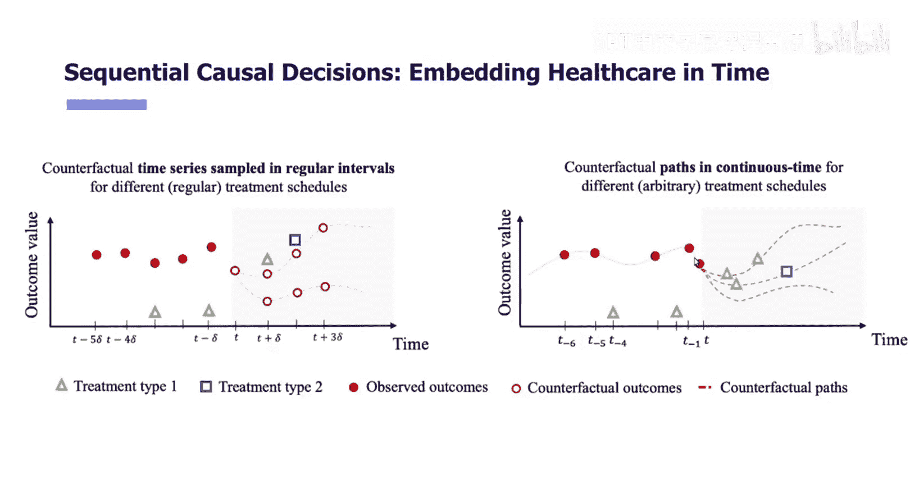

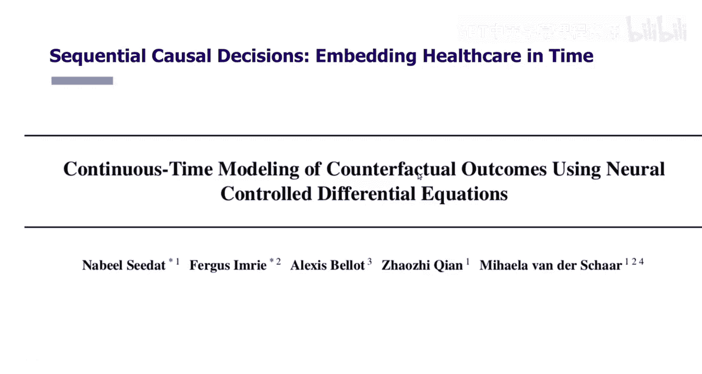

In our introduction to this week on our observed covariate so think of these again as our x values and note how they're now spread out in time and they're not regular in time so think of this as being what we were talking about last week where we had a bunch of covariates as I emphasized I'm sorry I said last week got on the last lecture think about these as。

Last time they were points at the beginning of some sort of temporal process now we can think about them really as covariates xvalue again from a distribution that is being sampled potentially irregularly。

 but that is spread out in time and the key insight or key thought here really is maybe we think about this as a hidden continuous dimension that's inferred from the observed covariates we're going to call that Z that's the same sort of transform that we talked about in our first entry to this week and these are all seen as embedded within a continuous time framework then we come in with our different treatments and these are evaluated at different points in time。

 so really are now doing sequential causal decisions at least in principle we're putting them in at different points in time then as we hit the present we're looking ahead into the future we would like ideally again to think about how our outcomes could have been improved by thinking about the best future treatments and again thinking about these as continuous pathways in time。

So this is obviously a real challenge and an important one to take on and really。

 really valid for healthcare it's exactly the question that we'd want to understand in terms of healthcare so what the group involved here did was to take a model for tumor growth。

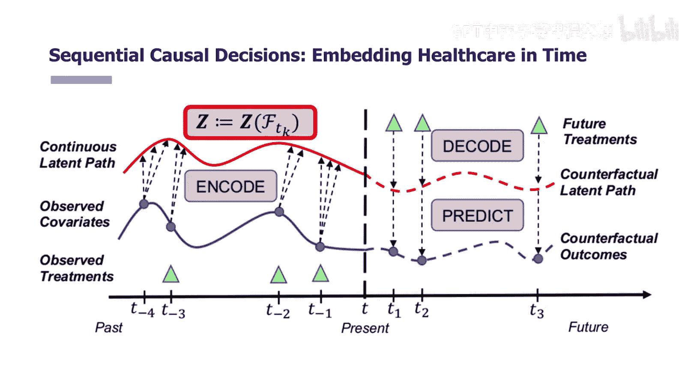

The nice thing about doing a model， the positive side of it is that they can think of all possible outcomes so as they draw data in and imagine that these are different types of tumors that are being grown under different conditions that to be different patient conditions as they model that they can treat with different options and they can therefore get all possible outcomes they can explore within the context of a model all of the things that are hidden in the real system。

 so in a real electronic health record system， we've got these things and they only observed once and you only sign one treatment。

 even if you do it into time with clinical input， you only get one outcome but within a model。

 the huge advantage is that you can model both what it would only be a counterfactual meaning something you could not observe and the actual factual outcome Now obviously the disadvantages it a model。

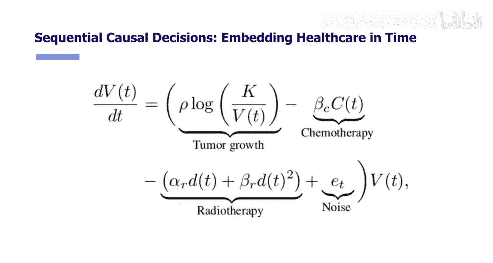

You can put too much faith in it。 It's not real patients。 We don't have real outcomes。

 We only have the simulated tumor growth。 So you kind of as Ivent as it， you win some。

 you lose some you gain some from this， you lose some from this' I think a net advantage in terms of understanding the machine learning and having testable algorithms know to evaluate how well you did it's maybe not so good if you're thinking in terms of real patience on the other it's quite nice again to see a real tumor growth model。

 So we've got something that would grow now we've got a log here。 we've got values。

 we've got to put in for K and row be sub C alpha sub R beta sub R got a noise term is if those of you that have seen a lot of differential equation type things。

 it's almost like we've got something this set of four terms in front of V of T So it's almost like E VDT is some constant times V of T。

 So that's something that could be easily thought about in terms of a simple model of growth but the growth has then modulated by。

underlyingline dynamics for the tumor and then treatment options， chemotherapy or radiotherapy。

 And so these chemotherapy and radiotherapy options could be applied at different points in time。

 and we could sample on that。 And again， that's the power of having a model is that we could sample on all possible treatment options and see the impact of these different treatments on different types of tumor growths where these are applied with different time constants。

 So this model has been fit build data， obviously when I say it's a model I don't mean to imply it's completely made up it's a model that's fit against real data。

 And so therefore to the extent that it's a correct model for what really happens in a patient with cancer and with tumor growth。

 it's potentially very insightful but again， it's a model。 So has to be a little careful。

 Here's an outcome from this model。 So tumor diameters sample time we're looking at different stages。

 you can see the tumor diameter has gone down due to treatment。

 This is one where it's effectively gone down within a reasonable kind of curve。

 the sort of curve that you might。

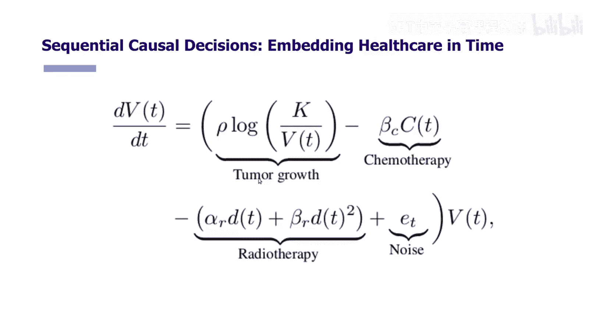

But almost as if was a constant and these are the stages。

 these are common stages based on the size of the tumor that's been observed that might be observed say radiologically and then depending on the size you assess what stage the person is at so for example。

 this six to 10 here you is in this realm here because it's above five so tumor greater than5 we're in stage3 and stage4 so this idea then is that we're going to define Z so again Z is related to this latent dimension and you can think of this as a transform on the observed covariates and this kind of a transform depends on initial conditions so you can see these are at the starting points so we've got our covariates we've got the actions that we take and we've got our outcomes again you can think of this as like the treatment things that we were talking about the intro to this week So we' got a set again。

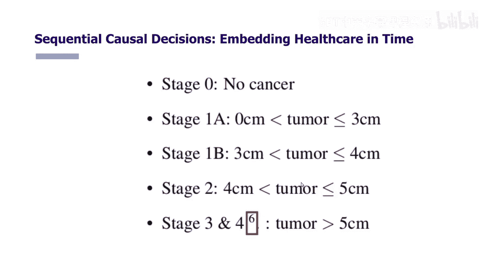

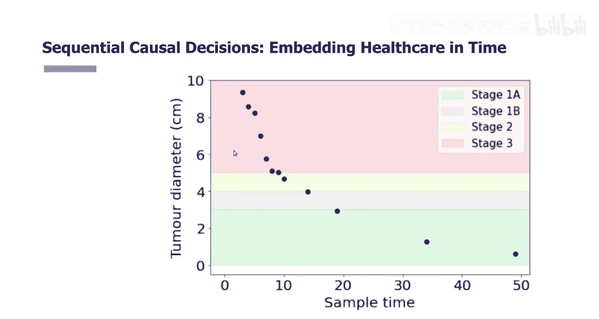

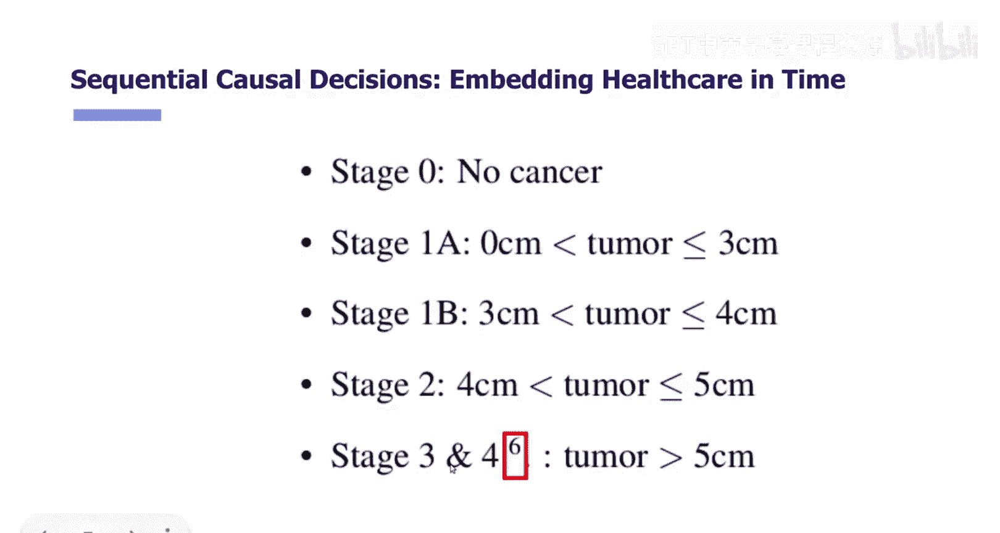

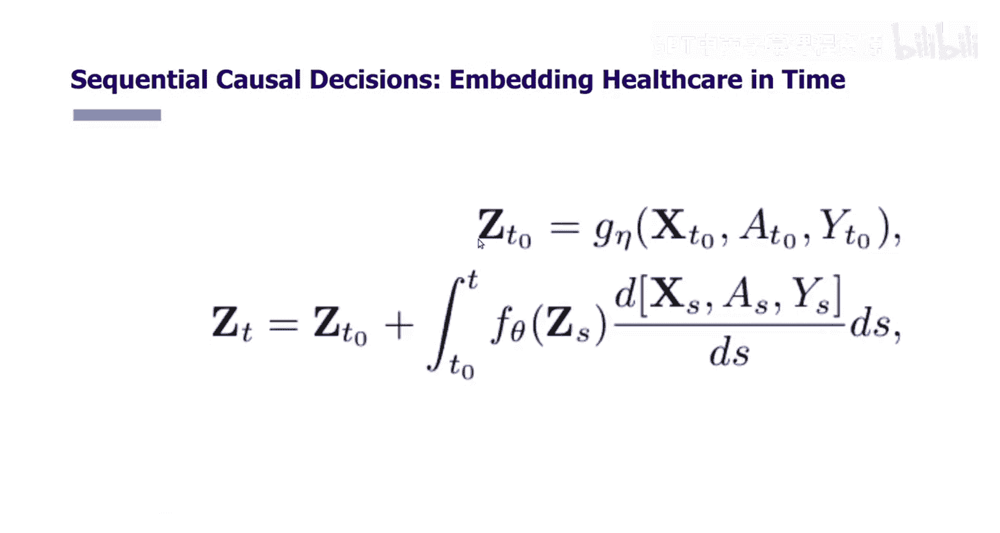

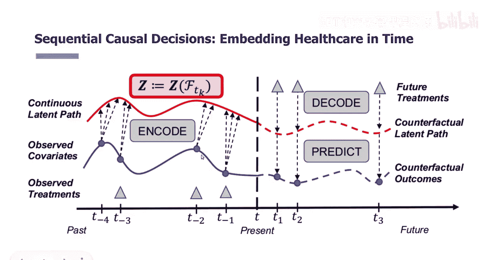

patient descriptors， options， actions that we have taken and outcomes， those at the start point。

 and then we model our latent process as essentially a differential equation so we've got an integral from t0 to t are f sub theta we can think of this again as our parameters in theta for the transform and then you can think of this as effectively then drivingriv the temporal dynamics of z in other words this set of covariates and actions and outcomes you notice that we've got a DSs divided by ds as effectively this differential is driving the outcomes on z of t so this is the form of the hidden variable and then what they did in terms of their sampling and again it's a model was to say they had a  hoax process which is just basically a modified Poisson process so you've got a base rate and then an exponential you can think of this as a self-reinforcing type term know that's falling off on t minus t sub M and what this process does and it's a fairly welltu process。

It's a fast process as well in its own way， but it's describing then the counts is being clustered as opposed to being in a poisson like process。

 we've got this extra term so we can get kind of a self- reinforcecement type mechanism so these would be to model when either interventions were done or when cos were observed and you can think of this as that a model for healthcare and that's eventually what they've got so they've got now a model for tumor growth and a model for the hos process and so we can think about observations and we can explore the whole counterfactual so it gives a way to evaluate in the context of the model whether one could predict future treatments better and understand which options best and where it's finding an optimal treatment plan for individual patients so if you had something like this where it's kind of almost oscillating it' starting to go back up at certain times you can imagine different treatments coming in because it's not a simple exponential fall off so you could imagine different treatment options coming in to try and。

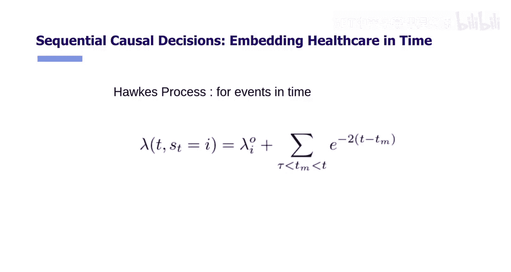

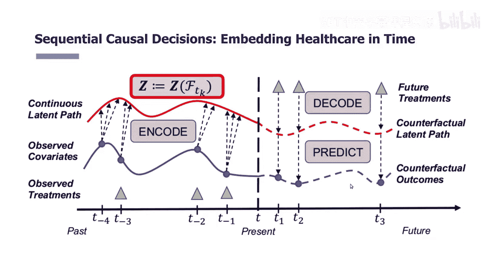

within the context of a model and that's the sort of thing that they're exploring in the paper again in the context of the neural CDEs which are again quite fascinating but a little bit outside of our core focus at this point in the class so that's why I'm not going too deeply intonder them at this point but again the context here is do we understand how to control in the context of making optimal treatment choices。

To effectively reduce this tumor diameter to help the patient to survive longer。

 can we make a sequential set of causal decisions from our embedded temporal dynamics in order to improve patient care and the argument they make in this particular paper is that yes you can and of course it's tested again in the model setting but that there is reason to believe that something like this is possible。

I think again， exactly the right question and encouraging step towards being able to set up something like this so okay。

 I hope you enjoyed this and helped you。

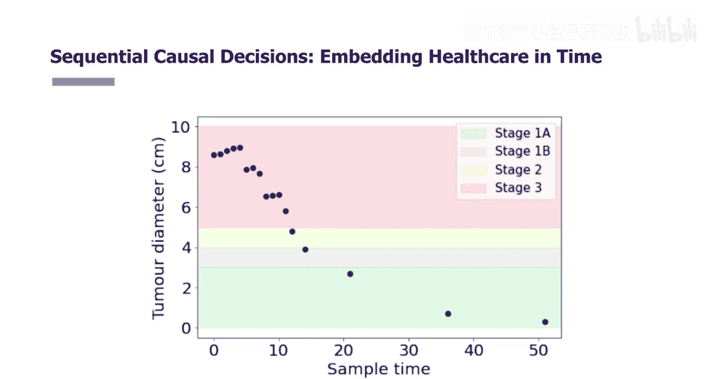