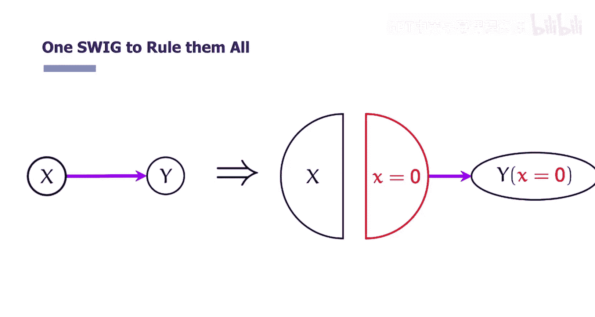
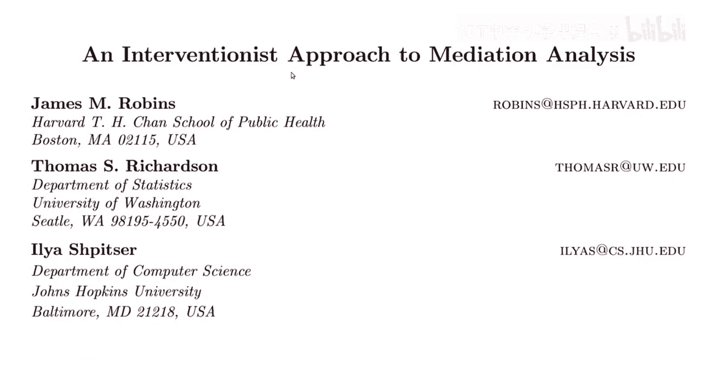
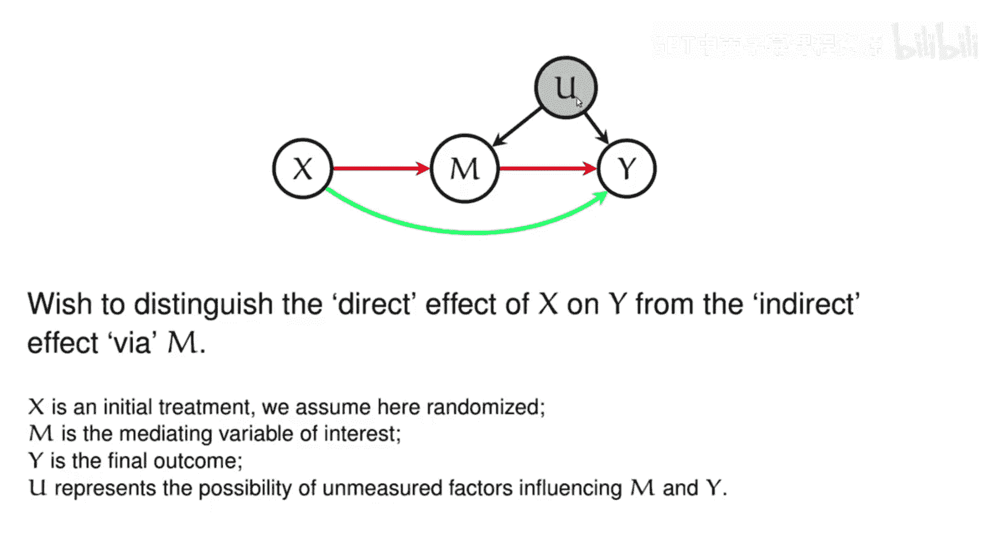
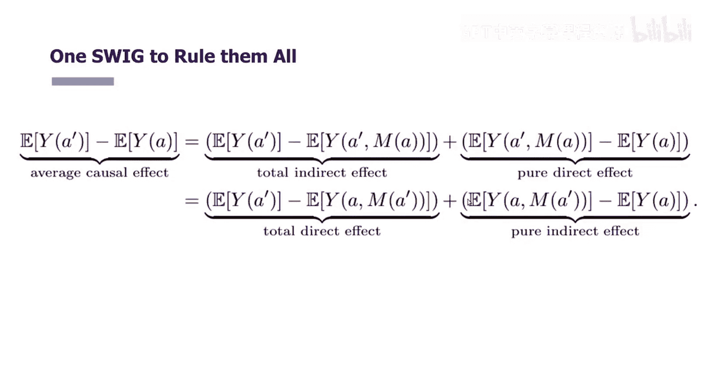
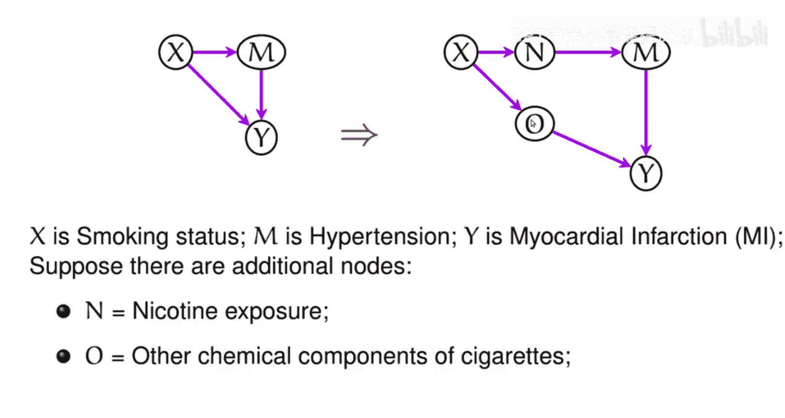
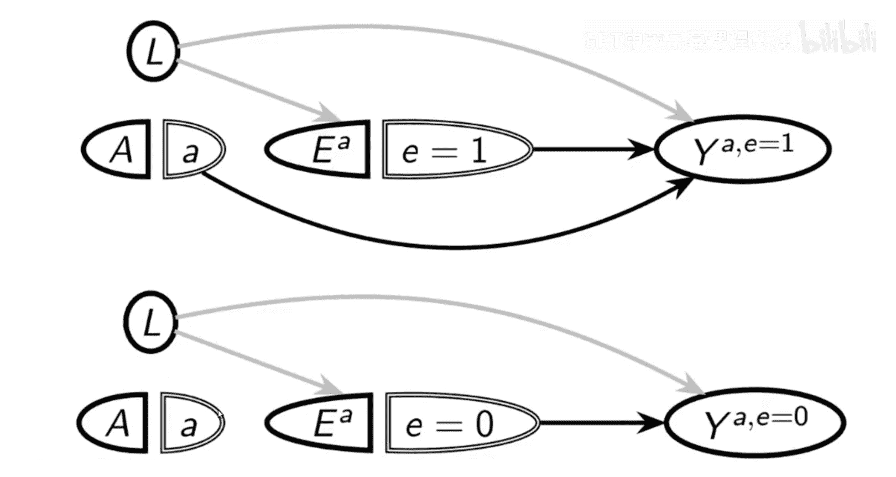
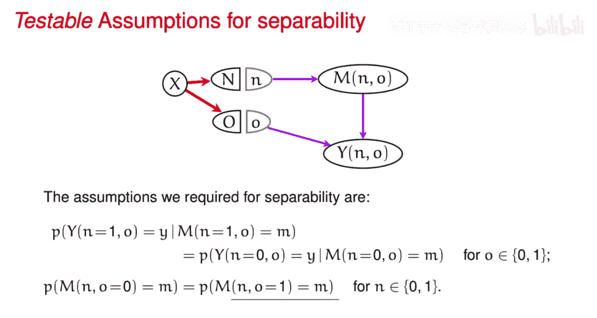
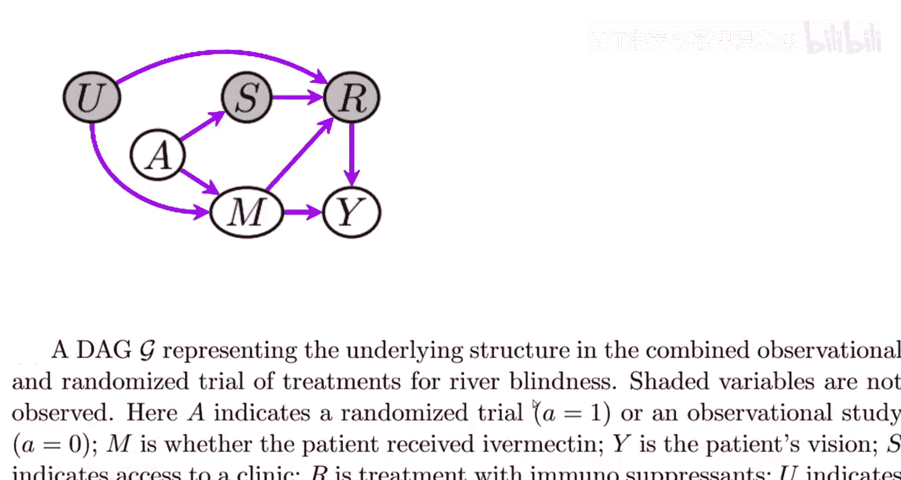
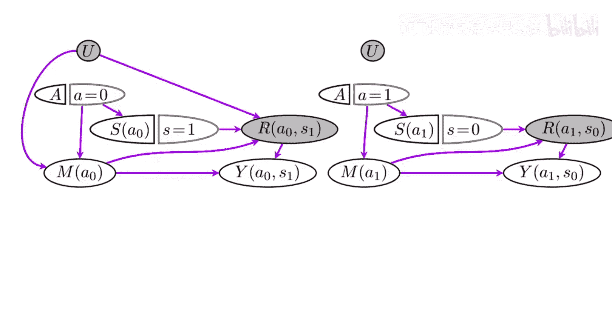
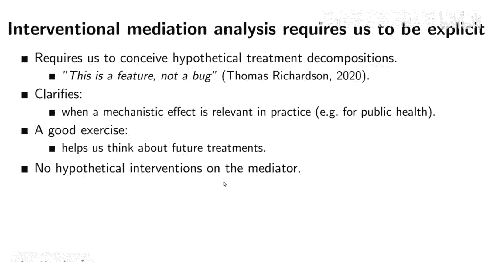

# 约翰霍普金斯大学《数据科学：时间中的决策｜Data Science Decisions in Time》中英字幕 p63 14_一饮而尽统御全局.zh_en -BV1NCuzzfEJa_p63-

Well now come to really the closing point for our four course specialization and I'd like to cover something I think is really quite interesting。

 this is this sg formulation which really is an attempt to bring together the efforts in directed ecyclic graphs and the idea of structure equation type models ands I think a formalism that many of people will find a little bit maybe unusual at the start。

 but it has the potential to become I think the dominant way of thinking for a lot of this causal analysis so that's why I raised it kind of seemingly maybe once way rule them all so in many ways what we're asking in causal analysis is can we move from something where X implies y and especially where we've got maybe compounders into analysis of that and in a graphical setting it's pretty easy I think you can almost immediately see what's going on we draw our capital variables。

Y and if we've got some sort of hidden confounder H here having an impact on both x and Y。

 we likewise draw it， but in the structural equation type modeling we really think about interventions。

 we think about say our control and our clinical trials， say our intervention。

It's really hard to see when you've got something like these two figures and compare it to the structure equation models where we' really defined particular values。

 and so the formalism that is the swing is an attempt to make a new type of graphical construct where these variables are clearly defined and it looks a little bit odd its something that will hopefully grow for some of you if you pursue this direction。

 but the idea again is that by drawing a new type of graph with things labeled it lets you very clearly describe things like mediators which we're coming up to and interventions in general。

 so this really grows from work from these three authors the beginning points with Robinson Richardson it let upstairs has worked with today Pearl and has direct connect therefore into the graphical models and he teamed up with these two and this is the one with the interventionist approach for mediation analysis。

So the idea then is， again。You've got a pathway that you can get struck。

 you've got a series of potentials impacts coming from your covariates X through some sort of mediators and your outcomes and the one of the questions is you know how strong is this mediator is X going directly on Y whereas M mediaing a mediator So where they want to distinguish in other words。

 this direct effect of X on Y for this indirect via M and X is the initial treatment and ideally we're thinking something like a randomized clinical trial。

 So it's randomized M is our mediating variable Y is our final outcome and these are effectively then unmeasured factors that are influencing M and Y's see L to both。

So the question is can we understand them and if we were writing it in terms of some sort of structural equation type framework。

 we would think about an average causal effect between these outcomes between a prime and a and these expectations we're thinking of these as distributions that are defined we have to discriminate between a total indirect effect。

 a puredirect effect， a total direct effect and a pure indirect effect in the words we're thinking all these combinations with these mediators under different values of a prime and a and thinking about this in terms of these purely equational type approaches may in some ways be straightforward for many people but it's actually fairly complicated and I think this is where describing it in terms of these kinds of models。

 graphical type models could really be a nice bridge between these two ways of viewing it。

 so now I'm going to try and describe a few studies that are trying to make this a little bit clear。

 this is like smoking status so X here。

Smoking centers Now we could have nicotine exposure or other chemical components in the cigarettes and the question is。

 do we have mediation through nicotine or do we have other chemical components directly impacting an outcome in this case amcardial infarction and the study then you can imagine different kinds of smoking habits where you're trying to break these things down and the question where you could you intervene and understand clearly what's going on that's one example here's another one where we're thinking in terms of a vaccine clinical trial and so we've got an L describing the characteristics of the patients we've got our actions and you can see that again it's this weekig so we've broken it down and we can create these different graphs and not something fun。

 I think about this is that in this case because the intervention is not having an impact presumably on this output we don't have anarrow so this is vaccine present vaccine not administered and we've got effectively a decoups so are equation。

And the effect are effectively going to lead towards something thats a testable assumption for sability so again if we're thinking back to the nicotine and other impacts we can write equations then for sability we can make this as a very testable root and I think that's one of the powers of this approach this big approach to try to think about how to combine graphicalal models with structural equation models so here's another one this is now river blindness this is from the main paper we've got our DG。

And've got our outcomes a little bit involved，' got a randomized trial for A and why here is the patient's vision as is access to a clinic or is treatment with this immunosuppressants and you is the inclination to go in for medical care when I really want to apply again or help you see it really mean is that you can break this down into related graphs depending upon which values are chosen and then again it leads statistical testal assumptions about the kinds of interventions so again it's complicated because it is complicated I mean the real world has a lot of these things that can get in the way of making clean observations and so by being able to write it out this way you really are forced to think about it and this is a nice summary of this you know it can really require you to think in terms of hypotheical treatment de compositionposition it can really clarify when a mechanistic practice relevant in practice so it's just a good exercise to think about treatments and to think about all the mediators。

And their potential impacts on what's going on so with that I want to thank all of you for being a part of this for course specialization and I hope you've enjoyed all the lectures it's been fun to put them all together and I hope you've learned a lot and I will continue to add to the course so depending upon when you're hearing it there may be different things that have been added and I hope everyone will stay in touch Thank you。

