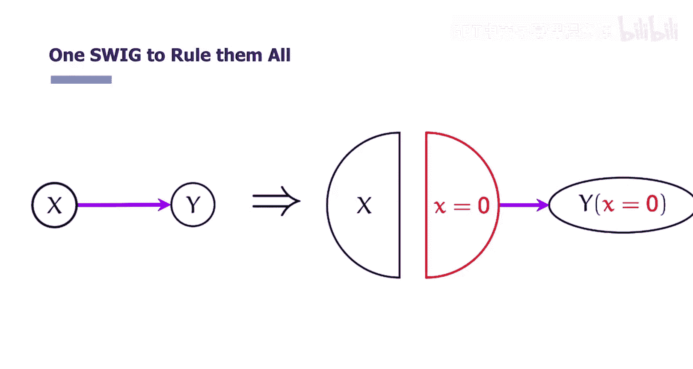
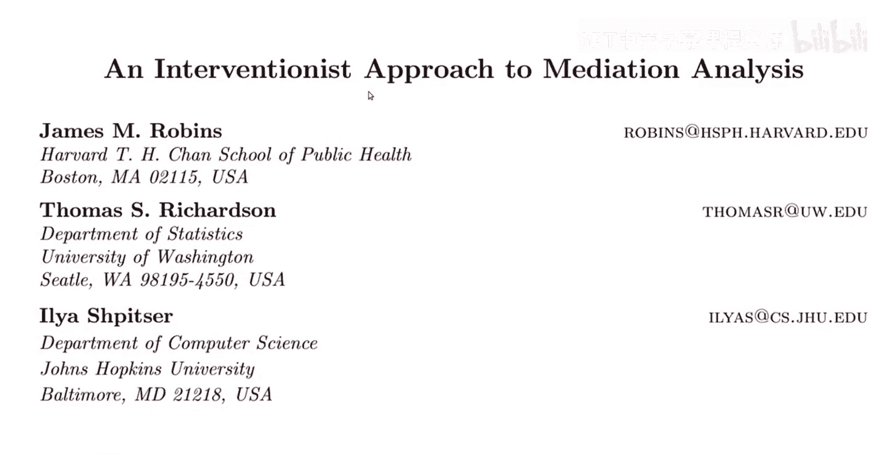
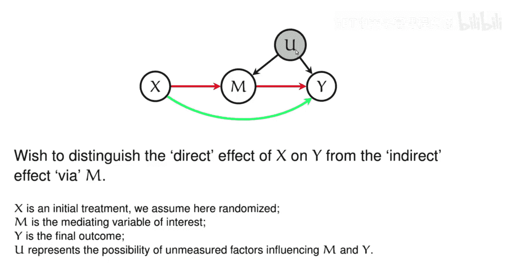
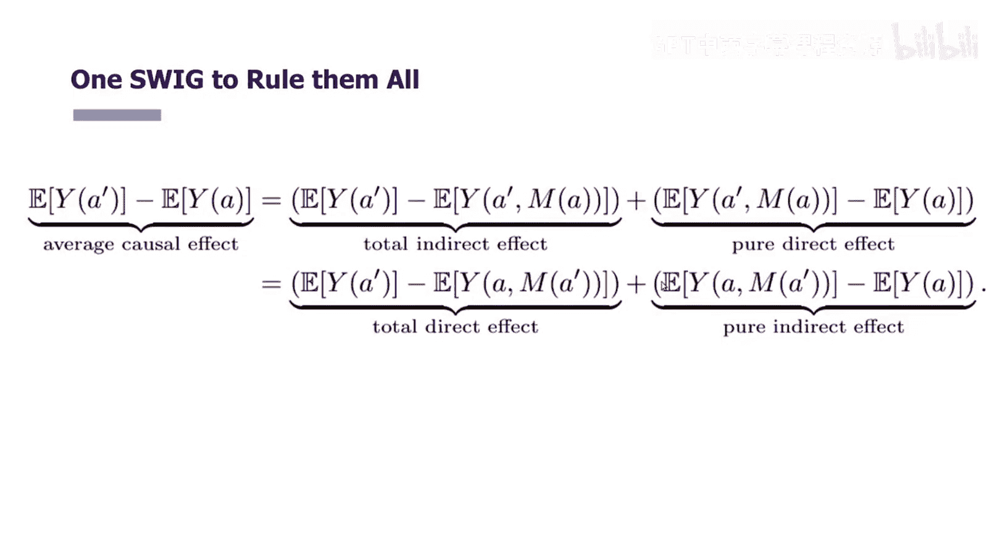
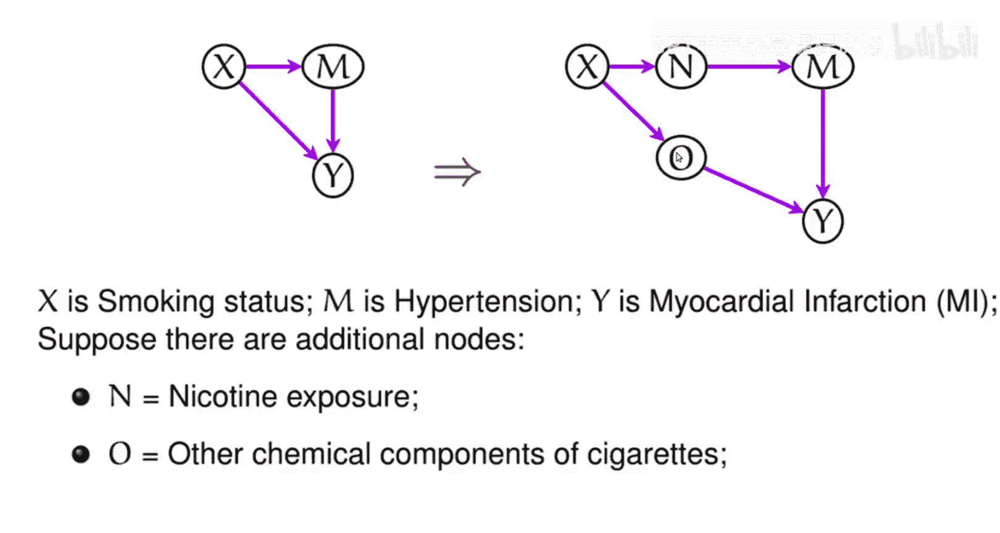
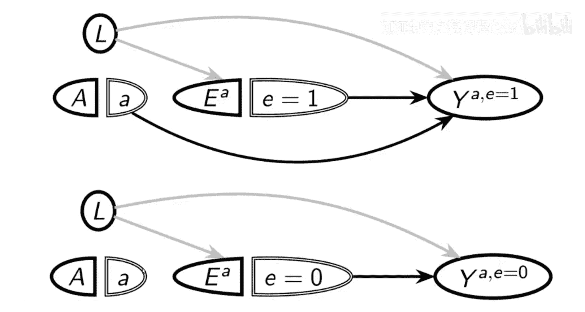
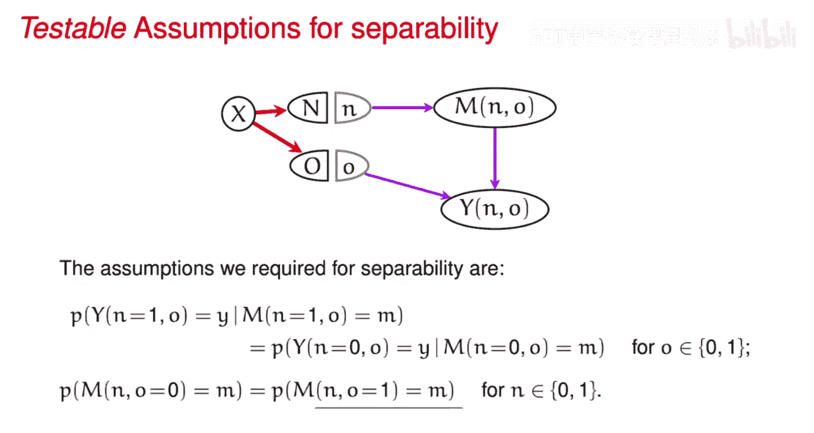
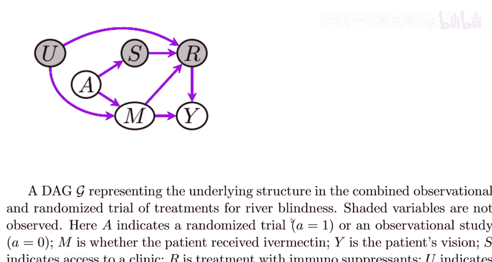
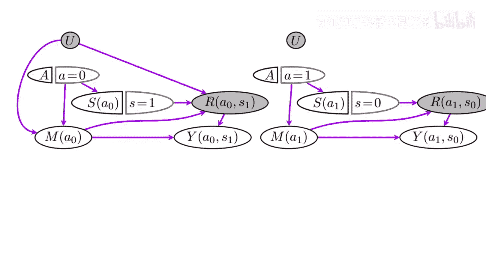
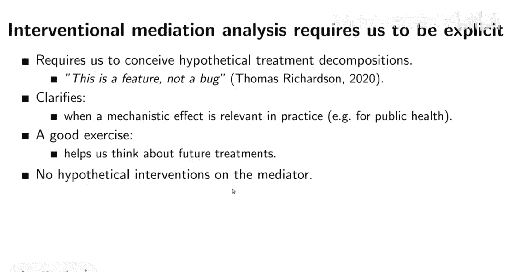

# 数据科学：时间中的决策｜课程四：章节十四：一饮而尽统御全局 🧠

在本节课中，我们将学习一种被称为“单世界干预图”的因果分析形式化框架。这个框架旨在整合有向无环图和结构方程模型的优势，为理解因果关系，特别是涉及中介变量和干预的场景，提供一种清晰、统一的图形化方法。

---

上一节我们讨论了因果分析中的基本图形模型。本节中，我们来看看如何将干预的思想更明确地整合到图形表示中。

在因果分析中，我们常常希望探究变量X是否导致变量Y，尤其是在存在混杂因素的情况下。在图形化设置中，这相对直观：我们绘制变量X和Y，并用箭头表示影响。如果存在一个隐藏的混杂因素H同时影响X和Y，我们也可以将其绘制出来。

然而，在结构方程模型中，我们更侧重于思考“干预”——例如临床试验中的对照组和干预组。当我们将传统的因果图与需要明确定义特定干预值的结构方程模型进行比较时，两者之间的对应关系并不总是清晰。

因此，单世界干预图这种形式化框架，试图创造一种新型的图形结构，在其中变量和干预能被清晰地定义。它的图形看起来可能有些独特，但对于希望深入此领域的学习者来说，它将成为一个强大的工具。其核心思想是，通过绘制带有特定标签的新型图表，可以清晰地描述中介效应和一般的干预效应。

这一框架主要基于三位研究者的工作：Robinson、Richardson和Pearl。它结合了图形模型的理论和基于干预的中介分析方法。

---

以下是单世界干预图试图解决的核心问题示意图。我们通常有一条从协变量X出发，通过一些中介变量M，最终影响结果Y的路径。关键问题之一在于区分X对Y的直接影响和通过M产生的间接影响。

理想情况下，X（如初始治疗）是随机分配的，M是中介变量，Y是最终结果。图中还包含了影响M和Y的未测量因素。

如果使用结构方程框架来表述，我们会考虑不同干预值（a‘ 和 a）下结果之间的平均因果效应。我们需要区分以下概念：
*   **总间接效应**
*   **纯直接效应**
*   **总直接效应**
*   **纯间接效应**

单纯用方程来思考这些组合可能很复杂。而单世界干预图这类图形化模型，可以成为连接这两种视角的良好桥梁。

---

为了更清楚地说明，我们来看几个应用示例。

**示例一：吸烟与心肌梗死**
在这个研究中，X是吸烟状态。问题在于，吸烟的影响是通过尼古丁暴露（中介变量M1）介导的，还是通过香烟中的其他化学成分（中介变量M2）直接影响结果Y（心肌梗死）？研究可以设想不同的吸烟习惯来分解这些效应。

**示例二：疫苗临床试验**
在这个例子中，L描述患者特征，A是干预行动（接种疫苗与否）。单世界干预图的一个巧妙之处在于：如果干预A对某个输出变量没有影响，那么相应的箭头就不会出现。这直接引出了一个可检验的“可忽略性”假设。

**示例三：河盲症研究**
这个例子来自相关论文，更为复杂。A是随机分配的治疗（如使用免疫抑制剂），Y是患者视力。图中有更多变量，如就诊意愿U。关键在于，可以根据所选变量的不同值，将其分解为相关的子图，从而导出关于干预类型的统计检验假设。

现实世界是复杂的，许多因素会干扰我们做出清晰的观察。通过单世界干预图这种方式将其写出来，迫使研究者进行深入思考。

---

以下是这种方法价值的总结：
*   它要求我们以**反事实处理分解**的方式进行思考。
*   它能够澄清**机制性实践**在何时具有实际相关性。
*   它是一个很好的练习，促使我们思考**处理**和所有**中介变量**及其对结果的潜在影响。

---

本节课中，我们一起学习了**单世界干预图**这一因果分析形式化框架。它通过创建一种整合干预概念的新型图形，清晰地描绘了中介效应和因果路径，从而桥接了图形模型与结构方程模型。这种方法迫使研究者明确表述其假设，并推导出可检验的结论，是处理复杂现实世界因果问题的有力工具。

感谢大家参与这门四门课程的专业课系列，希望你们喜欢所有的讲座。课程内容将持续更新，也希望大家保持联系。谢谢。