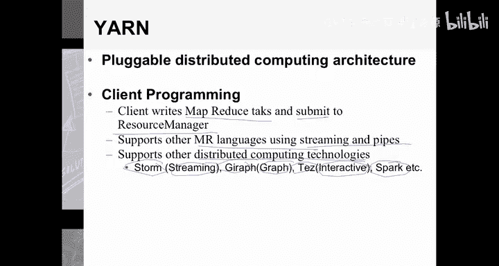
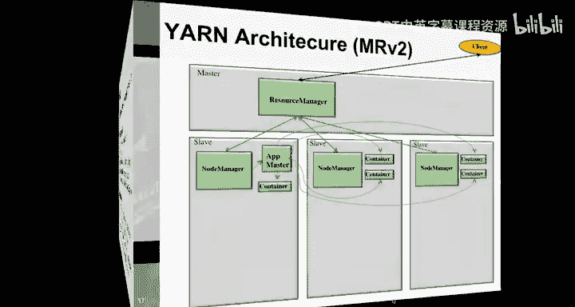
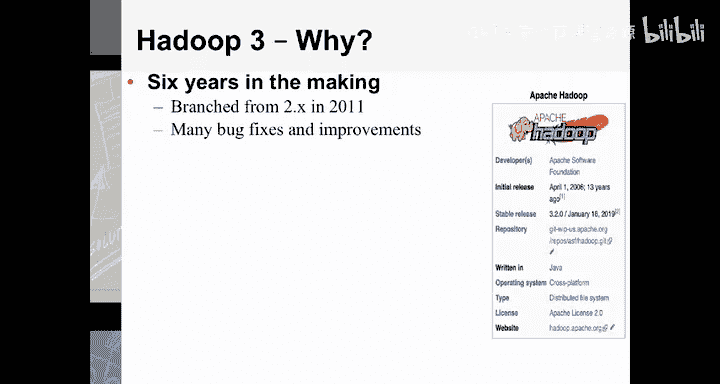
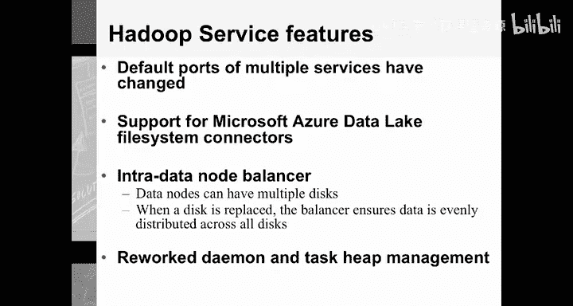

# 课程11：Hadoop架构解析 🏗️

在本节课中，我们将学习Hadoop的架构。我们将探讨经典的Hadoop架构（称为MRv1）和Hadoop YARN架构（称为MRv2）。我们还将了解Hadoop的内部模块以及构成Hadoop架构的主要组件。

这将是一个非常高层次的Hadoop架构概览。在本课程后续部分，我们将更深入地探讨Hadoop架构以及各组件之间的关键交互。

## Hadoop概览

Hadoop集群由物理硬件和逻辑软件共同构成。

Hadoop的物理层面是硬件，它本质上是数据中心机架上安装的一系列商用服务器阵列。每台独立的服务器本身可能拥有多个独立的磁盘和核心。

Hadoop的逻辑层面由此介入。Hadoop HDFS统一了跨服务器、跨机架的存储磁盘，使其看起来像一个单一的文件系统，尽管其底层实际上是分布式的。Hadoop YARN通过统一跨服务器的核心资源，为分布式处理提供统一的计算服务，以完成一个高层次的大数据处理作业，尽管其底层同样是分布式的。

那么，什么是Hadoop？

Hadoop是用于可靠、可扩展、分布式计算的开源软件。其“分布式”体现在你可以让Hadoop中的一大批机器、服务器协同工作以完成处理任务。其“可靠”体现在：当你将数据存入Hadoop HDFS时，数据被分割成块，不同的块被放置在不同的位置，并且这些块会被复制。因此，当一台机器崩溃时，另一台机器将接管特定的数据检索过程并提供该数据。同时，其可靠性还体现在：当你提交一个作业时，作业被分解为任务，这些任务在不同的机器上运行。如果一台机器崩溃，另一台机器将接管该特定任务。其“可扩展”体现在：你可以从10台服务器开始构建Hadoop集群，然后通过添加更多服务器来增加集群容量，实现向上扩展，也可以进行向下缩减。

Apache Hadoop的官方网站是 `hadoop.apache.org`。

## Hadoop核心模块与版本

以下是构成Hadoop的各个模块：Common、HDFS、YARN和MapReduce，这是Hadoop的四个核心模块。Hadoop还有许多相关项目，如Ambari、Avro、Cassandra、Chukwa等，这些项目构建于Hadoop之上或与Hadoop紧密协作。

Hadoop有两个主要发布版本：Hadoop 1.x（也称为经典MapReduce或MRv1）和Hadoop 2.x（也称为YARN，即“又一个资源协调者”，或MRv2）。MRv1在市场上非常普遍，许多使用Hadoop的组织都在使用Hadoop 1.x。Hadoop 2.x/YARN是一项新兴技术，也是本课程将使用的技术。在1.x版本中完成的所有工作都可以完全移植到2.x版本。因此，学习2.x版本也涵盖了1.x版本的所有方面，只是守护进程略有不同。本课程将重点介绍2.x版本。

## Hadoop 1.x 技术栈

我们用灰色表示核心Hadoop模块，用黄色表示构建在Hadoop之上的辅助或后续项目。在核心层，我们有Common库。构建在其之上的是HDFS分布式存储。再之上是MapReduce分布式处理。当你下载Hadoop时，这就是你获得的核心Hadoop模块。安装Hadoop时，你得到的就是这些。

构建在这些核心模块之上的还有其他项目。例如，Hive项目允许你编写类似SQL的查询，这些查询会被翻译成MapReduce作业。Pig项目允许你使用一种名为Pig Latin的脚本语言来编写MapReduce作业。HBase是一个构建在HDFS之上的NoSQL数据库。此外，还有几个辅助项目，如Ambari、Flume、Oozie、Zookeeper。理解的关键在于：当你下载Hadoop时，你下载的是核心模块，然后你需要为各种子项目或这些其他项目单独下载，它们共同协作。

### Hadoop Common模块

Hadoop Common提供了支持Hadoop核心项目（即Hadoop代码）以及其他子项目（如Hive和Pig）的实用工具和库。

Hadoop的配置方面由配置API管理，该API是Common模块的一部分。Hadoop还提供了文件系统抽象。作为程序员或客户端，你将与Hadoop文件系统抽象进行交互，请求它创建文件、删除文件、创建目录、删除目录。其底层可能使用HDFS，甚至可能使用Amazon的S3文件系统。实际上，你可以使用任何底层文件系统。

当你在HDFS中存储内容时，你可能希望压缩它，因为存储的是大量数据，Hadoop内置了压缩算法，例如BZip2和GZip。当Hadoop组件相互通信时，它们使用RPC（远程过程调用），因此RPC通信实用工具也是Hadoop Common模块的一部分。当数据在组件之间发送或存储在HDFS中时，可能需要序列化，Hadoop内置了自己的序列化和反序列化实用工具，而不是使用Java序列化。

这些构成了Hadoop Common模块，其他模块都构建在其之上。

### Hadoop HDFS模块

Hadoop HDFS模块提供了分布式、可扩展、可移植的文件系统。其“分布式”体现在多个服务器协同工作，为你提供一个统一的文件系统视图。其“可扩展”体现在你可以添加更多带有更多磁盘的服务器，从而增加文件系统的容量。其“可移植”体现在无论底层使用何种文件系统（标准的HDFS、S3文件系统或Cosmos文件系统），对于客户端API来说，它提供的是通用的文件系统抽象。

客户端可以使用Java API进行CRUD操作（创建、读取、更新、删除文件），也可以使用C API。本课程将主要使用Java API。此外，还有命令行接口（`hadoop fs`命令或`hdfs dfs`命令）以及REST API可用。

Hadoop HDFS的工作原理涉及一系列组件。NameNode是HDFS的“大脑”，它存储HDFS的元数据（关于文件的元数据）。DataNode守护进程是实际将数据读写到本地文件系统的“劳动力”，它们是NameNode的工作节点。当客户端想要创建或删除文件、创建或删除目录时，客户端直接与NameNode通信以进行元数据操作，并与DataNode通信以读写数据块。

让我们从图示角度看看HDFS架构。

这里有四台机器：一台主机器和三台从机器。在主机器上，运行着NameNode守护进程，它是HDFS的主节点。在从机器上，运行着DataNode守护进程，它们是主NameNode的工作节点。客户端与NameNode通信以创建文件的元数据。当客户端想要创建文件时，它与维护元数据的NameNode通信。客户端与DataNode通信以实际写入或读取文件系统中的文件。

DataNode之间也会相互通信，因为当文件被写入时，它被分解成数据块，并且数据块需要被复制。因此，DataNode在NameNode的指导下彼此复制数据块。

### MapReduce架构

MapReduce是跨多台机器、多个节点进行分布式处理的编程范式。

MapReduce的客户端编程本质上是客户端编写我们称为Map和Reduce任务的作业，并将此特定作业提交给所谓的JobTracker。

Map和Reduce程序通常用Java编写（这也是本课程将采用的方式），但你也可以使用其他语言编写MapReduce程序，这种情况下你需要使用Hadoop Streaming和Hadoop Piping。

在MRv1架构中，我们有JobTracker，它是Hadoop处理的“大脑”。客户端将作业提交给JobTracker，然后JobTracker与从属的TaskTracker协同工作，以启动和运行各种Map和Reduce任务。

让我们看看MapReduce架构的实际运作。

这里有四台机器：一台主机器和三台从机器。主机器运行着主守护进程，即JobTracker。从机器运行着TaskTracker守护进程，即从属的TaskTracker守护进程。当客户端想要提交作业时，客户端编写作业并将其提交给JobTracker。JobTracker与TaskTracker协同工作，TaskTracker启动任务（即Map和Reduce任务）来执行作业，然后将结果返回，最终返回给客户端。

因此，作业被提交给JobTracker，JobTracker与TaskTracker协作，TaskTracker启动任务（即Map和Reduce任务），然后结果被写回。

### 整合HDFS与MapReduce

MapReduce构建在HDFS之上，让我们将所有内容整合起来。

客户端可以与主NameNode通信以进行NameNode相关操作（元数据操作、文件系统操作）。客户端还可以与JobTracker通信以提交作业。JobTracker在某些情况下会咨询NameNode。

JobTracker在从机器上运行着从属的TaskTracker，而NameNode在从机器上运行着从属的DataNode守护进程。因此，在一台从机器内部，你同时运行着TaskTracker守护进程和DataNode守护进程。这些任务将与本地数据协作，这就是数据本地性。你还会注意到DataNode之间相互通信，这是数据复制发生的地方。

## MRv1的局限性

Yahoo使用Hadoop MapReduce版本1已有数年，他们发现MRv1存在一些问题。

存在可扩展性问题。使用MRv1，集群的最大规模约为4000个节点（至少Yahoo发现如此），最多可运行约40,000个并发任务。JobTracker的同步模型是核心同步模型，它承担了所有工作，负担过重。

还存在一些可用性问题。如果JobTracker失败，并且已有数千个作业提交给JobTracker，所有作业几乎都会停止并失败。

此外，资源被硬性划分为Map任务和Reduce任务槽位。当你有一个集群时，例如10台机器，每台机器有8个CPU核心，你可能会预分配一定数量的Mapper槽位和Reducer槽位。你只能运行那么多Mapper任务和Reducer任务，这导致了资源利用率低下。

MRv1也缺乏对替代编程范式的支持。你只能使用MRv1进行MapReduce编程，这是一种面向批处理的编程范式，对于某些迭代算法来说速度较慢。我们需要支持其他编程范式，如图计算、交互式处理甚至流处理范式。

## Hadoop 2.x/YARN架构

YARN（Hadoop MRv2）背后的核心思想是将JobTracker拆分为两部分，以分离职责。他们将JobTracker分解为两部分：一部分负责调度，另一部分实际运行MapReduce作业。同时，他们提出将Hadoop接口通用化，以便可以在此集群上运行任何类型的分布式计算应用程序。

YARN代表“又一个资源协调者”，它是一种可以运行任何类型分布式处理的范式。

让我们看看Hadoop 2.x技术栈。

再次用灰色表示核心Hadoop模块，用黄色表示辅助项目。在核心模块中，我们有之前介绍过的Common，有相同的Common，有HDFS分布式文件系统，然后有YARN分布式处理层。这是一个新增的层，MapReduce运行在其之上。这就是Hadoop 2和YARN的全部意义。在其之上，你还有其他项目，如Hive、Pig。在YARN之上，你可以引入一些框架。你当然可以引入MapReduce，但也可以引入其他框架，如Giraph。

这是Hadoop YARN架构的另一个视图。你可以看到HDFS，然后是YARN。在YARN之上，我们有批处理MapReduce（这是Hadoop的一部分，也是可用的框架之一），然后你还可以引入其他框架，如Storm、Giraph、Spark、OpenMPI、Search Weer等。任何这些框架都可以引入并在YARN之上运行。当然，MapReduce非常适合大数据处理，这也是本课程将重点关注的，并且它是Hadoop 2的标准组成部分。

### 什么是YARN？

YARN是一个可插拔的分布式计算架构。

就客户端编程而言，客户端编写Map和Reduce任务并将其提交给所谓的ResourceManager（这是新的JobTracker）。它支持使用Streaming和Piping的其他MapReduce语言。当然，它也支持其他分布式计算技术，如用于流处理的Storm、用于图处理的Giraph、用于交互式处理的Phoenix，以及用于流处理和交互式处理的新技术Spark。

### YARN工作原理

基本上，你有主ResourceManager，它管理集群中的资源。还有一个ResourceManager会分配一个ApplicationMaster。ApplicationMaster负责协商我们称为容器的资源，这些容器运行MapReduce作业。还有这些从属的NodeManager守护进程，它们运行MapReduce任务。

让我们看看YARN架构。

从高层次来看，这里有四台机器：一台主机器和三台从机器。主机器运行主ResourceManager。从机器运行从属的NodeManager守护进程。当客户端想要提交作业时，客户端编写作业并将其提交给ResourceManager。ResourceManager与NodeManager通信，获取其资源信息。然后，ResourceManager将联系NodeManager，代表客户端启动一个应用程序。

在MapReduce v1中，JobTracker是管理实际作业的组件。现在，这项工作被拆分到ResourceManager和ApplicationMaster之间。因此，ResourceManager要求NodeManager启动一个作业，作业就在那里运行。ApplicationMaster是特定作业的新管理器，它与NodeManager和ResourceManager紧密合作，协商容器（即你的任务），这些容器将运行你的Map和Reduce任务。

这就是YARN架构的工作原理。

### 整合YARN与HDFS

当你将YARN置于HDFS之上时，我们所拥有的就是在混合中添加了DataNode。然后，容器与本地DataNode通信，这就是数据本地性发挥作用的地方。

## Hadoop 3 新特性

我们已经讨论了Hadoop 1，并更详细地介绍了Hadoop 2 YARN。现在，Hadoop 3的架构没有太大变化，但有一些新增功能。让我们看看Hadoop 3的动机和新特性。

Hadoop 3显然建立在Hadoop 2的基础上，后者有重大的架构变化，但现在Hadoop 3有一些新功能。

Hadoop 3的工作始于2011年，但直到2017年底才首次发布。在此期间，一些错误修复和改进被移植到Hadoop 2版本中，但主要更改无法轻松移植回Hadoop 2。

Hadoop 3的主要动机之一是提高平台的可扩展性和可靠性。默认的复制因子（用于容错）导致200%的存储开销。换句话说，如果你存储一个1 GB的文件，它最终会存储为3 GB。必须存储每个文件的3个副本极大地限制了HDFS的可扩展性。

另一个可靠性和可扩展性问题是仅支持两个NameNode（一个活动，一个备用）的限制。对于非常大的集群，可能需要不止一个备用NameNode。因此，在Hadoop 3中，他们为此提供了支持。

Hadoop 2发行版还存在一些普遍问题。Java 7自2015年起已停止支持，因此推动将所有代码升级到Java 8是Hadoop 3的一大推动力。现在我们可以使用JDK 8。

Hadoop 2的应用程序经常遇到类路径冲突。原因是应用程序的库依赖可能与Hadoop客户端API本身的库依赖冲突。为了解决这个问题，应用程序开发人员需要“shade”他们的依赖项，以避免与Hadoop冲突。

Hadoop 2的另一个问题是默认端口。某些服务的默认端口位于临时端口范围内。TCP临时端口是当主机上的客户端应用程序连接到远程服务时自动分配的。这可能导致Hadoop 2的启动问题。因此，在Hadoop 3中，他们更改了这一点。

Hadoop 2的YARN也有一些严重的限制。只有两种资源类型可用于制定调度决策：CPU和内存。当今的计算集群可能包含Hadoop作业所需的其他有限资源，而YARN没有提供确定这些可用资源在集群中位置的方法。这些资源可能是GPU资源，因此Hadoop 3增加了对GPU类资源的支持。

### Hadoop 3 重要特性

以下是Hadoop 3发布说明中描述的16个功能中的几个值得注意的特性。

Hadoop 3的一个重大变化是支持纠删码。纠删码是一种用于磁盘阵列的冗余技术，现在被应用于存储在HDFS中的块。这种纠删码实现使用条带化和奇偶校验来提供冗余。文件被表示为存储在多个DataNode上的数据和奇偶校验块序列。

回想一下，Hadoop 2实际上是在块级别进行复制。如前所述，默认复制因子为3会导致200%的存储开销。你可以减少文件的复制因子，但这也会降低容错能力。另一个值得注意的因素是，块复制可以提高作业性能，因为同一个块存在于多个DataNode上，可以更容易地实现数据本地性。

因此，我想说明的是，是的，Hadoop 3有纠删码，但它带来了一些优点和缺点。使用纠删码，我们可以在没有块复制的情况下实现容错。实际上，纠删码将复制因子限制在不超过1.5。有多种策略可供选择，但总的来说，纠删码将存储开销降低到不超过50%。这可以极大地提高HDFS的可扩展性。

但它确实是有代价的。由于文件被条带化分布在多个DataNode上，读写操作会增加网络流量。编码和解码过程还需要客户端和服务器额外的CPU开销。还有其他可能影响性能的限制，例如，不支持追加和截断操作。

因此，尽管Hadoop 3支持纠删码，但它尚未被广泛使用，本课程也不会涉及，但我确实想提及它。

以下是两个改进应用程序开发和性能的Hadoop 3特性。

如前所述，Hadoop 2的开发人员必须使用“shading”来消除与Hadoop客户端API依赖项的任何冲突。在Hadoop 3中，客户端jar现在使用“shading”来消除依赖冲突。这意味着开发人员不会与Hadoop 3产生依赖冲突，但也意味着开发人员需要提供自己的依赖项。

Hadoop 3的另一个令人兴奋的特性是能够定义额外的YARN资源类型。例如，拥有GPU（图形处理单元）的Hadoop集群可以了解其每个节点上的GPU可用性。因此，应用程序可以根据GPU的可用性（而不仅仅是CPU和RAM）进行调度，从而利用GPU。

让我们看看一些Hadoop服务特性。

现在Hadoop服务不再使用临时端口范围，系统管理员不会遇到偶尔的启动错误。然而，Hadoop 3的用户需要了解新的默认端口。

Hadoop 3增加了对在Microsoft Azure中部署的支持。Microsoft Azure有自己的文件系统。Amazon的S3之前已受支持，现在我们支持Microsoft Azure文件系统。

Hadoop DataNode通常有多个驱动器用于本地存储冗余和并行性。Hadoop 2确实确保存储在所有驱动器上均匀分布。然而，当Hadoop 2 DataNode上的一个驱动器发生故障并被更换时，存储就不再均匀分布。Hadoop 3的节点内平衡器将重新分布数据，使新驱动器立即得到利用，并最终恢复平衡。

另一个特性是，在Hadoop 2中，必须为集群上运行的每个守护进程和其他任务预先确定Java堆大小。在Hadoop 3中，Java堆大小的确定是自动的，无需手动配置，这实际上使安装过程变得更容易一些。

## Hadoop 3 发行版

既然我们已经介绍了一些新功能，让我们看看在哪里以及如何找到Hadoop 3。

Apache发行版的最新版本是Hadoop 3.2（于2019年1月发布），这也是本课程将使用的版本，除非另有说明。

其他Hadoop发行版方面，Cloudera和Hortonworks已经合并，但Cloudera和Hortonworks的发行版都将再维护三年，直到一个融合的Cloudera发行版可用。顺便说一下，它将被称为CDP。

你可以看到商业发行版稍微落后一些。例如，Cloudera在3.0.0，Hortonworks在3.1.1，但我们将使用3.2.0或更高版本。请注意，MapR仍然与Hadoop 2基线绑定。MapR有自己的HDFS实现，它过去被称为MapR FS，但现在已更名为MapR XD。由于MapR XD不像Hadoop 2那样使用块复制，因此采用纠删码对他们来说没有意义。

## 总结

在本节中，我们学习了Hadoop架构，包括经典的Hadoop