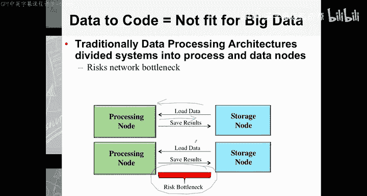
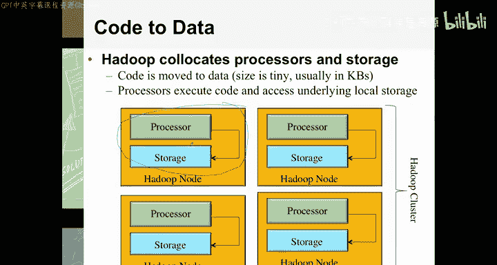
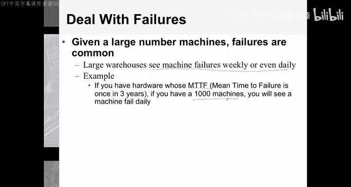
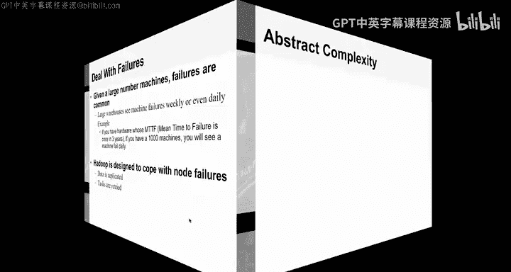
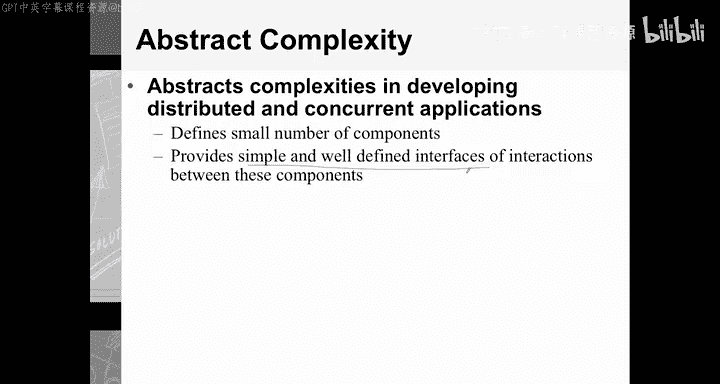

# 课程11：Hadoop架构设计的核心原则 🏗️

在本节课中，我们将学习Hadoop架构背后的核心设计原则。这些原则是Hadoop能够高效处理海量数据的关键所在。

---

## 概述

Hadoop的设计遵循一系列核心原则，使其成为处理大数据的强大工具。这些原则包括突破磁盘读写瓶颈、采用横向扩展而非纵向扩展、将代码移至数据处、自动处理故障以及抽象分布式应用的复杂性。接下来，我们将逐一详细探讨这些原则。

---

## 突破磁盘读写瓶颈 💾

上一节我们介绍了Hadoop的整体架构，本节中我们来看看它是如何突破传统存储系统的读写瓶颈的。

存储容量在过去二十年呈指数级增长，但磁盘的读取速度并未同步提升。例如，1990年的1.4GB硬盘读取需要约5分钟，而2010年的1TB硬盘顺序读取则需要约2.5小时。这意味着，将数据读入内存进行处理是一个巨大的瓶颈。

Hadoop的HDFS通过并行读写解决了这个问题。在Hadoop中，可以有多台机器上的多个磁盘同时工作，从而实现并行读取。例如，使用100个磁盘并行工作，读取1TB数据可能仅需约2分钟。这种方式使Hadoop HDFS成功突破了磁盘读写速度的瓶颈。

---

## 横向扩展而非纵向扩展 📈

上一节我们了解了如何突破I/O瓶颈，本节中我们来看看Hadoop在系统扩展性上的设计思路。

系统扩展主要有两种方式：
*   **纵向扩展**：为单台服务器增加更多的CPU、内存或硬盘。
*   **横向扩展**：向现有集群中添加更多的服务器节点。

纵向扩展不仅更困难、更昂贵，而且受限于摩尔定律，其性能提升速度赶不上数据的爆炸式增长。此外，单台服务器的资源扩展存在物理上限。

Hadoop采用了横向扩展的策略。使用Hadoop，你可以从一个10个节点的集群开始，然后根据需要轻松地扩展到20个、40个甚至更多节点。这种策略更具灵活性和成本效益。

在Hadoop中，我们使用廉价的商用硬件。例如，一台配备32GB内存、1TB硬盘和四核CPU的服务器成本约为5000美元。将10台这样的服务器组成集群成本约为5万美元，要扩大集群容量，只需添加更多这样的服务器即可，而无需购买昂贵的高端服务器或超级计算机。

一个典型的数据中心由多个机架组成，每个机架放置着多台廉价的商用服务器，这些机架之间相互连接。Hadoop集群通常就部署在这样一个数据中心内。

---

## 将代码移至数据处，而非反之 🚚

上一节我们讨论了横向扩展的优势，本节中我们来看看Hadoop在数据处理模式上的革新。

传统的数据处理架构将系统分为处理节点和存储节点。当需要计算时，数据从存储节点被传输到处理节点，这容易导致网络瓶颈。

Hadoop采取了不同的方法。它在设计上**将处理器和存储放在一起**，即在同一台服务器上既运行处理逻辑（如任务追踪器和任务），也运行存储逻辑（如从本地磁盘读取数据的数据节点）。

以下是Hadoop数据处理模式的示意图：

在这种架构下，代码被移动到数据所在的位置进行处理，这被称为**数据本地性**。它最大限度地减少了数据在网络中的传输，从而显著提升了处理效率。

---

## 自动处理故障 🛡️

在拥有大量机器的集群中，故障是不可避免的。大型数据中心每周甚至每天都会发生机器故障。

这里涉及一个概念：**平均故障间隔时间**。假设一台服务器的MTTF是3年，那么对于一个拥有1000台服务器的集群，几乎每天都会有一台服务器发生故障。像谷歌、Facebook这样拥有数十万台服务器的公司，故障的发生会更加频繁。

Hadoop被设计为能够从容应对节点故障。因为数据被复制了多份，如果存有某份数据的服务器宕机，其他存有相同数据副本的服务器可以继续提供数据。同样，对于MapReduce任务，如果运行某个任务的服务器失败，其他空闲的服务器（或具有空闲任务槽的服务器）会自动接管该任务。

Hadoop故障处理机制示意图：

---

## 抽象分布式应用的复杂性 🔧

开发分布式应用程序涉及许多复杂性，如同步、配置管理等。Hadoop通过其组件处理了所有这些分布式计算的复杂方面。

Hadoop为开发者提供了一个**简单且定义良好的接口**，即MapReduce编程接口。开发者只需编写业务逻辑，而无需担心分布式计算中的各种底层复杂性，例如：
*   竞态条件
*   资源饥饿
*   处理流水线
*   数据分区

这使开发者能够从系统级的挑战中解放出来，专注于实现业务逻辑。

---

## 总结

本节课我们一起学习了Hadoop架构背后的五大核心原则：
1.  **突破磁盘读写瓶颈**：通过并行I/O大幅提升数据吞吐量。
2.  **横向扩展而非纵向扩展**：通过添加廉价商用服务器节点来灵活、经济地扩展集群。
3.  **将代码移至数据处**：利用数据本地性减少网络传输，提升处理效率。
4.  **自动处理故障**：通过数据复制和任务重新调度，实现高容错性。
5.  **抽象分布式应用的复杂性**：为开发者提供简单的编程接口，使其专注于业务逻辑。

这些原则共同构成了Hadoop强大、可靠且易于扩展的大数据处理能力的基础。