# 课程13：Hadoop发行版本 🗂️

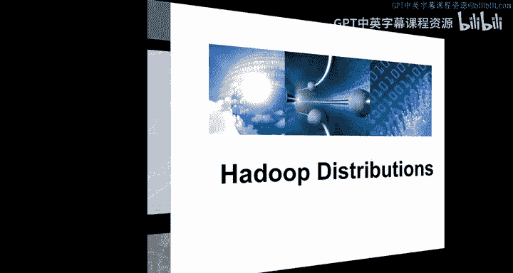

在本节课中，我们将学习Hadoop的发行版本。我们将首先了解开源Apache Hadoop发行版的现状，然后探讨市场上包括云平台提供商在内的各种商业发行版。最后，我们将决定在本课程中将使用哪种Hadoop发行版。

---

## Hadoop发行版的问题场景

让我们先来看一个Hadoop发行版可能带来的问题场景。假设你想使用Hadoop，于是你访问 `hadoop.apache.org`，下载了最新版本的Apache Hadoop，安装、配置并启动它，然后开始使用。

一段时间后，你意识到想使用Apache HBase，这是一个构建在Hadoop之上的实时NoSQL数据库。于是你下载了Apache HBase，但随后发现它需要旧版本的Hadoop，因为它依赖于旧版本的HDFS。为了同时运行Hadoop和HBase，你不得不将Apache Hadoop降级到旧版本，好在这没有影响你现有的项目。

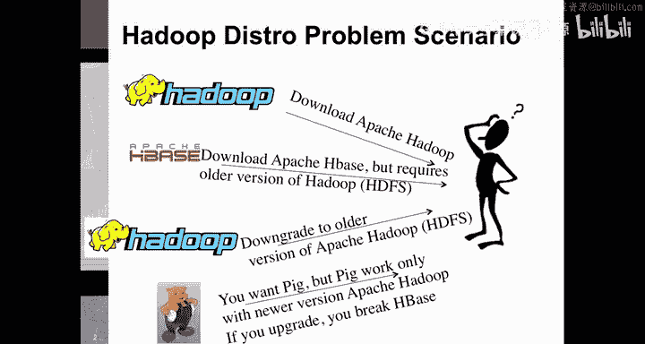

一切运行正常后，你又想下载Pig来进行数据分析。于是你下载了Pig，但发现Pig只兼容新版本的Apache Hadoop。如果你升级Hadoop，就会破坏HBase的运行。

这就是一个典型的困境。大约四五年前，当还没有商业发行版时，我开始使用Hadoop时就遇到了类似的问题。此外，还存在技术支持的问题：当出现问题时，你该找谁？

---

## 现状存在的问题

从构建、测试、打包到部署的整个流程来看，当前Hadoop项目及其所有子项目松散耦合的特性存在一些局限性。

以下是主要问题：

1.  **依赖项目版本测试不足**：对于像Hive、Pig、HBase、Zookeeper等依赖项目的“主干”版本，缺乏足够的构建测试。
2.  **子项目版本测试不足**：对于各个子项目的“主干”版本，缺乏充分的测试。
3.  **缺乏一致的Linux服务器打包**：没有提供一个统一的Hadoop数据中心平台供大家使用。
4.  **缺乏多节点集群的功能测试**：Hadoop是一个集群项目，需要在多台机器上运行。必须有人安装并测试，以确保它在集群上正常工作。

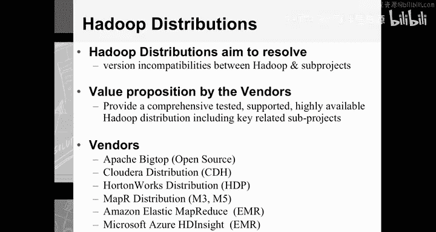

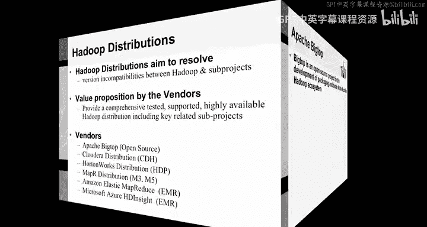

---

## Hadoop发行版的解决方案

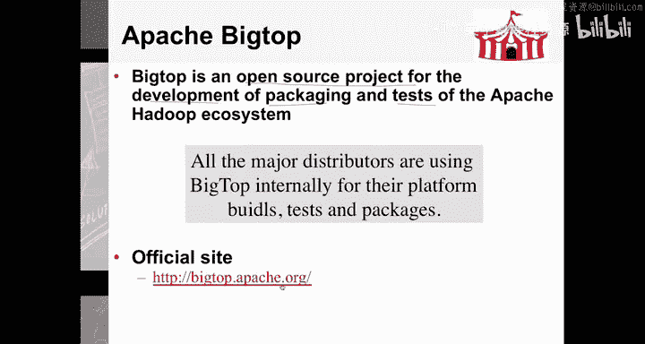

Hadoop发行版旨在解决Hadoop与其子项目之间的版本兼容性问题。它们的核心价值主张是提供一个经过全面测试、有技术支持、高可用的Hadoop发行版，其中包含Hadoop及相关项目，这样用户就不必担心软件间的兼容性问题。

市场上有多个供应商提供Hadoop发行版，包括开源的Apache Bigtop发行版，以及商业发行版，如Cloudera发行版、Hortonworks发行版、MapR发行版，还有云服务商提供的Amazon AWS Elastic MapReduce和Microsoft Azure HDInsight。

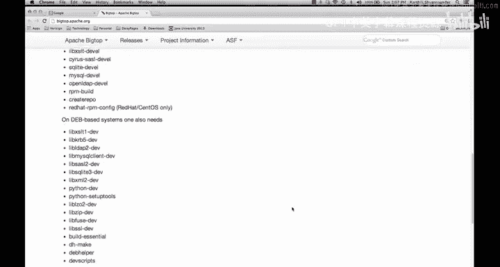

---

## 主要发行版详解

上一节我们概述了发行版的存在意义，本节我们来详细看看这些主要的发行版。

### Apache Bigtop 🐘

Apache Bigtop 实际上是一个开源项目，专注于Apache Hadoop及其生态系统中所有子项目的开发、打包和测试。所有主要的商业发行商都在内部使用Bigtop来进行其平台的构建、测试和打包。然而，我个人并不了解有哪家公司或企业直接在生产中使用Apache Bigtop发行版。其官方网站是 `bigtop.apache.org`。值得注意的是，它在大约两年前从一个孵化器项目升级为了顶级项目。

Bigtop展示了构建一个完整的Hadoop生态系统所需的各种库，以及如何将其用于持续集成和平台构建测试。

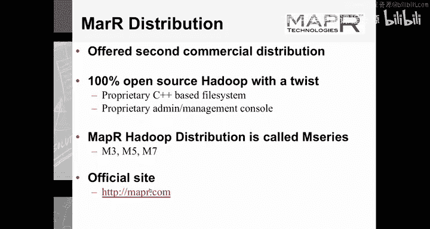

### Cloudera 发行版

Cloudera 提供了第一个商业Hadoop发行版。Cloudera在Hadoop打包方面所做的，类似于Red Hat对Linux平台的贡献。Cloudera发行版是100%开源的Hadoop发行版，但有一个小“转折”：Hadoop软件本身是100%开源的，但他们提供的用于运维管理的控制台不是开源的。

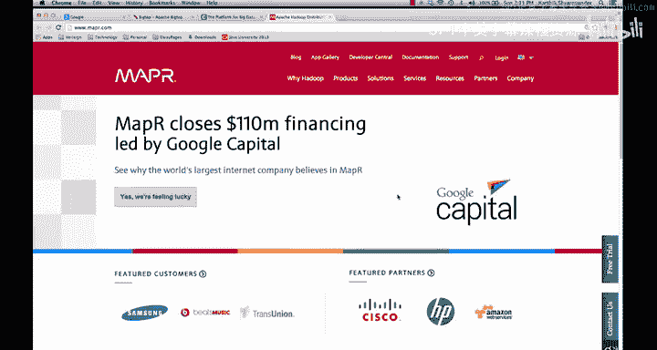

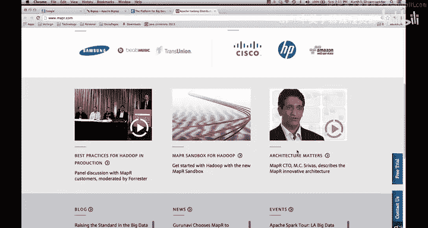

Cloudera的Hadoop发行版称为 **CDH**，即Cloudera Distribution for Hadoop。其官方网站是 `cloudera.com`。该网站提供了各种产品、专业服务、培训解决方案和合作伙伴信息，其博客也是很好的信息资源。

### MapR 发行版

MapR 提供了第二个商业Hadoop发行版。它也是100%开源的Hadoop，但同样有“转折”：其文件系统实现（即HDFS实现）是基于专有的C++代码，并且其管理控制台也是专有的。MapR声称其C++实现比基于Java的HDFS实现快得多。

MapR的Hadoop发行版称为 **M系列**（如M3, M5, M7等）。其官方网站是 `mapr.com`。值得一提的是，MapR的CTO曾是Google文件系统（GFS）的关键开发者之一。

### Hortonworks 发行版

Hortonworks 是第三个商业Hadoop发行版。它由前雅虎的Hadoop专家创立，这些专家曾直接参与Hadoop软件的开发。因此，它是从雅虎剥离出来的。Hortonworks是真正100%开源的Hadoop软件，没有任何“转折”。Hadoop软件本身是100%开源的，其用于运维的管理控制台（名为 **Ambari**）也是100%开源的。

Hortonworks的Hadoop发行版称为 **HDP**，即Hortonworks Data Platform。其官方网站是 `hortonworks.com`。

### 云平台发行版

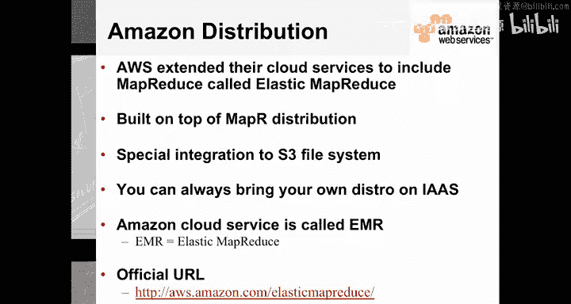

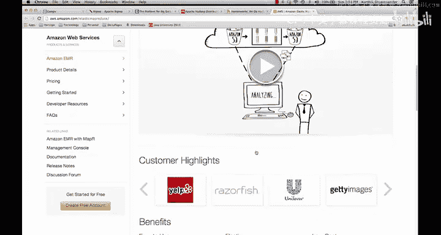

除了独立的商业发行版，主要的云服务商也提供了集成的Hadoop服务。

*   **Amazon AWS Elastic MapReduce (EMR)**：亚马逊AWS将其云服务扩展至包含MapReduce，称为Elastic MapReduce。它是基于MapR发行版构建的，亚马逊AWS团队与MapR合作，在云平台上实现了Hadoop。它还与S3文件系统有特殊集成。用户也可以在自己的AWS基础设施即服务（IaaS）上安装自己的Hadoop发行版，但EMR提供了开箱即用的服务。其官方网址是AWS EMR服务页面。
*   **Microsoft Azure HDInsight**：微软Azure也将其云服务扩展至包含MapReduce，称为HDInsight。为此，微软与Hortonworks合作，因此它是基于Hortonworks发行版构建的，运行在微软的云平台上。其官方网址是 `azure.microsoft.com`。

---

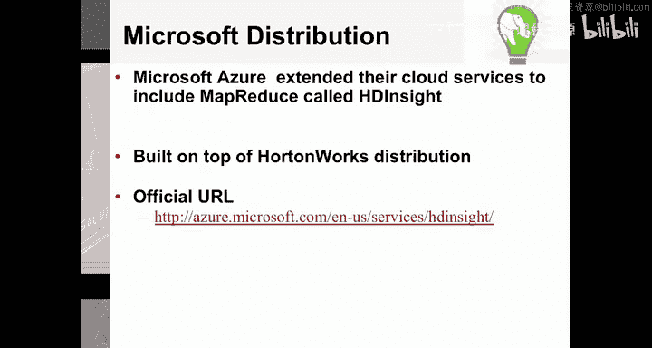

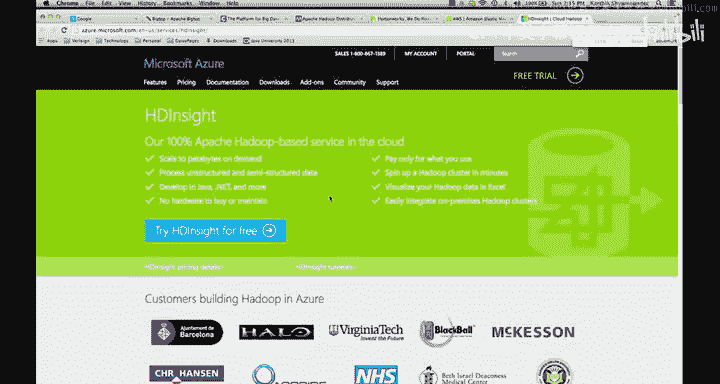

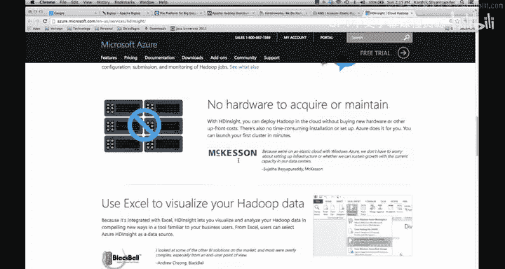

## 本课程的选择

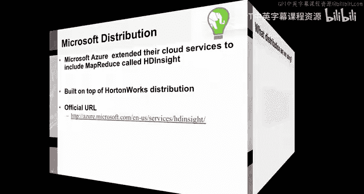

那么，本课程将使用哪种发行版呢？

我们可以使用任何商业发行版，因为它们都提供有限节点的免费版本。但我不想在课程中偏袒任何特定的发行版。更重要的是，我希望你能理解Hadoop的内部工作原理，学习如何下载和安装最新版本，因为后续课程会引入新的Hadoop子项目，我希望你能亲身体验这个过程。

因此，在本课程中，我们将直接使用开源的Apache Hadoop发行版及其相关的子项目发行版。我会要求你在学习过程中随时下载这些发行版并使用它们。

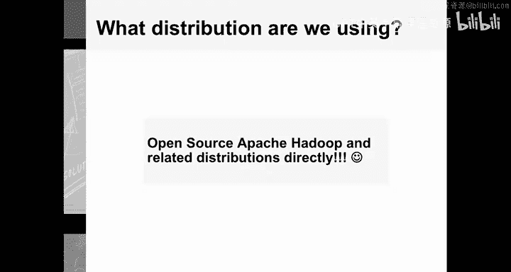

---

## 总结

在本节课中，我们一起探讨了使用开源Apache Hadoop发行版可能面临的问题。我们详细了解了市场上各种商业发行平台，如Cloudera CDH、MapR M系列和Hortonworks HDP，以及一些云Hadoop平台提供商，如Amazon AWS Elastic MapReduce (EMR) 和 Microsoft Azure HDInsight。最后，我们决定在本课程中使用开源的Apache Hadoop发行版，以便更深入地学习和实践。