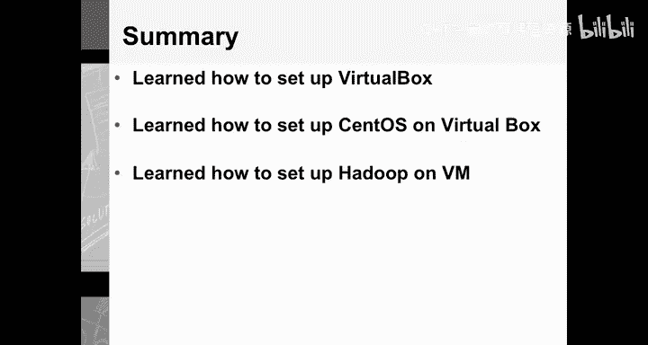

# 课程21：Hadoop环境配置总结 🎯

在本节课中，我们将回顾并总结如何配置和运行Hadoop环境。我们通过一系列实践步骤，学习了从虚拟机设置到Hadoop伪分布式模式安装与运行的全过程。

---

上一节我们介绍了Hadoop的安装与配置，本节中我们来对整个模块的学习内容进行总结。

我们通过动手实践，完成了以下三个主要步骤。

以下是本模块涵盖的核心操作：

1.  设置VirtualBox虚拟机。
2.  在VirtualBox上安装CentOS Linux系统。
3.  在Linux系统上以伪分布式模式安装、配置并运行Hadoop。

---

通过这些步骤，我们成功搭建了一个可运行的Hadoop开发环境。希望本模块能让你对Hadoop的实际操作方面有所了解。

更重要的是，你现在已经熟悉了构成Hadoop的各个组件。

---

本节课中我们一起学习了Hadoop环境的完整配置流程，从虚拟机基础设置到Hadoop核心服务的启动。你现在已经拥有了一个可以开始进行大数据处理实验的本地Hadoop平台。