# 课程 P23：HDFS架构解析 🏗️

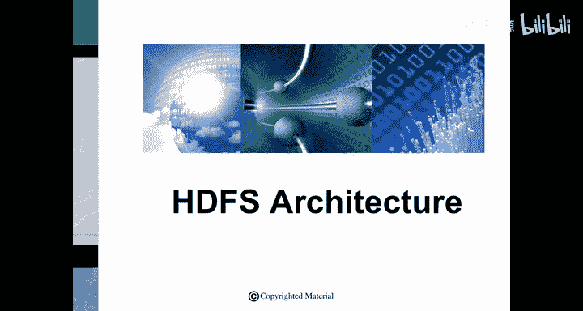

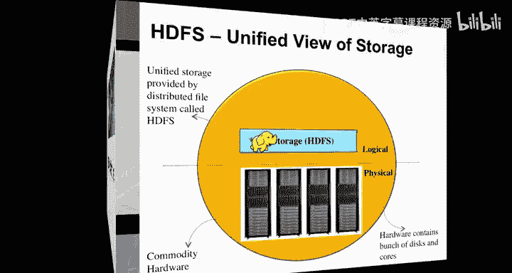

在本节课中，我们将深入学习Hadoop，并详细探讨HDFS的架构。我们将了解HDFS的关键特性、适用场景、不适用场景，以及构成HDFS的各个组件和守护进程的角色与交互。最后，我们将学习如何管理HDFS，例如格式化文件系统以进行初始化，以及启动和停止守护进程。

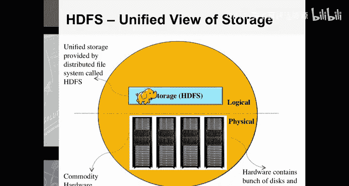

## HDFS概述

Hadoop集群是物理硬件和逻辑软件的结合体。物理层面是硬件，通常是一组安装在机架上的商用服务器，一个数据中心内可能有多个机架。每台服务器本身可能拥有多个独立的磁盘。Hadoop HDFS将跨服务器、跨机架的存储磁盘统一起来，使其看起来像一个单一的文件系统，尽管其底层是完全分布式的。

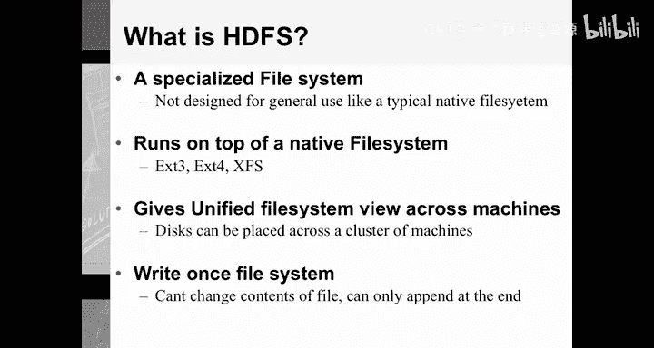

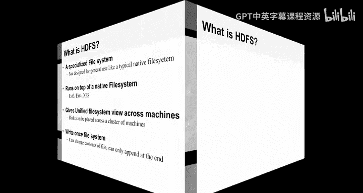

## 什么是HDFS？

HDFS是一个专门的文件系统。它并非为通用目的而设计，不像我们操作系统磁盘之上的传统文件系统（我们称之为原生文件系统）。HDFS实际上运行在原生文件系统之上。例如，你可能有一台服务器，服务器有磁盘，你在上面安装操作系统，为所有磁盘创建一个文件系统（如EXT3、EXT4或XFS），然后Hadoop运行在这个原生文件系统之上。它提供了跨机器、跨文件系统的统一视图。

HDFS是一个“一次写入”的文件系统。换句话说，文件一旦写入，你就不能真正改变其内容。你可以在文件末尾追加数据，但不能进入文件中间更改数据。如果你想这样做，需要创建一个全新的文件，重新复制所有数据，进行更改，然后追加其余部分。

HDFS具有容错性和高可用性。当你将数据放入HDFS时，它会在多台机器上进行复制。因此，如果其中一台包含数据块的机器崩溃，其他拥有该数据副本的机器将能够提供该特定数据。

HDFS是可扩展的。如果你想增加HDFS系统的硬盘容量或存储容量，只需添加更多带有更多驱动器的服务器即可。你也可以缩减规模。

HDFS实际上基于Google文件系统。有一篇非常出色的论文详细介绍了GFS架构的内部原理，HDFS架构正是基于此。

## HDFS的核心概念：文件与块

HDFS背后的核心思想是文件被分割成块。例如，一个名为 `customer.txt` 的文件会被分解成多个块。每个块都是一个独立的存储单元，并拥有一个与之关联的唯一ID。这些块由NameNode管理，但NameNode并不真正存储块。块的实际存储由DataNode完成。块的概念是HDFS的内部机制，对作为HDFS用户的我们来说是透明的。

块在加载时（即数据被复制到HDFS时）会在多台机器间进行复制。默认的复制因子是3，这意味着每个块总共有三个副本。这有助于实现容错。

### 文件与块的实际运作

假设我们有一个数据中心机架，上面安装了10台服务器。我们有一个HDFS文件 `customer.txt`，它由两个块组成：块1和块3。我们还有另一个文件 `product.txt`，它由三个块组成：块2、块4和块5。这些块被放置在同一机架内不同服务器上。由于复制因子为3，每个块都会被复制两次，总共产生15个块，分布在不同的服务器上。

这种设计实现了**条带化**和**镜像化**。将文件分解成块并跨多台机器放置，实现了条带化。跨多台机器复制块，则实现了镜像化。

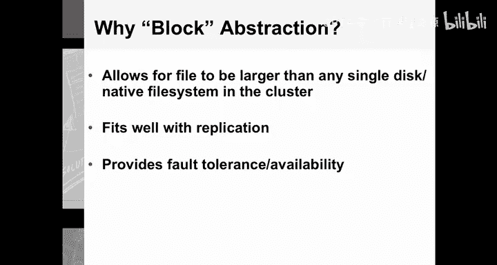

### 为什么采用块抽象？

块抽象允许文件的大小超过集群中任何单个原生文件系统磁盘的容量。例如，如果每台服务器的存储容量是2TB，那么在原生文件系统中，单个文件最大只能是2TB。但有了块抽象，HDFS中的文件可以超过2TB，对文件大小没有限制。

块抽象与复制方案配合良好。它提供了容错性和可用性。如果包含某个数据块的服务器因维护或故障而停机，拥有该块副本的其他服务器将能够提供该数据块。

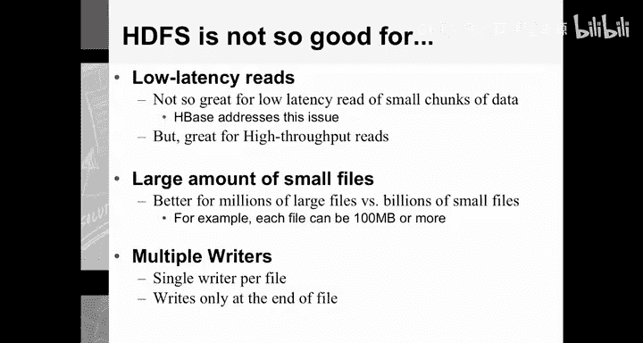

## HDFS的适用与不适用场景

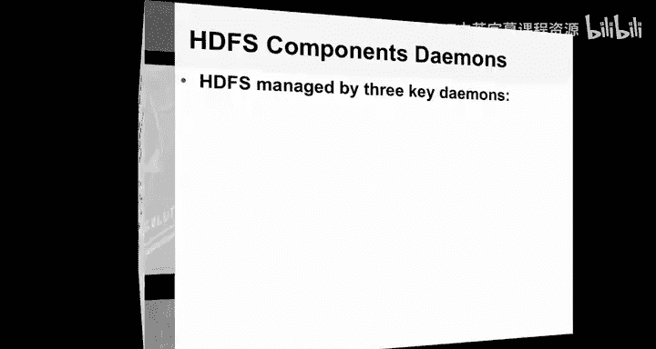

### HDFS适用场景
*   **存储大文件**：HDFS适合存储少量大文件，而不是大量小文件。文件大小通常在兆字节或千兆字节级别，而不是千字节级别。
*   **流式数据访问**：HDFS遵循“一次写入，多次读取”的模式。它针对流式读取进行了优化，而不是随机读取。
*   **运行在廉价商用硬件上**：HDFS不需要超级计算机或EMC等高端设备，普通的商用服务器即可。硬件不需要高度可靠，因为系统中有复制机制。

### HDFS不适用场景
*   **低延迟读取**：HDFS不适合读取小块数据。如果需要此类功能，可以考虑HBase等项目。
*   **存储大量小文件**：大量小文件会给NameNode带来压力。
*   **多写入者**：每个文件只能有一个写入者。文件写入后，只能在其末尾追加数据，且只能由一个写入者执行。

## HDFS组件与守护进程

HDFS系统由三个关键的守护进程组成：
1.  **NameNode**：管理文件系统的命名空间或元数据。它跟踪所有目录、文件名，以及文件如何分解成块、块ID、块位置等信息。NameNode通常运行在一台机器上。
2.  **DataNode**：存储和检索数据块。DataNode向NameNode报告其当前状态。每台物理服务器上都会运行一个DataNode。
3.  **Secondary NameNode**：执行清理工作，以减轻NameNode的负担。它需要与NameNode相似的硬件，但它的功能与NameNode完全不同，不能替代主NameNode。在未来，它可能被称为检查点节点。

在一个典型的设置中，会有一台主服务器运行NameNode，另一台服务器运行Secondary NameNode，其余多台从服务器运行DataNode。

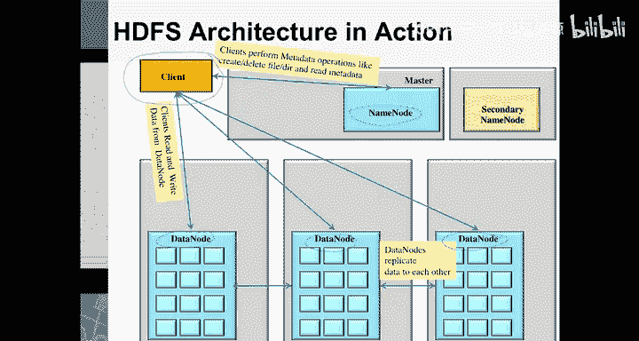

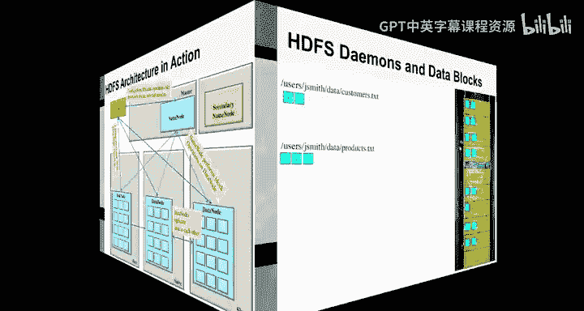

客户端连接到NameNode以执行元数据操作（如创建/删除文件/目录、获取文件信息）。客户端也直接与DataNode通信以实际写入或读取数据，因为NameNode只维护元数据。

DataNode之间也会相互通信，因为数据需要复制。NameNode会指示DataNode将副本放置到何处，DataNode之间直接通信以完成复制。

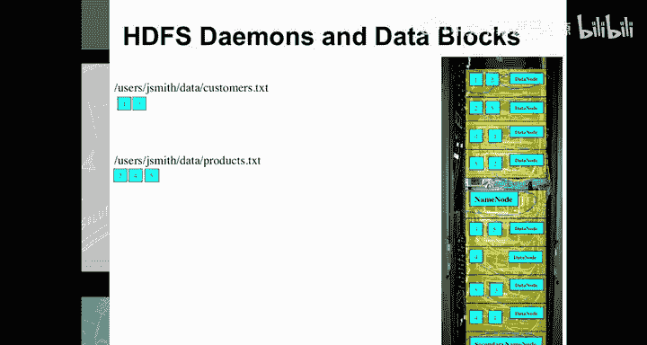

NameNode持续与DataNode通信，监控其状态、数据块情况、校验和，并管理数据块的复制。

## NameNode详解

NameNode是HDFS的簿记员。它创建并维护文件系统树和相关元数据。它决定文件如何分解成块，以及这些块应存储在何处。它监控整个分布式文件系统的健康状况。

NameNode对内存和磁盘I/O要求很高。所有关于文件和目录的元数据都保存在内存中以提高速度。元数据的副本也会存储到磁盘上，以防NameNode崩溃。这些被称为文件系统编辑日志，会定期检查点保存到磁盘。

在使用HDFS文件系统之前，必须格式化文件系统。格式化会初始化元数据结构。**警告**：一旦格式化HDFS，请不要再次格式化，因为这会丢失所有NameNode元数据，相当于丢失了整个文件系统的“目录”。

## Secondary NameNode详解

Secondary NameNode中的“Secondary”一词容易引起误解。它的功能与NameNode完全不同，在主NameNode宕机时无法替代它。它的主要目的是执行定期检查点。

Secondary NameNode会定期从NameNode获取文件系统镜像和编辑日志，将它们合并成一个新的文件系统镜像，然后上传回NameNode。这样做的目的是，如果NameNode崩溃后需要重启，它可以快速加载这个合并后的新镜像，而无需花费大量时间重新应用所有编辑日志。

## DataNode详解

DataNode是文件系统的主力。它在本地文件系统的本地磁盘上存储和检索实际的数据块。它是NameNode的从属节点，定期向NameNode报告其存储的块及其状态。

DataNode接收来自客户端的数据请求。当客户端想要读取或写入文件时，客户端直接与DataNode通信。DataNode还负责根据复制因子复制数据块到其他DataNode。

## HDFS端口与进程管理

*   **NameNode端口**：
    *   `50070`：HTTP协议端口，用于Web UI管理。
    *   `9000`：IPC端口，客户端用于元数据操作。
    *   `50470`：HTTPS版本的admin端口（默认未配置）。
*   **DataNode端口**：
    *   `50020`：IPC端口。
    *   `50010`：数据传输端口。
    *   `50075`：Web UI端口。
*   **Secondary NameNode端口**：
    *   `50090`：admin控制台端口。

### 启动和停止HDFS守护进程

*   启动所有HDFS守护进程：`start-dfs.sh`
*   停止所有HDFS守护进程：`stop-dfs.sh`
*   启动单个守护进程：`hadoop-daemon.sh start [namenode|secondarynamenode|datanode]`
*   停止单个守护进程：`hadoop-daemon.sh stop [namenode|secondarynamenode|datanode]`

## 总结

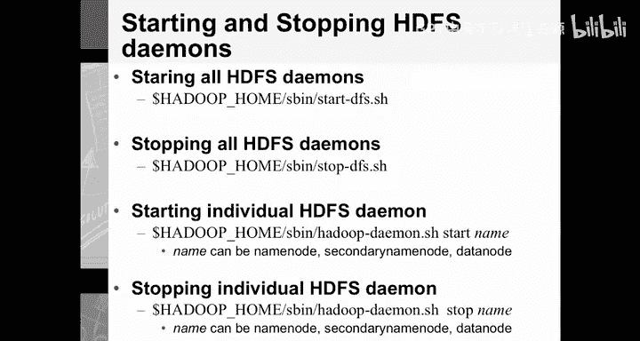

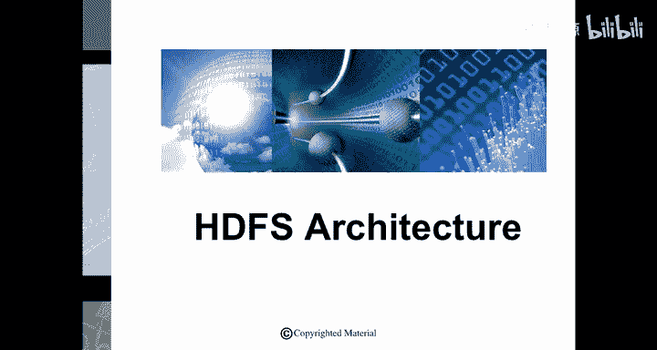

在本节课中，我们深入探讨了HDFS的架构。我们了解了HDFS的关键特性、适用与不适用场景。我们还详细研究了构成HDFS的各个组件和守护进程（NameNode、DataNode、Secondary NameNode）的角色及其交互方式。最后，我们学习了HDFS的一些基本管理操作，例如格式化文件系统以进行初始化，以及如何启动和停止守护进程。