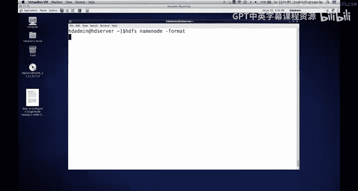
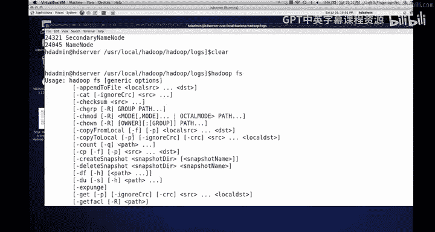
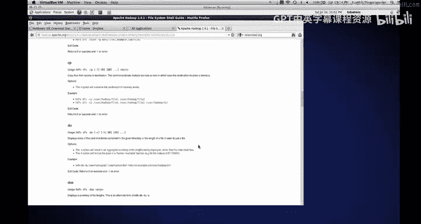
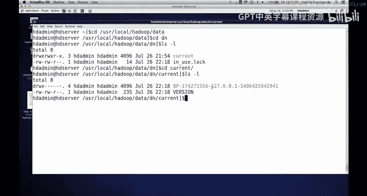
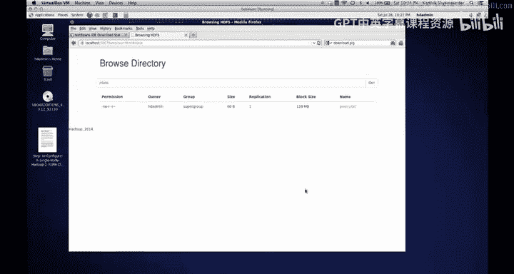
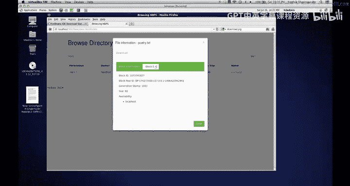
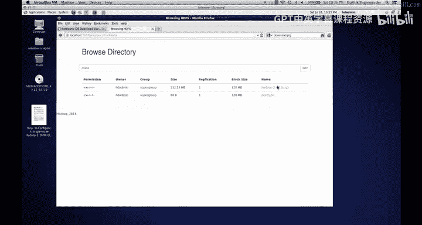
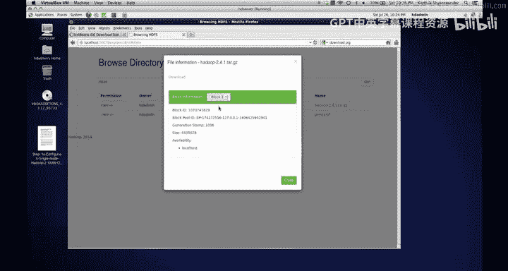

# 课程24：HDFS架构实践 🖥️




在本节课中，我们将登录虚拟机，从管理员视角和文件系统交互视角，通过内置的Hadoop命令来实践HDFS架构。目标是让你对HDFS架构有实际的理解。

## 概述

我们将学习如何格式化HDFS文件系统、启动和停止HDFS守护进程、使用Hadoop FS命令进行基本的文件系统操作，并通过模拟不同条件来观察HDFS的内部工作机制。

---

## 登录虚拟机并格式化文件系统

首先，我们登录到虚拟机。登录后，需要格式化HDFS文件系统。如果不格式化，将无法进行任何操作。

格式化文件系统的命令是：
```bash
hdfs namenode -format
```
执行此命令后，系统会提示文件系统已在特定目录（例如 `/usr/local/hadoop/data/nn`）中格式化。

接下来，我们可以查看该目录的内容：
```bash
ls -l /usr/local/hadoop/data/nn
```
你会看到一个名为 `current` 的目录，其中存储着文件系统镜像。这就是NameNode管理并存储文件系统元数据的地方。

---

## 配置与启动守护进程



NameNode如何知道在哪里存储元数据？答案在配置文件中。让我们查看HDFS的配置文件：
```bash
cd /usr/local/hadoop/etc/hadoop
cat hdfs-site.xml
```
在这个配置文件中，我们指定了NameNode存储元数据的位置、Secondary NameNode存储文件系统镜像的位置，以及DataNode存储实际数据块的位置。



现在，我们可以启动HDFS守护进程。启动所有守护进程的命令是：
```bash
start-dfs.sh
```
这个命令会依次启动NameNode、DataNode和Secondary NameNode。你可以使用 `jps` 命令来检查它们是否都在运行。

如果你想停止所有守护进程，可以使用：
```bash
stop-dfs.sh
```
你也可以单独启动或停止每个守护进程。例如，启动NameNode：
```bash
hadoop-daemon.sh start namenode
```
停止DataNode：
```bash
hadoop-daemon.sh stop datanode
```

---

## 检查端口与日志文件

了解守护进程监听的端口对于调试和管理很有帮助。例如，要查看NameNode监听的端口，可以运行：
```bash
netstat -an | grep LISTEN | grep <namenode进程ID>
```
通常，NameNode会监听9000端口（用于IPC通信）和50070端口（用于管理控制台）。

如果守护进程启动失败，你需要查看日志文件。日志文件位于Hadoop安装目录的 `logs` 文件夹中。例如，NameNode的日志文件可能是 `hadoop-<用户名>-namenode-<主机名>.log`。查看日志可以帮助你诊断问题。

---

## 使用Hadoop FS命令操作文件系统

现在，我们来学习如何使用Hadoop FS命令与HDFS文件系统进行交互。Hadoop FS命令提供了丰富的文件操作功能，类似于Unix命令。

以下是Hadoop FS命令的基本用法列表：

*   **列出文件**：`hadoop fs -ls /`
*   **创建目录**：`hadoop fs -mkdir /data`
*   **从本地复制文件到HDFS**：`hadoop fs -copyFromLocal localfile.txt /data/`
*   **从HDFS复制文件到本地**：`hadoop fs -copyToLocal /data/hdfsfile.txt .`
*   **查看文件内容**：`hadoop fs -cat /data/file.txt`
*   **追加内容到文件**：`hadoop fs -appendToFile localadd.txt /data/file.txt`
*   **重命名文件**：`hadoop fs -mv /data/oldname.txt /data/newname.txt`
*   **删除文件**：`hadoop fs -rm /data/file.txt`
*   **递归删除目录**：`hadoop fs -rm -r /data/olddir`

你可以通过 `hadoop fs` 命令查看所有可用选项，或者查阅Hadoop官方文档获取更详细的指南。

---

## 模拟故障以理解架构

为了深入理解HDFS架构，我们可以模拟一些故障场景。

上一节我们介绍了如何使用命令操作文件系统，本节中我们来看看当核心组件出现问题时会发生什么。

首先，停止NameNode守护进程：
```bash
hadoop-daemon.sh stop namenode
```
然后尝试列出HDFS根目录的文件：
```bash
hadoop fs -ls /
```
命令会失败，并提示无法连接到NameNode。这是因为所有元数据操作都需要与NameNode通信。

接着，重新启动NameNode，然后停止DataNode：
```bash
hadoop-daemon.sh start namenode
hadoop-daemon.sh stop datanode
```
现在，尝试列出文件（`hadoop fs -ls /data`）可能成功，因为这是元数据操作。但尝试读取文件内容（`hadoop fs -cat /data/file.txt`）将会失败，因为客户端无法连接到存储实际数据块的DataNode。

这些实验清晰地展示了HDFS中客户端、NameNode和DataNode之间的协作关系。

---



## 通过Web控制台查看信息

HDFS提供了Web管理控制台，方便我们直观地查看集群状态。NameNode的Web界面通常运行在 `http://<namenode-host>:50070`。



在控制台中，你可以：
*   查看集群概况，如配置容量、使用情况等。
*   浏览HDFS文件系统。
*   查看文件的详细信息，例如一个文件被分成了哪些块（Block）。对于小于64MB的文件，通常只有一个块；对于大文件，你可以看到多个块的信息。



---



## 总结



在本节课中，我们一起学习了HDFS架构的实践操作。我们登录了虚拟机，格式化了HDFS文件系统，并学会了启动和停止HDFS的各个守护进程（NameNode、DataNode、Secondary NameNode）。我们使用Hadoop FS命令对HDFS进行了完整的文件操作，包括创建、删除、复制、重命名文件和目录。我们还查看了守护进程的数据存储位置和日志文件。最重要的是，我们通过模拟NameNode和DataNode宕机的情况，直观地验证了HDFS的架构设计和工作原理。希望这次实践能帮助你更好地理解HDFS。