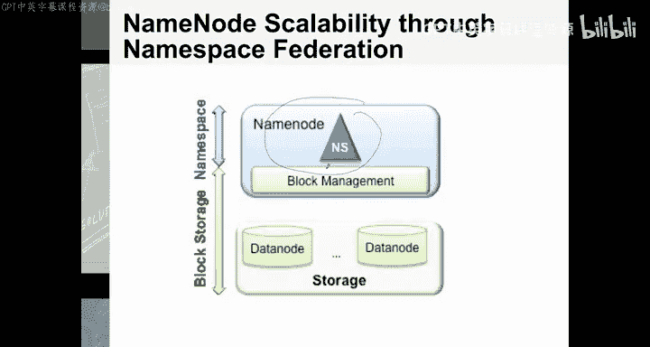
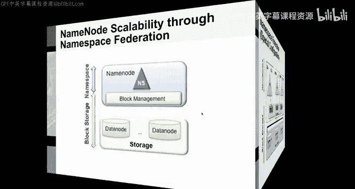
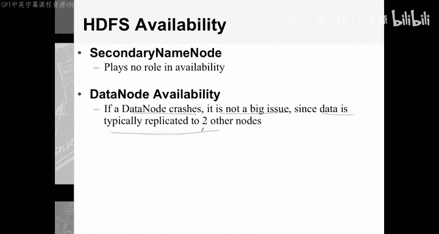
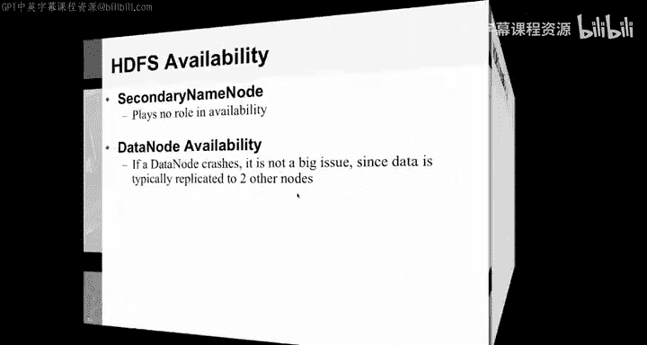
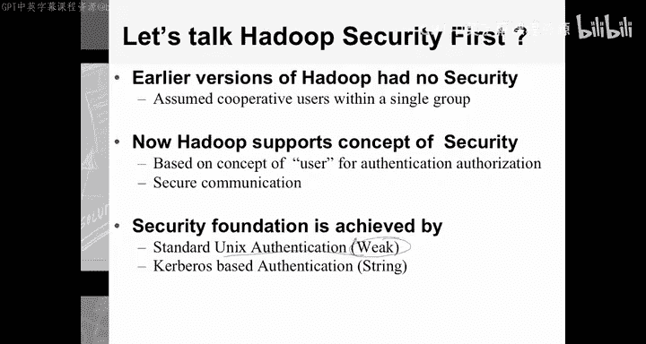
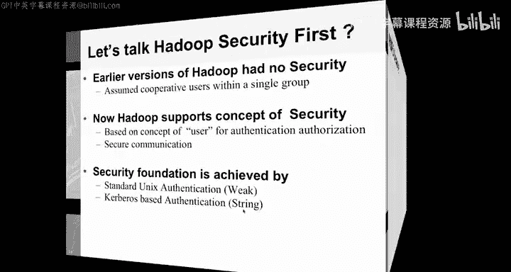
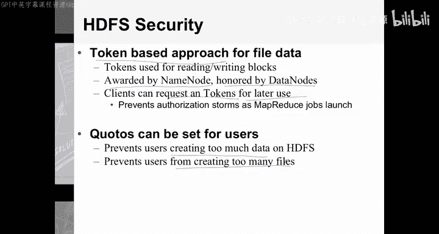
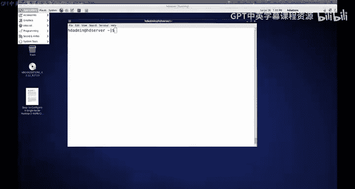

# 课程26：HDFS架构核心能力 🏗️

在本节课中，我们将从多个维度深入探讨HDFS的架构核心能力，包括性能、可扩展性、可用性、可安装性、可配置性、可操作性、易用性和安全性。

## 性能视角

上一节我们介绍了HDFS的整体架构，本节中我们来看看其各个守护进程的性能特点。

### NameNode 性能
NameNode的性能特点是：
*   **内存密集型**：它必须在内存中保存所有文件和目录的元数据。
*   **磁盘I/O密集型**：它需要将所有编辑日志写入磁盘。
*   **CPU密集型**：它需要与DataNode通信，向DataNode发出指令，并在元数据中进行必要的更改。有时，如果NameNode重启，它还需要重建文件系统镜像。

**提升方法**：可以通过添加更快的CPU和更快的磁盘来提升NameNode的性能。

### Secondary NameNode 性能
Secondary NameNode的性能特点是：
*   **CPU密集型**：它需要定期获取文件系统镜像，用所有文件系统编辑日志进行更新，然后将新镜像写回磁盘。从这个角度看，它也是I/O密集型的。

**提升方法**：可以通过添加更快的CPU和更快的磁盘来提升其性能。

### DataNode 性能
DataNode的性能特点是：
*   **磁盘I/O密集型**：它需要向磁盘读写数据块。
*   **网络I/O密集型**：它需要不断在不同节点间复制数据，并在客户端请求时提供数据或接收客户端数据以写入文件系统。

**提升方法**：可以通过添加更快的磁盘和更快的网络互连（如InfiniBand）来提升DataNode的性能。

## 可扩展性视角

了解了性能特点后，我们来看看HDFS各个组件如何应对规模增长。

### NameNode 可扩展性
在当前的默认实现中，只有一个NameNode。NameNode只能通过垂直扩展（纵向扩展）来提升能力，因为它将所有元数据保存在内存中。如果需要维护更多元数据，就必须增加更多内存、CPU和更快的磁盘。

此外，Hadoop 2引入了**命名空间联邦**的新概念。其核心思想是，不再只有一个NameNode管理所有DataNode（即一个命名空间），而是可以拥有多个NameNode，每个管理不同的命名空间。例如，NameNode1管理 `/data` 文件系统，NameNode2管理 `/home`，NameNode3管理 `/project`。它们都操作底层相同的数据块，但各自维护独立的元数据树。这实现了NameNode的水平扩展。

### Secondary NameNode 可扩展性
Secondary NameNode只能通过垂直扩展（增加更多内存、CPU和更快的磁盘）来提升性能，因为它主要的工作就是获取文件系统镜像、应用编辑日志、处理并重写镜像。

### DataNode 可扩展性
DataNode的可扩展性是其强大之处，可以通过水平添加更多DataNode来实现。**增加一倍的DataNode数量，系统的存储容量就增加一倍**。

## 可用性视角

在分布式系统中，高可用性至关重要。接下来我们分析HDFS各组件的可用性策略。

### NameNode 可用性
在简单的默认实现中，只有一个NameNode。如果它崩溃，整个系统几乎会停止。通常的做法是使用具有高**平均无故障时间**的硬件来提升其可用性。当NameNode崩溃时，唯一的方法是尝试重新启动它。这个过程可能需要10到30分钟，具体取决于NameNode需要合并的文件系统镜像和编辑日志的数量。

HDFS 2提供了一种**高可用性NameNode**的特殊配置。在这种模式下，可以运行两个NameNode：一个处于**活动**模式，另一个处于**备用**模式。活动节点处理所有客户端请求和元数据管理，并将编辑日志写入共享存储。备用节点持续应用这些编辑日志到自己的内存中。如果活动节点崩溃，备用节点可以迅速被提升为活动节点，从而保证服务不中断。

### Secondary NameNode 可用性
Secondary NameNode在可用性方面不扮演主要角色，因为它只负责下载文件系统镜像并应用编辑日志。

### DataNode 可用性
单个DataNode崩溃通常不是大问题，因为数据通常被复制到另外两个节点上。当某个DataNode失效时，拥有数据副本的其他DataNode会继续提供服务。因此，**高可用性内置于HDFS的架构之中**。

## 可安装性视角

对于大规模集群，手动安装是不现实的。以下是几种常见的安装和管理方式：

以下是常见的Hadoop安装与管理工具：
*   **手动安装**：适用于小型集群或学习环境（如我们的虚拟机伪分布式模式）。
*   **Apache Ambari**：一个开源工具，是Hortonworks数据平台的一部分，用于大规模集群的安装、管理和监控。
*   **Cloudera Manager**：Cloudera提供的专有管理工具。
*   **自定义脚本**：许多组织使用Puppet、Chef或Ansible等配置管理工具编写自定义安装脚本。
*   **Amazon EMR**：亚马逊的云服务，提供预配置的Hadoop集群镜像，用户无需手动安装，只需指定机器数量和Hadoop版本即可快速部署。

## 可配置性视角

Hadoop具有高度的可配置性，拥有数百个配置参数。

HDFS主要有两个需要配置的XML文件：
*   **`core-site.xml`**：属于Hadoop通用配置。对于HDFS，主要在此文件中指定NameNode的运行位置和端口。例如：`fs.defaultFS` 属性设置为 `hdfs://localhost:9000`。
*   **`hdfs-site.xml`**：用于配置Hadoop分布式文件系统本身。例如，设置副本因子（`dfs.replication`）、NameNode和DataNode的数据存储目录等。

## 可操作性视角

在拥有数百台机器的生产环境中，确保所有守护进程正常运行是一项挑战。

以下是提升HDFS可操作性的工具：
*   **Apache Ambari**：在运维方面表现出色，帮助监控和管理大型集群。
*   **集成监控工具**：如Ganglia和Nagios，可以与Hadoop集成，实现高效监控。
*   **商业产品**：如Cloudera Manager、Hortonworks的Ambari、MapR的Heatmap等，都提供了强大的运维管理功能。

## 易用性视角

用户可以通过多种方式与HDFS进行交互。

### 命令行工具
*   **`hadoop fs` 命令**：允许用户执行基本的文件系统操作，如列出文件、创建目录。例如：`hadoop fs -mkdir /newdir` 或 `hadoop fs -ls /`。
*   **`hdfs dfs` 命令**：功能与 `hadoop fs` 类似，但**额外包含了管理命令**，例如重新平衡集群、使节点上线等。

### 编程接口
HDFS提供了两种程序化访问模式：
1.  **语言绑定API**：支持Java和C++。在下一个模块中，我们将讨论如何使用HDFS Java API进行编程。
2.  **WebHDFS REST API**：可以通过流行的REST接口访问HDFS文件系统。

## 安全性视角

早期版本的Hadoop几乎没有安全性，它假设组织内的用户会友好协作。现在，Hadoop已经支持基于用户身份验证和授权的安全概念。

### 认证与授权基础
Hadoop的安全基础通过两种机制实现：
1.  **基于标准UNIX的认证**：使用UNIX用户ID进行身份验证和授权。这是默认的、相对较弱的机制。
2.  **基于Kerberos的认证**：这是一种更强大的安全方法。

### HDFS 安全特性
HDFS采用基于令牌的安全方法：
*   **令牌机制**：当客户端想要读写文件时，必须从NameNode获取令牌，DataNode会验证这些令牌。客户端也可以预先请求令牌以供后续使用（例如在MapReduce作业中，避免同时请求大量令牌造成网络风暴）。
*   **配额管理**：可以为用户设置存储空间和文件数量的配额，防止单个用户占用过多资源导致NameNode内存不足或磁盘写满。
*   **安全通信**：可以配置HDFS守护进程通过SSL进行通信，以加密节点间的网络传输。
*   **数据加密**：**Hadoop本身不加密磁盘上的文件**。如果需要对磁盘上的数据进行加密，需要从应用程序层面实现。

---

**本节课总结**：
在本节课中，我们一起从性能、可扩展性、可用性、可安装性、可配置性、可操作性、易用性和安全性等多个角度，全面学习了HDFS的架构核心能力。我们了解了每个守护进程（NameNode, Secondary NameNode, DataNode）在不同维度下的特点、限制以及提升方法，并熟悉了与HDFS交互和管理的各种工具与配置选项。