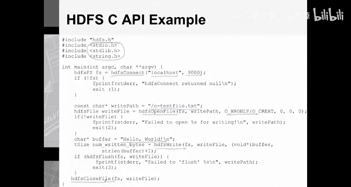
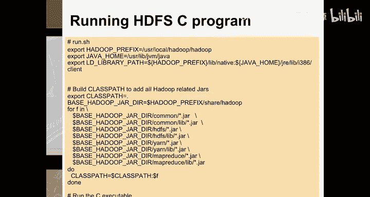
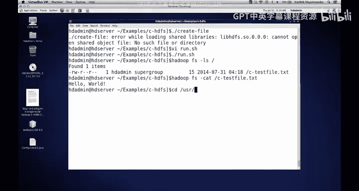

# 课程29：HDFS C API解析 🖥️


在本节课中，我们将学习如何使用C语言编程接口访问Hadoop分布式文件系统。我们将通过一个具体的示例来解析HDFS C API的工作原理、编译和运行过程。

## 概述

HDFS提供了多种编程接口，允许开发者对文件和目录执行创建、读取、更新和删除操作。本节重点介绍C API，它是一个基于Java本地接口的封装层，使得C/C++程序能够调用底层的Java实现。

## HDFS编程接口简介

上一节我们介绍了HDFS的基本概念，本节中我们来看看其编程接口。HDFS主要提供三种编程接口用于文件操作。

以下是三种主要的编程接口：

1.  **C API**：通过JNI桥接调用底层Java实现。
2.  **Java API**：由于HDFS本身用Java编写，因此这是最直接的调用方式。
3.  **REST API**：一种基于HTTP的接口，需要显式配置并启动REST服务。由于其通用性，几乎支持任何语言和客户端。

## HDFS C API详解

现在，让我们深入了解HDFS C API。C API本质上是Java实现的一个JNI包装器。

JNI代表Java本地接口。它允许Java程序调用C/C++程序，反之亦然。由于Hadoop HDFS是用Java编写的，C API利用JNI让C/C++程序能够调用Java程序。



使用C API编程时，需要遵循以下步骤：

以下是使用HDFS C API的关键步骤：

1.  包含头文件：在C程序中包含 `hdfs.h` 头文件，该文件位于Hadoop安装目录的 `include` 文件夹中。
2.  链接库文件：编译时需要链接HDFS库 `libhdfs.a`（静态库）或 `libhdfs.so`（动态库），它们位于Hadoop安装目录的 `lib/native` 子目录中。
3.  包含JNI头文件：为了编译，需要包含JNI的头文件。
4.  链接JVM库：运行时需要JVM库。

## 示例程序解析

接下来，我们通过一个简单的示例程序来具体说明。

```c
#include <hdfs.h>
#include <stdio.h>
#include <stdlib.h>

int main() {
    // 连接到运行在localhost:9000的NameNode
    hdfsFS fs = hdfsConnect("localhost", 9000);
    if (!fs) {
        fprintf(stderr, "连接失败\n");
        exit(1);
    }

    // 以写入模式打开（或创建）文件
    const char* writePath = "/c_test_file.txt";
    hdfsFile writeFile = hdfsOpenFile(fs, writePath, O_WRONLY|O_CREAT, 0, 0, 0);
    if (!writeFile) {
        fprintf(stderr, "打开文件失败\n");
        hdfsDisconnect(fs);
        exit(1);
    }

    // 向文件写入数据
    const char* buffer = "Hello, World from C API!";
    tSize num_written_bytes = hdfsWrite(fs, writeFile, (void*)buffer, strlen(buffer)+1);
    if (num_written_bytes < 0) {
        fprintf(stderr, "写入失败\n");
    }

    // 关闭文件并断开连接
    hdfsCloseFile(fs, writeFile);
    hdfsDisconnect(fs);

    return 0;
}
```

这个程序演示了如何连接到HDFS、创建文件、写入数据以及清理资源。所有HDFS C API函数都以 `hdfs` 为前缀。

## 编译与运行



编写完C程序后，下一步是将其编译成可执行文件。编译过程需要指定正确的头文件和库路径。

以下是一个编译脚本示例：

```bash
#!/bin/bash
export HADOOP_PREFIX=/usr/local/hadoop
export JAVA_HOME=/usr/lib/jvm/java-8-openjdk-amd64

gcc create_file.c \
    -I${HADOOP_PREFIX}/include \
    -I${JAVA_HOME}/include \
    -I${JAVA_HOME}/include/linux \
    -L${HADOOP_PREFIX}/lib/native \
    -L${JAVA_HOME}/jre/lib/amd64/server \
    -lhdfs -ljvm \
    -o create_file
```

编译成功后，运行程序前需要设置正确的环境变量，特别是 `CLASSPATH`，因为C API需要通过JNI调用Java类。

以下是运行前需要设置的环境变量示例：

```bash
#!/bin/bash
export HADOOP_PREFIX=/usr/local/hadoop
export JAVA_HOME=/usr/lib/jvm/java-8-openjdk-amd64
export LD_LIBRARY_PATH=${HADOOP_PREFIX}/lib/native:${JAVA_HOME}/jre/lib/amd64/server

# 构建包含所有Hadoop Jar文件的CLASSPATH
CLASSPATH="."
for jar in `find ${HADOOP_PREFIX}/share/hadoop -name "*.jar"`; do
    CLASSPATH=${CLASSPATH}:$jar
done
export CLASSPATH

./create_file
```

运行脚本后，程序将在HDFS的根目录创建名为 `c_test_file.txt` 的文件，并写入“Hello, World from C API!”。

## 核心API函数

最后，让我们简要了解一下 `hdfs.h` 头文件中定义的一些核心函数。这些函数为C程序员提供了完整的HDFS文件操作能力。

以下是部分关键函数：



*   `hdfsConnect` / `hdfsConnectBuilder`：建立与HDFS的连接。
*   `hdfsOpenFile`：打开（或创建）HDFS上的一个文件。
*   `hdfsWrite` / `hdfsRead`：向文件写入数据或从文件读取数据。
*   `hdfsCloseFile`：关闭一个已打开的文件。
*   `hdfsExists`：检查文件或目录是否存在。
*   `hdfsSeek`：在文件中定位读取/写入位置。
*   `hdfsDisconnect`：断开与HDFS的连接。

## 总结


本节课中我们一起学习了HDFS C API。我们了解到C API是建立在JNI之上的一个包装层，使得C/C++应用程序能够与用Java编写的HDFS进行交互。我们通过一个完整的示例，从编写代码、编译到运行，逐步解析了如何使用C语言在HDFS上创建和写入文件。掌握这些知识后，开发者就可以利用熟悉的C语言环境来处理Hadoop分布式文件系统中的数据了。