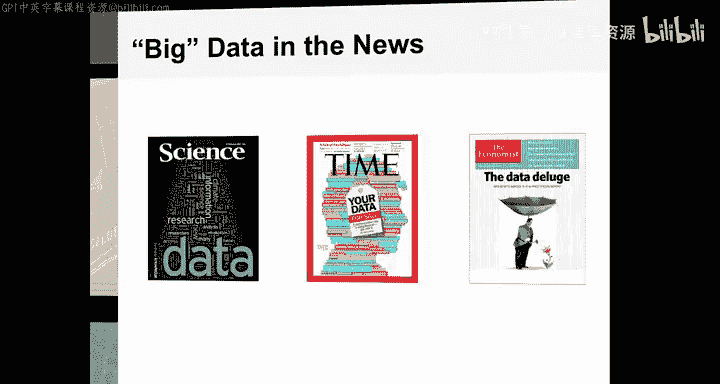
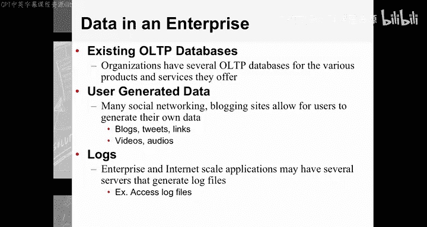
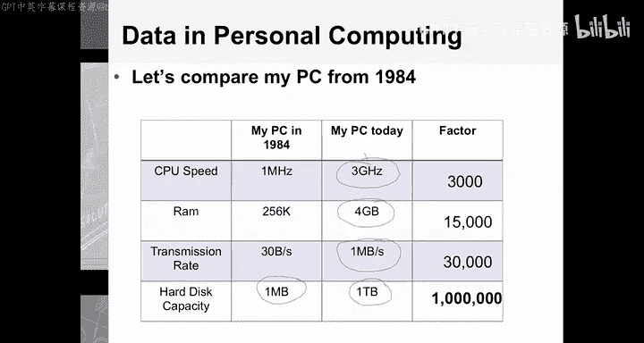
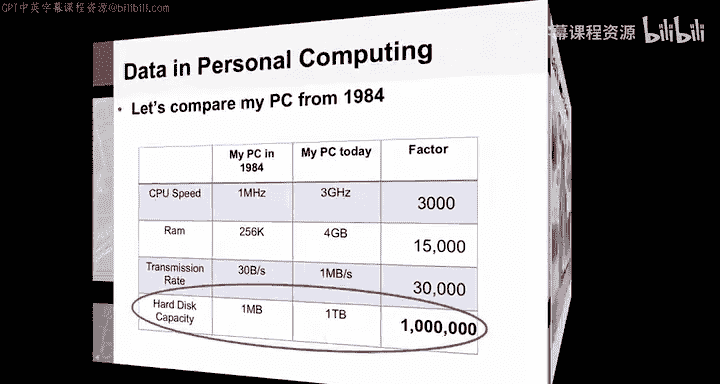

# 课程一：数据爆炸 📊

在本节课中，我们将要学习“数据爆炸”这一概念。我们将探讨数据为何以及如何以惊人的速度增长，并比较过去与现在在用户、应用和基础设施方面的差异，以理解数据爆炸背后的原因。

---

## 数据无处不在

过去五年，除非你与世隔绝，否则你一定听说过“数据”这个词，更准确地说，是“大数据”。科学杂志、时代杂志和经济学家杂志都在讨论数据。它们真正想说的是，像谷歌、脸书、推特和领英这样的公司，正在收集关于你、你的公司、你的想法的数据，并将其存储在服务器端，以有意义的方式提供给他人，并在此过程中赚取大量利润，而你的隐私则受到了影响。

甚至还有一个概念叫“数据节食”，其核心是从市场产生的海量数据中，丢弃不需要的部分，保留所需部分，从而提取出最重要的信息。

---

## 每分钟的数据生成量

以下是展示当前每分钟生成数据量的可视化图表。请暂停视频，以便更仔细地查看此图表。

让我们仔细看看这个图表：
*   **YouTube**：每分钟上传48小时的视频。这意味着每7到10天，上传的视频量就相当于约100年的内容。
*   **新网站**：每分钟生成571个新网站。
*   **Flickr**：用户每分钟添加3125张新照片。
*   **Instagram**：用户每分钟分享3600张新照片。
*   **Tumblr**：用户每分钟生成27778条新帖子。

由此可见，每分钟都在生成大量数据，所有这些数据都可能需要被处理和分析。

---

## 数据爆炸的原因：1975年与今天的对比

为什么市场上会产生如此多的数据？为了理解这一点，我们将从用户、应用和基础设施三个方面，比较1975年与今天的差异。

上一节我们看到了数据生成的惊人速度，本节中我们来看看背后的原因。

**1. 用户**
*   **1975年**：应用为大约2000名用户构建。例如，当时为AT&T构建的应用仅供其员工使用，用户群体是静态的。
*   **今天**：2000用户只是一个起点。应用发布到互联网后，用户可能来自你的城市、州、国家（如美国），进而扩展到整个北美、南美、欧洲和亚洲。你面对的是呈指数级增长的、来自全球的动态在线用户。

**2. 应用**
*   **1975年**：主要进行业务流程自动化，用户是公司内部员工（如银行职员）。
*   **今天**：仍在进行业务流程自动化，但用户变成了日常用户。例如，美国银行现在构建的应用供你我使用，以便进行电话银行、手机银行等操作，这些都在生成数据。

**3. 数据类型**
*   **1975年**：处理高度结构化的数据记录，通常存储在数据库中。
*   **今天**：处理**结构化数据**、**半结构化数据**（如XML、JSON）和**非结构化数据**（如音频文件、视频文件、PDF文档）。我们将在后面详细讨论这些数据类型。

**4. 基础设施**
*   **1975年**：数据网络处于起步阶段；计算以大型机或小型机为中心的集中式计算为主。
*   **今天**：拥有高速通用数据网络；智能手机可以高速连接互联网；计算是分布式的。你的手机本身就是一台连接服务器的客户端计算机，它本身就在生成大量数据。

正是由于用户基础、应用类型和基础设施的这些根本性变化，导致了数据的爆炸式增长。

---

## 企业中的数据

现在，让我们看看企业环境中的数据。在企业中，你通常不只有一个数据库。

以下是企业内常见的数据源：
*   **多个OLTP数据库**：公司可能为其提供的各种产品和服务设置多个在线事务处理数据库。
*   **用户生成内容**：在像脸书和推特这样的社交网络或博客网站，用户自己生成数据，如博客、推文、上传的视频和音频文件。
*   **日志文件**：企业和互联网规模的应用（Web级应用）可能在全世界不同地区拥有多台服务器，这些服务器会生成日志文件（如访问日志）。所有这些日志文件都需要被汇总和处理。
*   **系统生成数据**：企业内部的许多服务会生成需要处理的系统日志文件。例如，威瑞信公司每天处理约650亿次DNS查询，所有这些查询都会被记录并在当天结束时进行处理，以分析请求量和来源。

---

## 个人计算中的数据

最后，我们来看看个人计算中的数据。我将比较1984年我的个人电脑和今天的电脑。

以下是1984年与今天个人电脑关键指标的对比：
*   **CPU速度**：从 1 MHz 提升到 3 GHz（增长约3000倍）。
*   **内存**：从 256 KB 提升到 4 GB（增长约15000倍）。
*   **传输速率**：从 30 字节/秒提升到 1 MB/秒（增长约30000倍）。
*   **硬盘容量**：从 1 MB 提升到 1 TB（增长约100万倍）。

这些数据清晰地表明，即使在你个人的生活中，也在生成大量数据。你拥有自己的文档、视频和图片。存储容量的增长幅度最大，这正好满足了存储这些爆炸性增长的数据的需求。

---

## 数据量的冰山

是的，数据量正在不断增长。我将数据量比作一座冰山，因为如果你观察一座冰山，它非常庞大，但有趣的是，冰山的大部分质量都隐藏在底部。数据领域正在发生同样的事情：有大量数据正在涌入。

我想强调的是，这仅仅是个开始。数据量正在增长，并且随着时间推移，将以指数级速度持续增长。

---

## 总结

本节课中，我们一起学习了“数据爆炸”现象。我们了解了数据正以惊人的速度生成，并通过对比1975年与今天在用户、应用和基础设施方面的变化，深入探讨了数据爆炸的根本原因。我们还查看了企业和个人层面数据增长的例子，并认识到当前的数据增长趋势仅仅是一个开始，未来数据量将继续呈指数级扩张。理解数据爆炸是学习大数据处理技术的重要第一步。