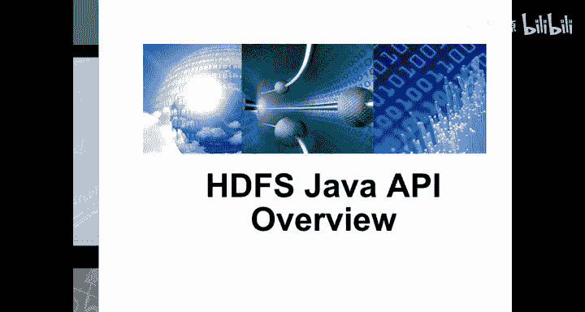
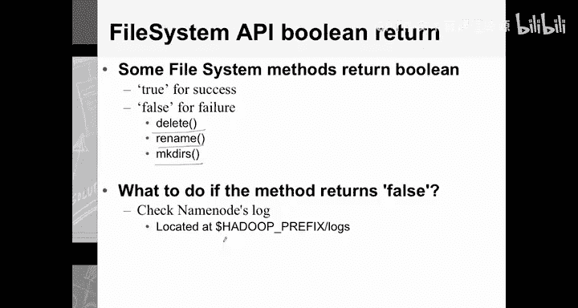
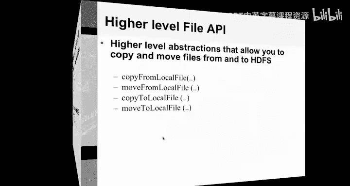
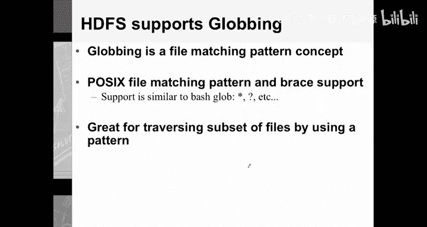
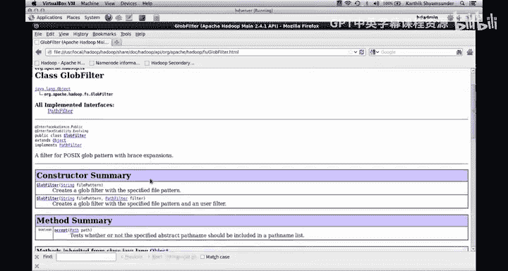
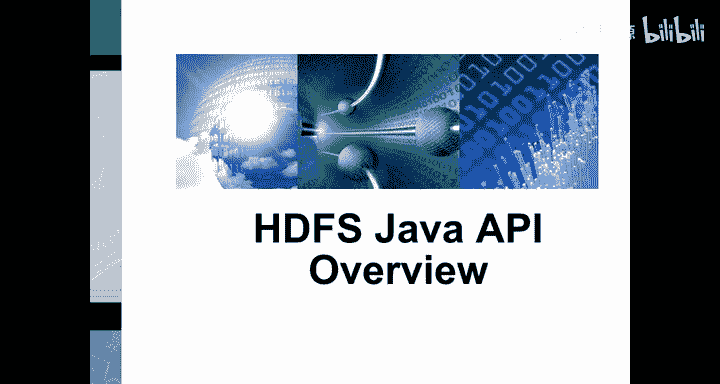

# 课程9：HDFS Java API解析 🗂️

在本节课中，我们将学习如何使用Java API来操作HDFS文件系统。我们将概述关键的Java API包和类，并了解API如何向客户端传递警告、错误和异常信息。

---

## HDFS Java API概述

上一节我们学习了如何为Hadoop设置Java开发环境以及如何实例化Hadoop配置对象。本节中，我们将重点学习用于HDFS编程的Java API。

正如之前提到的，对HDFS中的文件和目录进行CRUD操作有三种编程接口。我们已经讨论过使用JNI桥调用底层Java实现的C API。本节我们将概述Java API。

我们需要熟悉几个关键的HDFS Java API包。

以下是主要的HDFS Java API包：

*   **`org.apache.hadoop.fs`**：处理文件系统API。如其名，FS代表文件系统。它包含一个非常重要的抽象类`FileSystem`，以及随Hadoop JAR文件提供的多个`FileSystem`类的具体实现。
*   **`org.apache.hadoop.io`**：处理IO操作，特别是IO的序列化方面，即将对象序列化为网络流或文件流。该包包含`Writable`接口和`WritableComparable`接口。对于基本类型（如`Integer`、`Float`、`Double`、`String`），有多个`WritableComparable`接口的具体实现，我们将在Hadoop序列化章节中介绍。
*   **`org.apache.hadoop.io.compress`**：处理压缩API。该包包含压缩编解码器（Codec，即编码器/解码器）。Hadoop提供了多种压缩实现，它们都是这个包的一部分。

我们还需要熟悉几个关键的HDFS Java API类。

以下是关键的HDFS Java API类：

*   **`FileSystem`类**：这是一个抽象的文件系统类。你获取对此文件系统对象的引用，实际上会得到一个真实文件系统对象的实例，以执行所有文件系统操作。这是一个非常重要的类，几乎所有操作都通过`FileSystem`类完成。
*   **`Path`类**：表示一个文件。
*   **`FSDataInputStream`类**：用于从文件中读取数据。
*   **`FSDataOutputStream`类**：用于将数据写入文件。
*   **`FileStatus`类**：提供文件信息，例如文件大小、所有者、文件权限。

---

## FileSystem类详解

`FileSystem`类是一个抽象类，是通用文件系统的基类。核心思想是，由于`FileSystem`类是抽象类，你需要通过使用`FileSystem`对象中可用的工厂风格`get`方法来获取一个具体的文件系统对象。

这个`get`方法基于默认配置或你传递给`get`方法的URI方案，将返回你的文件系统对象。我们将在下一节（创建和删除文件）中看到相关示例。

一旦你在代码中获取了`FileSystem`对象，就可以使用它来操作文件系统。这里的“操作”包括：创建新文件、打开现有文件进行读取、打开文件进行追加操作、删除文件、创建和删除目录、检查文件或目录是否存在、获取文件状态信息（如文件长度、权限、所有者），以及我们将要讨论的用于列出或选择文件的“Globbing”概念。

Hadoop提供了多个具体的文件系统类。

以下是Hadoop中可用的具体文件系统类：

*   **`LocalFileSystem`类**：位于`fs`包中，处理本地文件系统。每台机器都有一个本地文件系统（即原生文件系统）。它代表你机器上的本地文件系统，URI方案是`file:///`。
*   **`DistributedFileSystem`类**：代表HDFS。这是最重要的文件系统之一，因为我们将使用HDFS。分布式文件系统的URI方案是`hdfs:///`。
*   **`NativeS3FileSystem`类**：代表Amazon S3文件系统。其URI方案是`s3n:///`。
*   **`S3FileSystem`类**：这是S3文件系统的一个变体。注意，这个叫S3文件系统，而前一个叫原生S3文件系统。这是一个基于块的文件系统，就像HDFS一样。原生文件系统对文件大小有限制（只能为5GB），而这个基于块的S3文件系统没有限制。其URI方案通常是`s3:///`。如果你要在Amazon环境中进行MapReduce编程，通常会使用S3文件系统，而不是原生S3文件系统，因为你的文件通常会超过5GB。

我想强调的是，Hadoop的`fs`包中提供了多种文件系统实现。

---

## Path类详解

`Path`类是一个具体类，代表HDFS中的一个文件或目录。它只表示文件名，因为你不能实例化一个`Path`对象然后直接用它来读取或写入文件。但是，你可以获取一个代表HDFS或本地文件系统中文件名的`Path`对象，然后将其传递给`FileSystem`对象以打开文件进行读取或写入。

有几种方法可以创建`Path`对象：你可以向`Path`对象传递一个字符串（相对或绝对路径，取决于是否以斜杠开头），它会创建一个代表该特定文件或目录的`Path`对象。你也可以通过传递一个父`Path`对象（目录）和一个子项（可能是父路径目录中的子目录或文件）来创建`Path`对象。还可以是`Path`和`String`、`String`和`Path`，或`String`和`String`的组合，有多种变体可供使用。

---

## 输入/输出流与文件状态类

`FSDataInputStream`类是用于读取文件的流。你不能直接实例化`FSDataInputStream`类，但可以通过打开一个现有文件进行读取来获取它的一个实例，这将返回一个`FSDataInputStream`对象。

一旦你有了与文件关联的`FSDataInputStream`对象，就可以从文件中读取数据。你可以读取`Integer`、`Float`、`Char`、`Boolean`等任何基本类型，也可以将字节读入数组，从而一次读取多个字节。你还可以获取当前读取位置，定位到特定位置，跳过字节，几乎可以在该特定文件内进行某种随机访问。

`FSDataOutputStream`类是用于写入文件的流。就像`FSDataInputStream`类一样，你不能实例化`FSDataOutputStream`类，但你可以使用`FileSystem`对象创建新文件或打开现有文件，当你这样做时，它会返回一个`FSDataOutputStream`对象。

一旦你有了`FSDataOutputStream`对象，就可以向文件写入字节。因此，基本类型（`Integer`、`Float`、`Char`、`Boolean`等）都可以写入。如果你有一个字节数组，可以写出整个数组。你可以获取当前位置，也可以同步所有缓冲区，确保你写入的所有内容都已写入底层文件系统。

`FileStatus`类代表文件的客户端信息。这里的“客户端信息”是指用于操作文件系统或获取文件系统信息的Java HDFS API客户端。因此，这是文件状态对象的客户端表示。

核心思想是，你通过在具体的文件系统对象上调用`listStatus`方法来获取`FileStatus`对象的实例。你访问`FileSystem`对象并调用`listStatus`方法，它将返回一个`FileStatus`对象。一旦你有了`FileStatus`对象，就可以获取文件长度、最后访问时间、修改日期和时间、块大小、复制因子等。当你执行`ls -l`操作时获得的所有文件信息，都可以通过`FileStatus`对象获得。

---

## 异常处理与返回值

你注意到，HDFS API中的许多方法都会抛出`java.io.IOException`。这是合理的，因为你正在读取文件、写入文件、删除文件，这些都是IO操作，因此抛出`IOException`是合理的。

如果一个方法抛出异常该怎么办？很简单，你可以检查异常堆栈跟踪，这通常是我们会做的。但你也可以检查NameNode的日志文件，该文件位于Hadoop安装目录的`logs`子目录下（`$HADOOP_PREFIX/logs`）。查看`namenode`日志文件，看看服务器端是否有任何特定信息，因为请记住，在HDFS编程中，有客户端和服务器端（即执行所有元数据操作的HDFS NameNode）。

你还会注意到，一些`FileSystem`方法返回一个布尔值。例如，`delete`、`rename`和`mkdirs`方法都返回布尔值。

为什么这些方法返回布尔值？想一想，如果你要求文件系统API删除一个文件，而该文件不存在（因为文件已被删除），它应该怎么做？是应该抛出异常，还是应该保持沉默？这里的方法，比如`delete`方法，会返回一个布尔值，指示它是否实际执行了操作。如果`delete`方法返回`true`，意味着它确实删除了文件（因为文件存在）。如果`delete`方法返回`false`，意味着它说“我没有删除文件，但你想让我删除的文件反正不存在”。这就是布尔返回类型背后的思想。

如果方法返回`false`该怎么办？你当然可以查看NameNode日志文件，看看是否有任何特定信息可供参考。

---

## 高级抽象：文件操作与Globbing

除了用于创建、删除和操作文件的低级API外，还有更高级的抽象，允许你在HDFS之间复制和移动文件。

如果你还记得使用`hadoop fs`命令，我们能够将文件从本地文件系统复制到Hadoop文件系统，从本地文件系统移动到Hadoop文件系统，反之亦然（从Hadoop分布式文件系统复制到本地，从Hadoop分布式文件系统移动到本地）。文件系统API中提供了类似的功能，因此有一些非常好的高级方法可供你使用，允许你将文件从本地文件系统移动或复制到Hadoop文件系统，反之亦然。

HDFS还支持一个称为“Globbing”的概念。Globbing是一种文件匹配模式概念，在Unix shell中经常使用。HDFS支持POSIX文件匹配模式，当然在此基础上还增加了大括号支持。这是一种通过使用模式遍历文件子集的好技术。如果你不知道什么是glob模式，你可能想在Google上阅读更多相关内容，网上有很多关于此的教程。

HDFS支持多种glob模式。

以下是HDFS支持的几种glob模式：

*   **`?`**：匹配任何单个字符。
*   **`*`**：匹配零个或多个字符。
*   **`[abc]`**：匹配括号内的任意单个字符（此处为a、b或c）。
*   **`[a-b]`或`[a-z]`**：范围匹配。
*   **`[^abc]`**：取反，匹配不在此特定集合中的任何字符。
*   **`\`**：用于转义字符的含义。
*   **`{ab, cd}`**：大括号概念，匹配字符串集合中的字符串（此处为“ab”或“cd”）。

HDFS支持许多glob概念。再次强调，如果你不理解Globbing，请参考互联网上的Globbing概念，有很多教程可用。

---

## 官方文档速览

我们刚刚看了各种HDFS包和文件。让我们看看Hadoop HDFS文档。

如果你访问Apache Hadoop页面，有API文档。这里列出了所有的包。我们看了`hadoop.configuration`包，也看了`hadoop.fs`包。我们还提到有`hadoop.io`包，它包含`hadoop.io.compress`包以及IO包中的一些其他子包。这些是HDFS编程所需的主要包。

让我们快速看一下`hadoop.configuration`包。它包含`Configuration`类。注意，`Configuration`是一个具有名称、值和`final`元素（指示属性是否可以更改）的属性。有像`addDefaultResource`（我们看过的静态方法）这样的方法，还有我们看过的`dumpConfiguration`方法。

让我们回过头来看看`FileSystem`包。在`FileSystem`包中，有`FileSystem`类，它是一个抽象的基类。有几个类实现或扩展了`FileSystem`类，比如`S3FileSystem`、`NativeS3FileSystem`或`RawLocalFileSystem`。然后是`FileStatus`类，它提供文件信息，例如文件长度、文件所有者、文件路径、文件权限。我们还提到了`GlobFilter`概念，所以这是支持GlobFilter概念的`GlobFilter`类。

让我们看看`io.compress`包。它包含所有各种编解码器、压缩编解码器、接口以及这些编解码器的几种实现。还有基本的`io`包，处理序列化。这里的关键类或关键接口是`Writable`接口和`WritableComparable`接口，我们稍后会介绍。这里是`Writable`接口和`WritableComparable`接口。

希望这能让你对HDFS文件系统中的所有各种包和类有一个概述。

---

## 总结

在本节中，我们学习了用于操作HDFS文件系统的关键Java API包和类。我们介绍了处理文件系统API的`hadoop.fs`包，处理序列化API的`hadoop.io`包，以及处理压缩API的`io.compress`包。我们还了解了像`FileSystem`类（允许你操作文件系统）、`Path`类（允许你表示HDFS或任何其他文件系统中的文件）、`FSDataInputStream`类和`FSDataOutputStream`类（允许你读写文件）、`FileStatus`类（允许你获取文件信息）这样的类，并且我们了解了HDFS中如何处理异常。