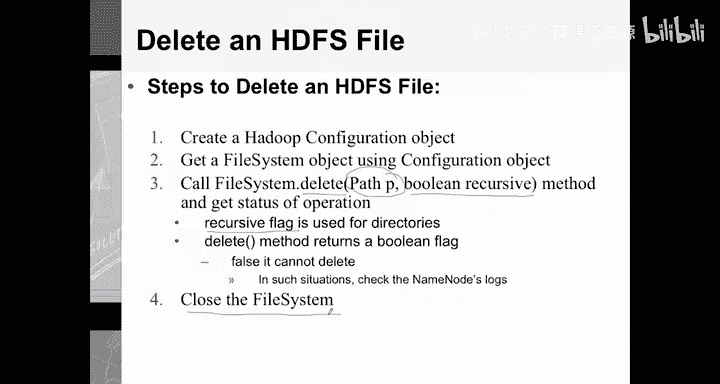
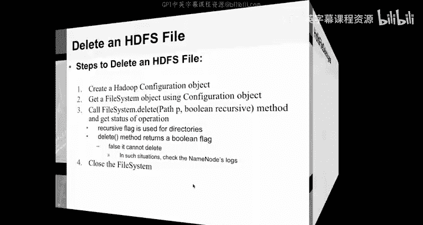
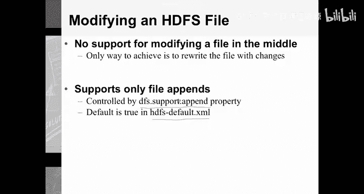
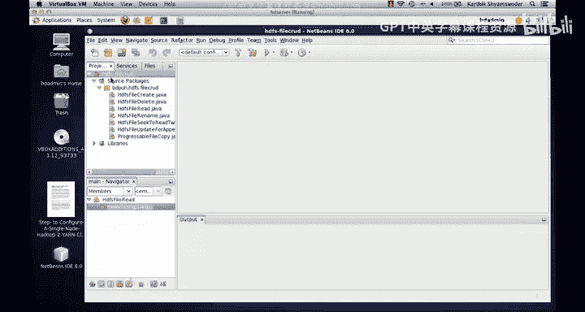
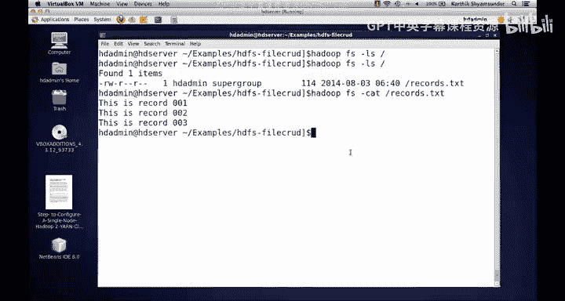
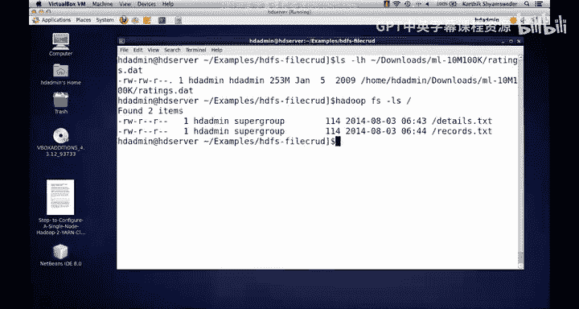
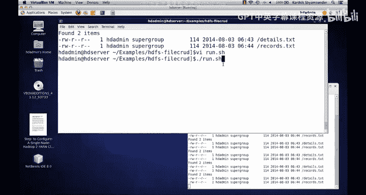
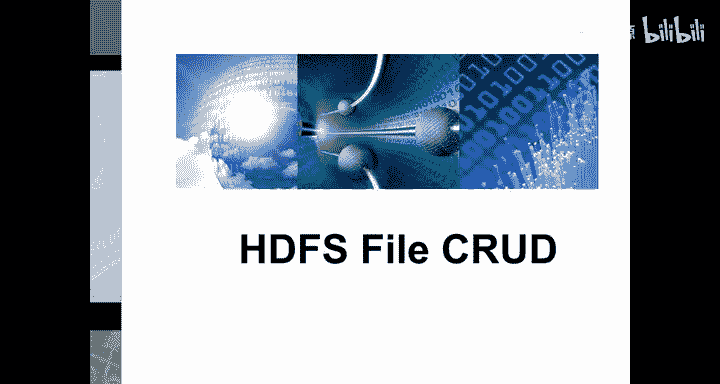

# 课程 10：HDFS 文件增删改查操作 📁


在本节课中，我们将学习如何使用 Java API 对 Hadoop 分布式文件系统（HDFS）中的文件进行创建、读取、更新和删除操作。我们将通过具体的代码示例来理解每个步骤，并探讨 HDFS 内部如何处理这些操作。

---

## 概述

HDFS 提供了丰富的 Java API 来管理文件。我们将学习如何配置 Hadoop 环境、获取文件系统对象，并执行基本的文件操作。理解这些操作背后的机制对于高效使用 HDFS 至关重要。

---

## 创建文件

上一节我们介绍了 HDFS 的基本概念，本节中我们来看看如何创建一个新文件并向其中写入内容。

以下是创建文件并写入内容的步骤：

1.  创建一个 Hadoop 配置对象。
2.  使用配置对象获取一个文件系统对象。`FileSystem` 类有一个静态方法 `get`，它接收配置对象，并根据配置返回相应的具体文件系统实例。
3.  在文件系统对象上调用 `create` 方法，并传入一个 `Path` 对象（代表文件系统中的路径）。如果创建成功，将返回一个 `FSDataOutputStream` 对象，用于向文件写入内容。
4.  `create` 方法有多个重载版本，允许你根据覆盖标志、副本级别、缓冲区大小等进行自定义设置。
5.  获得 `FSDataOutputStream` 对象后，调用其 `write` 方法将内容写入文件。有多个重载的 `write` 方法可供使用。
6.  写入完成后，关闭 `FSDataOutputStream` 对象和文件系统。

**示例代码：HDFSFileCreate.java**
```java
Path file = new Path("/records.txt");
Configuration conf = new Configuration();
FileSystem fs = FileSystem.get(conf);
FSDataOutputStream out = fs.create(file);
out.writeBytes("record1\n");
out.writeBytes("record2\n");
out.writeBytes("record3\n");
out.close();
fs.close();
```

---

## 读取文件

了解了如何创建文件后，接下来我们学习如何读取已存在的文件内容。

以下是读取文件的步骤：

1.  创建一个 Hadoop 配置对象。
2.  使用配置对象获取文件系统对象。
3.  使用文件系统对象的 `open` 方法打开文件，传入要打开的文件的 `Path` 对象。如果成功，将返回一个 `FSDataInputStream` 对象。
4.  使用 `FSDataInputStream` 对象的 `read` 方法读取文件内容。基本的 `read` 方法返回一个整数（字符）。当到达文件末尾时，`read` 方法会返回 -1，因此通常需要在循环中读取。
5.  读取完成后，关闭 `FSDataInputStream` 对象和文件系统。

**示例代码：ReadHDFSFile.java**
```java
Path file = new Path("/records.txt");
Configuration conf = new Configuration();
FileSystem fs = FileSystem.get(conf);
FSDataInputStream in = fs.open(file);
int bytesRead;
while ((bytesRead = in.read()) != -1) {
    System.out.print((char) bytesRead);
}
in.close();
fs.close();
```

---

## 追加内容到文件

除了创建新文件，我们还可以向现有文件追加内容。





以下是向文件追加内容的步骤：

1.  创建一个 Hadoop 配置对象。
2.  使用配置对象获取文件系统对象。
3.  在文件系统对象上调用 `append` 方法，传入要追加内容的文件的 `Path` 对象。这将返回一个 `FSDataOutputStream` 对象。
4.  使用 `FSDataOutputStream` 对象的 `write` 方法写入要追加的内容。
5.  写入完成后，关闭 `FSDataOutputStream` 对象和文件系统。

**示例代码：HDFSFileUpdate.java**
```java
Path file = new Path("/records.txt");
Configuration conf = new Configuration();
FileSystem fs = FileSystem.get(conf);
FSDataOutputStream out = fs.append(file);
out.writeBytes("record4\n");
out.writeBytes("record5\n");
out.writeBytes("record6\n");
out.close();
fs.close();
```

---

## 删除文件

文件管理也包括删除不再需要的文件。

以下是删除文件的步骤：

1.  创建一个 Hadoop 配置对象。
2.  使用配置对象获取文件系统对象。
3.  在文件系统对象上调用 `delete` 方法，传入要删除的文件的 `Path` 对象。第二个参数 `recursive` 对于目录更有意义，如果设为 `true` 则会递归删除目录及其内容。
4.  删除操作完成后，关闭文件系统。`delete` 方法返回一个布尔值，指示操作是否成功（文件存在并成功删除则返回 `true`，否则返回 `false`）。

**示例代码：HDFSFileDelete.java**
```java
Path file = new Path("/records.txt");
Configuration conf = new Configuration();
FileSystem fs = FileSystem.get(conf);
boolean isDeleted = fs.delete(file, false); // false 表示不递归
System.out.println("Delete successful: " + isDeleted);
fs.close();
```

---

## 重命名文件

有时我们需要更改文件的名称或位置。

以下是重命名文件的步骤：

1.  创建一个 Hadoop 配置对象。
2.  使用配置对象获取文件系统对象。
3.  在文件系统对象上调用 `rename` 方法，传入旧文件的 `Path` 对象和新文件的 `Path` 对象。新路径可以在不同目录甚至不同文件系统中。
4.  重命名操作完成后，关闭文件系统。`rename` 方法也返回一个布尔值指示操作状态。

**示例代码：HDFSFileRename.java**
```java
Path oldFile = new Path("/records.txt");
Path newFile = new Path("/details.txt");
Configuration conf = new Configuration();
FileSystem fs = FileSystem.get(conf);
boolean isRenamed = fs.rename(oldFile, newFile);
System.out.println("Rename successful: " + isRenamed);
fs.close();
```

---

## 带进度回调的文件操作

对于长时间运行的操作（如写入大文件），提供进度反馈对用户体验很重要。

`FileSystem` 类的 `create` 和 `append` 方法有重载版本，可以接收一个回调接口作为参数。这个回调接口用于在写入操作进行时报告进度。





**示例概念：ProgressibleCopy.java**
```java
// 在调用 create 方法时传入一个 Progressable 对象
FSDataOutputStream out = fs.create(destFile, new Progressable() {
    @Override
    public void progress() {
        System.out.print("."); // 写入过程中定期打印点号
    }
});
// ... 然后进行写入操作
```
在写入操作期间，`progress` 方法会被定期调用。

---

## HDFS 文件操作内部机制



理解 API 调用背后发生了什么，有助于我们编写更健壮的程序。

### 文件写入的解剖

当客户端调用 `create` 方法时：
1.  `DistributedFileSystem` 客户端向 NameNode 发起 RPC 调用。
2.  NameNode 检查权限，如果允许，则创建文件元数据（此时不分配数据块）。
3.  客户端通过 `FSDataOutputStream` 写入数据。输出流已从 NameNode 获取了数据块应写入哪些 DataNode 的信息。
4.  第一个数据块被写入一个 DataNode（例如 DataNode1），然后该 DataNode 会异步地将副本复制到其他 DataNode（例如 DataNode2, DataNode3）。
5.  客户端继续写入更多数据，副本在后台异步复制。
6.  客户端关闭文件。

### 文件读取的解剖

当客户端调用 `open` 方法时：
1.  `DistributedFileSystem` 客户端向 NameNode 发起 RPC 调用，获取文件块的位置信息。
2.  NameNode 返回包含每个块副本位置的列表。
3.  客户端通过 `FSDataInputStream` 读取数据。输入流会从最近的 DataNode 读取第一个块。
4.  如果读取某个 DataNode 失败，它会自动尝试从该块的其他副本读取。
5.  读取完所有数据后，客户端关闭输入流。

---



## HDFS 一致性模型

HDFS 有其特定的文件一致性保证。

*   **正在写入文件的可见性**：当客户端写入文件时，其他客户端只能看到已完全写完的数据块。例如，Client1 正在写 Block2，那么 Client2 只能读取已完成的 Block1。
*   **独占写入**：HDFS 支持独占写入。当第一个客户端打开文件进行写入时，NameNode 会授予一个“租约”。在此期间，其他客户端尝试写入同一文件将被拒绝。
*   **文件修改**：HDFS 不支持在文件中间进行修改。唯一“修改”文件的方式是重写整个文件，或者使用 `append` 操作在文件末尾追加内容（需确保 `dfs.support.append` 属性为 `true`）。



---

## 总结



本节课中，我们一起学习了使用 Java API 对 HDFS 文件进行增删改查操作。我们掌握了创建、读取、追加、删除和重命名文件的方法，并通过代码示例加深了理解。此外，我们还探讨了文件操作背后的内部机制，包括写入和读取的流程，以及 HDFS 的一致性模型。这些知识是构建高效、可靠的大数据应用的基础。