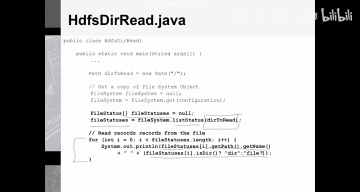
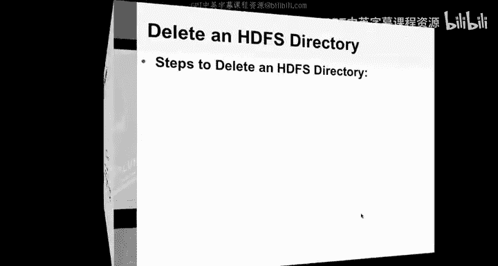
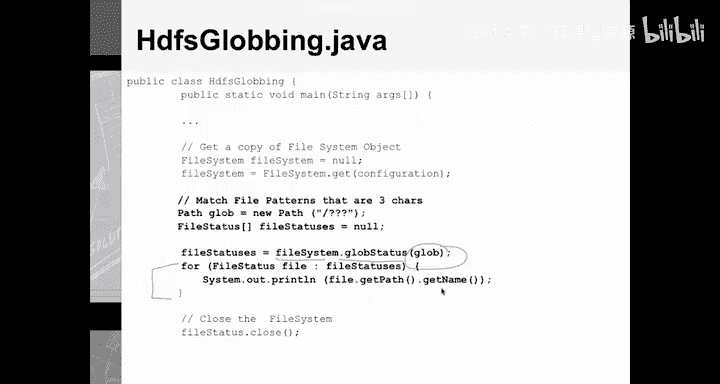
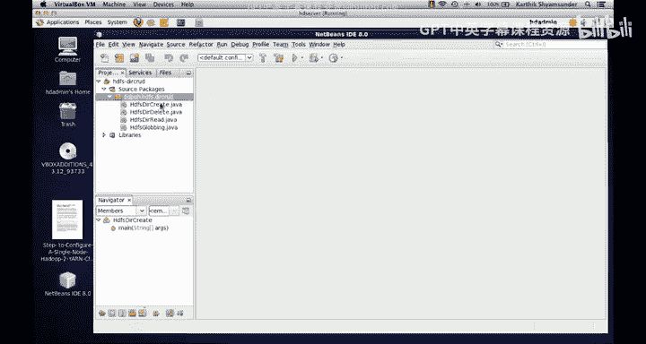
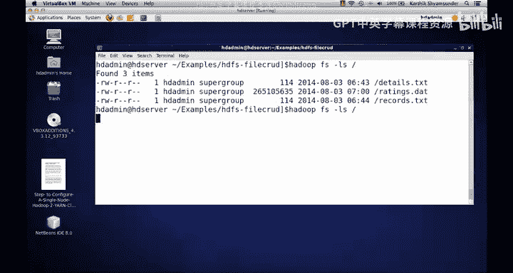
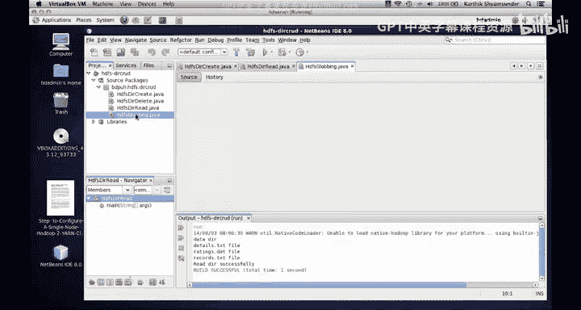
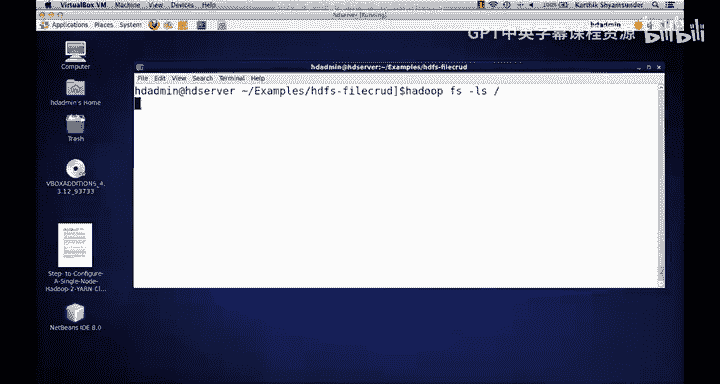

# 课程13：HDFS目录操作管理 📁


在本节课中，我们将学习如何使用Java API对HDFS（Hadoop分布式文件系统）中的目录进行创建、读取和删除操作。请注意，我们不会讨论“更新”目录，因为更新目录本质上就是在目录内创建文件或子目录，而创建文件的操作我们已经介绍过了。本节我们将重点介绍在目录内创建子目录，这涵盖了更新的概念。


---


## 创建HDFS目录

上一节我们介绍了文件操作，本节中我们来看看如何创建目录。创建HDFS目录的前几个步骤与文件操作类似。

以下是创建目录的步骤：

1.  创建一个Hadoop配置对象。
2.  获取一个文件系统对象。一旦你获得了一个具体的文件系统对象，就可以调用 `mkdirs` 方法。
3.  向 `mkdirs` 方法传递一个路径对象，即你想要创建的目录路径。

`mkdirs` 方法有几个重载版本：一个只接收路径；一个接收路径和权限；还有一个静态版本的 `mkdirs`，它接收一个文件系统对象作为参数。

你可以一次性创建多级目录（例如，目录、子目录、子子目录）。你只需要让路径对象表示出完整的层级结构，`mkdirs` 方法会自动为你创建所有这些目录。

`mkdirs` 方法会返回一个布尔值标志。如果无法创建目录（例如目录已存在），它会返回 `false`。操作完成后，记得关闭文件系统。

**示例代码：创建目录**
```java
// 定义要创建的目录路径，例如 /data/subdir/subsubdir
Path dirPath = new Path("/data/subdir/subsubdir");
// 获取文件系统对象
FileSystem fs = FileSystem.get(conf);
// 调用 mkdirs 方法创建目录
boolean isCreated = fs.mkdirs(dirPath);
// 检查创建是否成功
System.out.println("Directory created: " + isCreated);
// 关闭文件系统
fs.close();
```

---

## 读取（列出）目录内容

现在我们已经知道如何创建目录，接下来看看如何读取或列出一个目录的内容。

以下是读取目录内容的步骤：

1.  创建Hadoop配置对象。
2.  获取文件系统对象。
3.  在文件系统对象上调用 `listStatus` 方法。该方法接收一个路径作为参数。
4.  `listStatus` 方法返回一个 `FileStatus` 对象数组。它实际上接收一个目录作为参数，并返回该目录内所有文件和子目录的列表，每个项都封装为一个 `FileStatus` 对象。

`FileStatus` 对象代表一个文件或目录，包含文件名、路径、权限、所有者、副本数和文件大小等信息。获取数组后，只需遍历这些 `FileStatus` 对象即可。

`listStatus` 方法也有几个重载版本：一个接收单个目录路径；一个接收路径数组，可以一次性获取多个目录中所有文件的信息；还有一个版本允许传递路径过滤器，以排除你不感兴趣的文件。

操作完成后，关闭文件系统。





**示例代码：列出目录内容**
```java
// 定义要读取的目录路径，例如根目录 "/"
Path listPath = new Path("/");
// 获取文件系统对象
FileSystem fs = FileSystem.get(conf);
// 调用 listStatus 方法获取文件状态数组
FileStatus[] statusList = fs.listStatus(listPath);
// 遍历数组并打印信息
for (FileStatus status : statusList) {
    System.out.print("Path: " + status.getPath());
    // 判断是文件还是目录
    if (status.isDirectory()) {
        System.out.println(" [Directory]");
    } else {
        System.out.println(" [File]");
    }
}
// 关闭文件系统
fs.close();
```

---

## 删除HDFS目录

了解了目录的创建和读取后，我们来看看如何删除目录。

删除目录的步骤如下：

1.  创建Hadoop配置对象。
2.  获取文件系统对象。
3.  在文件系统对象上调用 `delete` 方法。

`delete` 方法接收一个路径对象和一个布尔类型的递归标志 `recursive`。请注意，这个 `delete` 方法与删除文件时使用的是同一个方法。区别在于，删除目录时，`recursive` 标志指示是否递归删除目录及其所有内容。

`delete` 方法同样返回一个布尔值，指示是否成功删除了目录。如果目录原本就不存在，则会返回 `false`。操作完成后，关闭文件系统。

**示例代码：删除目录**
```java
// 定义要删除的目录路径，例如 "/data"
Path deletePath = new Path("/data");
// 获取文件系统对象
FileSystem fs = FileSystem.get(conf);
// 调用 delete 方法删除目录，true 表示递归删除
boolean isDeleted = fs.delete(deletePath, true);
// 检查删除是否成功
System.out.println("Directory deleted: " + isDeleted);
// 关闭文件系统
fs.close();
```

---

## 使用通配符（Globbing）匹配文件

在HDFS API概述中我们提到了通配符（Globbing）的概念，现在让我们具体看看其步骤。

使用通配符匹配HDFS文件的步骤如下：



1.  创建Hadoop配置对象。
2.  使用配置对象获取文件系统对象。
3.  调用 `globStatus` 方法，并向其传递路径。

`globStatus` 方法有趣之处在于，你传递给它的路径实际上是一个通配符模式。该方法会返回一个与通配符模式匹配的 `FileStatus` 对象数组。



`globStatus` 方法也有重载版本：一个接收单个通配符路径；一个可以接收通配符路径对象数组。操作完成后，关闭文件系统。



**示例代码：使用通配符**
```java
// 定义一个通配符路径，匹配根目录下所有三个字符的文件或目录
Path globPath = new Path("/???");
// 获取文件系统对象
FileSystem fs = FileSystem.get(conf);
// 调用 globStatus 方法获取匹配的文件状态数组
FileStatus[] globList = fs.globStatus(globPath);
// 遍历并打印匹配项
for (FileStatus status : globList) {
    System.out.println("Matched: " + status.getPath().getName());
}
// 关闭文件系统
fs.close();
```

---

## 操作演示

现在，我将以用户 “ah amin” 的身份登录HDFS服务器，演示上述目录的CRUD操作。



**1. 创建目录**
首先，我想创建一个名为 `/data/subdir/subsubdir` 的目录。运行创建目录的程序前，先使用 `hadoop fs -ls /` 命令查看，确认该目录不存在。然后运行程序，程序显示目录创建成功。使用 `hadoop fs -ls -R /` 命令递归查看，可以看到 `/data`、`/data/subdir` 和 `/data/subdir/subsubdir` 都已成功创建。

**2. 读取目录**
接下来，运行读取目录内容的程序。程序告诉我根目录 `/` 下有四个内容：`data`（目录）、`dedo.txt`（文件）、`rating.data`（文件）和 `records_start.txt`（文件）。使用 `hadoop fs -ls /` 命令验证，`data` 确实是目录，其他三项是文件。

**3. 通配符匹配**
为了演示通配符，我先创建一些测试环境：
*   使用 `hadoop fs -mkdir /ful` 创建一个名为 `ful` 的三字母目录。
*   使用 `hadoop fs -copyFromLocal` 命令将本地文件 `AAA`、`BBB`、`CCC` 复制到根目录 `/`。
现在，根目录下有了三个三字母文件（AAA, BBB, CCC）和一个三字母目录（ful）。运行通配符程序，指定模式为 `/???`，程序成功列出了 `AAA`、`BBB`、`CCC` 三个文件和 `ful` 目录。



**4. 删除目录**
最后，运行删除目录的程序，目标是删除 `/data` 目录。程序运行后返回 `true`，表示删除成功。再次执行 `hadoop fs -ls /`，`/data` 目录已消失。如果再次运行删除程序，由于目录已不存在，程序会返回 `false`。

---

## 总结

在本节课中，我们一起学习了HDFS目录管理的CRUD API：
*   **创建目录**：使用 `FileSystem.mkdirs(Path)` 方法，可一次性创建多级目录。
*   **读取目录**：使用 `FileSystem.listStatus(Path)` 方法获取目录内容列表，返回 `FileStatus` 对象数组。
*   **删除目录**：使用 `FileSystem.delete(Path, recursive)` 方法，通过 `recursive` 参数控制是否递归删除。
*   **通配符匹配**：使用 `FileSystem.globStatus(Path)` 方法，通过路径模式批量匹配文件或目录。


通过理解这些核心方法和步骤，你已经掌握了在HDFS中进行基本目录操作的能力。