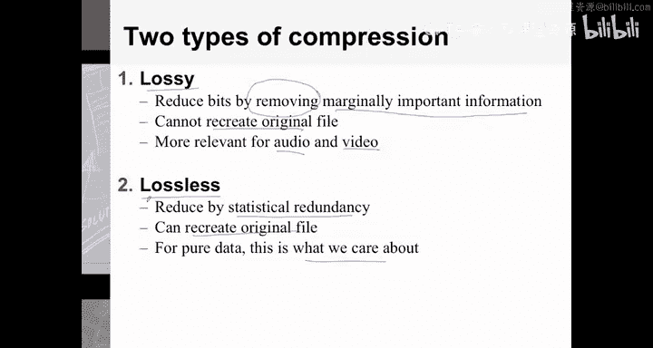
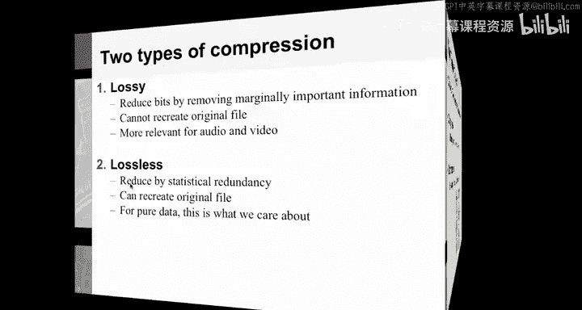
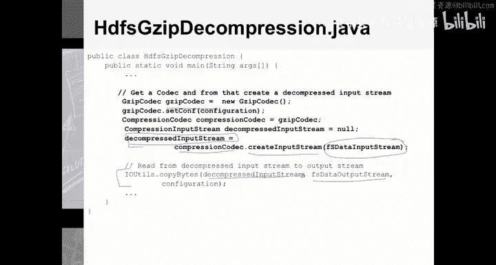
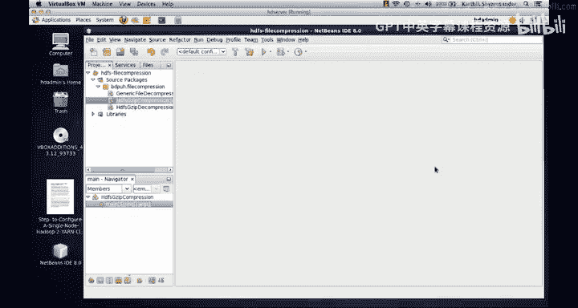
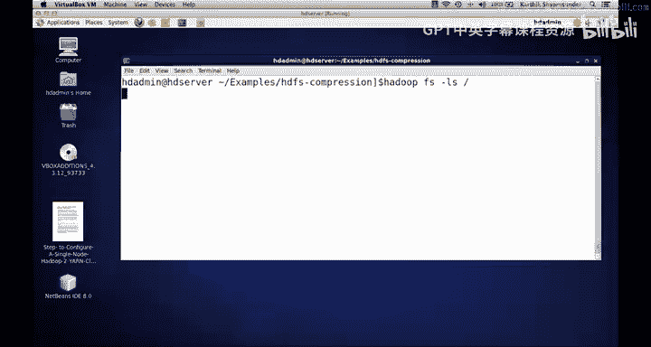
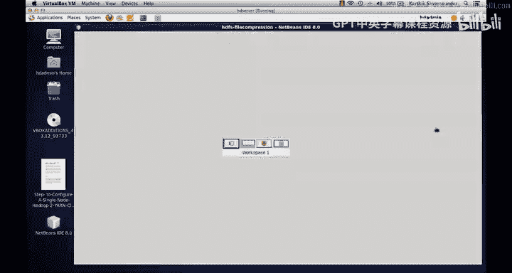
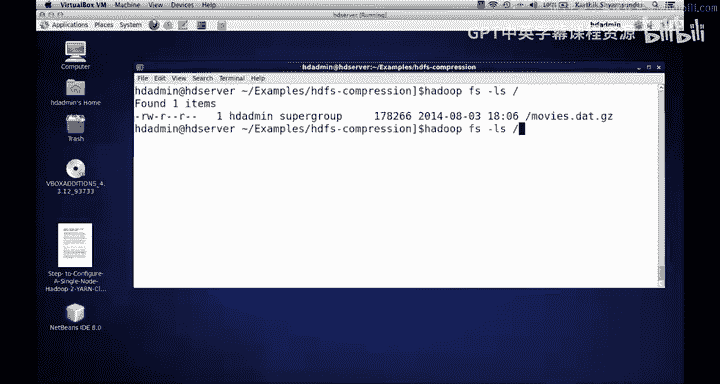

# 课程14：Hadoop文件压缩与解压缩技术 📦


在本节课中，我们将正式定义数据压缩及其相关术语，分析文件压缩的优缺点，并重点学习Hadoop HDFS对压缩的支持，包括如何压缩和解压缩HDFS中的文件。

## 什么是数据压缩？ 🤔

数据压缩是使用更少的比特位对原始数据进行编码的技术。其核心思想是减少数据的原始大小。

市场上有多种压缩算法，它们都遵循一种称为“空间-时间权衡”的原则。有些算法在压缩和解压缩速度上更快，但生成的文件可能占用更多空间；而另一些算法压缩速度可能较慢，但最终占用的磁盘空间更小。





压缩有多种文件格式，例如：`T F`、`自实`、`Bs of2`、`LG`、`snappy`等。需要明确的是，**数据压缩不是数据加密**，它们是两个不同的概念。尽管两者都可能生成二进制格式，但本质不同。

## 压缩的类型 🔄

压缩主要分为两种类型：有损压缩和无损压缩。

**有损压缩**通过移除相对不重要的信息来减少比特数。关键在于“移除”。你移除了认为不那么重要的信息。在有损压缩中，你无法重建原始文件，因为部分非关键内容已被移除。音频和视频文件的处理是典型的有损压缩例子，例如在存储或传输视频文件时，可能会移除每第10帧或第15帧。

**无损压缩**则是通过统计冗余来减少内容。换句话说，它会检查内容的哪些部分是冗余的，然后在目标文件中只存储一次，并记录这些信息片段出现的位置。在这种格式下，你可以重建原始文件。对于纯粹的数据处理，我们关心的是无损压缩，因此在数据分析中，大多数时候我们使用无损压缩。

## 编解码器与HDFS压缩支持 🛠️

“编解码器”是压缩器和解压缩器的别称。其思想是，你可以将原始文本或内容通过压缩器处理，得到压缩后的内容；然后可以再通过解压缩器处理压缩内容，以恢复原始文本。

在Java中，有一系列用于压缩和解压缩的编解码器类。

HDFS内置了多种压缩类。这些压缩编解码器可以是纯Java实现，事实上它们大多是纯Java实现。如果你想使用原生实现，也可以找到一些，但需要将其包含在你的LD库路径中。同样，也可以引入其他实现，无论是Java实现还是原生实现。例如，很多人会引入`LZ`实现，`LZF`是一个相当好的实现，但由于其LG许可证问题，Hadoop并未随其分发，但市场上很多人使用`LZU`实现。

## 文件压缩的优缺点 ⚖️

上一节我们介绍了压缩的基本概念和类型，本节中我们来看看压缩文件的具体好处和需要考虑的代价。

**压缩文件的好处如下：**
*   **减少存储空间**：压缩减少了存储文件所需的空间。特别是在HDFS中，文件通常有三份副本，文件大小会倍增，因此在HDFS中压缩文件是一个很好的做法。
*   **减少数据传输带宽**：压缩减少了数据传输所需的带宽，尤其是在写入数据块时，数据需要在节点间复制。
*   **提升数据传输速度**：压缩加快了磁盘与主内存之间的数据传输速度。考虑到磁盘的数据传输速率并不高，通过减小文件大小，你实际上减少了需要加载到主内存的数据量。因为要进行任何处理，都必须将数据加载到主内存。例如，一个54GB的文件如果压缩到17GB，那么只需加载17GB到内存，这就在无形中提升了磁盘的有效数据传输率。

**压缩的缺点如下：**
*   **消耗CPU资源**：压缩和解压缩是CPU密集型操作，会占用CPU周期。因此，在决定压缩之前需要权衡。如果你需要反复多次读取某个文件，可能不值得压缩，因为每次解压缩都会消耗CPU周期。这是一个权衡，我们将在Hadoop MapReduce部分进一步讨论。

## 压缩编解码器接口与使用步骤 💻

Hadoop Java API中有一个名为`compression`的包，它定义了一个名为`CompressionCodec`的接口。该接口是所有各种编解码器的基接口。例如，Hadoop自带了用于默认类型的默认编解码器、`GzipCodec`和`BZip2Codec`。

在代码中，只要有机会，就应该使用`CompressionCodec`接口，而不是具体的编解码器类。具体做法是：当你实例化一个具体的编解码器时，应将其赋值给`CompressionCodec`类型的变量，然后使用`CompressionCodec`接口中提供的方法来调用所有功能。

`CompressionCodec`接口中有几个非常重要的方法，一个是`createInputStream`，另一个是`createOutputStream`。这就是你获取压缩输入流和压缩输出流的方式。我们将在示例中查看这些内容。

### 压缩HDFS文件的步骤

基本思路是，假设HDFS中已有一个文件，你想压缩它。你需要做的就是读取这个现有的HDFS文件，然后创建一个新的压缩文件。

以下是具体步骤：
1.  创建Hadoop配置对象，获取文件系统对象。
2.  打开常规文件（即要压缩的输入文件），获取输入流。
3.  打开第二个文件（即要写入压缩信息的目标压缩文件），获取输出流。
4.  关键步骤：将常规输出流转换为压缩输出流。为此，你将使用`CompressionCodec`。
5.  从输入流读取数据，写入压缩输出流。
6.  关闭输入流、输出流和文件系统。

让我们通过一个程序片段来理解。假设有一个名为`HDFSCompression.java`的程序，其中最重要的部分是处理输出流：

```java
// ... 获取文件系统等前期代码
FSDataOutputStream fsDataOutputStream = fs.create(outputPath); // 这是要写入压缩数据的输出流，但还不是压缩输出流

// 创建GzipCodec对象并赋值给CompressionCodec接口
CompressionCodec codec = new GzipCodec();
// 使用编解码器创建压缩输出流
CompressionOutputStream compressedOutputStream = codec.createOutputStream(fsDataOutputStream);





// 现在，使用IOUtils工具类复制数据
IOUtils.copyBytes(fsDataInputStream, compressedOutputStream, conf);
// ... 关闭流等后续代码
```

`IOUtils.copyBytes`方法是一个辅助方法，允许你将数据从一个流复制到另一个流，无需像之前章节那样逐字节读取。

### 解压缩HDFS文件的步骤

假设HDFS中已有一个压缩文件，你想解压它。思路是打开该文件，获取压缩格式的输入流，然后在读取时将其解压缩。你需要将压缩输入流转换为解压缩后的输入流，然后打开一个新文件来写入解压后的数据。

以下是具体步骤：
1.  获取Hadoop配置对象。
2.  使用配置对象获取文件系统对象。
3.  打开压缩文件用于读取，获取输入流（这是一个压缩输入流）。
4.  打开一个新文件用于写入解压后的数据（这是常规输出文件）。
5.  **关键步骤**：使用`CompressionCodec`将压缩输入流转换为解压缩输入流。
6.  读取解压缩输入流，并写入输出流。
7.  关闭输入流、输出流和文件系统。

以下是一个解压缩程序的示例片段：





```java
// ... 获取文件系统等前期代码
FSDataInputStream fsDataInputStream = fs.open(inputPath); // 压缩输入流
FSDataOutputStream fsDataOutputStream = fs.create(outputPath); // 解压后的输出流

CompressionCodec codec = new GzipCodec();
// 使用编解码器创建解压缩输入流
CompressionInputStream decompressedInputStream = codec.createInputStream(fsDataInputStream);

// 将解压缩后的数据写入输出文件
IOUtils.copyBytes(decompressedInputStream, fsDataOutputStream, conf);
// ... 关闭流等后续代码
```



## 总结 📝

在本节课中，我们一起学习了数据压缩的核心知识。我们首先正式定义了压缩及其相关术语，并区分了有损和无损压缩。接着，我们探讨了文件压缩在节省存储空间、降低带宽和提升I/O速度方面的优点，也指出了其消耗CPU资源的缺点。最后，我们深入了解了HDFS对压缩的支持，并通过概念和代码示例，掌握了如何在HDFS中压缩和解压缩文件的具体步骤和编程方法。后续我们还将学习如何在Hadoop MapReduce中使用压缩技术。