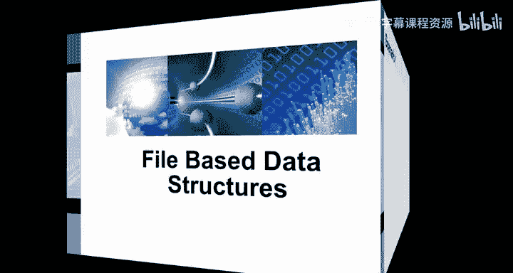
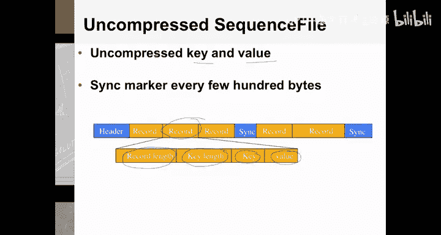
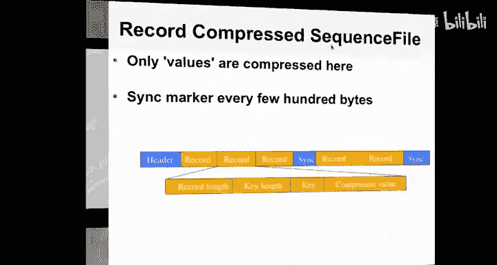
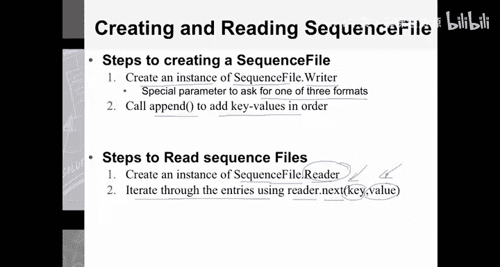
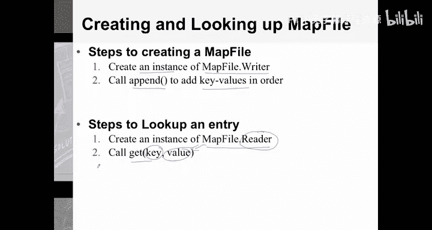
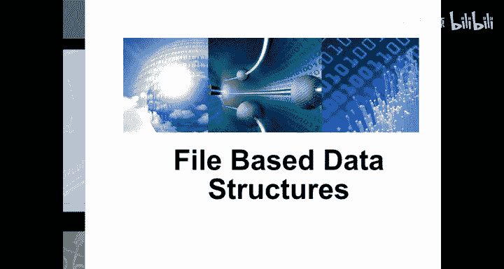

# 课程 16: 基于文件的数据结构 📁

在本节课中，我们将学习Hadoop HDFS支持的两种高级文件数据结构：序列文件（Sequence Files）和映射文件（Map Files）。我们将探讨它们如何解决HDFS中的小文件问题。

---

## 基于文件的数据结构简介

在深入了解具体的文件数据结构之前，我们先来看几个实际场景。

假设我们有一个全球访问的热门网站，服务分布在全球各地。这意味着我们有多个边缘站点和服务器。例如，我们有30个边缘站点和20台Web服务器。这里的“边缘站点”指的是位于特定位置的数据中心，比如纽约、伦敦、东京等。每个边缘站点大约有20台Web服务器。每小时整点，访问日志文件会进行轮转，这意味着每台Web服务器每小时都会生成一个全新的文件。

作为公司，我们需要存储和处理这些Web服务器访问日志文件，以分析热门页面、独立访客数量及身份等信息。为此，我们需要将数据导入Hadoop并存储。从架构角度看，我们面临几个问题：如何存储这些每小时生成的文件？是每个边缘站点、每台服务器的每个文件单独存储，还是合并存储？是否要压缩这些文件？

另一个场景是，假设我们有一个用户分享照片的应用，每天接近一百万张照片。公司需要存储和处理这些照片。我们可能需要处理元数据（如GIF和JPEG文件中包含的地理位置、拍摄时间、相机型号、光照等信息），或进行图像识别（如人脸识别、品牌识别）。同样，从架构角度看，我们面临问题：如何存储数据？每张照片单独存储还是合并到一个文件中？如何应用压缩？是压缩每张照片还是整个文件？

实际上，在大数据世界中，小文件是一个问题。首先，我们定义什么是小文件：小文件是指小于Hadoop块大小的文件。默认块大小为64MB（可配置为128MB、256MB或512MB）。HDFS中小文件的问题在于，NameNode为每个文件、块或目录的元数据开销约为150字节。这意味着，如果有100万个文件，就需要约150MB内存；1000万个文件需要约1.5GB内存；1亿个文件则需要约15GB内存。

在第一个场景中，我们有30个站点、20台服务器、每天24小时，每天生成约14,400个文件，每年约550万个文件，需要约1.5GB内存存储一年的数据。在第二个照片分享场景中，问题更大：每天约100万张照片，一年365天就是3.65亿个文件，需要接近128GB内存来存储所有数据。

即使在MapReduce中，小文件也是个问题（尽管我们尚未讨论MapReduce）。在MapReduce中，每个文件通常由一个单独的容器（JVM）处理。如果每个文件只有8-10MB，单独启动JVM来处理是不划算的。

Hadoop提供了几种基于文件的数据结构来解决这个问题，主要是序列文件和映射文件。

---

## 序列文件（Sequence Files）🔢

序列文件是一种由键值对组成的平面文件，每个键值对是一条记录。它是一个记录容器，其中每条记录都是一个键值对组合。键和值都是二进制的，因此它们必须是可序列化的。我们可以使用Java序列化机制或Hadoop序列化机制，但后者更优，因为它便于后续的MapReduce处理。键和值的长度可以不同。序列文件还包含称为同步点（sync points）的标记，每隔几条记录就会出现，用于指示记录的起始位置。

序列文件的一般结构包括头部、记录和同步标记。头部包含版本号（以“SQ”开头）、键类名、值类名、是否压缩、是否块压缩以及同步标记字符等信息。记录包含记录长度、键长度、键和值。同步标记大约占文件的1%，每隔几百字节放置一个。

序列文件有三种类型：未压缩、记录压缩和块压缩。

*   **未压缩序列文件**：键和值都不压缩，每隔几百字节放置一个同步标记。记录结构为：记录长度 -> 键长度 -> 键 -> 值。
*   **记录压缩序列文件**：只有值被压缩。记录结构为：记录长度 -> 键长度 -> 键 -> 压缩后的值。
*   **块压缩序列文件**：键和值被收集到块中，然后对整个块进行压缩。块大小是可配置的。每个块开始前都有同步标记。文件结构为：头部 -> 同步标记 -> 块 -> 同步标记 -> 块...。一个块包含以下字段：块内记录数、压缩后的键长度、压缩后的所有键、压缩后的值长度、压缩后的所有值。

现在，让我们看看如何将序列文件应用于之前的场景。

对于场景一（Web访问日志），我们可以将每小时生成的整个访问日志文件作为一条记录的值存入序列文件。键可以是边缘服务器ID（如“London-server12-20140812-13”），其中包含位置、服务器ID和时间戳（年-月-日-时）。这样，整个文件以压缩形式存储。

对于场景二（图像存储），我们可以将用户ID作为键，图像作为值存入序列文件，图像可以选择压缩或未压缩存储。

序列文件的优势包括：
*   存储效率高，可以存储二进制数据（如图像、音频、视频、PDF等）。
*   对NameNode的开销较小，尤其适合小文件。
*   在MapReduce处理中效率高，支持在块级别进行文件分割。

序列文件的用途包括：
*   作为其他文件的容器。
*   作为存储键值对组合的数据存储机制，为MapReduce处理奠定基础。
*   被MapReduce框架本身使用。

创建和读取序列文件的步骤如下：
*   **创建**：使用 `SequenceFile.Writer` 类（`SequenceFile` 的内部类）的实例。创建时需要指定序列文件格式、压缩类型和编解码器。然后调用 `append` 方法添加键值对。
*   **读取**：使用 `SequenceFile.Reader` 类（同样是内部类）的实例。通过调用 `next` 方法并传入键和值对象进行迭代，读取器会填充这些对象。

---

## 映射文件（Map Files）🗺️

现在我们已经了解了序列文件，接下来看看映射文件。

映射文件实际上是一种**排序的序列文件**。它是一个带有索引的序列文件，因此允许通过键进行查找。你可以将其视为Java `util.Map` 数据结构的持久化版本。Java Map受限于内存大小，而映射文件可以存储在平面文件中，大小可以超过内存。

映射文件中的键必须是 `WritableComparable` 类型（即可写入、可比较）。这是因为它们需要被序列化到文件流中，并且为了排序目的必须可比较。值必须是 `Writable`（可写入）类型，如果也是 `WritableComparable` 则更好。

映射文件的用途包括：
*   MapReduce框架内部使用映射文件。
*   应用程序可以将其用于快速查找和连接操作。
*   可以作为小文件的容器，以文件名作为键（如场景一中的边缘ID、服务器ID和时间戳组合）。

映射文件的结构需要注意：**映射文件实际上是一个目录**。当你创建映射文件时，会生成一个目录，其中包含两个文件：
1.  **`data` 文件**：这是一个完整的序列文件，包含所有键及其关联值。
2.  **`index` 文件**：这是一个较小的序列文件，也包含键值对。键是实际的键，而值是 `data` 文件中的字节偏移量，起到了索引的作用。为了效率，它通常只存储一部分键的索引（可配置）。

创建和查找映射文件的步骤如下：
*   **创建**：创建 `MapFile.Writer` 对象的实例，然后调用 `append` 方法添加有序的键值对。
*   **查找**：创建 `MapFile.Reader` 对象（`MapFile` 类的内部类）的实例，然后调用 `get` 方法，传入键和一个值对象，`get` 方法会填充该值对象。

---

## 总结 📝

在本节课中，我们一起学习了Hadoop HDFS支持的两种基于文件的数据结构：序列文件和映射文件。我们探讨了它们如何通过将多个小文件合并到更大的、可索引的容器中，有效解决HDFS中的小文件问题，从而减少NameNode的内存开销并提升MapReduce的处理效率。