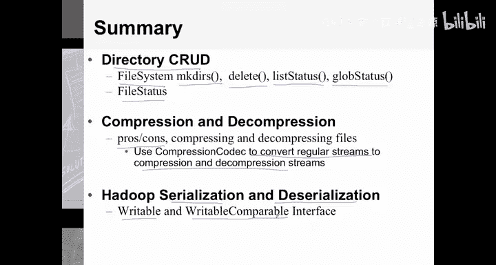
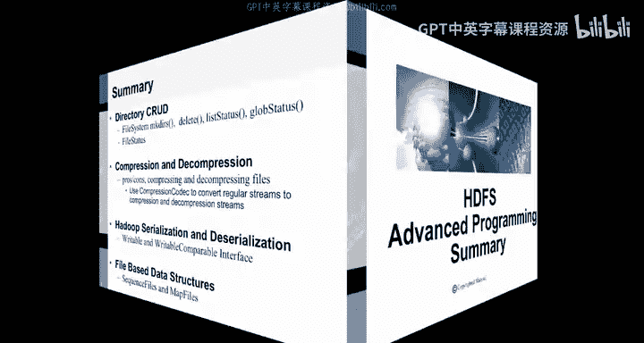

# 课程名称：Hadoop大数据处理 - 第39讲：HDFS高级编程总结 📚

在本节课中，我们将总结HDFS高级编程模块的核心内容。我们将回顾目录操作API、文件压缩与解压缩、Hadoop序列化机制以及基于文件的数据结构。这些知识对于高效处理HDFS上的数据至关重要。

## 目录操作API 📁

上一节我们介绍了HDFS的基本文件操作，本节中我们来看看目录相关的API。

FileSystem类提供了多个方法用于目录管理。

以下是关键方法及其功能：

*   `mkdirs`：用于创建目录。
*   `delete`：用于删除目录。该方法返回一个布尔值。如果成功删除目录，则返回`true`。如果因为目录不存在而无法删除，则返回`false`。
*   `listStatus`：用于获取目录中所有文件的列表。
*   `globStatus`：允许根据模式筛选文件，有选择地提取文件。

`listStatus`和`globStatus`方法都返回一个`FileStatus`对象数组。该对象提供了文件的详细信息，例如文件名、文件大小、所有者、权限和副本因子。

## 压缩与解压缩 💾

了解了目录操作后，我们转向数据存储优化技术：压缩与解压缩。

我们探讨了压缩的优缺点。

**优点**是节省存储空间。
**缺点**是每次解压缩（事实上压缩和解压缩都需要）都会消耗CPU资源。

我们学习了如何压缩和解压缩文件。压缩的基本思想是将常规流转换为专门的压缩流和解压缩流，以便对内容进行压缩和解压缩。

## Hadoop序列化机制 🔄

接下来，我们研究了Hadoop序列化。

我们了解到Hadoop拥有自己的序列化机制，它不使用Java的序列化机制。为了支持此机制，`Writable`和`WritableComparable`是两个关键接口。`WritableComparable`接口继承自`Writable`接口。

`Writable`接口包含两个方法：`write`和`readFields`。
`WritableComparable`接口除了继承自`Writable`的两个方法外，还包含来自`Comparable`接口的第三个方法：`compareTo`。

## 基于文件的数据结构 📄

最后，我们看了一些基于文件的数据结构，例如SequenceFile和MapFile。

这些数据结构解决了Hadoop HDFS中的小文件问题。

---

本节课中我们一起学习了HDFS高级编程的几个核心方面：使用FileSystem API进行目录管理、通过压缩流优化存储、理解Hadoop特有的`Writable`序列化机制，以及利用SequenceFile和MapFile处理小文件问题。掌握这些技术将帮助你更高效地在HDFS上管理和处理大数据。