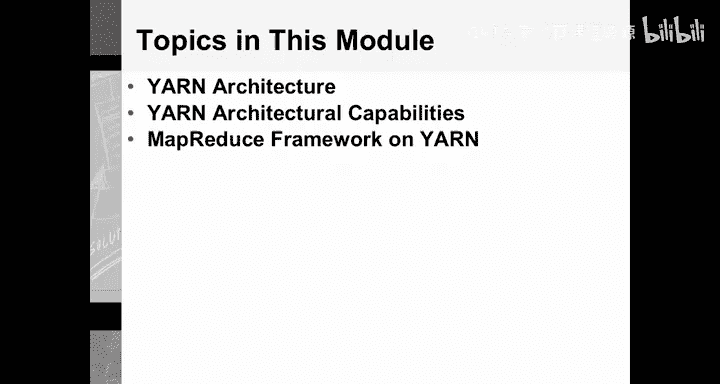
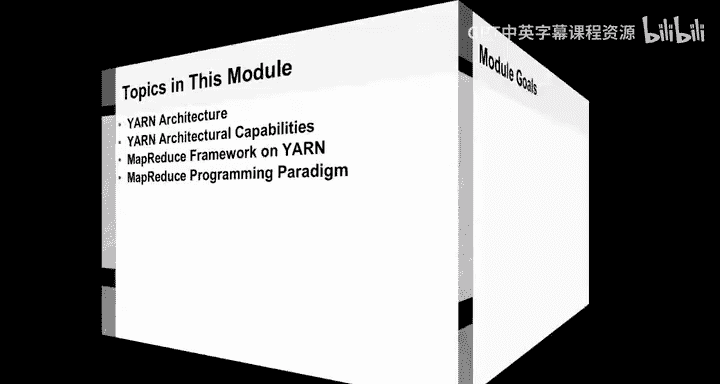
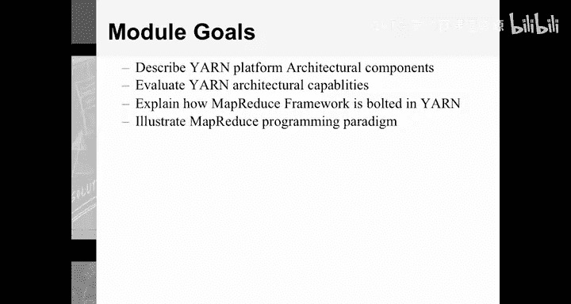

# 课程40：YARN与MapReduce架构导论 🚀

在本节课中，我们将学习YARN平台架构、其架构能力，以及MapReduce框架如何构建在YARN之上。最后，我们将探讨MapReduce编程范式。


## 概述 📋

本模块包含四个部分。首先，我们将介绍YARN架构，包括其各个组件及其交互方式。接着，我们将探讨YARN的架构能力，涵盖性能、可用性、可扩展性、可操作性和安全性等方面。然后，我们将学习MapReduce框架如何集成到YARN平台上。最后，我们将深入了解MapReduce编程模型。

## 模块目标 🎯

本模块的学习目标如下：
*   描述YARN平台的架构组件。
*   评估YARN的架构能力。
*   解释MapReduce框架如何构建在YARN之上。
*   阐述MapReduce编程范式。

---

## 第一部分：YARN架构 🏗️

上一节我们概述了本课程内容，本节中我们来看看YARN平台的具体架构。

YARN（Yet Another Resource Negotiator）是Hadoop 2.0引入的核心资源管理系统。它的主要功能是将资源管理与作业调度/监控分离。

以下是YARN架构的核心组件：

*   **ResourceManager (RM)**：集群资源的最终仲裁者。它负责调度和分配系统资源给各个应用程序。
*   **NodeManager (NM)**：每个节点上的代理，负责管理单个计算节点。它监控容器资源使用情况（CPU、内存、磁盘、网络）并向ResourceManager报告。
*   **ApplicationMaster (AM)**：每个应用程序特有的框架组件。它负责向ResourceManager协商资源，并与NodeManager协作以执行和监控应用程序的任务。
*   **Container**：资源的抽象封装，包括节点上的CPU核心、内存等。任务在容器中运行。

## 第二部分：YARN架构能力 ⚙️

了解了YARN的基本组件后，本节我们来评估其关键的架构能力。

YARN的设计旨在提供企业级的数据处理平台，其核心能力包括：

*   **性能**：通过细粒度的资源管理和调度，提高集群资源利用率。
*   **可用性**：ResourceManager的高可用性配置可以防止单点故障。
*   **可扩展性**：支持数千个节点和数万个容器的超大规模集群。
*   **可操作性**：提供了丰富的监控和管理接口，便于集群运维。
*   **安全性**：通过Kerberos认证、访问控制列表（ACLs）等机制保障集群安全。

## 第三部分：MapReduce在YARN上的集成 🔗



前面我们介绍了YARN作为通用资源管理平台的能力，本节中我们来看看经典的MapReduce框架如何“构建”在YARN之上。

在YARN架构下，MapReduce作为一个应用程序框架运行。其集成方式如下：
1.  用户提交一个MapReduce作业。
2.  ResourceManager为该作业启动一个特定的ApplicationMaster（即MRAppMaster）。
3.  MRAppMaster向ResourceManager申请运行Map和Reduce任务所需的容器资源。
4.  获得资源后，MRAppMaster与对应的NodeManager通信，在容器中启动MapTask或ReduceTask。
5.  MRAppMaster监控所有任务的执行状态，并在任务失败时重新申请资源运行。



这个过程可以用一个简单的代码逻辑表示：
```java
// 伪代码示意
MRAppMaster am = new MRAppMaster(job);
am.negotiateResourcesWithRM(); // 向RM申请资源
am.launchTasksOnContainers();  // 在NM上启动任务
am.monitorAndManageTasks();    // 监控和管理任务
```

## 第四部分：MapReduce编程模型 💻

在了解了MapReduce如何运行在YARN上之后，最后我们来学习其核心的编程模型。

MapReduce是一种用于处理海量数据集的编程范式。它将计算过程分为两个主要阶段：**Map**（映射）和**Reduce**（归约）。

以下是MapReduce模型的关键概念：

*   **输入与输出**：数据以键值对 `<key, value>` 的形式被处理和传递。
*   **Map阶段**：每个输入记录被一个Map函数处理，生成一组中间键值对。
    *   公式表示：`Map (k1, v1) -> list(k2, v2)`
*   **Shuffle与Sort阶段**：框架将Map输出的中间结果按键进行排序和分组，并发送给对应的Reducer。
*   **Reduce阶段**：每个Reduce函数接收一个键及其对应的所有值列表，进行处理后产生最终的输出。
    *   公式表示：`Reduce (k2, list(v2)) -> list(k3, v3)`



## 总结 📝

本节课中我们一起学习了YARN与MapReduce架构。我们首先剖析了YARN的组件化架构，包括ResourceManager、NodeManager、ApplicationMaster和Container。接着，我们评估了YARN在性能、可用性等方面的架构能力。然后，我们解释了MapReduce框架如何作为YARN上的一个应用程序运行，理解了从作业提交到任务执行的完整流程。最后，我们深入探讨了MapReduce编程模型的核心思想，即通过Map和Reduce两个阶段对大规模数据进行并行处理。掌握这些基础知识是理解现代大数据处理生态系统运作原理的关键。