# 课程 P41：YARN 架构解析 🏗️


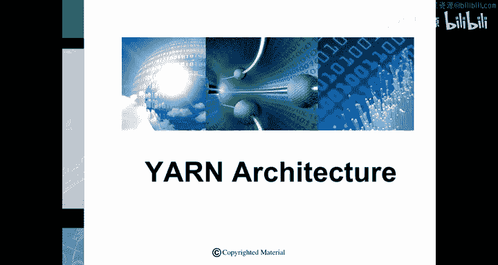

在本节课中，我们将学习 Hadoop 2 的核心组件——YARN 的架构。我们将了解构成 YARN 的各个组件、它们的功能职责以及它们之间的交互过程。

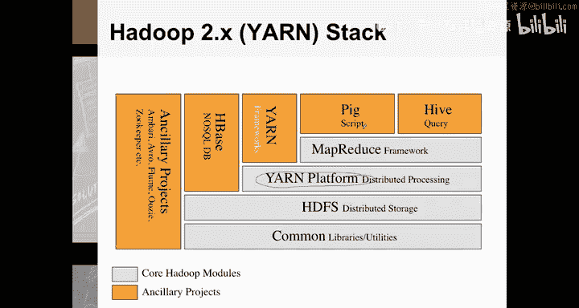

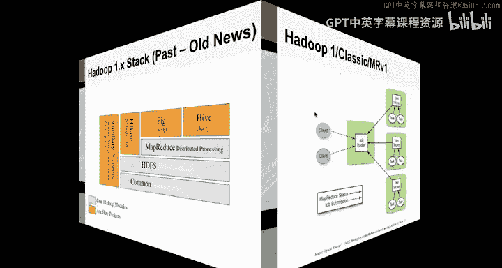

## 从 Hadoop 1 到 Hadoop 2 的演进

上一节我们回顾了 Hadoop 的整体架构。现在，我们来看看 YARN 是如何出现的。

在 Hadoop 1.X 的架构中，HDFS 之上直接是 MapReduce 框架，用于分布式数据处理。这个框架将平台（资源管理）和应用程序（MapReduce 任务）紧密耦合在一起。

然而，Hadoop 2.X 引入了一个新的中间层——YARN 层。这个新层将资源管理与应用程序框架分离开来，使得 Hadoop 能够支持除 MapReduce 之外的其他计算框架。

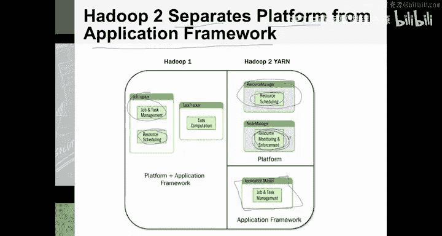

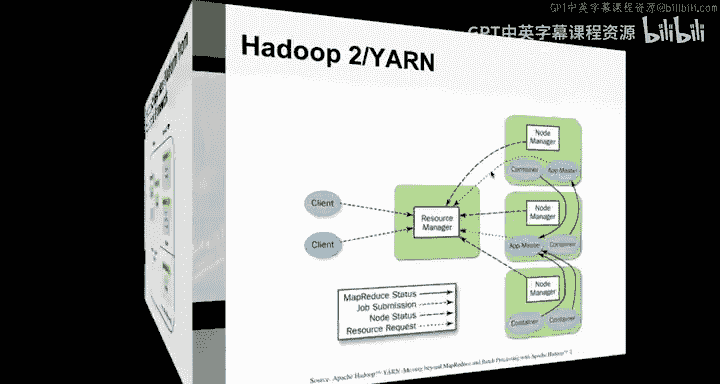

## Hadoop 1 经典架构回顾

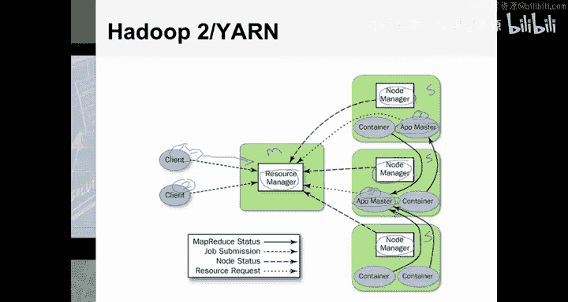

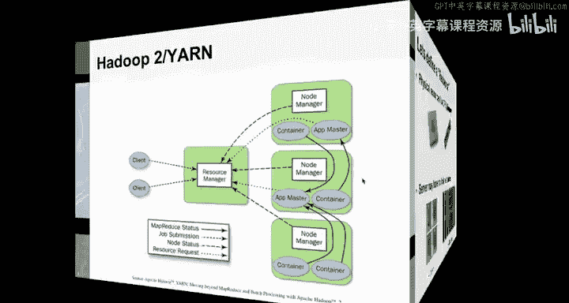

在 Hadoop 1 中，我们采用的是主从架构。主节点上运行着 **JobTracker** 守护进程，而从节点上运行着 **TaskTracker** 守护进程。

以下是其工作流程：
*   **JobTracker**：接收客户端提交的作业，将作业分解成多个任务，并根据数据位置将任务分配给各个 TaskTracker。
*   **TaskTracker**：与 JobTracker 通信，接收任务，并启动独立的 JVM 进程（如 Map 任务或 Reduce 任务）来执行这些任务。

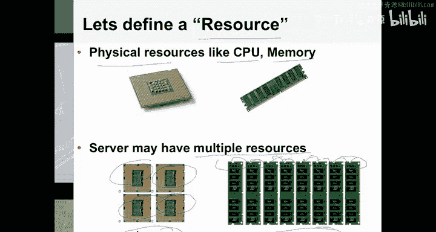

在这种架构中，JobTracker 同时负责**资源调度**和**作业/任务管理**，这导致了可扩展性和灵活性的限制。

## Hadoop 2 与 YARN 架构

Hadoop 2 用一组新的守护进程取代了旧的 JobTracker 和 TaskTracker，它们分别是 **ResourceManager** 和 **NodeManager**。

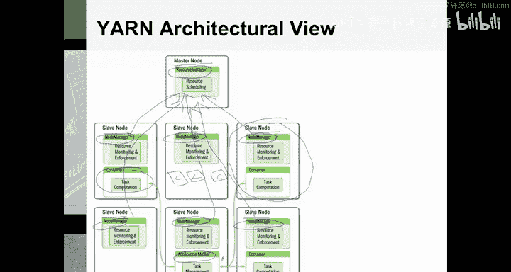

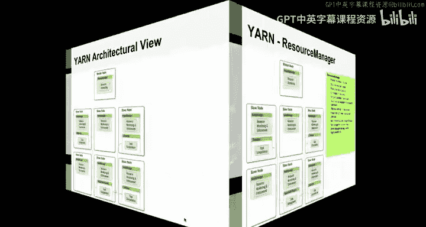

关键的变化在于职责的分离：
*   **ResourceManager**：作为主节点，**只负责集群资源的全局调度**。
*   **ApplicationMaster**：这是一个为每个提交的应用程序（如一个 MapReduce 作业）专门创建的组件，**负责该应用程序的任务管理和容错**。
*   **NodeManager**：作为从节点，负责管理单个节点上的资源，并执行来自 ResourceManager 和 ApplicationMaster 的指令。

这种分离使得 YARN 成为一个通用的资源管理平台，可以运行多种计算框架。

## YARN 核心概念详解

在深入架构细节之前，我们需要明确几个核心概念。

### 资源与容器

**资源** 指的是物理计算资源，在 YARN 中主要指 **CPU** 和**内存**。例如，一台服务器可能拥有 4 个 CPU 核心和 8GB 内存。

**容器** 是 YARN 中的基本资源分配单位。它是一个封装了特定数量 CPU 和内存资源的抽象。例如，一个容器可以被定义为拥有 **1 个 CPU 核心和 2GB 内存**。

一台物理服务器可以被划分为多个容器。例如，上述服务器可以划分为 3 个容器（各 1 核心，2GB 内存），剩余的资源则留给操作系统和其他守护进程使用。

### YARN 架构组件

现在，让我们详细看看 YARN 架构中的每个组件。

#### ResourceManager

ResourceManager 是 YARN 的主守护进程，整个集群中只有一个实例。

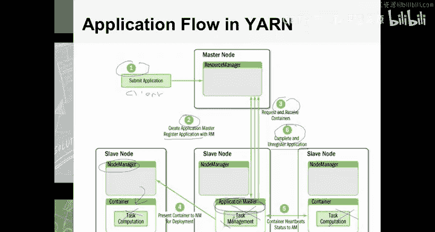

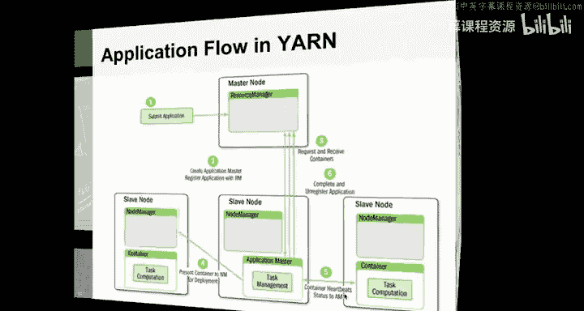

它的主要职责是：
*   **调度**：它是集群资源的最终仲裁者，负责将容器资源分配给各个 ApplicationMaster。
*   **资源管理**：它监控集群资源使用情况，并可以根据需要从 ApplicationMaster 回收容器资源，以便分配给其他应用程序。

#### NodeManager

NodeManager 是运行在每个从节点上的守护进程，是 ResourceManager 的从属。

它的主要职责是：
*   **节点代理**：启动时向 ResourceManager 注册，并定期发送心跳报告节点状态。
*   **容器生命周期管理**：根据 ResourceManager 或 ApplicationMaster 的指令，**启动或停止容器**。
*   **资源监控**：监控容器对资源（CPU、内存）的使用情况。

#### ApplicationMaster

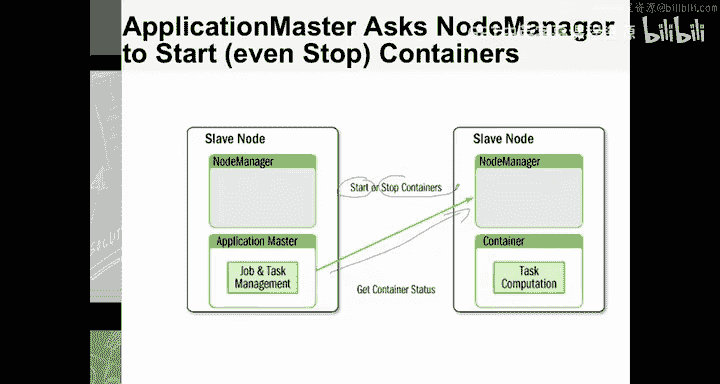

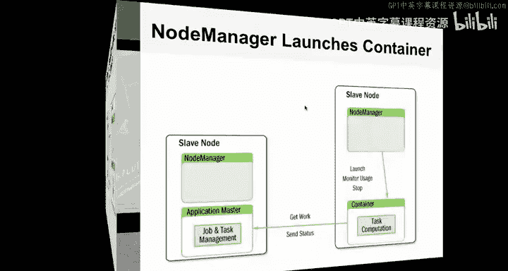

ApplicationMaster 是每个应用程序的“管家”。每当客户端提交一个作业（如一个 MapReduce 作业），就会为该作业启动一个专属的 ApplicationMaster。

它的主要职责是：
*   **作业协商**：向 ResourceManager 申请运行任务所需的容器资源。
*   **任务管理**：与 NodeManager 通信，在获得的容器中启动具体的计算任务（如 Map 任务）。
*   **容错**：监控任务的执行状态，并在任务失败时重新申请资源以重试。

ApplicationMaster 本身也是一个运行在容器中的特殊进程，通常被称为 **Container 0**。

#### 容器

容器是 NodeManager 根据指令启动的一个独立进程环境，是实际执行用户代码（如 Map 或 Reduce 函数）的地方。ApplicationMaster 和具体的计算任务都运行在容器中。

## YARN 应用执行流程

理解了各个组件后，我们来看看它们是如何协作完成一个作业的。以下是简化的执行步骤：

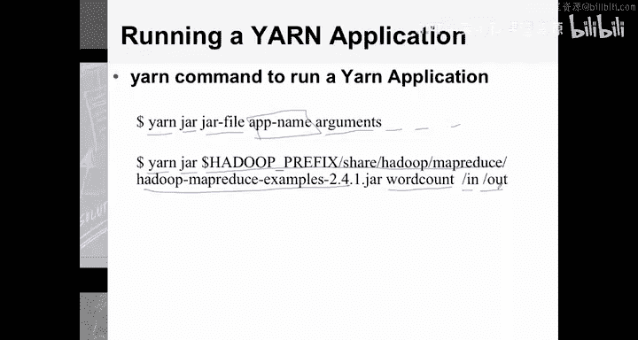

1.  **提交应用**：客户端向 ResourceManager 提交应用程序。
2.  **启动 AM**：ResourceManager 找到一个 NodeManager，并指令它为该应用启动一个 ApplicationMaster 容器。
3.  **注册与协商**：ApplicationMaster 启动后，向 ResourceManager 注册，并为其任务申请所需数量和规格的容器资源。
4.  **分配容器**：ResourceManager 根据调度策略，将可用的容器资源分配给 ApplicationMaster。
5.  **启动任务**：ApplicationMaster 与持有这些容器的 NodeManager 通信，指令它们启动容器来执行实际的计算任务。
6.  **执行与监控**：任务在容器中执行。ApplicationMaster 监控任务进度和状态。
7.  **完成与清理**：所有任务完成后，ApplicationMaster 向 ResourceManager 注销，然后自身容器终止。所有任务容器也被清理。

## YARN 服务管理与应用提交

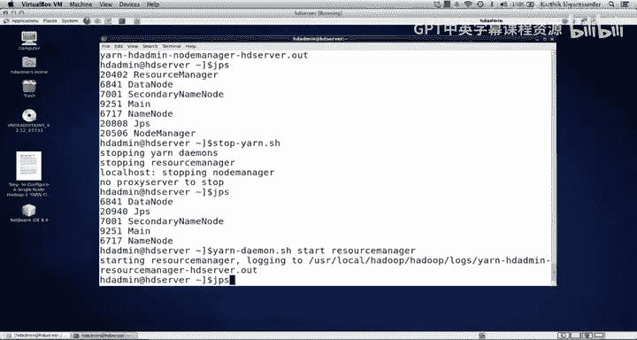

### 启动与停止守护进程

在命令行中，可以管理 YARN 服务：
*   启动所有 YARN 守护进程：`start-yarn.sh`
*   停止所有 YARN 守护进程：`stop-yarn.sh`
*   启动/停止特定守护进程：`yarn-daemon.sh start/stop [resourcemanager|nodemanager]`

### 提交 YARN 应用

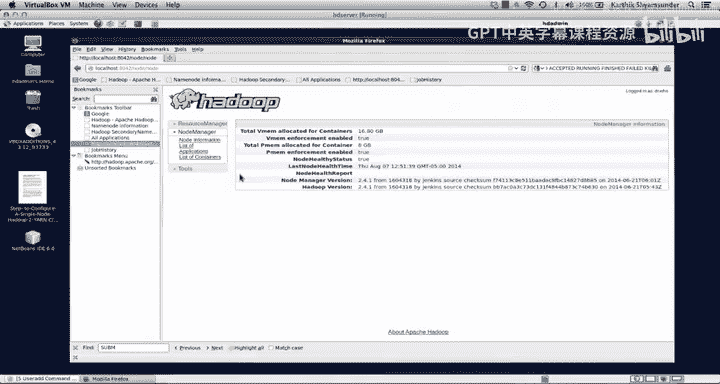

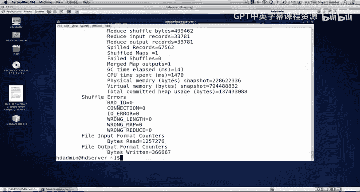

使用 `yarn` 命令提交应用程序，基本格式如下：
```bash
yarn jar <jar文件路径> <应用程序主类> [参数...]
```
例如，运行 Hadoop 自带的 MapReduce 词频统计示例：
```bash
yarn jar /usr/local/hadoop/share/hadoop/mapreduce/hadoop-mapreduce-examples-*.jar wordcount /input /output
```

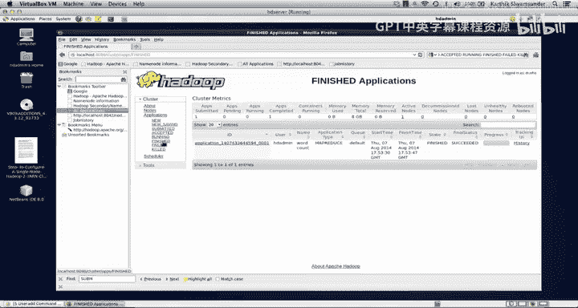

### Web 管理界面

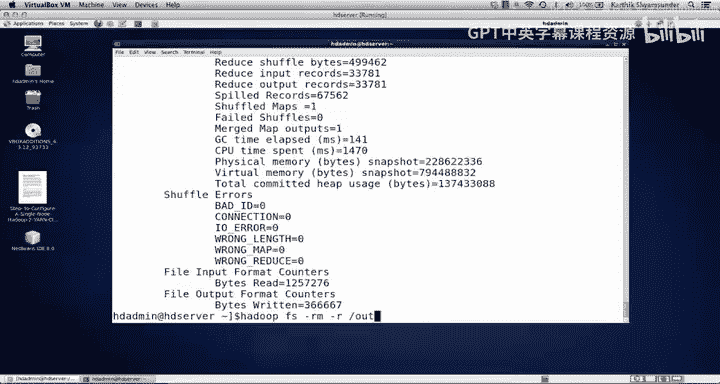

YARN 提供了 Web 界面用于监控：
*   **ResourceManager Web UI**：默认运行在 `http://<rm-host>:8088`。可以查看所有应用程序的状态、集群资源使用情况等。
*   **NodeManager Web UI**：默认运行在 `http://<nm-host>:8042`。可以查看单个节点上容器的运行状态。

## 总结

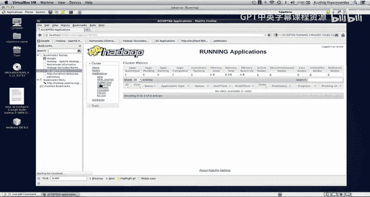

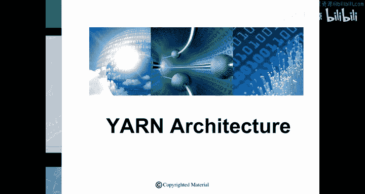

在本节课中，我们一起学习了 YARN 的架构。我们首先回顾了从 Hadoop 1 到 Hadoop 2 的演进过程，理解了引入 YARN 的必要性。接着，我们深入剖析了 YARN 的核心组件：负责全局调度的 **ResourceManager**、管理单个节点的 **NodeManager**、管理具体应用的 **ApplicationMaster** 以及执行实际任务的**容器**。我们还详细跟踪了一个 YARN 应用程序从提交到完成的完整执行流程。最后，我们学习了如何启动/停止 YARN 服务、如何通过命令行提交作业，以及如何通过 Web 界面监控集群状态。YARN 作为 Hadoop 2 的资源管理核心，其灵活的架构为大数据生态支持多种计算框架奠定了坚实的基础。