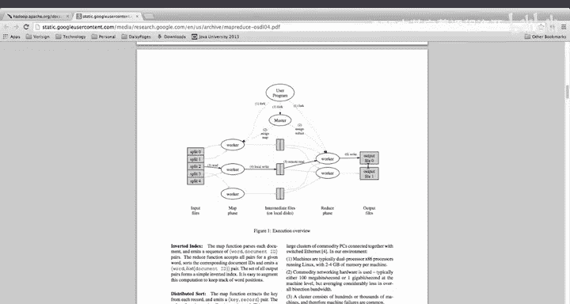
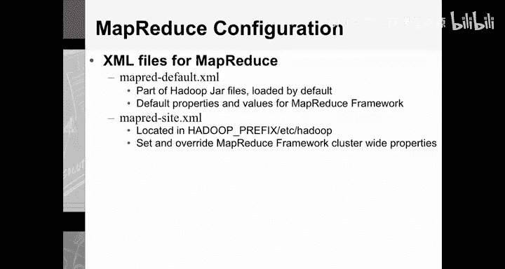
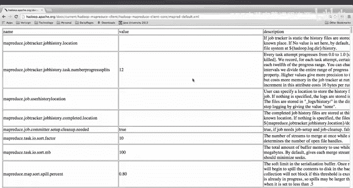
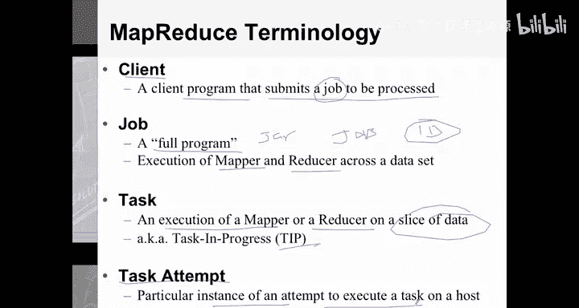
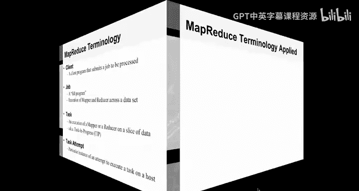
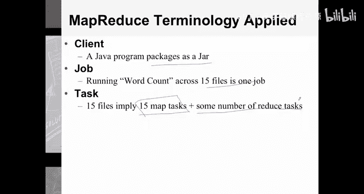
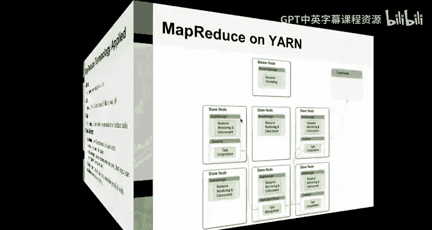
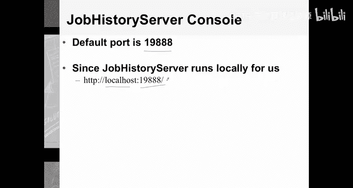
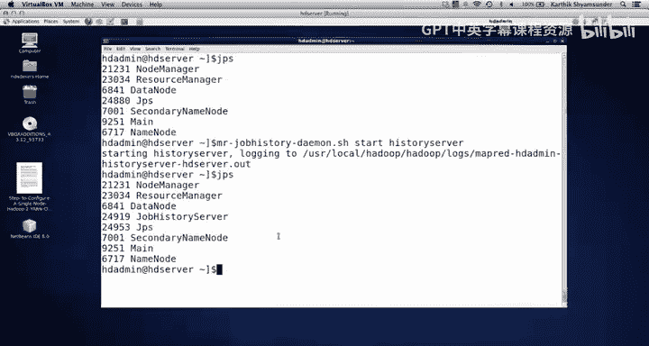
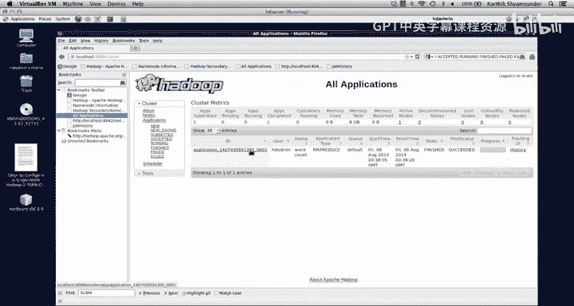

# 课程 43：YARN上的MapReduce框架 🧩

在本节课中，我们将学习MapReduce框架，并了解它如何集成到YARN平台上。

## 概述

MapReduce是一个用于在商用硬件上并行处理大量数据的编程模型。它源自函数式编程，其核心思想是将数据处理过程分解为**Map（映射）**和**Reduce（归约）**两个阶段。开发者只需编写这两个函数，框架便会自动处理分布式计算中的复杂性，如任务调度、容错和数据同步。

## 什么是MapReduce？

MapReduce是一个用于在多个节点上并行处理海量数据的精确模型。它源自函数式编程。从字面上看，“MapReduce”由两个词组成：**Map**和**Reduce**。在函数式编程语言中，Map和Reduce是两种特殊的函数，我们稍后会详细讨论。因此，MapReduce在某种程度上是函数式编程与分布式编程的结合。使用MapReduce框架，开发者编写Map函数和Reduce函数，正是这些函数被应用于输入数据。

MapReduce编程可以用多种语言实现。Java是首选语言，因为有原生的Java API可用。但你也可以使用称为**MapReduce Pipes**的工具在C++中进行MapReduce编程。此外，你还可以使用**Hadoop Streaming**或**MapReduce Streaming**在Ruby、Python、Perl等语言中进行MapReduce编程。

MapReduce技术基于谷歌的MapReduce论文。让我们快速浏览一下这篇论文。

这篇论文由Jeffrey Dean和Sanjay Ghemawat撰写。我强烈建议你访问这个URL，快速阅读并了解其大意。虽然我们将在本课程中深入探讨这个架构的细节，但先看看这篇论文是个好主意。你可以看到输入如何被分割成多个分片，以及运行的不同工作器任务（即Map任务）。在Shuffle和Sort发生的屏障之后，是运行的Reduce任务，最终输出结果。我们在Hadoop中的整个架构，即Hadoop MapReduce框架，就是基于这篇论文构建的。

## MapReduce框架与YARN的关系

别忘了，MapReduce框架运行在YARN之上。在Hadoop 2中，Common模块位于底层，HDFS构建在Common之上，YARN又构建在HDFS之上。YARN实际上是一个分布式计算平台，上面可以运行多个框架。MapReduce只是众多框架中的一个，它是一个非常流行的、面向批处理的框架，但也有其他团队在研究其他框架。

MapReduce内置于Hadoop中，并随Hadoop一起分发。MapReduce的配置是可调的。如果你还记得，Hadoop是高度可配置的，MapReduce作为一个框架也是可配置的。MapReduce的XML配置文件是`mapred-default.xml`和`mapred-site.xml`。`mapred-default.xml`包含了所有MapReduce属性的默认值，它是Hadoop jar文件的一部分，默认加载。`mapred-site.xml`是你覆盖所有想要修改的属性的文件，它被放置在Hadoop的安装目录`/etc/hadoop`下。让我们看看`mapred-default.xml`配置，了解其中有哪些不同的属性。

我正在查看Hadoop文档。如果你向左滚动，可以看到`mapred-default.xml`。它列出了所有属性及其默认值和描述。如你所见，这里有很多属性，你可以根据需要覆盖它们。

在我们的安装中，我们也有`mapred-site.xml`文件。在我们的安装配置中，我们设置了一个名为`mapreduce.framework.name`的属性，并将其值设为`yarn`。这就是在告诉YARN，我们将MapReduce框架集成在其之上。换句话说，我们是在告诉MapReduce框架，它将在YARN上运行。

这个属性可以取三个不同的值之一：`local`、`classic`或`yarn`。当设置为`local`时，MapReduce作业将在单台机器的单个JVM中运行，没有NodeManager，没有ResourceManager，也没有NameNode，所有东西都在客户端JVM内运行。这用于调试和测试目的。当设置为`classic`模式时，你是在Hadoop 1模式下运行。当设置为`yarn`时，你实际上是将它集成在YARN框架之上，这正是我们正在做的。

这是我们设置的唯一属性，但我们可以在`mapred-site.xml`中设置其他属性，这些我们将在后续更详细的MapReduce编程中讨论。

## MapReduce处理流程

现在，让我们看看MapReduce的处理过程。框架将输入分解为分片，我们也称之为输入分片。框架还将处理过程分解为多个阶段，即**Map阶段**和**Reduce阶段**。

程序员编写Map函数和Reduce函数，并将其打包成Jar文件。然后，程序员将其作为作业的一部分提交。框架在Map阶段使用Map函数，在Reduce阶段使用Reduce函数。框架会对它接收到的每一个输入应用Map函数，并对Map函数的所有输出应用Reduce函数。

每个阶段，无论是Map阶段还是Reduce阶段，都使用键值对作为输入和输出。Map阶段接收输入文件。如你所知，输入文件实际上被分解为键值对组合。我们稍后会看到它是如何将输入分解为键和值的，因为输入可能一次只是一行。Map的输出是一个键值对组合，这个输出被发送到Reduce阶段，然后Reduce阶段处理它并发送最终输出。

Map的输出在被发送到Reduce阶段之前，实际上会由框架进行处理。因此，输入进入Map阶段，Map阶段处理输入并产生输出。Map阶段的输出由框架处理，然后产生一个新的输出，这个新输出成为Reduce阶段的输入。我想在这里强调的是，MapReduce框架正在对Map的输出进行一些处理。

如果你查看`yarn-site.xml`，其中有一个属性叫`yarn.nodemanager.aux-services`。这是我们在`yarn-site.xml`中实际设置的一个属性，我们将其值设置为`mapreduce_shuffle`。`mapreduce_shuffle`是框架在Map输出上所做的特殊工作。这是集成在YARN框架上的一个附加功能，以便它能进行洗牌操作。大多数框架没有辅助服务，但YARN中引入了辅助服务以支持MapReduce框架。我们稍后将讨论Shuffle和Sort框架，到那时会更容易理解。现在只需记住，为了将MapReduce集成到YARN之上，我们必须将`yarn-site.xml`中的`yarn.nodemanager.aux-services`属性设置为`mapreduce_shuffle`。

## MapReduce的内置优势

MapReduce框架内置了许多应用特性。首先是**并行性**：框架将输入分解为分片，并自动将作业分解为任务。其次是**自动故障处理**：当任务因节点崩溃或磁盘损坏而失败时，框架会自动处理，将任务转移到其他节点。它实际上是在YARN平台的帮助下完成这一点的。如果你注意到，我们在YARN平台中看到过称为容器的概念，这些容器会自动重新启动，这正是这里发生的情况。它还**简化了分布式处理**：如果你必须进行分布式处理，并且必须管理所有这些数据并同步它们，你需要执行许多复杂的机制才能以正确的方式处理数据。所有这些复杂的锁定机制不再需要由开发者管理。开发者只需专注于编程逻辑，实际上是专注于组织的业务逻辑。

MapReduce非常适合并行处理大量数据，但别忘了它是一个面向批处理的框架，非常适合批处理系统。它擅长处理大量数据和面向批处理的场景。它之所以适合批处理，是因为顺序读取非常高效，而不是在文件的不同部分之间跳转、寻址和前后移动，那样成本非常高。磁头移动的成本很高。我们在HDFS架构中讨论过这一点，在介绍现代分布式计算架构时也提到过。

## MapReduce的局限性

然而，MapReduce不太适合在线数据访问，因为它是一个批处理框架，不适合需要几毫秒甚至几秒钟内得到快速答案的场景。如果你需要快速的随机访问，有称为**HBase**的工具，我们稍后会讨论。此外，如果你只想处理大型数据集中的一小部分，MapReduce也不适合。它最适合读取整个文件并进行处理，而不是处理小数据集。它也不适合实时或基于流的处理。假设有数据不断流入你的系统，你试图实时处理这些数据并获得实时分析，你无法用MapReduce做到这一点。现在正在开发许多更新的框架，如**Storm**，用于实时处理，但这些框架并非构建在Hadoop 2之上。不过，这些框架正在被改造以在Hadoop上运行，特别是在YARN上运行，因为YARN允许你运行任何框架。

## MapReduce术语

让我们看看MapReduce的术语。在MapReduce中，我们使用术语**客户端**。客户端是一个程序，一个独立的程序，它提交一个要处理的作业。这就引出了一个问题：什么是作业？作业是一个完整的程序。所谓完整程序，是指一个包含主方法的类，以及所有支持类，包括Mapper类和Reducer类，以及处理数据所需的其他库类，所有这些都打包在一个Jar文件中。然后你提交这个Jar文件作为作业。作业还有一个与之关联的作业ID。

当作业运行时，作业被分解为**任务**，每个任务在一个单独的进程中运行。每个任务要么是Map任务，要么是Reduce任务。因此，任务实际上是Mapper或Reducer的一次执行，并且它实际上是在处理一片数据。还有一个术语叫**TIP**，即“进行中的任务”。还有**任务尝试**这个术语。任务尝试是尝试执行某个任务的特定实例。为什么说是“特定尝试”？因为一个任务可能被执行多次。任务可能被执行多次，因为第一次执行时失败了，或者因为MapReduce发现某个特定任务非常慢，所以在不同的机器上启动相同的任务。这就是我们所说的**推测执行**。我们将在接下来的三到四个模块中学习Hadoop MapReduce时讨论所有这些内容。

例如，客户端是一个打包为Jar文件的Java程序。一个作业就像跨15个文件运行词频统计。假设我们下载了15本小说，我们想找出所有不同书籍中独特的单词，并统计这些不同单词的数量。一个任务基本上就是一个MapReduce任务。这15个输入文件至少会转换为15个Map任务，每个文件成为一个Map任务。如果文件足够大，文件可能会被分解为多个块，每个块将作为单独的任务运行。我们现在先简化一下：15个文件，15个任务。然后，在Reduce方面，会有一定数量的Reduce任务运行。默认情况下，只有一个Reducer，但我们可以自定义Reducer的数量，这将在我们学习MapReduce编程和高级MapReduce编程时讨论。

每个任务至少被尝试执行一次。如果任务崩溃，它可能会被尝试执行多次。任务崩溃的原因有很多：可能因为收到了错误的输入。你甚至可以配置MapReduce框架，比如说：“我有10亿条记录，即使有1%的记录出错也没关系。”你可以配置为，如果有一部分或一定比例的记录是坏的，就忽略它。我想在这里强调的是，一个任务可以被尝试执行多次。

## YARN上的MapReduce架构

现在，让我们看看YARN上的MapReduce架构。如果你看这张图，它看起来和你之前看到的非常相似，这是有意为之的。它看起来像YARN架构，原因是我要将MapReduce架构集成到YARN架构之上。

如果你还记得，在YARN架构中，可以有一个客户端，客户端向ResourceManager提交一个应用程序。ResourceManager随后启动一个Application Master作为进程或容器来执行客户端提交的作业。在MapReduce的情况下，Application Master实际上就是一个MR作业。想一想，Application Master实际上与ResourceManager通信，作为通信的一部分，它应该协商资源。换句话说，它将请求它需要的容器，以便执行任务。

在MapReduce框架中，数据和处理应该放在一起。这就是Application Master（即MR作业主节点）将与NameNode通信的地方，获取该特定作业数据放置的所有主机、所有机器的列表，然后它将去主节点请求仅在这些数据所在的容器上运行。这就是MapReduce中数据和业务处理共置的理念。这不是YARN的特性，更多的是MapReduce的特性。我想强调的是，从节点可能不仅运行NodeManager和各种容器，它们还可能运行DataNode守护进程。回想一下，DataNode守护进程是管理节点内数据的。因此，这些从节点不仅可以作为计算节点，也可以是数据节点。在这种情况下，任务实际上与本地DataNode通信，并进行共置处理。

现在，MapReduce作业已经获得了所有容器。然后，MapReduce作业将启动各种任务。在这个例子中，它在三台不同的机器上启动了三个任务。正如我所说，这些任务将在本地数据上工作。一旦它们完成处理，MapReduce框架现在将做一些内部工作。记住我说过，Map的输出由框架处理，然后框架将获取结果并启动一个Reduce任务。所以现在它启动了一个Reduce任务，在这个例子中，它在那个容器上启动了一个Reduce任务。一旦Reduce任务完成，Reduce任务就结束了，MR作业也结束了，最终整个作业完成。

## YARN上的MapReduce作业流程

让我们看看YARN上的MapReduce作业流程。客户端在第一步提交作业。ResourceManager接收作业，确定Application Master需要在哪里运行。假设在这个例子中，它选择了这个特定的从节点作为Application Master。因此，它通过NodeManager启动一个Application Master，也就是MR作业。然后，Application Master将与各个NodeManager通信以启动各个容器。各个容器将处理Map和Reduce作业。一旦Map和Reduce作业完成，当然，它是通过咨询NameNode获得容器的。一旦工作完成，它就告诉ResourceManager它已经完成了工作，然后应用程序结束。

YARN上的MapReduce框架还引入了一个新的守护进程，称为**作业历史服务器**。这是一个全新的守护进程，不是YARN框架的一部分。它实际上是MapReduce框架的守护进程。作业历史服务器的理念是，它将跟踪所有正在进行的MapReduce作业，并为你提供有关MapReduce作业中正在发生什么的详细信息。如果你还记得，ResourceManager管理资源，它不提供应用程序级别的状态详情，只提供高级别的应用程序状态，而不是详细信息。应用程序级别状态的真正详细信息在MapReduce框架中是从作业历史服务器获取的。

这里的理念是，在YARN中，Application Master不仅与NameNode通信以获取应运行其计算任务的所有数据节点列表，还与这个称为作业历史服务器的新服务器通信。作业历史服务器是它提交所有与作业相关信息的地方。因此，有一个与作业历史服务器关联的HTTP Web控制台，你可以在其中获取有关作业的更多详细信息，所有不同的Map任务、所有不同的Reduce任务、所有日志文件、所有信息都可在作业历史服务器中找到。

## 启动和停止作业历史服务器

启动作业历史服务器的方法是执行`mr-jobhistory-daemon.sh`命令，并传递`start historyserver`作为参数。这将启动作业历史服务器。停止它的方法是`mr-jobhistory-daemon.sh stop historyserver`。请注意，当你启动作业历史服务器时，使用的术语是`historyserver`，而不是`jobhistoryserver`。

还有一个作业历史服务器控制台可供你使用。控制台的默认端口是19888。因为作业历史服务器在本地运行，你可以访问`localhost:19888`来查看作业的历史记录。现在，让我们登录到我们的虚拟机，启动作业历史服务器，启动一个MapReduce作业，并观察整个流程。

好的，我已经以`hdadmin`用户身份登录到我的Hadoop服务器虚拟机。让我执行`jps`命令。我的NameNode正在运行，Secondary NameNode正在运行，DataNode也在运行，这是我的HDFS架构。然后，我的NodeManager和ResourceManager也从我的YARN架构中运行。现在是我启动历史服务器的时候了。启动历史服务器的方法是：`mr-jobhistory-daemon.sh start historyserver`。这应该会为我启动历史服务器。

历史服务器应该已经启动了，让我再执行`jps`。历史服务器在那里，它正在运行。我们还知道历史服务器在端口19888上有一个管理控制台，所以让我们访问它。

我已经在这里标记了历史服务器。19888，这是历史服务器。这里是我到目前为止运行的所有作业。这些是所有不同的作业，它正在跟踪我运行过的所有作业。让我把它设置为显示100条。现在让我开始一个作业。

启动一个作业。好的，这是将要执行MapReduce的YARN作业。点击它。它在那里，作业正在运行。让我看看是否有作业ID。这里有一个作业ID：`job_1305_0001`。好的，让我们返回并刷新。它在那里：`job_1305_0001`，所以这是作业ID。

我可以点击作业，它会给我作业的详细信息。这是应用程序特定的，它会告诉我运行了多少个Mapper，多少个Reducer。点击Map，它会给你那个特定Map任务的详细信息。请注意，这与ResourceManager的管理控制台不同。让我转到ResourceManager的管理控制台。

这是ResourceManager的管理控制台。让我刷新一下。从ResourceManager的角度来看，有一个应用程序被启动，它被赋予了一个ID：`application_..._0001`。如果你想知道这个数字是什么，它是基于ResourceManager的启动时间的。这就是这里的数字。然后`0001`是序列号。下一个作业将是`0002`，然后是`0003`，依此类推。所以这是ResourceManager对客户端提交的特定作业（或应用程序）的看法。

但它随后启动了Application Master，也就是一个MR作业。这个MR作业与作业历史服务器通信以获取有关MR作业本身的信息，这是另一个不同的控制台，就是这里的这个。

它也有一个ID，而且它的ID非常相似。它是`job`而不是`application`，后面跟着ResourceManager启动时的一个数字（即时间戳），然后是与之关联的编号。好的，你现在明白这个意思了。

## 总结

在本节中，我们学习了MapReduce框架，并看到了MapReduce平台如何集成到YARN架构之上。我们探讨了MapReduce的基本概念、处理流程、内置优势、局限性以及关键术语。我们还了解了YARN上MapReduce的架构和作业流程，并介绍了作业历史服务器的作用和使用方法。通过实际启动历史服务器和提交作业，我们观察了从作业提交到完成的整个流程，以及如何通过不同控制台监控作业状态。