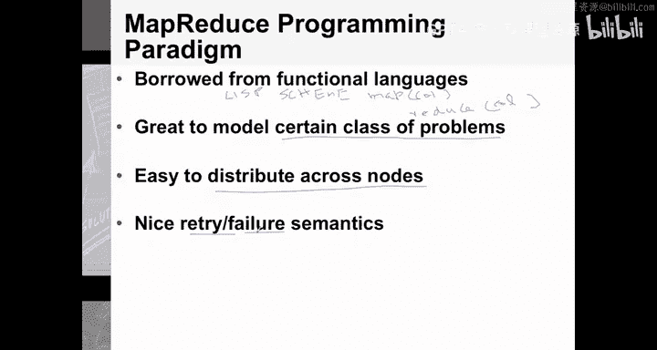
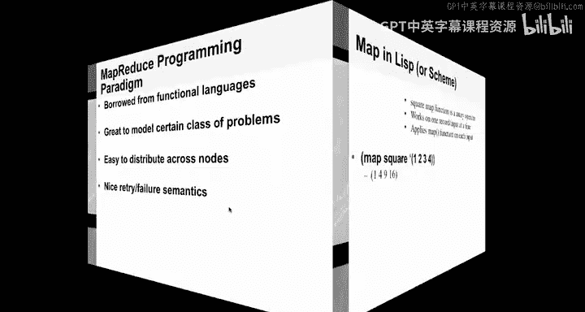
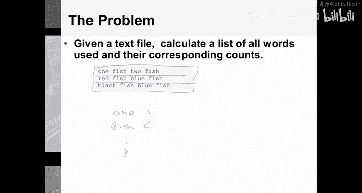
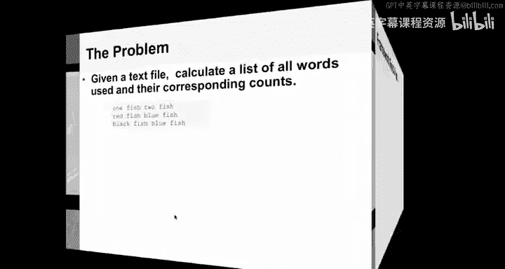
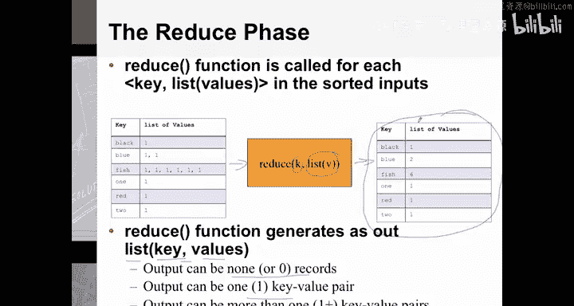
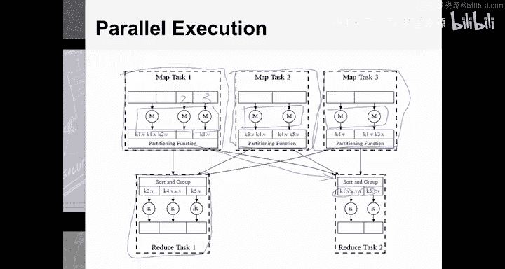
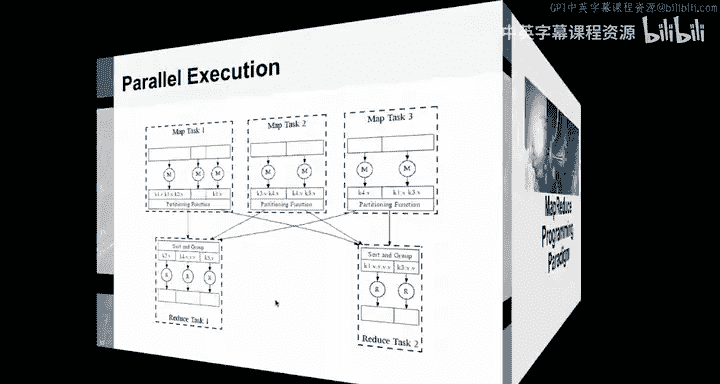

# 课程04：MapReduce编程范式 🧩


在本节课中，我们将学习MapReduce编程范式。我们将从函数式语言中“Map”和“Reduce”术语的起源讲起，并探讨函数式编程与分布式编程之间的相似之处。接着，我们将深入MapReduce编程模型，包括作为Map和Reduce阶段输入输出的键值对、框架的Shuffle和Sort过程，以及框架为完成一个作业而并行执行任务的一系列步骤。

---

## 函数式编程中的Map与Reduce





MapReduce编程范式借鉴了Lisp、Scheme等函数式语言中的Map和Reduce概念。在这些语言中，`map`和`reduce`函数接收一个集合作为输入，并对集合中的每个元素应用一个函数。这种范式非常适合解决某一类问题，并且易于在多个节点间进行分布式计算。当你为单机编写程序时，同样的编程范式可以应用到上百台机器上。MapReduce框架还在重试和容错方面提供了良好的语义支持，例如当一个节点崩溃导致任务失败时，相同的任务可以在另一台机器上重新执行。

### Map函数示例

以下是一个Scheme语言中调用`map`函数的语句：

```scheme
(map square ‘(1 2 3 4))
```

这段代码的含义是：`map`函数接收一个`square`函数和一个列表`(1 2 3 4)`作为参数。`map`函数将对列表中的每个元素应用`square`函数。因此，`1`的平方是`1`，`2`的平方是`4`，`3`的平方是`9`，`4`的平方是`16`。最终结果是得到一个新列表`(1 4 9 16)`。其核心思想是：获取输入的每个条目，应用作为参数传入的`map`函数，然后得到结果。

### Reduce函数示例

以下是`reduce`函数的一个例子：

```scheme
(reduce + 0 ‘(1 4 9 16))
```

这段代码的含义是：`reduce`函数接收一个`+`函数（加法运算符）、一个初始值`0`以及一个列表`(1 4 9 16)`作为参数。`reduce`函数的目标是将传入的列表值归约为一个单一的值。由于`+`是二元运算符，计算过程如下：`0+1=1`，`1+4=5`，`5+9=14`，`14+16=30`。最终结果是`30`。其核心思想是：通过应用一个归约函数，将一个大的列表归约为一个新值。

---

## MapReduce编程模型

在MapReduce编程模型中，它强制要求输入和输出都采用键值对的形式。换句话说，Map函数和Reduce函数都接收键值对作为输入，并产生键值对作为输出。整个过程都围绕着以键值对为输入和输出展开。





实际上，情况要稍微复杂一些。Map函数接收一个键`K1`和值`V1`作为输入，并产生一个键`K2`和值`V2`的列表作为输出。而Reduce函数则接收一个键`K2`和一个值`V2`的列表作为输入，并产生一个键`K3`和值`V3`的列表作为输出。这里使用的`K1`、`V1`等符号实际上代表类型，它们可以是完全不同的类型。

---

## 通过示例理解：单词计数

为了更好理解，我们通过一个具体问题来演示：给定一个文本文件，计算文件中所有单词及其出现次数。

假设文本文件包含以下三行内容：
```
one fish two fish
red fish blue fish
black fish blue fish
```
我们的目标是输出每个单词及其出现次数，例如：`one: 1`， `fish: 6`。

### 第一步：框架读取输入

MapReduce框架从输入源（这里是一个文本文件）读取数据。由于文本文件本身不是键值对格式，框架需要将其解析为键值对记录。对于文本文件，它使用**字节偏移量**作为键，**整行内容**作为值。

*   **记录1**：键是`0`（字节偏移量），值是`"one fish two fish"`。
*   **记录2**：键是`18`，值是`"red fish blue fish"`。
*   **记录3**：键是`37`，值是`"black fish blue fish"`。

### 第二步：Map阶段

框架会为每个键值对记录依次调用Map函数。Map函数处理一条记录后，可以产生零个、一个或多个输出记录。

在我们的单词计数例子中，Map函数的逻辑是：将一行文本拆分成单词，为每个单词输出一个中间键值对，其中**键是单词本身，值是数字1**（表示该单词出现了一次）。

以下是Map阶段处理三条记录后的中间输出：
*   处理记录1后输出：`(one,1)`, `(fish,1)`, `(two,1)`, `(fish,1)`
*   处理记录2后输出：`(red,1)`, `(fish,1)`, `(blue,1)`, `(fish,1)`
*   处理记录3后输出：`(black,1)`, `(fish,1)`, `(blue,1)`, `(fish,1)`

### 第三步：Shuffle与Sort阶段

框架会收集所有Map任务产生的中间输出，并进行**分组**和**排序**。

*   **分组**：将所有具有相同键的键值对聚集在一起。
*   **排序**：通常按键的字典序进行排序。

经过Shuffle和Sort后，数据被组织成如下形式，准备发送给Reduce函数：
*   `(black, [1])`
*   `(blue, [1, 1])`
*   `(fish, [1, 1, 1, 1, 1, 1])`
*   `(one, [1])`
*   `(red, [1])`
*   `(two, [1])`

### 第四步：Reduce阶段

Reduce函数接收一个键和该键对应的值列表作为输入。在我们的例子中，Reduce函数的逻辑是：将这个值列表中的所有数字`1`相加，得到该单词的总出现次数，然后输出最终的键值对。



Reduce阶段处理后的最终输出为：
*   `(black, 1)`
*   `(blue, 2)`
*   `(fish, 6)`
*   `(one, 1)`
*   `(red, 1)`
*   `(two, 1)`

这正是我们想要的单词计数结果。

---

## 从顺序执行到并行执行

以上描述的是一个顺序执行的模型：一个Map任务顺序处理所有输入记录。MapReduce的强大之处在于其内置的并行处理能力。

在并行执行模型中：
1.  **多个Map任务**：输入数据被分割成多个部分（分片），每个部分由一个独立的Map任务处理。这些Map任务可以运行在不同的机器上，处理各自本地的数据。
2.  **分区**：所有Map任务产生的中间输出会根据键被**分区**。框架确保所有相同键的键值对都会被发送到同一个Reduce任务。
3.  **多个Reduce任务**：多个Reduce任务可以并行运行，每个处理分配给自己的那一部分键。

开发者只需编写Map和Reduce函数的业务逻辑，而无需关心数据分割、任务调度、节点间通信、故障恢复等复杂的并行计算细节，这些都由MapReduce框架自动处理。

---

## 总结 🎯

在本节课中，我们一起学习了MapReduce编程范式。





我们首先了解了Map和Reduce概念如何源于函数式编程。接着，我们深入探讨了MapReduce编程模型，认识到该框架在整个数据处理流程中——从Map阶段，经过Shuffle和Sort阶段，再到Reduce阶段——都强制使用键值对的概念。我们通过单词计数的例子，清晰地看到了数据如何从输入流经各个阶段最终产生输出。最后，我们了解到这个编程模型既可以顺序执行，也可以并行执行，而所有的并行化细节都由框架负责，开发者只需专注于核心的业务逻辑编写。

通过本节课的学习，你应该对MapReduce如何将一个大问题分解为可并行处理的Map和Reduce任务，并最终合并结果有了基本的理解。