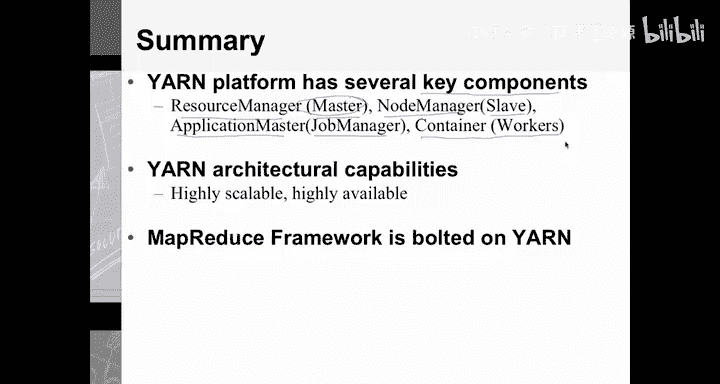

# 课程名称：Hadoop大数据处理 - 第5课：YARN与MapReduce架构总结 🧠

在本节课中，我们将总结YARN平台和MapReduce框架的核心架构与关键组件。我们将回顾YARN的主要组成部分、其架构能力，以及MapReduce如何构建在YARN之上运行。

---

## YARN平台关键组件 🏗️

上一节我们介绍了YARN的整体角色，本节中我们来看看其具体的核心组件。

YARN平台包含几个关键组件。

*   **资源管理器**：这是YARN架构的主节点，负责所有调度工作。
*   **节点管理器**：作为主资源管理器的从节点，负责向资源管理器提供节点健康信息。
*   **应用管理器**：这是提交给资源管理器的作业的“作业管理器”。
*   **容器**：容器是真正的“工作者”，它们在独立的JVM或独立进程中执行实际任务。

---

## YARN的架构能力 💪

了解了组件之后，我们来看看YARN架构所具备的重要能力。

我们探讨了YARN的几项能力，包括**安全性**、**可用性**、**可扩展性**和**可操作性**。我们发现YARN具有高度的可扩展性和高可用性。

---

## MapReduce框架 🗺️➡️📉

现在，让我们将目光转向构建在YARN之上的MapReduce框架。

MapReduce框架构建在YARN之上。该框架有两个关键组件。

*   **MapReduce框架应用管理器**：负责与资源管理器协商获取各种容器，以便实现数据与处理的协同定位。
*   **作业历史服务器**：此组件已加入MapReduce框架，用于跟踪作业的所有应用程序状态信息，因为资源管理器并不真正关心应用程序状态。

---

## MapReduce编程范式 ⌨️

最后，我们来回顾MapReduce的核心编程思想。

我们还研究了MapReduce编程范式。我们看到了一个作业如何被分解为Map阶段和Reduce阶段的任务。在Map和Reduce阶段中，所有这些不同的任务都以**键值对**作为每个阶段输入和输出的基础。

---

## 总结 📚

本节课中，我们一起学习了YARN架构的核心组件（资源管理器、节点管理器、应用管理器、容器）及其关键能力（如可扩展性与高可用性）。同时，我们回顾了MapReduce框架如何基于YARN运行，其核心组件包括MapReduce应用管理器和作业历史服务器，并再次明确了MapReduce以**键值对**处理和分阶段（Map/Reduce）执行任务的编程范式。