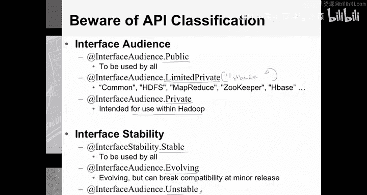
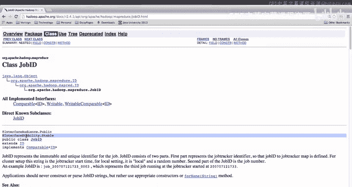
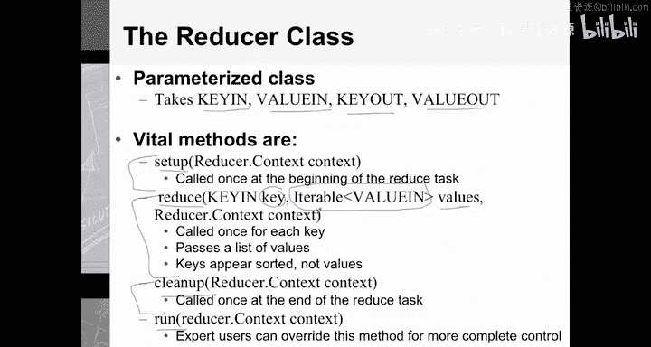
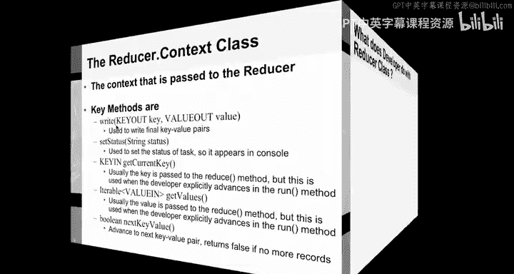
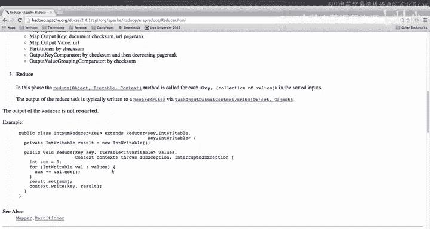
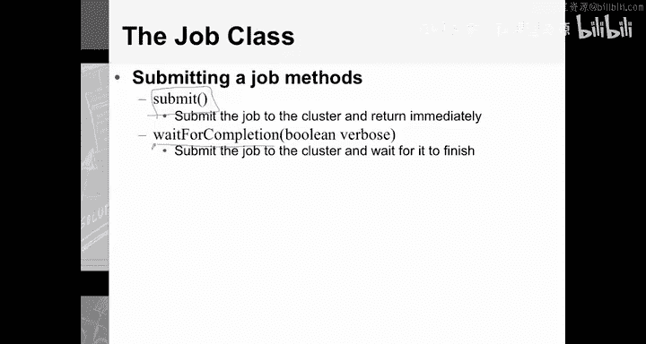
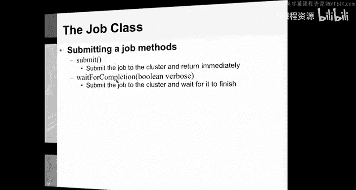
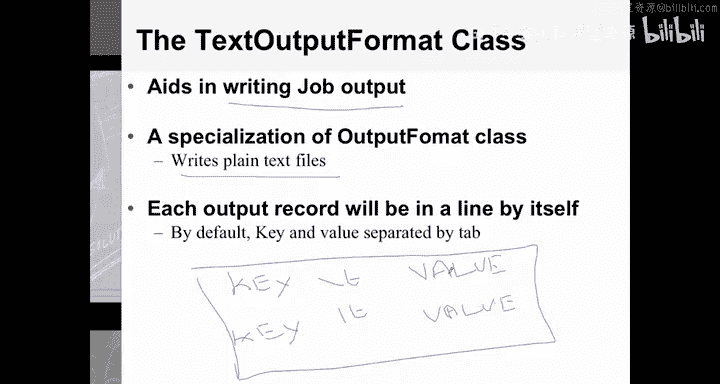

# 课程 7：MapReduce编程API解析 🧩

在本节课中，我们将学习Hadoop MapReduce编程API的核心组成部分。我们将了解关键的类、接口和方法，以及它们如何协同工作来构建一个MapReduce作业。通过本教程，你将熟悉编写MapReduce程序所需的基本组件。

---

## MapReduce编程API概述

MapReduce编程API概述。本节将概述MapReduce编程API。这将使你熟悉MapReduce库中各种重要的类、接口和方法。

## 新旧API对比

新旧API对比。MapReduce API有两种风格。旧包是`org.apache.hadoop.mapred`包的一部分。新包是`org.apache.hadoop.mapreduce`包。注意区别。

我们将专门使用新API，也就是这里的这个包。你需要确保使用来自这个`mapreduce`包的所有类。

因为有些类在旧包和新包中具有完全相同的名称。导入时，你必须小心一点，因为如果你尝试混合使用旧类和新类，可能会遇到麻烦。

新API是旧API的重新设计版本，它被重新设计以便于未来的演进。

你可能会问，为什么旧API仍然存在？这是因为新类依赖于旧类。他们并没有真正将旧API完全迁移到新API中。大部分内容已经迁移，但有些东西仍未迁移，因此旧API仍然存在。

## API分类注意事项

API分类注意事项。当你查看Hadoop源代码或Hadoop文档时，你会注意到有些类被标注了`InterfaceAudience`。

`InterfaceAudience.Public`意味着特定的类、接口或方法可以被任何人使用。

如果它说`InterfaceAudience.LimitedPrivate`，那么意味着它只能被有限的一组人使用，并且可以使用该类、接口或方法的人员被标记为某个值。你可能会看到类似`LimitedPrivate({"HBase"})`的内容，这意味着只有HBase开发人员才被允许使用它。

如果你看到任何标记为`Private`的类、接口或方法，这意味着它仅供Hadoop内部使用。因此，请避免在你的代码中使用这些类、接口或方法。

同样，还有一个概念叫做`InterfaceStability`。接口稳定性可以是`Stable`，这意味着你可以使用它，没有问题。它也可以是`Evolving`，这意味着该类将来可能会破坏兼容性。它也可以是`Unstable`，这意味着他们仍在开发中，不能保证这个特定的类、方法或接口将来会存在。

## Hadoop API快速浏览

Hadoop API快速浏览。这是Hadoop API文档。我将向你展示`mapreduce`包。这是`mapreduce`包。让我们进入`mapreduce`包。

在`mapreduce`包中，有`Job`类。如果你查看`Job`类，它是`Evolving`。它是一个公共类，但它仍在演进，他们还没有完全改变它。

如果你查看`JobID`类，它说它是公共的并且是`Stable`的，所以`JobID`没有问题。你可以看到这些类是如何被标注的。

## MapReduce API概览

MapReduce API概览。这是API中所有对我们重要的类的一个鸟瞰图。

*   `JobID`类代表一个作业的ID。
*   `Job`类代表一个将要提交的作业。你通常实例化一个`Job`对象，然后自动会有一个`JobID`对象与之关联。你从不实例化`JobID`对象。
*   还有一个与作业关联的`JobConfiguration`对象。
*   还有一个`JobContext`对象，它为你提供关于该作业的信息。当你实例化一个`Job`对象时，也会有一个`JobContext`与之关联。你通常不直接使用`JobContext`，它通过`MapperContext`和`ReducerContext`间接使用，`Mapper`和`Reducer`类将其作为参数获取。

你会注意到中间有一大堆类，比如`TaskAttemptContext`、`TaskOutputContext`、`MapContext`和`ReduceContext`。这些都是你不需要太担心的中间类。我把它放在这里只是为了向你展示层次结构的一部分。我用矩形标记的那些是我们关心的类。

*   `Mapper`类是一个非常重要的类，这可能是最重要的类之一，因为作为MapReduce作业的作者，你将编写扩展自`Mapper`类的类，或者编写扩展自`Reducer`类的类。所以，`MyMapper`和`MyReducer`是你将要编写的类，并且你将覆盖这些类的方法。
*   还有一个名为`InputFormat`的类和一个名为`FileInputFormat`的类。`FileInputFormat`是一种特殊类型的`InputFormat`。
*   有几种输入格式。`TextInputFormat`是最重要的输入格式类，因为它代表纯文本文件。通常，在进行MapReduce编程时，你使用纯文本文件，所以这是一个非常重要的类。当然，你也可以使用序列文件或映射文件，所有这些类都继承自`FileInputFormat`类。

所以我们并不直接关心`FileInputFormat`类或`InputFormat`类，因为它们是中间类。`FileInputFormat`类中有一些方法你会在`TextInputFormat`类中使用。

*   还有处理HBase输入的`DBInputFormat`类。所以，如果你想在HBase上进行MapReduce编程，你可以这样做。
*   同样，对于`DBOutputFormat`，我们现在先不担心输出格式，让我们先关心处理纯文本文件的`TextOutputFormat`。纯文本输入和纯文本输出。我希望他们把这个叫做`FileTextInputFormat`。他们在这里叫它`InputFormat`，然后在这里叫`FileInputFormat`。我想`TextFileInputFormat`会是一个更好的名字，而`TextFileOutputFormat`在这里会是一个更好的名字。

无论如何，他们就是这么叫的。好了，这基本上从高层次的角度涵盖了所有的类。现在让我们看看其中一些重要的类，并看看与它们相关的方法。

## JobID 类

`JobID`类代表作业的唯一标识符。`JobID`是不可变的。作业的标识符格式为单词`job`，后跟服务器的启动时间，再后跟序列号。所以，每当你启动一个作业时，`JobID`就是这样生成的。下一个作业将获得`job_..._6`的`JobID`，末尾是序列号6，然后是7，依此类推。

`JobID`对象是拥有这些信息的对象。你可能想使用`JobID`来打印日志消息，以便跟踪你的作业，并且你也可以使用你的`JobID`转到作业历史服务器并查看该特定作业的详细信息。

应用程序永远不应该实例化`JobID`对象。事实上，当你提交作业时，它会自动为你实例化。如果你有一个字符串形式的`JobID`，有一个工厂风格的`get`方法：调用`forName`，这将允许你获得一个`JobID`对象的实例，但你很少使用它。

## JobContext 类

`JobContext`类是作业的上下文视图或作业的上下文视图。它是一个只读视图，换句话说，你不能更改作业上下文的任何内容。

应用程序不应该实例化`JobContext`对象。

但是`JobContext`对象将被传递给应用程序。实际上，当我说应用程序时，在MapReduce的情况下，就是你的`Mapper`和`Reducer`在运行。所以`Mapper`和`Reducer`任务会自动传递`JobContext`对象，但有趣的是，它不是作为`JobContext`对象传递的，而是作为`MapperContext`对象或`ReducerContext`对象传递的，这在某种程度上是一个继承自`JobContext`对象的类。

但重要的是，一旦你手中有了一个上下文对象，无论是`MapperContext`还是`ReducerContext`，由于它也是一个`JobContext`，你可以获取关于作业的信息。你可以获取`JobID`，这就是你找出`JobID`是什么的方式。你可以获取作业名称，作业在创建和提交时被赋予了一个名称。你可以获取与作业关联的配置信息。你还可以获取`Mapper`键类、`Reducer`键类、输出键类、输出值类。所有不同的键和值类也可以通过这些`get`方法获取，这些方法实际上返回一个类类型。

正如我所说，`JobContext`类实际上是`MapperContext`和`ReducerContext`的基类，这对我们来说非常关键，因为`Mapper`的`map`方法和`Reducer`的`reduce`方法都获取`MapperContext`和`ReducerContext`，它们有一个对我们来说非常非常重要的方法，叫做`write`方法。

## Mapper 类

`Mapper`类是Hadoop API中的关键类之一。

`Mapper`类处理输入键、输入值、输出键和输出值。因此，它适当地接受`KeyIn`、`ValueIn`、`KeyOut`和`ValueOut`类型，用于它需要经历的各种参数化。

`Mapper`类有一些重要的方法：

*   它有一个叫做`setup`的方法，它被调用一次。这就像你的初始化方法，这是你进行初始化的地方。
*   然后，`Mapper`类最重要的方法是`map`方法。注意，它获取一个键和一个值，并且还获取一个上下文对象。这是你进行转换实际工作的地方，将输入转换为输出。
*   然后还有`cleanup`方法，这是你清理`Mapper`任务的地方。所以，任何你需要做的反初始化或任何你真正需要做的清理工作，你都会在这个特定方法中完成。
*   还有一个叫做`run`的方法，一些专家用户在多线程情况下会使用它。所以你可以实际控制输入的到来。通常你不这样做，你通常使用`map`方法进行处理，其中`map`方法由框架自动调用。

正如我提到的，`MapperContext`类是一个重要的类，它为你提供了`Mapper`工作的上下文。它为你提供了`MapperContext`，这也是一个`JobContext`。

现在，如果你回到上一张关于`Mapper`类的幻灯片，你会注意到`Mapper`类的`map`方法获取一个上下文对象。甚至`setup`方法和`cleanup`方法也获取一个上下文对象。所以上下文对象非常重要，它包含关于作业的信息。别忘了，一个作业可能被分解成任务，任务可能跨多个机器运行，所以每个任务都必须知道它们到底在做什么，上下文是什么，我的作业上下文是什么。这就是`MapperContext`的作用。`MapperContext`为你提供关于`Mapper`的信息，也为你提供关于作业本身的信息。

`MapperContext`有一个非常重要的方法，这个方法叫做`write`方法。`write`方法接受一个键和一个值，这就是`map`方法用来将输出作为中间键值对输出的方法。所以这对我们来说是一个极其重要的方法，当我们编写`map`方法时，我们将持续使用它。

然后还有一个叫做`setStatus`的方法，你可以设置MapReduce作业的状态。如果你设置了状态，那么它就会出现在管理控制台的UI控制台中。所以从这个角度来看，它非常有用。

然后这里还有三个方法，分别是`getCurrentKey`、`getCurrentValue`和`nextKeyValue`。再一次，如果你想控制获取下一条记录、再下一条记录，那么你会使用这些方法，但你通常不这样做。你通常在`map`方法中被给予键和值，这对你来说已经足够了，这就是你进行处理的方式。

## 开发者如何使用 Mapper 类

开发者如何使用`Mapper`类？这是最重要的类。开发者必须将输入键值对映射到一组中间键值对。这就是开发者必须做的事情。

这意味着开发者必须做的是扩展`Mapper`类。

*   覆盖`setup`方法以初始化`Mapper`。你可能需要查找数据库或某种参考数据，无论你想做什么，都必须在`setup`方法中完成。
*   然后你覆盖`map`方法，这是你执行所有业务逻辑的地方。将输入记录转换为中间记录的实际技巧就是在这个方法中完成的。

别忘了，一个输入键值对可能映射到零个输出键值对，或一个输出键值对，或多个输出键值对。它具体映射到什么取决于你将在上下文对象上调用`write`方法的次数。

另外，你生成的中间记录。记住，你正在将键和值输入到`Mapper`中，然后你将生成这个中间键值对。中间键值对不必是相同的类型。它们不必是相同的类型，这就是为什么当你定义`Mapper`类时，最终将`KeyIn`、`ValueIn`、`KeyOut`和`ValueOut`作为四个参数类型的原因。

现在先了解大致的轮廓。然后当我们开始查看代码示例时，你会开始更清楚地理解。

*   开发者必须做的下一步是覆盖`cleanup`方法以清理任何资源。

在我深入探讨框架如何使用`Mapper`类之前，让我们快速查看一下文档。所以我要查看`Mapper`类。这是`Mapper`类。

注意我说过，`Mapper`类将`KeyIn`、`ValueIn`、`KeyOut`和`ValueOut`作为参数化类型。当你编写`Mapper`类时，你会注意到你实际上是在传递参数化。这是你的`KeyIn`、`ValueIn`、`KeyOut`、`ValueOut`。

注意在这种情况下，你所做的只是覆盖`map`方法。你没有覆盖`setup`方法或`cleanup`方法。你不必这样做。`map`方法是最重要的方法。

所以你在这里覆盖`map`方法。`map`方法接受一个键、一个值和一个上下文对象。正是这个上下文对象，你用它来写入你的输出。所以注意，上下文对象有一个叫做`write`的方法，这就是你用来写入输出的方法。输出类型必须是`Text`类型，输出键类型必须是`Text`类型，输出值类型必须是`IntWritable`类型。

## 框架如何使用 Mapper 类

框架如何使用你刚刚编写的`Mapper`类？框架的工作是将输入键值对传递给`Mapper`。

所以框架实际上实例化了一个`Mapper`对象，也就是你编写的`Mapper`类。

然后它调用`setup`方法一次。这是`Mapper`必须进行初始化的地方。

然后，对于输入分片中的每个键值对，`map`方法都会被调用。所以它只是不断地调用`map`方法，这就是你执行所有业务逻辑的地方。

然后，一旦完成，它就调用`cleanup`方法。然后我们就完成了。

## Reducer 类

好了，这就是`Mapper`。现在让我们看看`Reducer`。同样，这是一个非常相似的故事。

`Reducer`是一个参数化类。它接受`KeyIn`、`ValueIn`、`KeyOut`、`ValueOut`作为输入。这些是它接受的各种数据类型。

它有`setup`方法、`reduce`方法、`cleanup`方法和`run`方法。

*   `setup`方法是你为`Reducer`进行初始化的地方。
*   `reduce`方法是最重要的方法，这是你将生成输出的地方。
*   `cleanup`方法是你将进行任何需要做的清理工作的地方。这与我们在`Mapper`类中拥有的非常相似。

这里要记住的最重要的事情是，`reduce`方法是关键方法，并且`reduce`方法接受一个键和一个值列表。这是不同的地方。注意它接受一个值列表。它接受一个`Iterable<ValueIn>`，这是一个值列表。

所以一旦你得到键和值列表，你就可以决定做任何你想做的事情。如果你回想一下，当我们做单词计数示例的场景时，我们看到我们得到了所有数字的列表，我们得到了单词`fish`为`[1,1,1,1,1]`，这将是那个列表。所以你必须遍历这个列表并把它们加起来，这就是你将在`reduce`方法中做的事情。

然后还有`ReducerContext`类，它与`MapperContext`类非常相似。`ReducerContext`类有一个叫做`write`的方法，这就是你用来写出键值对组合的方法。

然后它还有一个叫做`setStatus`的方法，所以你可以设置作业的状态。

当然，如果你想控制自己获取键和值，你可以使用`getCurrentKey`和`getValues`方法。

大多数时候，我们都在使用这两个，特别是只使用`write`方法，这就是我们关心的。

## 开发者如何使用 Reducer 类

开发者如何使用`Reducer`类？开发者负责获取中间键值对组合并生成最终的键值对，这些键值对成为输出的一部分。

所以开发者必须扩展`Reducer`类。

*   再次覆盖`setup`方法，这是你进行所有初始化的地方。
*   然后覆盖`reduce`方法，这是你执行所有业务逻辑的地方，这是你执行归约逻辑的地方。
*   然后作为归约逻辑的一部分，将输入记录转换为最终输出记录。别忘了，转换后的记录类型可能与输入类型不同。
*   最终为`Reducer`进行清理。

## 框架如何使用 Reducer 类

框架如何使用`Reducer`类？再一次，在我们看这个之前，让我们继续查看文档。

让我们看看`Reducer`类。`Reducer`就在那里。很好。

我们讨论了`shuffle`和`sort`。所以这里是`Reducer`类。注意`Reducer`类接受`KeyIn`、`ValueIn`、`KeyOut`、`ValueOut`，这就是你的参数化类型。

`reduce`方法接受一个键，它还接受一个`Iterable`值列表（键和值），并且还接受上下文对象。然后它遍历这个列表。这是经典的单词计数示例，我们接下来会讨论。

框架如何使用你编写的`Reducer`类？框架应该将中间键值对传递给`Reducer`。

所以框架将实例化一个`Reducer`对象，然后它将调用`setup`方法，这是你可以进行初始化的地方。

然后它将最终调用`reduce`方法，这是最重要的方法。当它调用`reduce`方法时，它将作为`reduce`方法的一部分传递键和值列表。

然后，一旦完成，在处理完所有输入记录后，它将最终调用`cleanup`方法。

## Job 类

然后是`Job`类。`Job`类是一个非常重要的类，因为当你想向Hadoop框架提交作业时，你需要实例化一个`Job`对象。所以它代表了作业提交者对作业的视图。它允许用户配置作业。

所以想法是，你实例化一个`Job`对象，你可以配置它，你可以提交它，你还可以控制它的执行。换句话说，如果你愿意，你可以杀死作业。你可以查询作业的状态，你可以看到作业处于什么状态。

它有几个`set`方法。`set`方法只在作业提交之前有效。如果你尝试在作业提交后调用`set`方法，它会抛出一个叫做`IllegalStateException`的异常。所以你在提交作业之前进行设置。

让我们看看一些方法。`Job`对象中有很多方法，但一些重要的方法是：

*   `setJobName`：你可以设置作业名称，以便它在管理控制台中以正确的名称可用。
*   你还可以设置`Jar`类，这是我们在下一节要讨论的内容。
*   然后你还可以设置`InputFormat`、`Mapper`类、`Reducer`类、输出键类、输出值类。什么是输出键和输出值？注意你没有设置输入键和输入值。原因是它根据文件获取该信息。如果是文本输入文件，它会自动知道键是字节偏移量（被视为`LongWritable`），值是字符串，所以变成`Text`。

注意我在这里使用像`Text`、`LongWritable`和`IntWritable`这样的词。这是因为这些键和值必须是Hadoop序列化类型。我们将在下一节中更多地讨论这个问题。

好了，所以你设置了输出键类、输出值类。分区类是一大堆你可以设置的东西。我们将在Hadoop MapReduce编程部分讨论所有这些不同的东西。

你还可以获取作业的进度。什么是设置进度？这是当你提交作业时。你还可以找出`map`进度，你可以找出`reduce`进度。当你运行MapReduce作业