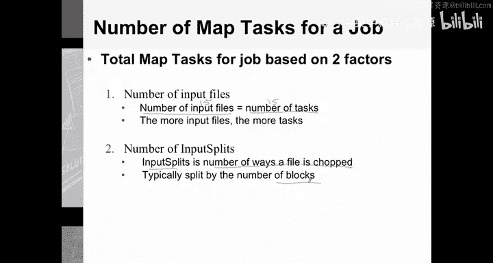
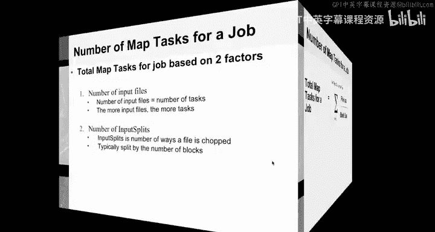
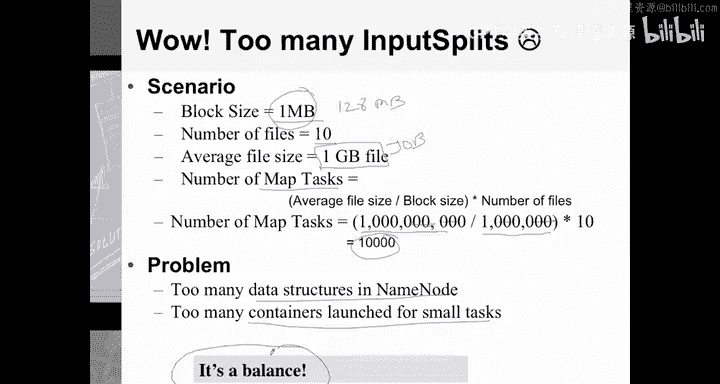
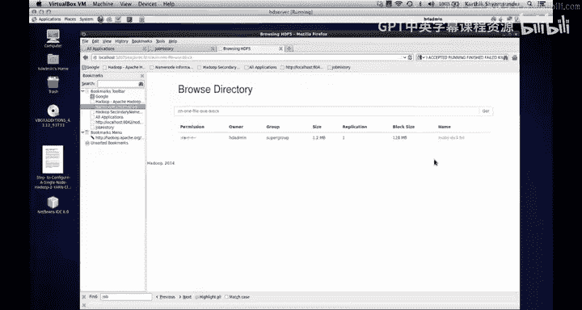
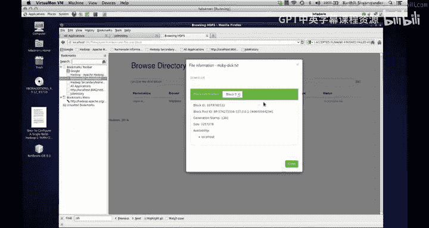
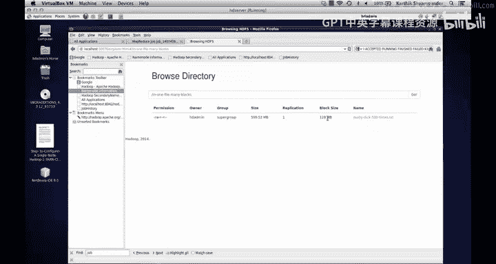
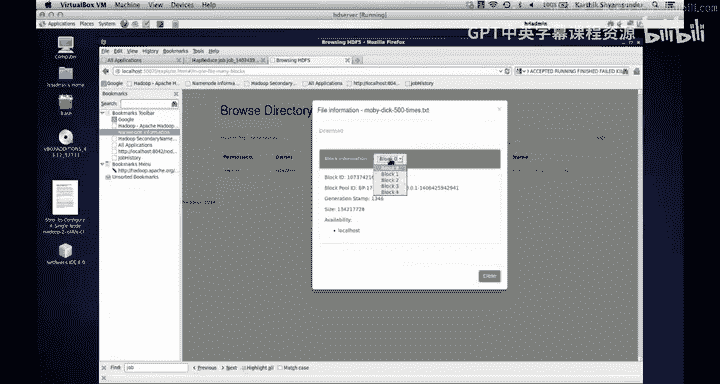
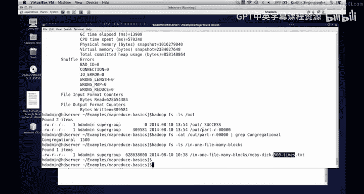

# 课程9：MapReduce Mapper并行机制 🚀

在本节课中，我们将学习MapReduce框架中Mapper任务的并行机制。我们将了解如何实现和控制Mapper的并行执行，以及影响并行度的关键因素。

---

## Mapper并行机制概述

到目前为止，我们已经学习了如何编写一个MapReduce作业。现在，让我们来看看并行性。在本节中，我们将探讨如何为一个作业实现和控制Mapper的并行性。

为了理解Mapper并行性，让我们回顾一下MapReduce框架。在MapReduce框架中，你有输入文件。这些输入文件可以被多个Mapper处理。到目前为止，我们只关注了一个Mapper，但实际上可以有多个Mapper，例如Mapper1、Mapper2、Mapper3、Mapper4。它们可以在同一台机器上运行，也可以在多台机器上运行。

输入被分解成不同的片段，不同的Mapper可以处理不同的输入片段，然后它们各自产生输出。最终，Mapper的输出被发送到Hadoop框架的Shuffle和Sort阶段，然后传递给Reducer。目前我们暂时不关心Reducer，先专注于Mapper。让我们弄清楚输入文件是如何被分解成多个片段，以便多个Mapper可以处理不同的片段。

---

## 如何确定Mapper任务数量

那么，问题是如何为一个作业定义或确定Mapper的数量？一个作业的Mapper任务总数基于两个因素。

第一个因素是输入文件的数量。**输入文件的数量等于Mapper任务的数量**。因此，如果你有15个输入文件，那么该特定作业将有15个Mapper任务。所以，你可以认为输入文件越多，并行性就越高，因为会有更多任务并行运行。

第二个因素是输入分片（Input Splits）的数量。输入分片是文件被切分的方式。通常，一个文件按其拥有的块（Block）数进行分片。因此，如果一个文件有七个块，那么意味着将有七个Mapper任务运行。

这两个因素共同决定了作业的Mapper任务数量。现在，这两个因素需要协同工作，因此我们需要一个公式将两者结合起来。

---

## Mapper任务数量计算公式

让我们来看看这个公式。一个作业的Mapper任务数量实际上是文件数量的总和，以及每个文件的块数。对于每个文件，你需要计算它有多少个块。你可以通过文件大小除以块大小来得到块数，然后将所有文件的块数相加，就得到了该作业将要执行的总Mapper任务数。

我想强调的是，**你不能直接设置作业的Mapper任务数量**。它实际上是由框架根据你的输入间接计算出来的。换句话说，它基于你拥有的文件数量和每个文件的块数。

---

## 不同场景示例

让我们看几个场景。如果你要运行一个词频统计作业，输入是一个文件和一个块，那么将有一个Mapper任务。

如果你要运行词频统计，输入是10个文件，每个文件是一个块，那么将有10个Mapper任务。

如果你要运行词频统计，输入是一个文件，但该文件有五个块，那么你将拥有五个Mapper任务。

如果你要运行词频统计，输入是两个文件，一个文件有三个块，另一个文件有六个块，那么就是3加6，总共九个Mapper任务。

---

## 输入文件过多的问题

然而，你可能会遇到输入文件过多的问题。让我展示一个场景。假设你的块大小是128兆字节（这是默认块大小），并且你的平均文件大小是10兆字节。如你所见，你的文件大小远小于块大小，这并不理想，但假设这就是我们导入HDFS的情况。

假设我们有一个作业，有10,000个文件，每个文件当然是10兆字节。这意味着将启动10,000个Mapper任务，也就是将启动10,000个进程。

因此，输入文件过多的问题在于，在这种情况下，我们有10,000个非常小的、小于一个块的输入文件，这会导致NameNode中存储过多的数据结构。我们已经知道这对HDFS来说是个问题，但在MapReduce中，我们还有另一个问题，即为非常小的任务启动过多的容器。在这种情况下，10,000个JVM、10,000个子进程、10,000个容器将在多台机器上启动以执行你的作业。

---

## 输入分片过多的问题

同样存在输入分片过多的问题。让我为你模拟一个场景。假设块大小是1兆字节。我知道你不会将块大小设置为1兆字节，这太小了，正如我所说，默认块大小是128兆字节。假设文件数量是10，所以我们有很少的文件。平均文件大小是1千兆字节。

因此，我们有一个作业有10个1千兆字节的文件。让我们看看将有多少个Mapper任务。每个文件大约是1千兆字节，所以1千兆字节除以块大小（1兆字节），大约是1000。然后乘以10个文件，得到10,000个Mapper任务。再次强调，输入分片过多也会导致问题，而输入分片过多也可能基于块大小。稍后，我将讨论在MapReduce框架中，针对不同输入格式如何进行输入分片。到那时，你会更理解这一点，但现在只需明白，你可能会遇到输入分片过多的情况，最终导致Mapper任务过多。

这里的问题再次是NameNode中过多的数据结构，以及启动过多的容器。所以，这一切都需要平衡。你必须考虑如何导入数据以及如何存储数据，这就是为什么我深入探讨了HDFS部分，并要求你思考如何设计你的系统。

---

## 实践演示

好了，让我们登录一个Hadoop服务器作为Hadoop管理员，并进行一些演示。

我以Hadoop管理员用户ID登录到我的虚拟机Hadoop服务器。首先，我想向你展示我的HDFS文件系统中有什么。在我的HDFS文件系统中，我有一个名为`in_one_file_one_block`的目录。这是一个输入目录，包含一个文件，并且该文件只有一个块。然后我有另一个目录叫`in_10_files_one_block_each`，在这个目录中我有10个文件，每个文件都是一个块。还有一个目录`in_one_file_many_blocks`，里面有一个文件，它包含多个块。我将运行这三种不同的场景。

首先运行第一个场景：一个目录中有一个文件和一个块。

让我执行`hadoop fs -ls /in_one_file_one_block`。好的，有这个文件夹，里面有一个文件`MobyDick.txt`。如果我执行`ls -lh`，你可以看到它大约是1.2兆字节。如果我去我的文件系统查看`in_one_file_one_block`，1.2兆字节，块大小是128兆字节，点击它，它显示只有一个块，这很合理，实际上远小于一个块。

现在我想运行我的MapReduce程序。在此之前，我需要清理输出目录。让我清理输出目录。现在我将运行MapReduce程序。我将运行`yarn jar`命令，指定jar文件和词频统计程序，并传递输入路径`/in_one_file_one_block`，它包含一个文件且只有一个块。这意味着它将只使用一个Mapper，这正是我们应该看到的。现在让我们运行它。

总输入路径数是1，分片数是1，因此将只有一个Mapper。Mapper阶段完成，Reducer阶段完成，程序结束。现在让我们查看输出目录。`hadoop fs -ls /out`。我们有`_SUCCESS`文件和`part`文件。程序运行正常，我可以展示输出内容。执行`hadoop fs -cat /out/part-r-00000`，确保我们的程序运行了。是的，程序运行了。

然后我将执行一个grep命令。我们执行`hadoop fs -cat /out/part-r-00000 | grep congregational`。没有输出？等等，这里有单词“congregational”，它在我的输出中出现了三次。有一个Reducer运行，有一个输出文件。

现在我想查看作业历史服务器。让我看看我运行的作业名称是什么。如果我稍微向上滚动，你可以看到作业ID是`job_22...`。让我们看看在历史服务器中这个MapReduce作业是什么样子。这是我的历史服务器，刷新一下，这里有22号作业。点击它。你可以看到有一个Mapper任务运行，有一个Reducer任务运行。我们看到了输出。这是标准内容，你已经见过了。

现在我想展示下一个场景。让我清屏。下一个场景是一个目录中有10个文件，每个文件1兆字节。这意味着是10个文件，10个块。执行`hadoop fs -ls /in_10_files_one_block_each`。有10个文件，每个文件一个块。它们是《白鲸记》文本的10个副本。如果我执行`ls -lh`，你可以看到有10个1.2兆字节的文件。如果我看我的文件系统`in_10_files_one_block_each`，有10个文件（01到10），它们每个都是一个块，因为1.2兆字节小于块大小。

现在我想运行程序。但在运行程序之前，我需要清理输出目录。让我清理输出目录，我已经做了。我想运行我的程序。我程序中唯一的区别是输入文件夹。所以输入文件夹是`/in_10_files_one_block_each`。输入文件夹包含10个文件，每个文件一个块。根据公式，由于是10个文件且每个都是一个块，应该需要10个Mapper。

让我们运行这个。总输入路径数是10，分片数是10，因此将有10个不同的Mapper运行。它们正在运行时，让我执行`jps`。注意你看到这些名为`YarnChild`的进程，它们是容器。这是NodeManager，这是DataNode，这是MR AppMaster（容器0），然后这些是被启动并正在执行的不同子节点。将有10个Mapper任务运行，所以最终将启动10个不同的进程。在这个例子中，它们都在同一台机器上运行，但如果你有多机架构，它将在多台机器上运行。

程序结束，作业完成，那是作业23。让我们返回验证一下，因为之前运行了22号作业。那是作业23。让我们查看历史服务器。我在这里，刷新，点击它。有10个Mapper任务运行。点击它，这里有运行的10个Mapper任务。启动了10个不同的容器，它们是并行完成的。至于Reducer，仍然是一个。

让我们回去查看输出。`hadoop fs -ls /out`，有输出文件，因为只有一个Reducer，所以生成了一个文件。现在我将执行grep查找“congregational”。`hadoop fs -cat /out/part-r-00000 | grep congregational`。出现了，“congregational”出现了30次。在这个例子中，“congregational”出现了30次，而在前一个例子中，它出现了3次。在这个例子中，我有10个不同的文件，这就是为什么是30次。为了向你证明上次是3次，让我再次运行之前的作业。所以`hadoop fs -rm -r /out`，然后我将运行之前的作业。之前的作业是`/in_one_file_one_block`。那是作业24。所以在这种情况下，我生成一个新的输出，它应该只有三次“congregational”。`hadoop fs -ls /out`，然后如果我看输出，执行grep，应该只有三次。是的，只有三次。所以当你有一个文件时，是3次；当你有10个文件副本时，是10个不同的Mapper，但最终你得到30次，因为Reducer介入并将所有计数合并在一起。我们还没有深入Reducer部分，但我想在这里说明一点。

我还想让你注意另一件事。让我执行`hadoop fs -cat /out/part-r-00000`。你还会注意到输出实际上是先排序的，首先是大写A到Z，然后是小写a到z，所以输出是排序过的。

现在我将展示第三个场景：我有一个文件，并且它包含多个块。让我们看看那个文件夹。执行`hadoop fs -ls /in_one_file_many_blocks`。我有一个文件，它有很多块。让我执行`ls -lh`。那是599兆字节，这让我相信它大约有5个块，因为128兆字节一个块。但让我们验证一下。我将转到HDFS浏览器，查看`in_one_file_many_blocks`，599兆字节，每个块120兆字节，点击文件，这里有五个不同的块。好的，所以那是五个块。

现在我想运行这个程序。`hadoop fs -rm -r /out`，然后我想运行相同的程序。但这次，我将指定输入为`/in_one_file_many_blocks`。运行程序。让我们思考一下：五个块，每个块128兆字节，所以我将有五个不同的JVM运行，每个JVM将处理一个大约128兆字节的块，然后它们将在Shuffle和Sort阶段被合并，之后发送给Reducer。我们现在讨论Mapper并行性，下一节我们将讨论Reducer并行性。

让我们运行这个。这将需要大量的计算，因为我有很多数据，而且我只有一台简单的笔记本电脑在这里运行，所以需要一些时间。让我们运行它。

好的，输入分片数是5。所以将有五个不同的任务运行。让我执行`jps`。一、二、三、四、五，这些是正在运行的五个不同任务。我有NameNode、DataNode，那是我的HDFS。然后我还有Secondary NameNode作为HDFS的一部分，这是三个守护进程。然后我有NodeManager和ResourceManager，这是YARN框架的守护进程。然后我有支持MapReduce框架的历史服务器。当然，YARN框架也支持MapReduce框架。在这种情况下，我有五个进程正在运行，它们正在工作，所以将有五个Mapper任务，它们正在运行。每个Mapper任务处理大约128兆字节的数据，因此正在进行大量处理。每个任务一次读取一行，解析该行，提取单词，然后将其写入Mapper输出，格式为“单词 1”、“单词 1”、“单词 1”，依此类推，最终进入Shuffle和Sort阶段。这将运行一段时间，所以我将暂停并在几分钟后回来。

好的，作业完成了。让我回退一下。这是作业号25。输入分片数是5，因为我们有一个包含五个块的文件，所以Mapper继续运行，启动了大约五个Mapper任务，也就是`YarnChild`。然后在这里，你注意到Mapper尚未完成？实际上Mapper已经完成了，但Reducer显示完成了7%，这并不是因为Reducer已经启动，而是因为Shuffle和Sort阶段正在发生，而Shuffle和Sort阶段被认为是Reducer阶段的一部分，所以你看到了这个情况。一旦Mapper 100%完成，Reducer才会启动。实际上，在Mapper阶段和Reducer阶段之间存在一个屏障，Reducer阶段在Mapper阶段完成之前无法工作。

程序结束了。如果我执行`hadoop fs -ls /out`，我应该看到输出。输出就在那里。现在我将执行`cat`命令，然后执行`grep`查找“congregational”。`hadoop fs -cat /out/part-r-00000 | grep congregational`。我得到1,500。

如果我执行`hadoop fs -ls /in_one_file_many_blocks`，我想向你展示这个文件是什么。它实际上是《白鲸记》文本重复了500次。当我们有一个文件时，我们看到“congregational”出现了三次，现在我们有500次重复，所以是3乘以500，这就是为什么你看到“congregational”的总计数是1500。

让我们查看作业历史服务器。这是作业历史服务器，作业25，点击它。你会注意到有五个Mapper任务，每个Mapper任务运行了大约九分钟，但其中一个只运行了六分钟，那可能是块大小最小的那个，可能是第五个块或第四个块。

---

## 本节总结

在本节中，我们研究了如何控制作业中Mapper任务的并行性。我们了解到，**不能直接控制Mapper任务的并行性**，它是通过文件数量和每个文件的块数间接控制的。