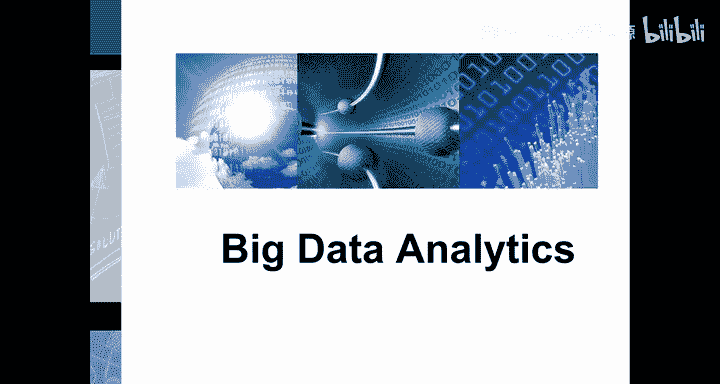
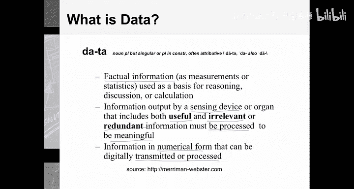
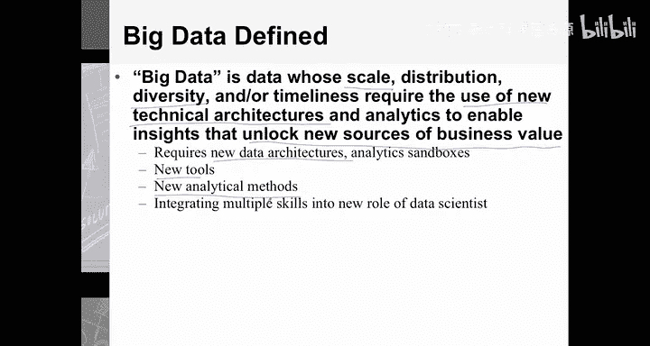
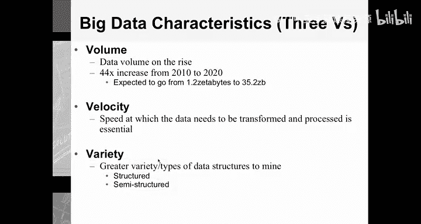
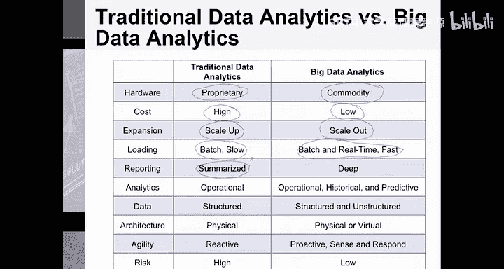
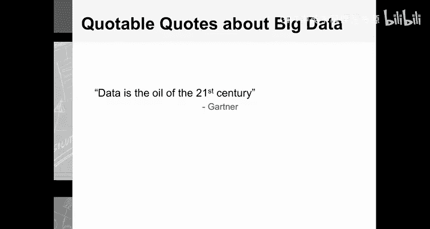
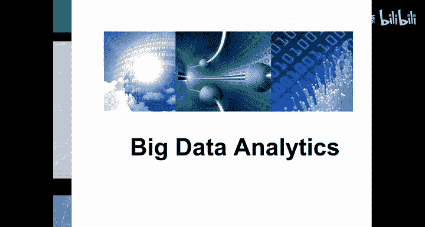

# 课程 4：大数据分析 📊

在本节课中，我们将正式定义数据、大数据和传统数据分析，并讨论大数据分析与传统数据分析有何不同。

---

## 什么是数据？

虽然你可能已经接触数据一段时间了，但我们还是先看看韦氏词典的定义，以理解它在现代世界中的意义。

第一个定义是：用作推理、讨论或计算基础的测量值或统计数据等事实信息。关键在于“事实信息”。当你想到数据时，可以联想到数据库，其中存储的客户信息、产品信息、销售信息、用户信息等，都是存储在数据库中的事实信息。

第二个定义是：由传感设备或器官输出的信息，其中包含有用、无关或冗余的信息，必须经过处理才能变得有意义。这个定义有些复杂，我们需要拆解一下。它指出，由传感设备输出的重要信息，包含有用、无关或冗余的内容，必须经过处理才有意义。

理解这个概念的最佳方式是通过一个例子。例如，我提到我在威瑞信工作，我们每天收到约650亿次查询，请求返回域名的IP地址。我们在全球各地都有DNS服务器处理这些请求，你可以将这些服务器视为传感设备，它们接收请求并向客户端发送响应。所有这些请求都会被记录，我们处理这些日志。这些日志对威瑞信来说包含有用信息，因为我们可以分析哪些域名受欢迎，以及谁在查询这些域名。从某些角度看，这些信息可能无关紧要，因为我们并未直接从中获利；也可能显得冗余，因为热门网站每隔几秒就会被频繁查询其IP地址。但关键在于，所有这些数据必须经过处理才能变得有意义，这正是我们所做的——对数据进行精确的大数据分析，以理解这些信息。

第三个定义是：可以数字传输或处理的数字形式信息。这意味着数据以某种数字形式存储，必须被传输或处理。因此，数据是存储、传输和处理的对象。当你想到这一点时，可以将其视为处理所有这些特定数据的计算集群或分布式计算环境。

---

## 什么是大数据？📈

现在，让我们正式定义大数据。大数据是指其规模、分布、多样性和/或时效性要求使用新的技术架构和分析方法，以获取能够解锁新业务价值来源的洞察。这同样是一个复杂的定义，让我们仔细分析一下。

它指出，大数据的规模很重要，多样性或种类在大数据中也变得非常重要。另一个关键点是需要使用新的技术架构，这明确表明现有的数据分析技术将无法胜任。我们需要新的技术架构来处理数据并解锁新的业务价值来源。这就是大数据的真正定义。其中的关键点包括：需要新的数据架构、新的工具和新的分析方法。在本课程中，你将反复看到这些内容。

---

## 大数据的特征（3V）🔍

以下是Gartner集团定义的大数据特征，也称为大数据的三个“V”。

第一个特征是**体量**。我们已经看到数据量正在增长。2010年，预计数据量为1.2泽字节，到2020年预计将增长到35泽字节。因此，体量是大数据处理和大数据定义中一个非常重要的特征。

大数据的第二个重要特征是**速度**。速度是指数据被摄取的速度，以及你需要处理这些数据的速度。

让我举个例子。在威瑞信，我们平均每天收到650亿次查询，高峰时段每秒约100万次查询。但在遭受攻击时，我们每天可能收到3000万到6000万次查询。有时，我们的DNS系统会遭到黑客的分布式拒绝服务攻击，查询量会激增。这就是峰值数据速度的例子，我们需要处理这些特定数据。

构成大数据的第三个特征是**多样性**。多样性是指不同类型的数据。不同类型可以指数据格式，例如，可以是结构化、半结构化或准结构化的数据，如JSON数据、XML数据、传统的OLTP结构化数据等。但多样性也体现在数据来源上，你可能拥有Twitter数据、注册数据、博客数据、流量数据，并希望将这些数据整合在一起。因此，大数据的三大特征再次是：体量、速度和多样性。

---

## 数据量级与来源示例 💾

再次强调，据估计，到2010年我们拥有1.2泽字节的数据，1泽字节等于1万亿千兆字节。预计到2020年，全球将看到约35泽字节的数据。市场上涌入大量数据，所有这些都需要被处理和理解，这正是数据经济的核心。

以下是一些持续生成大量数据的公司示例：
*   Facebook：每天60亿条消息。
*   eBay：每天20亿次页面浏览量，产生约9拍字节的存储。
*   Skybox Imaging的卫星图像：每天1太字节数据。

由此可见，数字世界中正在生成大量数据。

---

## 从数据结构角度看大数据特征 🗂️

在处理大数据时，我们需要处理多种类型的数据。

第一种是**结构化数据**。结构化数据是指具有明确定义的数据类型、格式和结构的数据，易于解析。结构化数据的典型例子来自OLTP数据库或OLAP系统。

第二种是**半结构化数据**。半结构化数据是具有可识别模式的文本数据，意味着它可以被处理。半结构化数据的例子包括XML数据文件或JSON文件。它们可能是自描述的，或者可能有关联的模式。

第三种是**准结构化数据**。准结构化数据是具有不规则数据格式的文本数据。例如，网络点击流数据。每次你在网页上点击一个项目，都会生成点击流访问日志。所有这些数据被收集后进行处理。想象一下，如果你的公司在世界各地拥有许多网络服务器，那么所有这些点击流数据必须被汇集在一起。东海岸、西海岸和欧洲的数据，它们的访问日志可能有时区差异，可能存在冗余或错误，你可能需要进行一些转换。这就是我们所说的准结构化数据。

第四种是**非结构化数据**。非结构化数据是指没有固有结构但存储在文件中的数据，例如纯文本文档、PDF、图像、视频等。因此，在处理大数据时，你必须应对所有这些不同类型的数据结构。

---

## 数据分析的业务驱动力 🚀

许多业务问题为组织提供了变得更加数据驱动和分析化的机会。

例如，一个驱动力可能是**优化业务运营**的愿望。组织可能希望查看销售数据、定价数据、盈利能力数据，并开始影响这些方面。例如，亚马逊、沃尔玛可能希望查看其网站和零售店的所有这些不同数据，以找出如何影响销售、定价和盈利能力等。

也可能是**识别业务风险**的愿望。例如，保险公司和银行可能希望查明是否存在欺诈行为，或者客户流失情况。例如，Netflix曾想了解他们为何失去客户。因此，通过查看数据来管理业务风险是一个重要驱动力。

还有**预测新的商业机会**。组织可能希望进行向上销售或交叉销售，甚至可能想在某个地方开设新店。为此，他们必须查看数据并尝试理解其含义。

**遵守法律或监管要求**。银行和金融机构可能需要生成报告，表明不存在洗钱行为，或存在公平的贷款实践。因此，他们需要整理、处理数据并向政府机构提交报告。

这些都是进行数据分析的不同原因。

---

## 传统数据分析与大数据分析的区别 ⚖️

理解这一点非常重要，因为在组织中，你通常已经有一个团队使用传统数据仓库进行数据分析，他们经常会问大数据分析与数据分析有何不同。让我们来看看。

在传统数据分析中，你通常处理的是**干净的数据**，而在大数据分析中，虽然也可能处理干净数据，但更常处理的是**杂乱、有噪声的数据**。这正是准结构化数据、点击流数据开始发挥作用的地方。

在传统分析中，你通常处理的是**太字节级**的数据，而在大数据分析中，你处理的是**拍字节级**的数据，数据量巨大。

在传统分析中，你通常**提前知道业务将要提出的问题**，因此你围绕他们提出的问题来设计你的BI或数据仓库解决方案。而在大数据分析中，你**常常不知道他们会问什么问题**。因此，在设计时，你只需将数据存储在平面文件中，不采用特定的范式，然后在需要时进行处理。这是两种不同的方法。

在传统数据分析中，其架构**不支持高计算量**。你更感兴趣的是以结构化、规范化的格式存储数据，以便进行查询，但无法在其上进行大量计算。主要是获取数据并将其返回给用户，可能附带一些报告。而在大数据分析中，你需要一个**支持分布式存储和高计算量**的环境，例如可能需要使用Hadoop这样的技术。

通常，在传统数据分析中，答案是**事实性的**。而在大数据分析中，答案可能是**概率性的**。例如，对于汽车保险公司，某个特定客户撞车的概率是多少？我们在这里寻找的是概率性的答案。

在传统数据分析中，你处理的是**结构化数据**。而在大数据分析中，正如我们之前所学，我们处理**结构化和非结构化数据**。

在传统分析中，你通常处理**一到两个业务领域**的数据。而在大数据分析中，你可能需要处理**数十个领域的数据集**。以威瑞信为例，我进行大数据处理，涉及互联网域名领域。为此，我需要理解DNS、EPP域名注册、网站创建和利用方式、内容下载、HTTP协议等。无论你从事哪个行业，如生物技术、金融或制造业，为了进行大数据分析，你可能需要处理多个领域的数据集。

---

## 从多维度看传统与大数据分析对比 📊

现在，让我们从硬件成本、扩展性、加载、报告分析、数据架构、敏捷性和风险等角度，再次审视传统数据分析与大数据分析的区别。

在传统数据分析中，通常使用**专有硬件**，而在大数据分析中，使用**商用硬件**。这意味着在传统分析中，成本更高，因为你处理的是专有硬件，有时甚至是专有软件。而在大数据分析中，成本较低，因为商用硬件更便宜，软件方面也常使用开源软件。

在传统数据分析中，通常采用**纵向扩展**，这种方式昂贵且难以通过添加更多系统来扩展。而在大数据分析中，你使用支持**横向扩展**的系统，这种方式更好。

在传统分析中，你处理的是**批处理**，对于大数据来说可能非常慢。而在大数据分析中，我们处理**批处理和实时处理**，并努力使其更快，可以通过添加更多CPU、内存和机器来实现。

在传统数据分析中，我们进行**汇总**。而在大数据分析中，我们**保留所有原始数据**，以便随时进行深入分析。

在传统分析中，通常侧重于业务的**运营方面**。而在大数据分析中，我们处理**运营改进**，也希望理解历史增长和变化，预测未来，了解行业将如何变化。因此，它也涉及预测或推荐方面。

在传统分析中，如前所述，我们处理**结构化数据**。在大数据分析中，我们处理**结构化和非结构化数据**。

在架构方面，传统数据分析通常使用来自供应商的**物理硬件**，非常专有。而在大数据分析中，你可以使用物理硬件，也可以使用**虚拟硬件**，例如云环境。

在传统数据分析中，你进行的是**被动报告**。而在大数据分析中，你是**主动的**，希望感知并响应，因此存在预测和推荐的成分。

传统数据分析风险稍高，因为你实际上是在向供应商投入资金，购买他们的产品和软件。而在大数据分析中，由于使用低成本商用服务器，成本更低，因此在大数据分析方面，它无疑是一个成本更低的替代方案。

---

## 组织内的数据分析生态 🌐

我不想说传统数据分析和传统数据仓库已经过时或消亡。它们必须存在，而大数据分析这一新领域（也称为数据科学，我将在下一节详细讨论）也必须存在。因此，在组织的数据分析生态中，过去我们进行数据仓库和商业智能，未来我们将继续这样做。但未来的趋势似乎指向一个名为“数据科学”的领域。

在数据仓库和商业智能领域，典型的技术和数据类型是针对结构化数据的标准即席报告和警报。典型的问题围绕“上个季度发生了什么？”——这是关于过去的。例如，“我们卖出了多少小部件？”或“问题出在哪里？”。

而在数据科学领域，典型的技术和数据类型是优化、预测建模、预测等，并且你处理结构化和非结构化数据。常见的问题不是“上个季度发生了什么？”，而是“如果我们这样做会怎样？”、“我们能推荐这个吗？”、“如果我们采取这些措施可能会发生什么？”、“最优方案是什么？”。因此，它更侧重于预测方面。

Gartner有一句名言：“数据是21世纪的石油。”我想稍作修改：**数据是21世纪的原油**。你必须处理这些特定的数据才能得到石油。这就像获取原油并提炼出石油一样，我们获取数据，处理它，并从中提取信息。

---

## 总结 📝

在本节关于大数据分析的内容中，我们定义了数据，定义了大数据的特征，也讨论了传统数据分析，并探讨了它与大数据分析的不同之处。