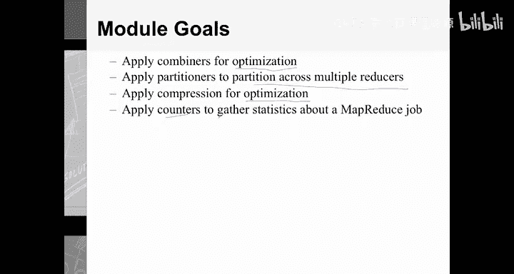
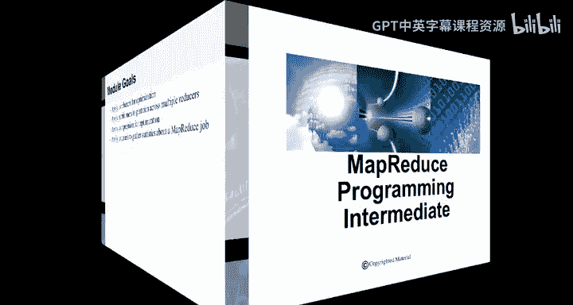

# 课程12：MapReduce中级编程导论 🚀


在本节课中，我们将深入探讨MapReduce API的细节，包括Combiner、Partitioner、压缩和计数器等核心概念。这些技术能帮助我们优化作业性能，并更好地控制数据处理流程。

## 概述 📋

MapReduce编程模型不仅包含基础的Map和Reduce阶段。为了提升效率和控制力，Hadoop框架提供了多种高级组件。本节将逐一介绍Combiner、Partitioner、压缩和计数器，解释它们的工作原理及适用场景。

## 1. Combiner：本地聚合优化 ⚙️

上一节我们介绍了Map和Reduce的基本流程。本节中我们来看看如何优化Map阶段的输出，以减少网络传输开销。Combiner扮演着关键角色。

Combiner是一种运行在Map任务节点本地的“迷你Reducer”。它在Map输出被发送到Reducer之前，先在本地对相同键的数据进行聚合。这能显著减少需要跨网络传输的数据量。

以下是Combiner的核心概念：
*   **作用**：在Map端执行局部聚合，减少Map输出到Reduce端的网络I/O。
*   **工作流程**：`Map -> Combiner (Local) -> Partition & Shuffle -> Reduce`
*   **约束**：Combiner的输入/输出键值类型必须与Reducer一致，且其操作必须是**可结合、可交换**的（例如求和、求最大值）。求平均值则不适用。

## 2. Partitioner：控制数据分发 🗂️

了解了如何优化数据量后，我们来看看如何控制这些数据的流向。Partitioner决定了Map输出的每条记录将被发送给哪个Reduce任务。

默认的Partitioner是`HashPartitioner`，它根据键的哈希值对Reducer数量取模来分配。通过自定义Partitioner，我们可以实现更符合业务逻辑的数据分发，例如确保某个范围的所有数据都由同一个Reducer处理，这对于需要全局状态的运算至关重要。

以下是Partitioner的核心要点：
*   **默认行为**：`partition = (key.hashCode() & Integer.MAX_VALUE) % numReduceTasks`
*   **自定义目的**：实现数据倾斜的优化，或满足特定业务逻辑的分组需求。
*   **关键方法**：需要重写`getPartition`方法，返回目标Reducer的索引号。

## 3. 压缩：提升存储与传输效率 📦

在HDFS中应用压缩可以节省存储空间。在MapReduce中，压缩同样能带来性能提升，尤其是在Shuffle阶段，减少数据读写量。

MapReduce支持在Map输出、Reduce输出等多个阶段启用压缩。选择合适的压缩编解码器（如Snappy、Gzip）需要在压缩比和解压速度之间取得平衡。

配置压缩通常很简单，以下是一个启用Map输出压缩的示例代码：
```xml
<!-- 在 mapred-site.xml 中配置 -->
<property>
    <name>mapreduce.map.output.compress</name>
    <value>true</value>
</property>
<property>
    <name>mapreduce.map.output.compress.codec</name>
    <value>org.apache.hadoop.io.compress.SnappyCodec</value>
</property>
```

## 4. 计数器：收集作业统计信息 📊

最后，我们来学习如何监控和收集作业运行时的详细统计信息。计数器（Counter）为此提供了强大支持。

Hadoop内置了多种计数器（如FileSystem计数器、Map-Reduce框架计数器），用于统计读取的字节数、处理的记录数等。我们也可以定义自定义计数器，来跟踪业务相关的指标，例如统计无效记录的数量或特定事件的发生次数。

在代码中，可以通过上下文（Context）对象来递增计数器：
```java
context.getCounter("MyGroup", "INVALID_RECORD_COUNT").increment(1);
```

## 总结 🎯



本节课我们一起学习了MapReduce的四个中级编程概念：
1.  **Combiner**用于在Map端进行本地聚合，减少网络传输。
2.  **Partitioner**让我们能够精细控制Map输出到哪个Reducer，优化负载均衡。
3.  **压缩**技术应用于MapReduce流程，有效节省磁盘和网络带宽。
4.  **计数器**是强大的诊断工具，既能利用内置计数器监控系统，也能创建自定义计数器跟踪业务指标。



掌握这些组件，将使你能够编写出更高效、更可控的MapReduce程序，以应对更复杂的大数据处理任务。