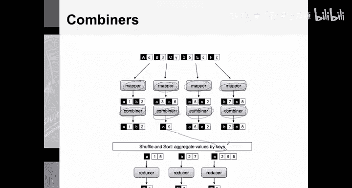
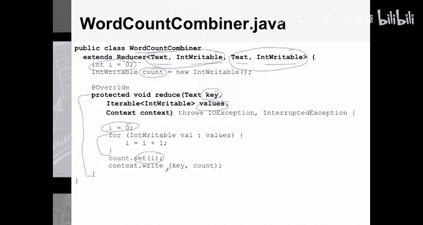
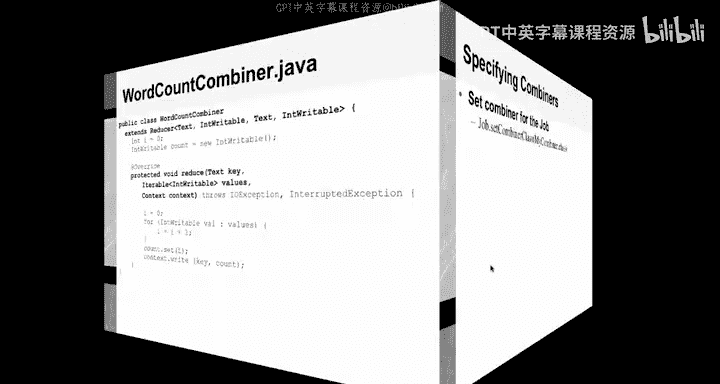
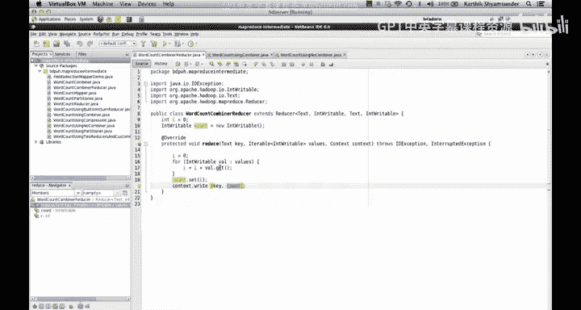
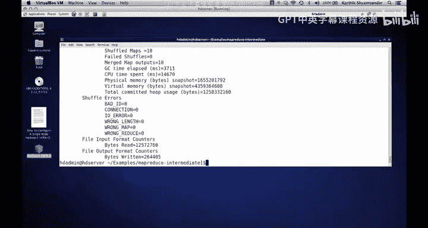

# 课程13：组合器应用 🧩


在本节课中，我们将学习MapReduce框架中的一个重要组件——组合器。我们将了解组合器的概念、如何实现它、如何为作业设置组合器，以及组合器能为MapReduce作业带来哪些性能上的好处。

---

## 什么是组合器？

上一节我们回顾了MapReduce的基本流程，本节中我们来看看组合器在其中扮演的角色。

组合器是MapReduce框架的一部分，它在Map阶段被调用。组合器本质上是一个函数，用于在数据发送给Reducer之前，对单个Mapper的输出进行局部的聚合处理。

---

## MapReduce流程与组合器

为了更好地理解组合器，让我们仔细审视一下MapReduce的数据流。

以下是MapReduce流程的简化视图：


假设输入被分割成四个部分：
*   输入分片1
*   输入分片2
*   输入分片3
*   输入分片4




每个分片由一个Mapper处理：
*   Mapper1 处理 输入分片1
*   Mapper2 处理 输入分片2
*   Mapper3 处理 输入分片3
*   Mapper4 处理 输入分片4

每个Mapper处理其输入记录并生成键值对输出。假设输出如下：
*   Mapper1 输出：`A, 1` 和 `B, 2`
*   Mapper2 输出：`C, 3` 和 `C, 6`
*   Mapper3 输出：`A, 5` 和 `C, 2`
*   Mapper4 输出：`B, 7` 和 `C, 8`

在Shuffle和Sort阶段，这些键值对会根据键被发送到对应的Reducer。假设有三个Reducer：
*   Reducer1 处理键 `A`
*   Reducer2 处理键 `B`
*   Reducer3 处理键 `C`

因此，Reducer接收到的输入是：
*   Reducer1: `A, [1, 5]`
*   Reducer2: `B, [2, 7]`
*   Reducer3: `C, [3, 6, 2, 8]`

然而，请注意Reducer3实际看到的是 `C, [9, 2, 8]`，而不是 `C, [3, 6, 2, 8]`。这是因为 `C, 3` 和 `C, 6` 在到达Reducer之前被合并成了 `C, 9`。

这个合并操作就是由组合器完成的。在上图中，每个Mapper都关联了一个组合器。Mapper的输出会先发送给组合器进行处理，组合器的输出才会进入Shuffle和Sort阶段。对于Mapper2，其输出 `C, 3` 和 `C, 6` 被组合器合并为 `C, 9`，然后才发送给Reducer3。

---

## 组合器的形式化定义与优势

现在，让我们更正式地定义组合器并探讨其优势。

组合器在Mapper之后被调用。实际上，每个Mapper都可以关联一个组合器。你需要在配置作业时显式地设置组合器类。

组合器处理单个Mapper的输出（每个Mapper处理一个分片）。Mapper处理分片并生成输出，该输出会传递给组合器。组合器在Reducer阶段之前运行，它产生的输出将作为Reducer阶段的输入。

这意味着：
*   组合器的**输入**类型与Reducer的输入类型相同。
*   组合器的**输出**类型与Mapper的输出类型相同。

组合器是重要的优化手段，主要带来两大好处：
1.  **减少Map输出IO**：Mapper的输出通常需要写入磁盘。组合器将多个输出记录合并为更少的记录，从而减少了写入磁盘的数据量。
2.  **减少Shuffle网络IO**：经过Shuffle阶段，数据需要通过网络发送到正确的Reducer。更少的输出记录意味着需要传输的网络数据量也更少。

---

## 组合器的内部机制与注意事项

了解组合器的内部工作机制有助于理解其一些限制。

Mapper的输出被序列化后，首先放入一个**内存缓冲区**，而不是直接写入磁盘。当这个缓冲区被填满时，框架会对缓冲区内的数据进行排序，然后，如果为该MapReduce作业指定了组合器，则调用组合器处理这部分数据。组合器的输出才会被写出。

这个过程的关键点在于：
*   组合器可能被调用多次（针对缓冲区每次满的数据），而不是一次性处理Mapper的所有输出。
*   框架可能会判断在某些情况下运行组合器并不高效，从而选择不运行它。
*   即使使用了组合器，Mapper的最终输出中，同一个键仍可能出现多次（因为组合器是分批次处理缓冲区的）。例如，一个Mapper可能最终输出 `C, 9` 和 `C, 16` 两个记录，它们会在Reducer端再次被合并。





因此，**组合器并不能保证每个键在Map端只输出一个记录**，它只是进行局部聚合以减少数据传输量。

---

## 如何实现组合器？

实现一个组合器非常简单。你需要编写一个类，它继承自 `Reducer` 类。

**重要提示**：MapReduce框架中没有专门的 `Combiner` 类，组合器本身就是一种特殊的Reducer。

在Reducer类的 `reduce` 方法中，你需要编写组合器的业务逻辑。

关于组合器的输入输出类型，记住这个核心关系：
*   **组合器的输入** = **Reducer的输入** = `(K2, List<V2>)`
*   **组合器的输出** = **Mapper的输出** = `(K2, V2)`

以下是为词频统计（Word Count）问题编写的一个组合器示例：

```java
public class WordCountCombiner extends Reducer<Text, IntWritable, Text, IntWritable> {
    private IntWritable count = new IntWritable();

    @Override
    public void reduce(Text key, Iterable<IntWritable> values, Context context) throws IOException, InterruptedException {
        int i = 0;
        // 对传入的列表中的所有值进行求和
        for (IntWritable val : values) {
            i += val.get();
        }
        count.set(i);
        // 输出合并后的键值对，例如 ("apple", 3)
        context.write(key, count);
    }
}
```

在这个 `reduce` 方法中，我们接收一个键（单词）和一个值的列表（通常是数字1），然后将这些值相加，得到该单词在**当前Mapper输出中**的局部计数，并输出这个结果。

---


## 如何为作业设置组合器？

为作业设置组合器非常直接。你只需要在作业配置中调用 `setCombinerClass` 方法。

```java
Job job = Job.getInstance(conf, "Word Count Using Combiner");
...
job.setMapperClass(WordCountMapper.class);
job.setCombinerClass(WordCountCombiner.class); // 设置组合器
job.setReducerClass(WordCountReducer.class);
...
```



---

## 使用Reducer作为组合器

很多时候，你可以直接使用Reducer类作为组合器。但这有一个重要的前提条件：Reducer执行的运算必须是**可交换的**和**可结合的**。

*   **可结合**：`(x + y) + z = x + (y + z)`
*   **可交换**：`x + y = y + x`

词频统计中的加法运算满足这两个条件，因此我们可以将同一个Reducer类同时设置为Reducer和Combiner。

但是，我们之前编写的简单Reducer（只是遍历值列表并+1）在作为组合器时会有问题，因为组合器接收到的值可能已经是局部和（如 `[3, 6]`），而不是一堆 `[1, 1, 1...]`。因此，一个健壮的、可兼作组合器的Reducer应该像下面这样实现：

```java
public class WordCountCombinerReducer extends Reducer<Text, IntWritable, Text, IntWritable> {
    private IntWritable count = new IntWritable();

    @Override
    public void reduce(Text key, Iterable<IntWritable> values, Context context) throws IOException, InterruptedException {
        int sum = 0;
        // 正确做法：累加传入的每个值
        for (IntWritable val : values) {
            sum += val.get(); // 这里获取的是值，可能是1，也可能是局部和如3
        }
        count.set(sum);
        context.write(key, count);
    }
}
```

然后，在作业配置中：
```java
job.setMapperClass(WordCountMapper.class);
job.setCombinerClass(WordCountCombinerReducer.class); // 使用同一个类
job.setReducerClass(WordCountCombinerReducer.class);   // 使用同一个类
```

**注意**：对于求平均值这类运算，因为不满足结合律，通常不能直接用Reducer作为组合器，需要特殊处理。

---

## 组合器效果演示 🎯

为了直观展示组合器的效果，我们运行两个词频统计作业进行对比：
1.  **使用组合器**
2.  **不使用组合器**



两个作业处理相同的输入（10个文本文件）。

在作业历史服务器的计数器页面，我们关注 **“Reduce input records”** 这个指标：
*   **不使用组合器**的作业：Reducer接收了约 **2，151，190** 条记录。
*   **使用组合器**的作业：Reducer仅接收了约 **226，000** 条记录。

使用组合器后，Reducer需要处理的记录数减少了约90%！这显著降低了磁盘I/O和网络传输开销，极大地提升了作业效率。

---

## 总结 📚

在本节课中，我们一起学习了MapReduce框架中的组合器。

*   组合器是一个在Map阶段被调用的函数，用于对单个Mapper的输出进行局部聚合。
*   组合器处理Mapper的输出，其输入类型与Reducer相同，输出类型与Mapper相同。
*   组合器通过减少Map端的输出数据量，显著优化了磁盘I/O和网络传输效率。
*   实现组合器就是编写一个继承自 `Reducer` 的类。
*   如果一个Reducer的运算逻辑满足**可结合性**和**可交换性**（如加法），那么它可以同时用作Combiner和Reducer。
*   实际演示表明，组合器能大幅减少传输到Reducer的数据量，从而提升整体作业性能。


理解并合理使用组合器，是编写高效MapReduce程序的关键一步。