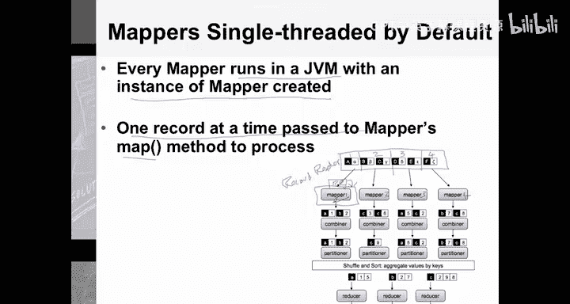
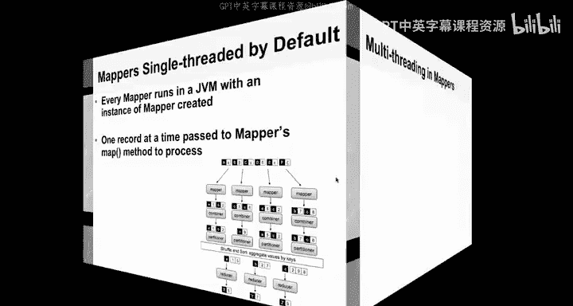
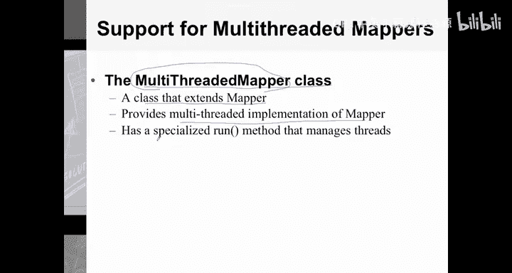
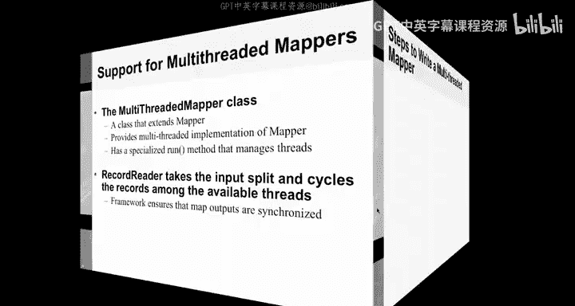
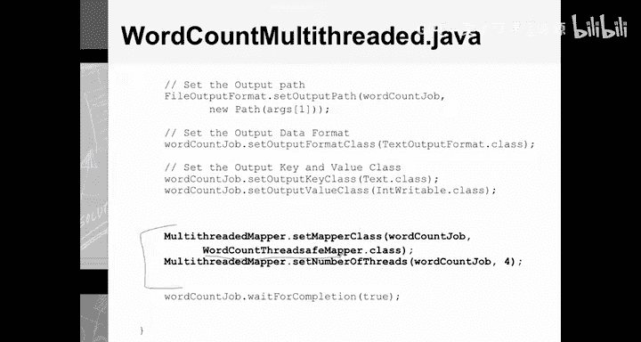
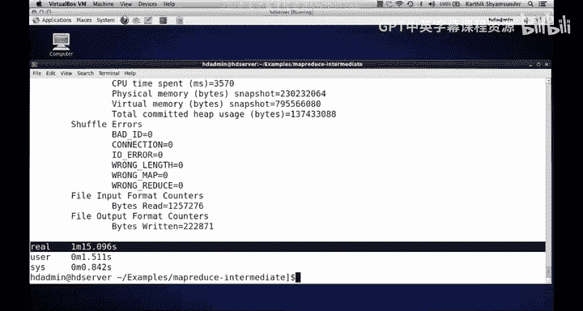

# 课程19：MapReduce中的多线程优化技术 🧵

在本节课中，我们将学习如何在MapReduce框架中利用多线程技术来优化Mapper的性能。我们将探讨多线程适用的场景、其工作原理，并通过一个具体的例子来演示如何实现多线程Mapper。

---

## 概述

我们知道MapReduce支持多任务处理，即同一台机器上运行多个进程来完成一个作业，甚至支持多台机器协同工作的架构。但是，多线程呢？本节我们将探讨何时以及如何在MapReduce中利用多线程的优势。

为了理解多线程，我们首先需要了解默认情况下Mapper内部发生了什么。

---

## 默认的Mapper处理方式

默认情况下，Mapper是单线程的。每个Mapper在一个JVM中运行，并创建一个Mapper实例。输入分片中的记录会**一次一条**地传递给Mapper。

让我来解释一下。你之前见过这个图表：假设我们的输入被分解为四个输入分片（Input Split 1, 2, 3, 4）。每个分片对应一个Mapper（Mapper 1, 2, 3, 4）。我们知道这四个Mapper是并行工作的，但**在一个Mapper内部，记录是按顺序处理的**。这实际上是由一个叫做“记录读取器”的组件完成的。记录读取器负责一次将一条记录传递给Mapper，以便Mapper进行处理并生成输出。

---

## 多线程Mapper的理念

Mapper中多线程的理念是**利用多线程同时处理多条记录**。这通常不是默认做法，但在某些情况下，这种多线程可能非常合适。

当Mapper受限于I/O操作时，多线程Mapper就很有用。例如，如果Mapper的`map`方法需要获取网页（这比本地I/O有更高的延迟），或者需要调用某种网络服务（如IP地理位置服务）。每当Mapper需要等待某些处理或I/O操作时，多线程Mapper就能发挥作用。

在这种情况下，多线程是有益的，因为当一个线程因网络调用而阻塞时，其他线程可以继续工作。Hadoop MapReduce确实支持多线程Mapper。

---

## Hadoop对多线程的支持

Hadoop框架提供了一个名为`MultithreadedMapper`的类，它扩展了标准的`Mapper`类。这个类提供了一个多线程的Mapper实现，它有一个专门的`run`方法来管理线程。

此外，框架通过确保记录读取器能够获取输入，并在Map任务中的可用线程之间循环分配记录，来支持多线程。

---

## 编写多线程Mapper的步骤

以下是编写多线程Mapper的步骤，稍后我们将通过一个词频统计的例子来演示其用途和实现方法。

要编写多线程Mapper，你需要确保编写一个**线程安全**的Map类。线程安全意味着实例变量需要同步，静态变量也应该同步。

你还需要将Mapper设置为多线程Mapper。在编写单线程Mapper（默认情况）时，你编写自己的Mapper类并将其设置为Mapper类。但在使用多线程Mapper时，你实际设置为Mapper类的是`MultithreadedMapper`类。那么，你编写的线程安全Map类如何设置呢？

你编写的线程安全Map类将通过调用`MultithreadedMapper`类的静态方法进行设置，将作业对象和你自己的Mapper类（即线程安全的Mapper类）传递给它。同时，你还需要调用`MultithreadedMapper`类的另一个静态方法`setNumThreads`，传入作业对象和你希望`MultithreadedMapper`处理的线程数量。

当我们通过示例讲解时，这会变得更加清晰。

---

## 示例：线程安全的词频统计Mapper

这里有一个名为`WordCountThreadsafeMapper`的类。我说过你需要编写一个线程安全的Mapper类。我所做的是，取用现有的Mapper类，并将其称为线程安全Mapper。我这样称呼它是因为我将在Mapper中使用多线程。当我说线程安全时，我需要确保如果使用了任何实例变量，我要么将它们转换为局部变量，要么对它们进行同步。我过去在类中有一个名为`textWord`的实例变量，但我已将其改为局部变量，这样我们就不必担心任何线程安全问题。

我之所以在这里使用多线程，真正的原因是：在`map`方法中，我实际上在进行一个外部调用（这里我模拟了一个外部调用）。在这个`makeExternalCall`方法中，我让线程睡眠大约10毫秒，以模拟一个I/O场景。我想说明的观点是：如果你编写的Mapper需要进行外部调用，并且这些调用在I/O上花费时间，那么你的Mapper处理速度将会非常慢。我将向你展示，在没有多线程Mapper的情况下，处理时间要比使用多线程Mapper长得多。

好的，这就是一个线程安全的词频统计Mapper。

---

## 示例：多线程主类

现在我有一个名为`WordCountMultithreaded`的主类，它包含`main`方法。我想再次向你展示：我有一个配置对象，一个新的作业对象，并完成所有设置。

最重要的是，当我设置Mapper类时，我没有设置我的业务逻辑Mapper类，而是设置了`MultithreadedMapper`类，这是Hadoop框架内置的一个类。

然后，我使用`MultithreadedMapper`类的静态方法来实际设置我的Mapper（这将是一个线程安全的Mapper），并设置线程数量。实际上，在这种情况下发生的是：当记录读取器读取输入分片时，它会启动多个线程。然后，它会为每一条记录调用`map`方法。所有这些不同的线程一次读取一条记录，并以多线程方式调用`map`方法。事实上，我设置了四个线程。

---

## 演示与对比

让我通过演示来对比两种方式的性能。我将运行两个版本的程序：一个是不使用多线程的版本，另一个是使用多线程的版本。

首先，我运行非多线程版本的词频统计程序。Mapper在每次调用`map`方法时都会等待10毫秒。对于一个需要处理大量记录的任务，这会累积成显著的延迟。使用`time`命令计时，这个程序运行了大约**4分11秒**。

接下来，我运行多线程版本的词频统计程序。这次，每个Mapper内部有四个线程同时处理记录。理论上，这应该使处理速度提高大约四倍。实际运行结果显示，该程序耗时大约**1分15秒**。

正如你所见，当Mapper执行某些外部调用或受I/O限制的活动时，多线程确实大有帮助。多线程是优化Mapper性能的一个极佳方式。

---

## 重要注意事项

我想提醒你的唯一注意事项是：**没有“多线程Reducer”这个概念**。只有Mapper可以被多线程化。

---

## 总结

在本节中，我们学习了MapReduce中的多线程技术。我们了解到可以拥有多线程Mapper。Hadoop框架通过提供一个名为`MultithreadedMapper`的特殊类来支持多线程，该类允许我们在一个Mapper内同时读取和处理多条记录。请记住，没有所谓的多线程Reducer，只有Mapper可以被多线程化。