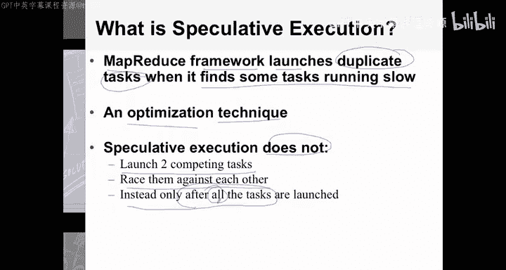
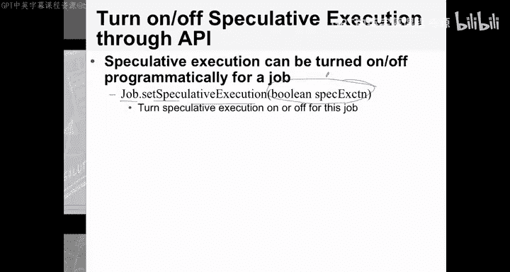

# 课程21：推测执行策略 🚀


在本节课中，我们将要学习MapReduce框架中的“推测执行”策略。这是一种优化技术，旨在处理分布式计算环境中运行缓慢的任务，从而提升整体作业的执行效率。

## 概述

推测执行是MapReduce框架为应对任务执行缓慢而设计的一种机制。当一个作业被分解成大量任务并行执行时，个别任务的缓慢会拖慢整个作业的完成速度。推测执行通过启动这些慢任务的“备份”任务来尝试解决这个问题。

## 什么是推测执行？

为了理解推测执行，我们需要了解分布式计算框架如何处理运行缓慢的任务。

一个作业实际上被分解为许多小任务。这些任务可能是Map任务，也可能是Reduce任务。因此，**一个作业的完成速度取决于其中最慢的任务**。

考虑到一个作业可能被分解为成百上千个任务，并分布在多台机器上运行，某些任务运行缓慢的原因有很多：
*   硬件问题，例如磁盘或内存故障。
*   I/O瓶颈。
*   机器上同时运行了其他进程或其他MapReduce任务，占用了CPU、I/O或内存资源。
*   机器本身的操作系统配置不佳。

框架可以通过在另一台机器上启动相同的任务来解决慢任务问题。在Hadoop HDFS中，文件会被复制到多台机器上。因此，当一个Map任务在处理某个数据块时，完全可以在拥有该数据块副本的另一台机器上启动一个相同的Map任务，然后比较两者的结果。这就是推测执行背后的核心思想。

**正式定义**：推测执行是指当MapReduce框架发现某些任务运行缓慢时，启动重复（或称“推测性”）任务的机制。



这是一种**优化技术**，而非功能性改进。需要明确的是，推测执行并非一开始就启动两个竞争任务让它们赛跑。它是在所有任务都已启动后，针对那些进度显著落后的特定任务，才启动其推测性副本。

## 推测执行何时触发？

推测执行在满足以下所有条件时触发：
1.  作业的所有任务都已启动。
2.  某个任务已运行了较长时间（通常超过一分钟）。
3.  该任务与其他任务相比，进度明显落后。

例如，假设一个作业被分解为三个Map任务（M1, M2, M3），分别在三个主机（H1, H2, H3）上运行。
*   M1的处理速度是每秒30条记录。
*   M3的处理速度是每秒32条记录。
*   M2的处理速度是每秒2条记录。

显然，M2运行缓慢。在这种情况下，Hadoop框架可能会启动另一个任务M4，让它处理与M2相同的数据集（利用HDFS的副本机制）。如果M4能以每秒25或30条记录的速度正常运行，框架就会终止缓慢的M2，并继续使用M4。这就是推测执行的工作方式。

## 如何配置推测执行？

推测执行可以通过配置开启或关闭。默认情况下，推测执行在配置中是开启的。

以下是通过配置文件 `mapred-site.xml` 进行控制的示例：
*   将属性 `mapreduce.map.speculative` 设置为 `false`，可以关闭Map任务的推测执行。
*   将属性 `mapreduce.reduce.speculative` 设置为 `true`，可以开启Reduce任务的推测执行。

因此，你可以在配置文件中分别控制Map级别和Reduce级别的推测执行。

**请注意**：推测执行不能替代编写低效的代码。如果系统或作业性能不佳，你需要深入排查根本原因，而不是简单地依赖开启推测执行。

## 通过API控制推测执行

你也可以通过编程方式控制推测执行。例如，通过Job对象进行设置：



```java
// 为整个作业（Map和Reduce）设置推测执行
job.setSpeculativeExecution(true);

// 或者分别设置Map和Reduce任务的推测执行
job.setMapSpeculativeExecution(true);
job.setReduceSpeculativeExecution(false);
```

## 总结


本节课中，我们一起学习了MapReduce框架如何利用推测执行来处理因环境问题导致的慢任务。推测执行默认是开启的，但可以关闭。许多系统管理员会选择关闭它，以便及时发现系统性能问题，因为作业执行缓慢本身可能就是系统状态不佳的信号。推测执行既可以通过配置文件（`mapred-site.xml`）进行控制，也可以通过编程API进行设置，并且可以精细地控制仅对Map任务或仅对Reduce任务生效。