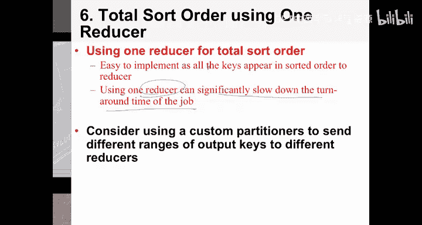
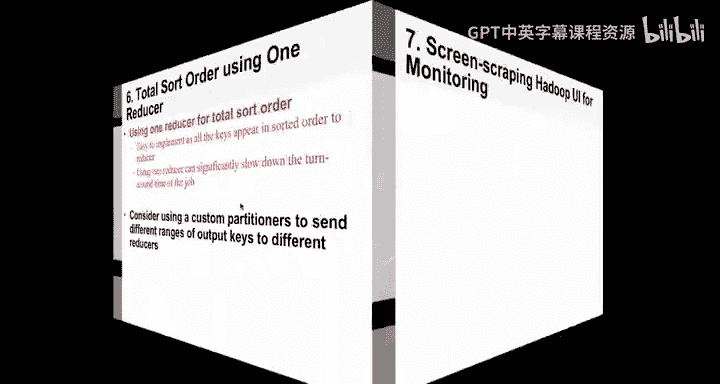
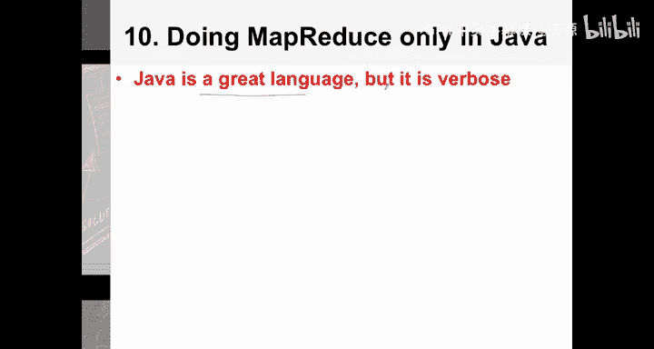
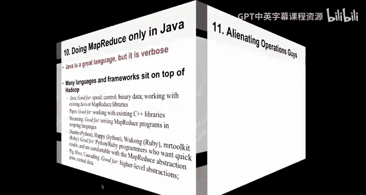
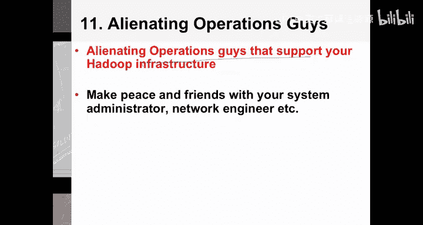

# 课程23：MapReduce反模式解析 🚫

在本节课中，我们将学习11种Hadoop MapReduce开发中常见的反模式。对于每一种反模式，我们都会探讨其问题所在以及如何避免它们。理解这些反模式有助于编写更高效、更健壮的大数据处理程序。

---

## 使用完整大数据集进行开发

上一节我们介绍了课程概述，本节中我们来看看第一个反模式：在开发阶段使用完整的大数据集。

当开发者被告知需要处理数据时，他们倾向于直接使用生产环境的完整数据集进行开发。这样做的问题是会增加开发运行时间，并且可能效率低下。

以下是使用完整数据集开发的主要问题：
*   开发运行时间长。在开发过程中需要反复编写、编译和运行代码，如果每次运行都需要几分钟，会严重影响效率。
*   不利于测试各种边界情况。

更好的方法是，从大数据集中提取一个具有代表性的小子集用于开发。这不仅能缩短开发运行时间，还能帮助测试数据中可能存在的各种情况。如果你在进行数据科学活动，使用代表性小数据集也能让你对处理完整数据集时可能得到的结果有一个预期。

---

## 进行外部网络调用

在编写MapReduce程序的`map`和`reduce`函数时，进行外部网络调用（如HTTP调用、TCP调用）来获取额外数据以供处理，是一个糟糕的做法。

换句话说，在你的`map`函数和`reduce`函数内部，不要进行网络调用。一个例子是调用地理定位服务来查询IP地址，或者在Mapper中爬取网站。

进行网络调用会使Mapper或Reducer变慢，因为你在进行I/O操作。尽管可以使用多线程，但通常不建议进行网络调用。此外，在共享集群环境中，低效的作业会占用计算资源，影响他人使用。

如果你需要连接不同的数据集，应确保所有数据在作业开始前都已准备就绪，然后使用Map端连接或Reduce端连接等技术。对于爬虫任务，应在进行任何处理之前，先爬取所有所需数据。

---

## 忽视数据类型选择

开发者在编写MapReduce程序前，往往不仔细考虑数据类型。例如，开发者倾向于对所有数据都使用字符串类型，或者对所有数据都使用整数类型。

你必须在使用前思考数据类型的选择。这会影响内存使用以及数据的溢出或下溢。你需要考虑数据的大小、该数据类型能容纳的最大值以及数据集将占用多少内存。

之所以强调这一点，是因为你正在处理大数据。在处理大数据时，任何小错误都会被放大，因此在选择数据类型前必须深思熟虑。

---

## 不使用Combiner

对于直接的聚合操作（如计数），不使用Combiner是一个坏主意。Hadoop非常擅长计数和各类计算。

本地聚合是Hadoop和分布式计算中的基本算法之一。因此，尽可能考虑使用Combiner。

---

## 只使用一个Reducer

Hadoop中默认的Reducer数量是1，而开发者常常忘记这一点。如果你有500个输入文件，它们将生成500个不同的Mapper。即使Mapper可以并行运行，但所有Mapper产生的数据最终都必须发送到Reducer。

因此，你需要考虑为你的应用程序设置多个Reducer。当然，在使用多个Reducer时，需要考虑使用合适的分区算法。

---

## 为全局排序只使用一个Reducer

很多时候，开发者希望输出结果是有序的。他们通常的做法是将Reducer数量设置为1，这样会自动产生一个全局排序的输出。

虽然这是一个简单的方法，但只使用一个Reducer会显著降低作业的完成时间。这里的建议是考虑使用自定义分区器，将不同范围的输出键发送到不同的Reducer，并且使用多个Reducer。

---

## 通过爬取Hadoop UI界面进行监控

为了满足企业中的监控需求，许多开发者倾向于通过爬取资源管理器或作业历史服务器UI来获取信息。他们编写程序访问网站，下载HTML页面内容，解析后存入数据库或显示在管理控制台。

不要这样做，因为作业历史服务器UI和资源管理器UI可能在下一个版本中发生变化。你应该考虑使用API来获取信息。Hadoop提供了RESTful API来获取作业信息。此外，`yarn`命令也有`application`参数，配合`-status`和`application ID`可以给出作业状态信息。

---

## 每个作业使用数十或数百个计数器

很多时候，Hadoop开发者希望获取作业的统计信息，于是开始大量使用计数器。虽然计数器非常适合跟踪信息，但不应过度使用，因为它们需要进行同步。

如果你有50、60甚至100个Mapper，所有这些Mapper都需要回连到中央应用程序主节点来更新计数器。在大型集群中，大量Mapper并行运行时，频繁更新计数器会使应用程序主节点不堪重负。

你可以使用计数器，但必须有效地使用。具体做法是定期、按块递增计数器值。查看计数器API，你可以递增1，也可以定期递增100或200。这就是“按块递增”的含义，你可能需要结合定期和按块递增两种方式。

---

## 运行大量短时Map任务

拥有成千上万个运行时间非常短（例如5到10秒）的Map任务的应用程序是一个坏主意。如果你有10000个文件，每个文件只有2MB或3MB，那么每个文件都会启动一个Mapper。

启动一个Mapper意味着启动一个进程，启动Reducer也是如此。由于启动进程本身较慢，这会拖慢整个作业的处理速度。

你应该考虑使用更大的文件和更大的块大小。你也可以研究YARN的一个较新特性——Uber任务，它可以复用现有的JVM。

---

## 仅使用Java进行MapReduce编程

在过去的四周里，我们一直在讨论用Java进行MapReduce编程。Java无疑是一门强大的语言，但有时也显得冗长。

当然，Java运行在Hadoop之上，它在速度控制、二进制数据处理以及与现有Java或MapReduce库协作方面表现出色，因为Hadoop本身是用Java编写的，集成性很好。但除了Java，还有其他技术可用于Hadoop MapReduce编程。

以下是其他可选方案：
*   **Hadoop Pipes**：允许你使用C++ API编写MapReduce程序。
*   **Hadoop Streaming**：允许你使用脚本语言（如Python、Ruby）编写MapReduce程序。
*   **高级编程语言**：如Pig、Hive和Cascading，这些是更高级的声明式编程语言，可以在进行MapReduce编程时利用。

在接下来的几周里，我们将稍微讨论Pipes和Streaming，并重点介绍Pig和Hive。

---

## 疏远运维团队

最后，我想告诉你，当你在企业环境中使用Hadoop时，不要疏远你的运维团队。在这门课程中，我让你们同时担任系统管理员和开发者，但现实中，你可能是一名开发者，而由系统管理员为你提供Hadoop环境。

你需要与系统管理员保持良好的关系，因为他们是为你分配大数据处理配额的人，当Hadoop出现任何问题或你的应用程序在Hadoop环境中运行时遇到困难时，他们也是提供帮助的人。很多事情都可能出错，因此你真的需要与系统管理员，当然还有网络工程师成为朋友，因为系统管理员和网络工程师通常紧密合作。

---

## 总结

本节课中，我们一起学习了Hadoop MapReduce开发中常见的11种反模式，包括使用完整数据集开发、进行外部网络调用、忽视数据类型、不使用Combiner、不合理设置Reducer数量、低效的监控方法、滥用计数器、创建大量短任务、局限于Java编程以及忽视与运维团队的合作。理解并避免这些反模式，对于构建高效、可维护的大数据应用至关重要。