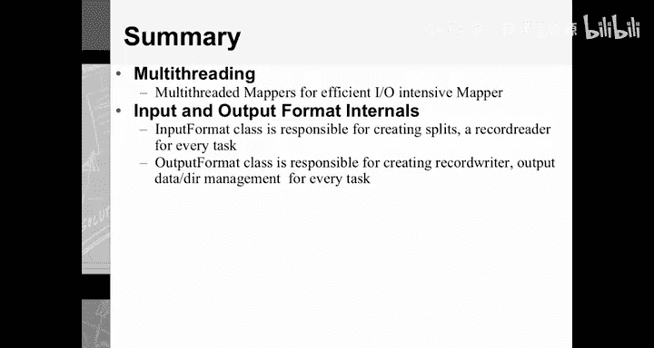

# 课程名称：Hadoop大数据处理 - P64：MapReduce高级编程总结 📚


在本节课中，我们将总结MapReduce高级编程的几个核心概念。这些概念包括多线程Mapper、输入输出格式类的内部机制、推测执行、本地作业运行以及MapReduce反模式。掌握这些内容将帮助你编写更高效、更健壮的大数据处理程序。

---

## 多线程Mapper处理IO密集型任务 🧵

上一节我们介绍了MapReduce的基础编程模型，本节中我们来看看如何通过多线程技术优化Mapper的性能。

我们学习了如何在Mapper中使用多线程来高效处理IO密集型任务。如果你编写的Mapper需要进行网络调用，从这一角度看，它是IO密集型的。在这种情况下，你可以使用多线程Mapper。在编写多线程Mapper时，你需要关注线程安全问题。

以下是实现多线程Mapper的一个核心代码结构示例：

```java
public class MultiThreadedMapper extends Mapper<KEYIN, VALUEIN, KEYOUT, VALUEOUT> {
    private ExecutorService executor;
    @Override
    protected void setup(Context context) {
        // 初始化线程池
        int numThreads = context.getConfiguration().getInt("mapreduce.mapper.multithreaded.threads", 10);
        executor = Executors.newFixedThreadPool(numThreads);
    }
    @Override
    public void map(KEYIN key, VALUEIN value, Context context) throws IOException, InterruptedException {
        // 将任务提交给线程池处理
        executor.submit(new ProcessingTask(key, value, context));
    }
    @Override
    protected void cleanup(Context context) {
        // 关闭线程池
        executor.shutdown();
    }
}
```

---

## 输入与输出格式类的内部机制 ⚙️

我们深入探讨了输入和输出格式类的内部工作原理。

我们看到，输入格式类负责为每个任务创建数据分片（Splits）和记录读取器（Record Reader）。输出格式类则负责创建记录写入器（Record Writer），用于将数据写出作业，并且每个任务的输出数据和目录管理也由输出格式类负责。

其核心关系可以概括为以下流程：
**InputFormat → Splits → Record Reader → Mapper → Reducer → Record Writer → OutputFormat**

---

## 推测执行机制 ⚡



然后，我们也学习了推测执行的概念。推测执行是指当Hadoop框架发现某个任务由于多种原因（可能是硬件问题，也可能是同一机器上运行的其他进程）运行缓慢时，它会在另一个主机上启动相同的任务。此功能默认是开启的。

我们学习了如何开启或关闭此功能，包括如何为Map阶段或Reduce阶段显式开启它。配置参数如下：
*   `mapreduce.map.speculative`: 控制Map任务的推测执行。
*   `mapreduce.reduce.speculative`: 控制Reduce任务的推测执行。

---

## 本地运行作业 🖥️

接着，我们了解了如何在本地运行作业，而不是在资源管理器、节点管理器和历史服务器的控制下运行。这对于测试和调试目的非常有用。

你可以通过设置以下配置，在IDE或单机环境中运行MapReduce作业：
```bash
Configuration conf = new Configuration();
conf.set("mapreduce.framework.name", "local");
```

---

## MapReduce反模式与最佳实践 🚫

最后，我们探讨了MapReduce反模式。我们研究了11种常见的MapReduce反模式及其相应的最佳实践。

以下是部分关键反模式与建议的简要列表：

*   **单Reducer**：避免将所有数据发送到单个Reducer，这会造成瓶颈。应根据数据量合理设置Reducer数量。
*   **数据倾斜**：某些键对应的值过多，导致个别Reducer负载过重。应考虑在Mapper端进行Combine操作或自定义分区器。
*   **无意义的中间数据**：避免在Map和Reduce阶段产生大量不需要的中间数据，这会造成IO和网络开销。
*   **过度复杂的键/值对象**：使用复杂对象作为键或值会增加序列化开销。应尽量使用原生类型或Hadoop提供的Writable类型。

---

本节课中我们一起学习了MapReduce高级编程的多个关键主题：利用多线程Mapper提升IO效率、理解输入输出格式的职责、通过推测执行应对慢任务、在本地环境进行作业测试与调试，以及识别并避免常见的MapReduce反模式。掌握这些知识，将有助于你设计出性能更优、容错性更强的大数据处理应用。