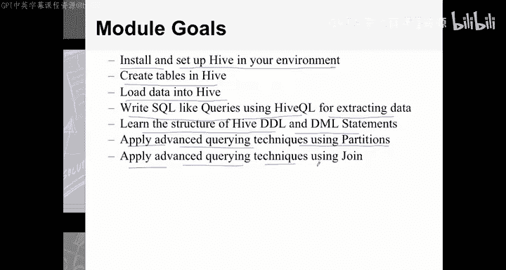

# 课程名称：Hadoop大数据处理 - 第65讲：Hive导论 🐝

## 概述


在本节课中，我们将学习如何使用Hive进行大数据分析。Hive是一种构建在Hadoop之上的数据仓库工具，它允许我们使用类似SQL的语言（HiveQL）来查询和管理存储在HDFS中的大规模数据集。我们将从Hive的基本概念和架构开始，逐步学习如何安装、配置Hive，并执行数据操作。

---

## Hive概念与架构

上一节我们回顾了Hadoop的核心组件。本节中，我们来看看Hive是什么以及它是如何工作的。

Hive是一个数据仓库基础设施，它提供了数据汇总、查询和分析的功能。Hive将结构化的数据文件映射为一张数据库表，并提供完整的SQL查询功能。Hive的架构主要包括以下组件：

*   **Hive CLI/Beeline**：命令行界面，用于与Hive交互。
*   **Hive Server**：允许远程客户端使用JDBC/ODBC连接并执行查询的服务。
*   **Metastore**：存储Hive的元数据（如表名、列信息、分区信息等）的数据库。
*   **Driver**：接收查询，编译查询，优化执行计划，并执行。
*   **Execution Engine**：默认使用MapReduce作为执行引擎，将HiveQL转换为MapReduce任务在Hadoop集群上运行。

其核心工作流程可以概括为：用户提交HiveQL查询 -> Hive编译器将其转换为一个或多个MapReduce任务 -> Hadoop集群执行这些任务 -> 结果返回给用户。

---

## 设置Hive环境

了解了Hive的架构后，我们需要将其部署到Hadoop环境中。以下是设置Hive的基本步骤。

1.  **下载Hive**：从Apache官网下载稳定版本的Hive压缩包。
2.  **解压与配置**：将压缩包解压到指定目录，并配置环境变量（如`HIVE_HOME`）。
3.  **配置Metastore**：Hive需要一个数据库（如Derby、MySQL）来存储元数据。需要配置`hive-site.xml`文件来指定数据库连接信息。
4.  **初始化Metastore**：运行`schematooinit`命令来初始化元数据库。
5.  **启动Hive**：运行`hive`命令启动Hive命令行界面。

一个简单的环境变量配置示例（在`~/.bashrc`或类似文件中）：
```bash
export HIVE_HOME=/path/to/your/hive
export PATH=$PATH:$HIVE_HOME/bin
```

---

## 一个简单的Hive示例

环境配置完成后，我们可以通过一个简单的例子来快速体验Hive。本节我们将创建一张表，加载数据，并执行查询。

假设我们有一个文本文件`sample.txt`，内容如下：
```
1,Alice,Engineering
2,Bob,Marketing
3,Charlie,Sales
```

在Hive CLI中执行以下操作：
```sql
-- 1. 创建表
CREATE TABLE IF NOT EXISTS employees (
    id INT,
    name STRING,
    department STRING
)
ROW FORMAT DELIMITED
FIELDS TERMINATED BY ',';

-- 2. 将本地文件数据加载到Hive表中
LOAD DATA LOCAL INPATH '/path/to/sample.txt' INTO TABLE employees;

-- 3. 执行查询
SELECT * FROM employees WHERE department = 'Engineering';
```
这个例子展示了Hive的基本操作：使用类SQL语法定义表结构，从本地文件系统加载数据，以及进行条件查询。

---

## 将数据加载到Hadoop的策略

在Hive中操作数据，首先需要将数据导入HDFS。有多种策略可以将数据加载到Hadoop中。

*   **使用`LOAD DATA`命令**：如上例所示，可以直接将本地文件或HDFS中的文件加载到Hive表。
*   **使用`INSERT`语句**：可以从一个Hive查询的结果，将数据插入到另一张表中。
*   **使用Sqoop工具**：这是一个专用于在Hadoop和关系型数据库之间高效传输批量数据的工具。
*   **使用Flume工具**：适用于实时收集、聚合和移动大量日志数据到HDFS。
*   **直接放置文件到HDFS**：使用`hadoop fs -put`命令将文件直接上传到HDFS的特定目录，然后创建Hive外部表指向该位置。

选择哪种策略取决于数据源、数据量以及数据到达的频率。

---

## Hive语句与数据类型

要灵活使用Hive，必须熟悉其数据定义语言（DDL）和数据类型。本节我们来看看如何创建数据库、表以及定义列。

Hive支持多种语句，主要分为：
*   **DDL（数据定义语言）**：用于创建、修改、删除数据库、表、视图等，如`CREATE`, `ALTER`, `DROP`。
*   **DML（数据操作语言）**：用于向表中加载、插入、导出数据，如`LOAD DATA`, `INSERT`, `EXPORT`。
*   **查询语句**：用于检索数据，即`SELECT`语句。

以下是创建数据库和表的一个例子，其中展示了常用的基本数据类型：
```sql
-- 创建数据库
CREATE DATABASE IF NOT EXISTS company_db;

-- 使用数据库
USE company_db;

-- 创建表，定义列及其数据类型
CREATE TABLE employees_details (
    emp_id INT,          -- 整数类型
    emp_name STRING,     -- 字符串类型
    salary FLOAT,        -- 浮点数类型
    join_date DATE,      -- 日期类型
    is_active BOOLEAN    -- 布尔类型
);
```
Hive还支持复杂数据类型，如`ARRAY`, `MAP`, `STRUCT`，用于处理更嵌套的数据结构。

---

## 使用分区管理大数据

当数据量非常庞大时，全表扫描会非常低效。Hive的分区功能通过将数据组织成更易管理的部分来提升查询性能。

分区（Partition）类似于根据表中某一列的值（如日期、地区）将数据存储在不同的子目录中。查询时，如果指定了分区条件，Hive只会扫描相关分区，而非整个数据集。

以下是如何创建和使用分区表：
```sql
-- 创建一个按‘部门’分区的表
CREATE TABLE employees_partitioned (
    id INT,
    name STRING,
    salary FLOAT
)
PARTITIONED BY (department STRING)
ROW FORMAT DELIMITED FIELDS TERMINATED BY ',';

-- 向特定分区加载数据
LOAD DATA LOCAL INPATH '/path/to/engineering_data.txt' INTO TABLE employees_partitioned PARTITION (department='Engineering');
LOAD DATA LOCAL INPATH '/path/to/sales_data.txt' INTO TABLE employees_partitioned PARTITION (department='Sales');

-- 查询特定分区的数据，效率更高
SELECT * FROM employees_partitioned WHERE department='Sales';
```
通过分区，我们可以有效地管理和查询大规模数据集。

---

## 使用Join进行高级查询

Hive支持类似SQL的连接（Join）操作，允许你组合多个表中的数据。这对于关系型数据分析至关重要。

Hive支持多种JOIN类型，包括`INNER JOIN`, `LEFT OUTER JOIN`, `RIGHT OUTER JOIN`, `FULL OUTER JOIN`。其基本语法与SQL一致。

假设我们有两张表：`employees`和`departments`。
```sql
-- 创建部门表
CREATE TABLE departments (
    dept_id INT,
    dept_name STRING
);

-- 使用INNER JOIN查询员工及其部门信息
SELECT e.name, e.salary, d.dept_name
FROM employees e
JOIN departments d ON e.dept_id = d.dept_id;
```
这个查询将`employees`表和`departments`表连接起来，返回每个员工的姓名、工资和所属部门名称。掌握Join操作能让你执行复杂的数据关联分析。

---

## 总结



本节课中我们一起学习了Hive，这个在Hadoop生态中进行大数据分析的重要工具。我们从Hive的核心概念和架构入手，学习了如何安装和设置Hive环境。通过一个简单的示例，我们实践了创建表、加载数据和执行查询的完整流程。我们还探讨了将数据导入Hadoop的不同策略，深入了解了Hive的DDL语句和丰富的数据类型。为了高效管理海量数据，我们介绍了分区技术。最后，我们学习了如何使用Join操作来关联多张表的数据，完成更复杂的分析任务。掌握这些知识，你将能够利用HiveQL轻松地对Hadoop中的大数据进行查询和分析。

---