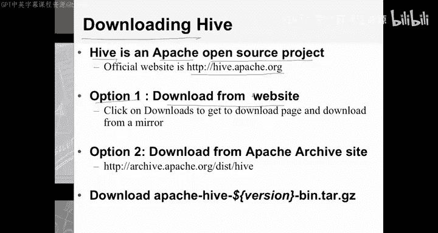
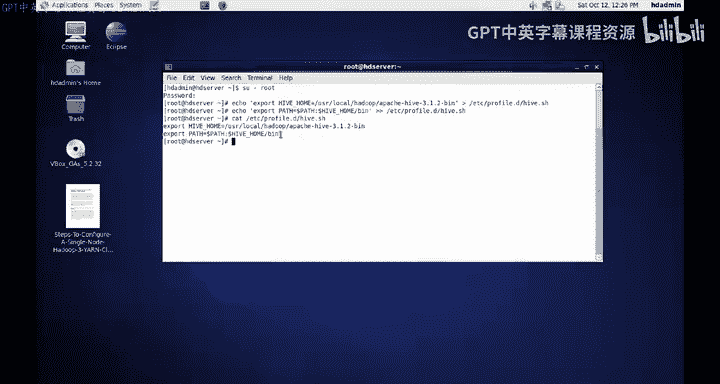
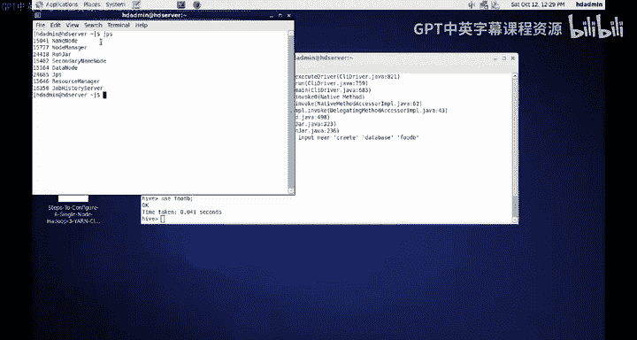

# 课程 2：Hive 环境配置 🛠️




在本节课中，我们将学习如何下载、安装、配置并运行 Apache Hive。Hive 是一个基于 Hadoop 的数据仓库工具，它允许我们使用类似 SQL 的查询语言（HiveQL）来处理存储在 Hadoop 分布式文件系统（HDFS）中的大数据。

## 概述


Hive 的安装和配置过程主要分为几个步骤：下载安装包、解压安装、设置环境变量、配置元数据存储以及启动 Hive 命令行界面。我们将使用内置的 Derby 数据库作为元数据存储，以简化配置过程。

## 下载 Hive

首先，我们需要下载 Hive 的安装包。Hive 是 Apache 的开源项目，可以从其官方网站或镜像站点获取。

以下是下载 Hive 的两种主要方式：

*   **从官方网站下载**：访问 `hive.apache.org`，点击 “Downloads” 进入下载页面，然后从镜像站点下载文件。文件通常命名为 `apache-hive-<版本号>-bin.tar.gz`。
*   **从 Apache 归档站点下载**：访问 `archive.apache.org/dist/hive/`，该目录包含了 Hive 的各个历史版本，你可以选择并下载所需的版本。

## 安装 Hive

下载完成后，安装 Hive 的过程非常简单，主要就是解压文件到指定目录。

我们假设 Hadoop 安装在 `/usr/local/hadoop` 目录下。执行以下命令进行解压安装：

```bash
cd /usr/local/hadoop
tar -zxvf ~/Downloads/apache-hive-<版本号>-bin.tar.gz
```

执行上述命令后，Hive 就被解压安装到了 `/usr/local/hadoop/apache-hive-<版本号>` 目录下。

现在，让我们来了解一下 Hive 安装目录的结构：

*   **`bin/`**：包含最重要的命令行程序 `hive`，它是启动 Hive 解释器的入口。
*   **`conf/`**：存放 Hive 的配置文件。其中 `hive-default.xml.template` 是一个包含所有默认配置的模板文件。
*   **`lib/`**：包含 Hive 运行所需的核心 JAR 文件及其依赖项。
*   **`examples/`**：提供了一些 HiveQL 的示例脚本。
*   **`hcatalog/`** 和 **`scripts/`**：分别用于集成 HCatalog 和初始化外部数据库（如 MySQL）作为元存储。在本教程中，我们将使用内置的 Derby 数据库，因此暂时不需要关注这两个目录。

## 配置环境变量

为了让系统能够方便地找到 Hive 命令，我们需要设置两个环境变量：`HIVE_HOME` 和 `PATH`。

通常，我们在用户的 `~/.bashrc` 或 `~/.profile` 文件中进行设置。添加以下内容：

```bash
export HIVE_HOME=/usr/local/hadoop/apache-hive-<版本号>
export PATH=$PATH:$HIVE_HOME/bin
```

保存文件后，执行 `source ~/.bashrc` 使配置立即生效。

接下来，我们需要告诉 Hive Hadoop 的安装位置。这通过设置 `HADOOP_PREFIX` 环境变量来实现：

```bash
export HADOOP_PREFIX=/usr/local/hadoop
```

Hive 会通过这个变量找到 Hadoop 的配置，从而知道如何与 HDFS 和 YARN 资源管理器通信。另一种方式是确保 Hadoop 的 `bin` 目录已在 `PATH` 中。

## Hive 的目录结构


在 HDFS 中，Hive 有自己默认的存储路径：

*   **数据仓库目录**：`/user/hive/warehouse`。所有在 Hive 中创建的数据库和表，其对应的数据文件都存储在这个目录下。
*   **临时目录**：`/tmp`。Hive 处理过程中的临时文件存放在这里。

对于多用户环境，你可能需要修改这些目录的权限，确保所有 Hive 用户都属于同一个用户组并具有读写权限。但在本单节点示例中，我们使用 `hdadmin` 用户，因此默认配置即可。

## 配置 Hive 站点文件

上一节我们介绍了 Hive 的目录结构，本节我们来具体配置 Hive。Hive 的主要配置文件位于 `$HIVE_HOME/conf` 目录下。

虽然存在一个 `hive-default.xml.template` 模板文件，但我们通常不直接修改它，而是创建一个 `hive-site.xml` 文件来覆盖默认配置。对于我们最重要的配置是**元数据存储（Metastore）**的连接信息。

我们将使用内置的 Derby 数据库作为元存储。在 `hive-site.xml` 中添加以下配置：

```xml
<configuration>
  <property>
    <name>javax.jdo.option.ConnectionURL</name>
    <value>jdbc:derby:;databaseName=/usr/local/hadoop/metastore_db;create=true</value>
    <description>JDBC connect string for a JDBC metastore.</description>
  </property>
</configuration>
```

这个配置指定了 Derby 数据库文件的存储路径为 `/usr/local/hadoop/metastore_db`。

## 初始化元数据库

配置文件创建好后，我们需要初始化元数据库的模式（Schema）。Hive 提供了 `schematool` 命令来完成这项工作。

进入 Hive 的 `bin` 目录，执行以下命令：

```bash
./schematool -initSchema -dbType derby
```

此命令会根据 `hive-site.xml` 的配置，在指定路径创建并初始化 Derby 数据库文件。执行成功后，你会在 `/usr/local/hadoop/` 目录下看到新生成的 `metastore_db` 文件夹。

## 启动与使用 Hive CLI

现在，所有准备工作已经就绪，可以启动 Hive 命令行界面（CLI）了。确保 Hadoop 的所有守护进程（如 NameNode, DataNode, ResourceManager）已经启动。



在终端中直接输入 `hive` 命令：


```bash
hive
```


如果一切配置正确，你将看到 Hive 的命令行提示符 `hive>`。在这个界面中，你可以执行 HiveQL 语句，就像在传统的 SQL 解释器中一样。

以下是一些基本操作示例：

```sql
-- 显示所有数据库
SHOW DATABASES;

-- 创建一个新数据库
CREATE DATABASE mydb;

-- 使用某个数据库
USE mydb;



-- 创建表
CREATE TABLE users (id INT, name STRING);
```

当你完成操作后，可以使用以下任意一种方式退出 Hive CLI：

```sql
QUIT;
-- 或
EXIT;
-- 或直接按 Ctrl+D
```

**重要提示**：由于我们使用的是嵌入式（Embedded）Derby 数据库，它**不支持多连接**。这意味着在同一时间，只能有一个 Hive CLI 会话连接到元数据库。如果尝试启动第二个会话，将会连接失败。要支持多用户并发访问，需要将元数据库配置为独立的服务，如 MySQL 或 PostgreSQL。

## 总结

在本节课中，我们一起学习了 Apache Hive 的完整环境配置流程。我们从下载安装包开始，逐步完成了安装解压、设置环境变量、配置 `hive-site.xml` 文件以指定 Derby 作为元数据存储、使用 `schematool` 初始化数据库，最后成功启动并验证了 Hive 命令行界面。


现在，你的 Hive 环境已经准备就绪。在接下来的课程中，我们将深入探索如何使用 HiveQL 创建数据库、表，加载数据并执行查询，从而利用 Hadoop 的强大能力来处理大规模数据集。