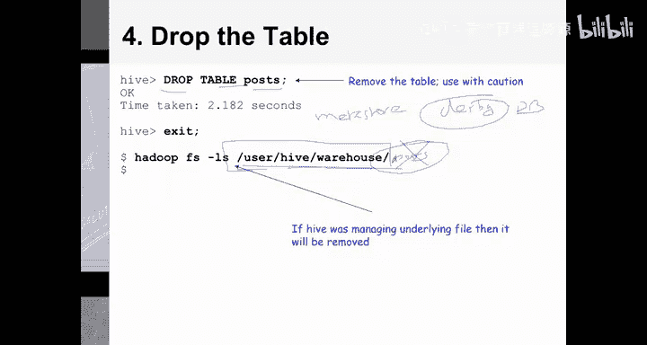
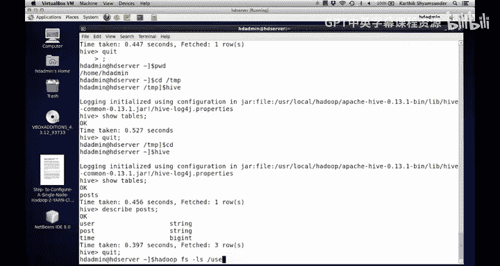

# 课程 3：Hive 基础应用示例 🐝


在本节课中，我们将通过一个简单的例子来学习 Hive 的基本操作。我们将了解如何在 Hive 中创建表、加载数据、查询数据以及最终删除表。通过这个过程，你也会理解 Hive 内部的一些工作原理，例如创建表时发生了什么、加载数据时 HDFS 如何变化、查询如何触发 MapReduce 作业，以及删除表时 HDFS 的相应操作。

我们将按照以下四个步骤进行：
1.  创建表
2.  向表中加载数据
3.  查询数据
4.  删除表

---

## 第一步：创建表 📄

上一节我们介绍了本课程的目标，本节中我们来看看如何创建表。首先，我们需要准备数据。在用户主目录下，有一个名为 `examples` 的文件夹，其下有一个 `hive` 子文件夹，里面包含一个名为 `user_post.txt` 的文件。这个文件包含了用户的博客帖子数据。

我们可以从 Hive 解释器中查看这个文件。进入 Hive 解释器后，可以使用 `!` 命令来执行 Unix 命令。例如，输入 `!cat examples/hive/user_post.txt;` 可以查看文件内容。

这个文件包含三列数据，用逗号分隔：
*   用户 ID
*   博客帖子标题
*   帖子发布时间

了解数据结构后，我们就可以在 Hive 中创建对应的表了。创建表的命令与 MySQL 类似，使用 `CREATE TABLE` 语句。

以下是创建表的 HiveQL 语句：

```sql
CREATE TABLE posts (
    user STRING,
    post STRING,
    time BIGINT
)
ROW FORMAT DELIMITED
FIELDS TERMINATED BY ‘,’
STORED AS TEXTFILE;
```

*   `CREATE TABLE posts`：创建名为 `posts` 的表。
*   `(user STRING, post STRING, time BIGINT)`：定义三个列及其数据类型。
*   `ROW FORMAT DELIMITED`：指定行格式为分隔符格式。
*   `FIELDS TERMINATED BY ‘,’`：指定列之间用逗号分隔。
*   `STORED AS TEXTFILE`：指定数据以文本文件格式存储。

执行创建表命令后，Hive 会在元存储（存储在 Derby 数据库中）记录表结构，同时在 HDFS 的 `/user/hive/warehouse/` 目录下创建一个名为 `posts` 的文件夹。

可以使用 `SHOW TABLES;` 命令查看所有表，使用 `DESCRIBE posts;` 命令查看 `posts` 表的结构。

---

## 第二步：向表中加载数据 📥

现在我们已经创建了表，接下来看看如何向表中加载数据。我们使用 `LOAD DATA` 命令将本地文件的数据加载到 Hive 表中。

加载数据的命令如下：

```sql
LOAD DATA LOCAL INPATH ‘examples/hive/user_post.txt’
OVERWRITE INTO TABLE posts;
```

*   `LOAD DATA LOCAL INPATH`：从本地文件系统加载数据。
*   `‘examples/hive/user_post.txt’`：指定源数据文件的路径。
*   `OVERWRITE INTO TABLE posts`：将数据覆盖写入到 `posts` 表中。

在 Hive 中，表本质上对应 HDFS 中的一个目录，而数据记录就是该目录下的文件。因此，加载数据的过程实际上是将本地文件复制到 HDFS 中对应的表目录下。



执行加载命令后，数据文件 `user_post.txt` 会被复制到 HDFS 的 `/user/hive/warehouse/posts/` 目录中。我们可以通过 Hadoop 命令 `hadoop fs -cat /user/hive/warehouse/posts/user_post.txt` 来验证数据是否已成功加载。

---

## 第三步：查询数据 🔍

数据加载完成后，我们就可以对数据进行查询了。Hive 的查询使用 SQL 语法，但背后会转换成 MapReduce 作业来执行。

首先，我们查询表中的总记录数：

```sql
SELECT COUNT(*) FROM posts;
```

执行此查询时，Hive 会启动一个 MapReduce 作业。你会在输出中看到作业 ID、跟踪 URL 等信息。作业完成后，会返回结果 `4`，因为我们的数据文件中有四条记录。

我们也可以执行更复杂的查询，例如查找特定用户的记录：

```sql
SELECT * FROM posts WHERE user = ‘user2’;
```

或者，查找在某个时间点之前发布的帖子，并限制返回结果数量：



```sql
SELECT * FROM posts WHERE time < 13413431821333839 LIMIT 2;
```

这些查询都会触发 MapReduce 作业，并在完成后返回结果。这展示了 Hive 如何将高级的 SQL 查询自动转换为分布式的 MapReduce 任务进行处理。

---

## 第四步：删除表 🗑️

最后，当我们不再需要某个表时，可以将其删除。删除表使用 `DROP TABLE` 命令。

删除表的命令非常简单：

```sql
DROP TABLE posts;
```

执行此命令后，会发生两件事：
1.  Hive 会从元存储（Derby 数据库）中删除该表的元数据信息。
2.  Hive 会删除 HDFS 中与该表对应的目录，即 `/user/hive/warehouse/posts/`。

删除后，使用 `SHOW TABLES;` 命令将看不到 `posts` 表，使用 Hadoop 命令 `hadoop fs -ls /user/hive/warehouse/` 也确认该目录已被删除。

---

## 总结 📝

本节课中我们一起学习了 Hive 的四个基本操作。我们创建了一个表，定义了它的结构；将本地文件的数据加载到了表中；使用 SQL 语法查询了数据，并观察到查询被转换成了 MapReduce 作业；最后，我们删除了这个表。

通过这个简单的示例，我们看到了 Hive 如何作为 Hadoop 的数据仓库工具，将结构化的数据文件映射为一张数据库表，并提供简单的 SQL 查询功能。其核心在于：
*   **表** 对应 HDFS 中的一个**目录**。
*   **加载数据** 就是将文件**复制**到该目录下。
*   **查询** 会触发 **MapReduce** 作业。
*   **元数据**（如表结构）存储在独立的**元存储**数据库中。


这使得用户无需编写复杂的 MapReduce 程序，就能利用 Hadoop 集群处理大规模数据集。在接下来的课程中，我们将探索更多 Hive 的高级功能。