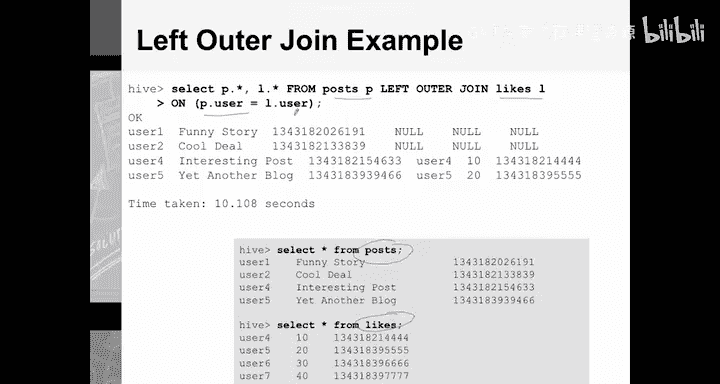
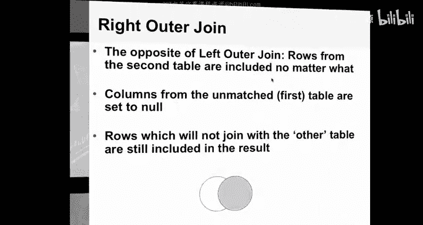
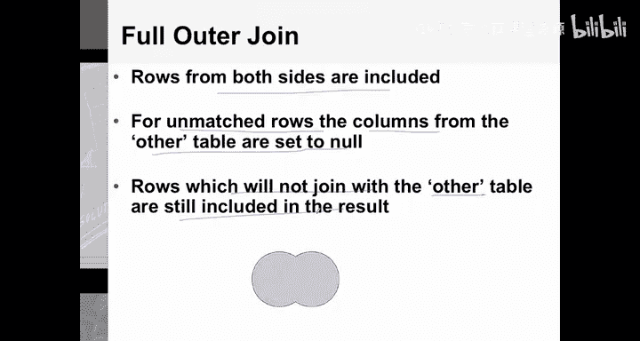

# 课程7：Hive中的联结操作实现 🧩


在本节课中，我们将学习如何在Hive中对表进行联结操作。我们将讨论内联结和外联结，并了解其具体语法和结果差异。相比复杂的MapReduce编程，Hive中的联结操作要简单直观得多。

## 联结操作概述

上一节我们介绍了Hive的基本查询，本节中我们来看看如何将多个表的数据组合在一起。Hive中的联结概念允许你基于某个键将多个表连接起来，这与关系型数据库管理系统中的联结操作非常相似。

如果你还记得在MapReduce中执行联结是多么困难，那么你会发现Hive的联结操作非常简单。Hive支持内联结和外联结。在外联结中，它还支持左外联结、右外联结和全外联结。Hive中的默认联结是内联结。

## 数据表示例

让我们看一个联结的场景。假设我们有两个表：一个帖子表和一个点赞表。

以下是帖子表的内容，我们通过执行 `SELECT * FROM post` 来查看结果。在帖子表中，我们有三列：用户ID、博客故事以及博客发布的时间。

```sql
SELECT * FROM post;
```

以下是点赞表的内容，我们通过执行 `SELECT * FROM likes` 来查看结果。在点赞表中，我们有用户ID、点赞次数以及最后一次点击点赞按钮的时间戳。

```sql
SELECT * FROM likes;
```

我们的目标是通过不同的联结方式，将这两个表的数据组合起来。

## 内联结

在内联结中，只有当键匹配时，行才会被联结。假设我们有两个表：表一和表二，它们各自拥有键。结果集中将只包含那些键值匹配的行，不匹配的行则不会被包含。

让我们看一个内联结的例子。几秒钟前你看到了帖子表和点赞表，现在我们来将这两个表进行内联结。

联结的语法如下：
```sql
SELECT P.*, L.*
FROM post P
INNER JOIN likes L
ON P.user = L.user;
```

在这个查询中，`P.*` 表示帖子表的所有列。注意 `FROM post P` 和 `likes L`，这里的 `P` 和 `L` 是表的别名。这个查询的意思是：我希望基于用户ID来联结帖子表和点赞表。如果 `P.user` 和 `L.user` 的值匹配，那么这两条记录就会被联结起来。当然，我会打印出帖子表的所有列和点赞表的所有列。

执行这个查询后，你会注意到在数据场景中，是记录4和记录5，即用户4和用户5在两个表中都有匹配。因此，结果是用户4和用户5的数据，并且它给出了帖子表的所有列和点赞表的所有列。

## 外联结

外联结有三种类型：左外联结、右外联结和全外联结。让我们先看看左外联结。

### 左外联结

在左外联结中，无论第一个表（左表）的行在第二个表中是否有匹配，这些行都会被包含在结果中。



以下是左外联结的特点：
*   所有来自左表的记录都会出现在结果中。
*   对于左表中那些在右表没有匹配的行，来自右表的列值将被设置为 `NULL`。
*   不与另一表联结的行仍然会包含在结果中。

让我们看一个左外联结的例子。我们再次使用帖子表和点赞表。

```sql
SELECT P.*, L.*
FROM post P
LEFT OUTER JOIN likes L
ON P.user = L.user;
```



这里我将帖子表与点赞表基于用户ID进行联结，但这次使用的是左外联结。我打印出帖子表和点赞表的所有列。

你会注意到，它引入了帖子表中的所有记录：用户1、用户2、用户4和用户5。当它在另一个表中找不到匹配的列时，它直接使用 `NULL` 作为列值。因此，你会看到用户1和用户2没有出现在点赞表中，所以对应的列被设为 `NULL`。这就是左外联结。

### 右外联结

右外联结与左外联结相反，无论是否匹配，第二个表（右表）的所有行都会被包含在结果中。

以下是右外联结的特点：
*   所有来自右表的记录都会出现在结果中。
*   对于右表中那些在左表没有匹配的行，来自左表的列值将被设置为 `NULL`。
*   不与另一表联结的行仍然会包含在结果中。

让我们看一个右外联结的例子。我有帖子表和点赞表。

```sql
SELECT P.*, L.*
FROM post P
RIGHT OUTER JOIN likes L
ON P.user = L.user;
```

我将帖子表与点赞表进行右外联结，联结键是用户ID。在这种情况下，我将引入右表（即点赞表）中的所有记录。所以你会看到用户4、用户5、用户6和用户7出现。但对于那些在左表（即第一个表或帖子表）中没有对应记录的行，其属性或列将被设置为 `NULL`。请注意，这些列被设置为 `NULL`，而其他列则正常显示。

### 全外联结



在全外联结中，来自两个表的所有行都会被包含在结果中。对于不匹配的行，来自另一个表的列将被设置为 `NULL`。不与另一表联结的行仍然会包含在结果中。

让我们看一个全外联结的例子。这里我们再次使用帖子表和点赞表。

```sql
SELECT P.*, L.*
FROM post P
FULL OUTER JOIN likes L
ON P.user = L.user;
```


它将引入所有表中的所有记录。所以我们将看到用户1、用户2、用户4、用户5、用户6、用户7，所有记录都会出现。在那些没有联结的行中，列仍然会出现，并且会被设置为 `NULL`，正如你在所有这些情况中所看到的。这就是全外联结。

## 总结


本节课中我们一起学习了在Hive中跨表执行联结操作是多么容易。请记住，当你在Hive中执行联结时，它们实际上会被转换成一个MapReduce作业。但无论我们需要执行内联结还是其他联结，编写起来都像写一个SELECT语句一样简单。这与我们在Java MapReduce编程中看到的复杂性形成了鲜明对比。