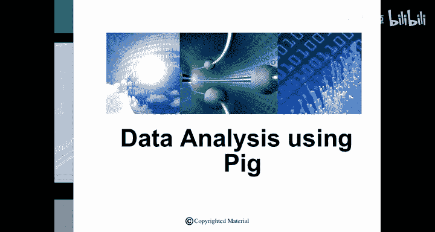
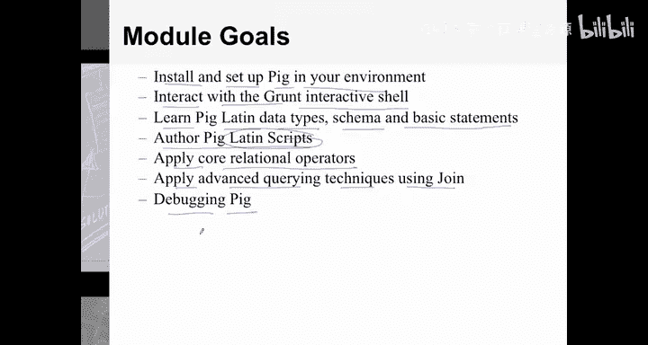

# 课程9：Pig导论 🐷

在本节课中，我们将学习如何使用一种名为Pig的高级编程语言在Hadoop环境中进行大数据分析。我们将从Pig的概述和架构开始，逐步学习其安装、交互式环境、核心语言特性以及各种操作符的使用。


---

## 概述与架构 🏗️

上一节我们深入探讨了Hadoop架构、HDFS编程以及MapReduce的Java API细节。本节中，我们来看看如何利用更高级的编程语言Pig来简化Hadoop上的大数据分析工作。

Pig提供了一个名为Pig Latin的高级数据流语言，它允许用户编写复杂的数据转换，而无需编写底层的MapReduce Java代码。Pig Latin脚本最终会被编译成一系列的MapReduce作业，在Hadoop集群上执行。

Pig的架构主要包括两个组件：
1.  **Pig Latin**： 用于描述数据流的数据处理语言。
2.  **执行引擎**： 负责将Pig Latin脚本编译并优化为MapReduce作业，然后在Hadoop上执行。

---

## 安装与设置 ⚙️

为了开始使用Pig，我们需要在已有的Hadoop环境中进行安装和配置。我们将使用与安装Hive时相同的Hadoop环境。

以下是安装Pig的主要步骤：
1.  从Apache官网下载稳定版本的Pig压缩包。
2.  将压缩包解压到合适的目录，例如 `/opt/pig`。
3.  配置环境变量，将Pig的`bin`目录添加到系统的`PATH`中。
4.  设置`PIG_HOME`环境变量指向Pig的安装目录。
5.  配置Pig以使用正确的Hadoop版本（通过`PIG_CLASSPATH`环境变量或`pig.properties`文件）。

完成这些步骤后，Pig就可以与Hadoop协同工作了。



---

## Grunt交互式Shell 🐚

Pig提供了一个名为Grunt的交互式命令行Shell，方便用户快速测试和执行Pig Latin语句。

启动Grunt Shell后，你可以直接输入Pig Latin命令，它们会被立即执行。这对于学习和调试脚本片段非常有用。例如，你可以使用`LOAD`命令加载数据，使用`DUMP`命令查看结果。

---

## Pig Latin语言基础 📝

Pig Latin是Pig使用的数据流语言。它的设计目标是让数据转换操作更直观、更易于编写。

Pig Latin脚本由一系列语句组成，每个语句以分号结束。一个基本的Pig Latin脚本通常遵循“加载-转换-存储”的模式。核心概念包括关系（类似于数据库中的表）、字段和数据类型。

一个简单的Pig Latin语句示例如下：
```pig
records = LOAD 'input/data.txt' USING PigStorage(',') AS (name:chararray, age:int, city:chararray);
filtered = FILTER records BY age > 18;
STORE filtered INTO 'output/adults';
```

---

## 数据类型与模式 📊

Pig Latin支持多种数据类型，包括基本类型和复杂类型，这为处理结构化、半结构化和嵌套数据提供了灵活性。

以下是Pig支持的主要数据类型：
*   **基本类型**： `int`（整型）、`long`（长整型）、`float`（浮点型）、`double`（双精度浮点型）、`chararray`（字符串，相当于Java的String）、`bytearray`（字节数组）、`boolean`（布尔型）、`datetime`（日期时间）。
*   **复杂类型**： `tuple`（元组，有序字段集合）、`bag`（包，元组的无序集合，相当于多行数据）、`map`（映射，键值对集合）。

模式（Schema）用于为数据定义字段名和类型，它可以在`LOAD`语句中使用`AS`子句指定，也可以在后续转换中推断或声明。

---

## 核心关系型操作符 ⚙️

Pig Latin提供了一系列关系型操作符，用于对数据进行过滤、分组、排序和聚合等操作。这些操作符是编写数据处理脚本的基础。

以下是Pig Latin中的核心关系型操作符：
*   **`LOAD`**： 从文件系统（如HDFS）加载数据。
*   **`STORE`**： 将数据存储到文件系统。
*   **`FILTER`**： 基于条件过滤行（元组）。
*   **`FOREACH ... GENERATE`**： 对每一行数据进行转换，生成新的列或修改现有列。
*   **`GROUP`**： 根据一个或多个键对数据进行分组。
*   **`COGROUP`**： 对两个或更多关系进行分组，常用于连接操作的前置步骤。
*   **`JOIN`**： 连接两个或多个关系。
*   **`UNION`**： 合并两个或多个关系。
*   **`SPLIT`**： 根据条件将一个关系拆分成多个关系。
*   **`ORDER BY`**： 根据指定字段对关系进行排序。
*   **`DISTINCT`**： 去除关系中的重复行。
*   **`LIMIT`**： 限制输出的行数。

---

## 关系连接操作符 🔗

在数据分析中，经常需要合并来自不同数据集的信息。Pig Latin提供了强大的连接操作符来实现这一目的。

`JOIN`操作符用于基于共同的键（字段）合并两个或多个关系。Pig支持内连接、外连接等多种连接类型。例如，将用户信息表与订单表通过用户ID进行连接，可以生成包含用户详细信息的订单列表。

---

## 调试操作符 🐞

为了帮助开发者更高效地编写和调试Pig Latin脚本，Pig提供了一些专门的调试操作符。

以下是常用的调试操作符：
*   **`DUMP`**： 将关系的内容输出到控制台。这是查看中间结果最直接的方式。
*   **`DESCRIBE`**： 显示关系的模式（字段名和类型）。
*   **`EXPLAIN`**： 显示Pig Latin语句的执行计划，包括它将如何被转换成MapReduce作业。这对于性能调优非常有帮助。
*   **`ILLUSTRATE`**： 使用数据的样本逐步展示操作的执行过程，让你直观地看到每一步转换对数据的影响。

---

## 总结 📚

本节课我们一起学习了Apache Pig，这是一个构建在Hadoop之上的高级数据流处理平台。我们从Pig的概述和架构入手，学习了如何安装和设置Pig环境，并体验了Grunt交互式Shell。接着，我们深入探讨了Pig Latin语言的基础、丰富的数据类型与模式系统。然后，我们详细介绍了用于数据转换的核心关系型操作符和用于合并数据集的连接操作符。最后，我们了解了一些用于开发和调试脚本的实用操作符。



通过Pig，你可以用更简洁、更声明式的代码来表达复杂的数据处理逻辑，而无需直接编写冗长的MapReduce Java程序，从而大大提高了大数据分析的开发效率。