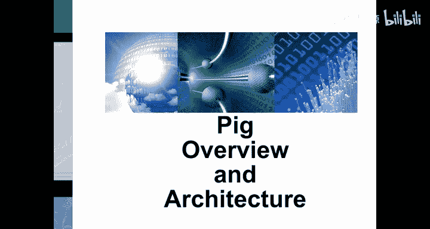
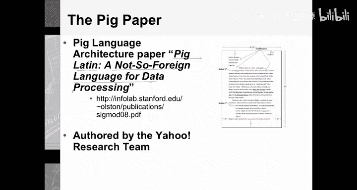
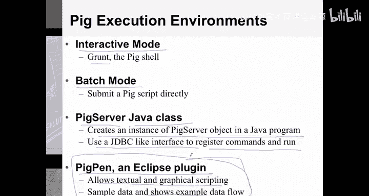
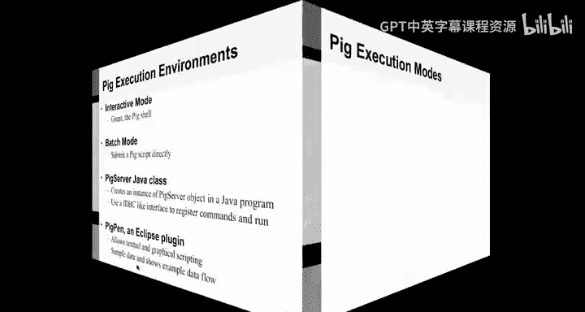
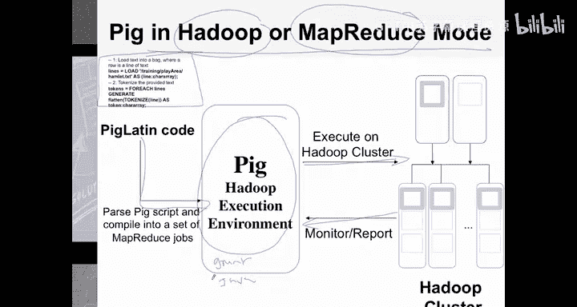
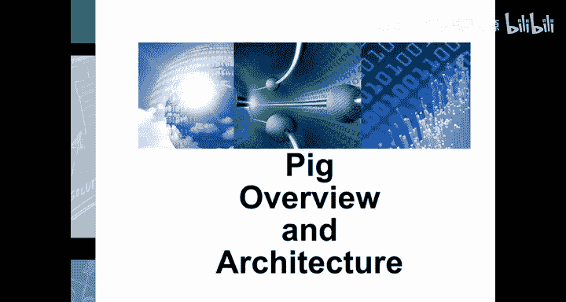

# 课程10：Pig架构与核心特性 🐷

在本节课中，我们将学习Apache Pig的概述、架构及其核心特性。Pig是一个用于分析大型数据集的高级平台，它简化了在Hadoop上进行数据处理的过程。

---

## Pig概述与架构

上一节我们介绍了MapReduce编程的复杂性。本节中，我们来看看Pig如何解决这些问题。

MapReduce编程，尤其是使用Java进行MapReduce编程，具有挑战性。它要求开发者不仅会编写Java程序，还需要理解Google最初提出的分布式计算范式。编写一个简单的程序（如词频统计）可能需要超过100行代码。

为了解决这个问题，雅虎公司开发了Pig。

---

## 什么是Pig？

Pig是一个用于分析大型数据集的平台，其核心是一个用于表达数据分析程序的高级语言。Pig是构建在Hadoop之上的抽象层，它提供了一个专为数据处理设计的高级编程语言——Pig Latin。该语言会将你的Pig脚本转换为MapReduce程序，并在Hadoop集群上执行。

Pig是一个由Apache软件基金会管理的开源项目。

---

## Pig的特性

以下是Pig的一些关键特性：

*   **灵活的数据处理**：Pig可以在有或没有预定义数据类型和模式（Schema）的情况下工作。与Hive不同，你无需先创建表结构，Pig可以自动加载数据。
*   **丰富的数据操作**：你可以对数据集进行加载、过滤、排序、分组（Group）、连接（Join）等操作。
*   **可扩展性**：Pig提供了许多内置函数。如果这些函数不满足需求，你还可以使用Java编写自己的用户定义函数（UDF）。

---

## Pig使用示例

为了更好地理解Pig的数据流处理思想，让我们看一个例子。

假设我们有两个数据集：用户记录和页面访问记录。数据科学家想找出“18至25岁用户访问量最高的五个页面”。

使用Pig Latin，解决思路是一个清晰的数据流：
1.  加载用户数据。
2.  使用`FILTER`操作符按年龄（18-25岁）过滤用户。
3.  加载页面访问数据。
4.  使用`JOIN`操作符将过滤后的用户数据与页面数据连接起来。
5.  使用`GROUP`操作符按URL分组。
6.  使用`COUNT`函数统计每个URL的点击量。
7.  使用`ORDER`操作符按点击量降序排序。
8.  使用`LIMIT`操作符取前5条结果。

这个过程体现了Pig作为数据流语言的本质：通过一系列操作符逐步转换数据，最终得到结果。

---

## Pig的主要应用场景

Pig主要有两大应用场景：

*   **ETL（提取、转换、加载）**：这是Pig的经典用例。由于Pig不需要初始模式，非常适合用于数据清洗、格式转换，以及将数据从一处迁移并加载到另一处。
*   **数据研究与探索**：当面对原始数据，需要探索其中规律或模式时，Pig Latin语言是数据科学家和分析师的理想工具。它允许你灵活地处理数据，快速获得洞察，从而可能催生新的业务流程。

---

## 关于Pig的趣谈

Pig这个名字并非缩写，它源于项目早期研究人员的随意命名，并最终被保留下来。围绕Pig有一个有趣的类比：

*   **Pigs eat anything（猪什么都吃）**：类比Pig Latin语言可以处理任何数据，无论其是否有元数据。
*   **Pigs live anywhere（猪随处可居）**：Pig的长期目标是成为分布式数据处理的通用语言，而不仅限于Hadoop。
*   **Pigs are domesticated animals（猪是家养动物）**：Pig被设计成可由用户高度控制和定制，例如通过编写UDF。
*   **Pigs fly（猪会飞）**：意指Pig处理数据非常快速。经过优化，Pig Latin脚本生成的MapReduce作业运行效率已接近手动编写的代码。

---

## Pig的架构组件

现在，我们来深入了解Pig的架构组成。

Pig的核心架构包括以下几个部分：

*   **Pig Latin语言**：基于命令的数据转换语言。
*   **Pig编译器**：负责将Pig Latin脚本转换为一个或多个MapReduce作业。编译器还会尝试优化执行计划。
*   **执行环境**：支持两种模式——本地模式（Local Mode）和MapReduce模式。
*   **交互式Shell（Grunt）**：类似于Hive Shell，用于交互式地执行Pig命令。
*   **批处理模式**：可以将Pig脚本写入`.pig`文件进行批量执行。
*   **PigServer**：一个Java类，允许在Java程序中通过JDBC-like接口调用Pig。
*   **PigPen**：Eclipse IDE的插件，支持文本和图形化脚本编辑。

---

## Pig的执行模式

Pig可以在两种模式下执行：

*   **本地模式（Local Mode）**：在此模式下，Pig脚本在单个JVM中执行，使用本地文件系统。它不涉及Hadoop集群，非常适合用于开发和调试。
*   **MapReduce模式**：在此模式下，Pig Latin代码被转换为MapReduce作业，并提交到Hadoop集群（完全分布式、伪分布式等）上执行。这是生产环境的标准模式。

在MapReduce模式下，无论你是通过Grunt Shell还是Java程序（PigServer）提交脚本，Pig执行环境都会将其翻译成MapReduce作业，与Resource Manager、Node Manager等Hadoop守护进程通信，并最终将结果返回。

---

## 总结

本节课中，我们一起学习了Apache Pig的核心知识。我们了解到Pig是一种高级语言，能够轻松处理Hadoop集群上的数据，而无需编写复杂的MapReduce代码。Pig最初由雅虎为数据科学家开发，现已成为一个被众多公司使用的开源项目。

Pig的核心是Pig Latin语言，用于编写数据处理脚本。这些脚本可以在本地模式（用于开发测试）或MapReduce模式（用于生产）下运行。Pig的设计理念使其特别适合ETL和数据探索任务，其灵活的架构和强大的扩展性为大数据处理提供了便利。