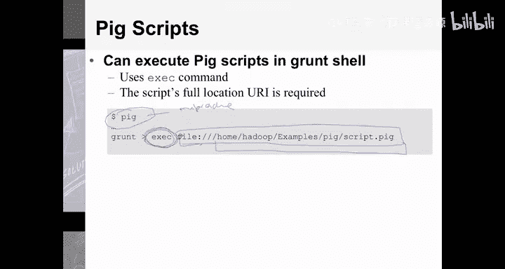
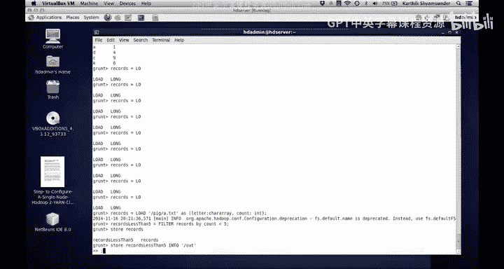

# 课程12：Grunt交互式终端 🐖


在本节课中，我们将学习如何使用Grunt交互式终端与Pig进行交互。我们将了解Grunt Shell的两种运行模式，以及如何在Shell中直接执行Pig Latin语句或运行脚本。

---

## Grunt交互式Shell简介

上一节我们介绍了Pig的基本概念，本节中我们来看看其交互式操作环境。Grunt Shell是Pig提供的交互式命令行界面。它主要支持两种运行模式：本地模式（Local Mode）和MapReduce模式（MapReduce Mode）。用户可以在Shell中直接输入Pig Latin语句，也可以执行预先写好的脚本文件。

---

## 启动Pig与运行模式

当你通过在终端输入 `pig` 命令来启动Pig时，就进入了我们所说的交互式Grunt Shell。

启动Pig时，你会注意到它首先尝试本地模式，然后尝试MapReduce模式，并最终默认选择MapReduce作为执行类型。这意味着，默认情况下，你执行的任何Pig脚本或语句都将作为一个MapReduce程序运行。

同时，启动Pig时会创建一个日志文件，所有出现的日志消息都会记录在其中。如果出现异常，你可能需要查看这个日志文件。

Pig实际上可以在本地模式或MapReduce模式下运行。

*   **本地模式**：你可以通过输入 `pig -x local` 来显式地在本地模式下运行Pig。在此模式下，没有MapReduce程序运行，所有操作都在Pig解释器或Pig客户端上下文中执行。你会注意到它选择的文件系统是 `file:///`，这意味着它没有使用HDFS。本地模式非常适合测试，因为你不会真正调用资源管理器或数据节点。
*   **MapReduce模式**：这是默认模式。输入 `pig -x mapreduce` 即可在此模式下执行Pig。它会尝试连接HDFS（例如 `hdfs://localhost:9000`）。回忆我们安装Pig时，设置了一个名为 `HADOOP_PREFIX` 的环境变量，指向Hadoop的安装位置。Pig正是通过这个变量来定位Hadoop并运行在MapReduce模式下的。如果找不到这个变量，尝试运行MapReduce模式会导致运行时错误，Pig解释器会关闭。

---

## Grunt Shell的实用功能

Grunt Shell内置了一些非常实用的功能，能提升操作效率。

以下是Grunt Shell提供的一些便捷编辑和操作特性：

*   **命令历史记录**：使用上下箭头键可以浏览和执行之前输入过的Pig语句或脚本。
*   **命令内导航**：使用左右箭头键可以在一个命令内移动光标，方便修正拼写错误。
*   **Tab键自动补全**：在Grunt Shell中，Tab补全功能在两个场景下特别有用：
    *   **补全关系运算符命令**：例如，输入 `du` 然后按Tab，它会建议补全为 `dump`。
    *   **补全关系名称**：当你加载数据并赋值给一个变量（称为关系变量或关系名）后，输入该变量名的开头部分并按Tab，Shell会尝试补全这个关系名。
*   **自定义补全**：你还可以通过修改 `conf` 文件夹下的 `pig.properties` 文件，添加自己的补全词列表。

---

## 在Grunt Shell中操作HDFS

在Grunt Shell中操作HDFS文件系统变得异常简单。回想一下，在普通终端中，你需要输入冗长的命令，如 `hadoop fs -ls` 或 `hadoop fs -mkdir`。

以下是Grunt Shell中操作HDFS的便捷方式：

*   **使用 `fs` 前缀**：在Grunt Shell中，你可以直接输入 `fs` 后跟命令，例如 `fs -ls`、`fs -mkdir`。这样就无需每次都输入 `hadoop fs`。
*   **内置快捷命令**：Grunt Shell还提供了一些非常方便的内置命令，如 `cat`、`mkdir`、`rm`、`cd` 等。你甚至不需要加 `fs -` 前缀，直接输入 `cat 文件名` 就可以查看HDFS中的文件内容。同样，`cp`、`copyFromLocal`、`copyToLocal` 等命令也都可用。

---

## 一个简单的Pig示例

让我们看一个在Grunt Shell中运行的简单Pig例子。假设HDFS中有一个文件 `/pig/a_or_z.txt`，包含4行记录，每行有两列：第一列是字母（字符串），第二列是数字（整数）。

我们执行以下Pig Latin语句：



```pig
records = LOAD '/pig/a_or_z.txt' AS (letter:chararray, count:int);
records_less_than_5 = FILTER records BY count < 5;
STORE records_less_than_5 INTO '/out';
```

*   **第一行**：将文件加载到名为 `records` 的关系变量中，并定义两个字段 `letter` 和 `count` 及其类型。
*   **第二行**：对 `records` 应用 `FILTER` 操作，筛选出 `count` 小于5的记录，结果存入新变量 `records_less_than_5`。
*   **第三行**：使用 `STORE` 命令将结果保存到HDFS的 `/out` 目录。正是这个命令会触发MapReduce作业的执行。

---

## 执行Pig脚本

除了在Shell中逐行输入，你也可以将所有Pig Latin语句写在一个文件中，然后作为脚本执行。

执行脚本的基本命令格式如下：
*   `pig script.pig` (使用默认的MapReduce模式)
*   `pig -x local script.pig` (在本地模式下执行)
*   `pig -x mapreduce script.pig` (显式指定MapReduce模式)



关于脚本文件的位置，需要注意：
*   如果Pig运行在本地模式，它默认会在本地文件系统寻找脚本。
*   如果Pig运行在MapReduce模式，它默认会在HDFS上寻找脚本。
*   你可以显式指定脚本的来源，无论当前是哪种模式：
    *   从HDFS执行：`pig hdfs://namenode:9000/pig/script.pig`
    *   从本地文件系统执行：`pig file:///path/to/local/script.pig`

---

## 操作演示

（以下为演示过程摘要，展示了上述功能在实际终端中的使用）

1.  登录服务器，启动Grunt Shell（输入 `pig`）。
2.  演示HDFS命令：使用 `fs -ls /` 查看根目录，使用 `ls /bdp`（快捷方式）查看特定目录。
3.  演示Tab补全：输入 `rec` 并按Tab补全为 `records`；输入 `du` 并按Tab补全为 `dump`。
4.  运行之前的Pig示例：逐行输入LOAD、FILTER、STORE语句。执行STORE时，会触发一个MapReduce作业。通过资源管理器可以查看作业进度。作业完成后，使用 `cat /out/part*` 查看输出结果。
5.  演示执行脚本：首先使用 `cat` 查看脚本内容，然后使用 `exec /pig/script.pig` 命令执行该脚本。如果输出目录已存在，需要先使用 `fs -rm -r /out` 删除它。
6.  演示通过命令行直接执行脚本：`pig -x mapreduce hdfs://localhost:9000/pig/script.pig`。

---


## 总结 🎯


本节课中我们一起学习了Grunt交互式终端。我们了解到Grunt Shell可以在本地模式或MapReduce模式下运行，且默认为MapReduce模式。我们还学习了Shell内置的便捷功能，特别是如何轻松地操作HDFS文件系统。最后，我们掌握了如何在Shell中直接执行Pig Latin语句，以及如何使用 `exec` 命令或通过命令行来运行Pig脚本。